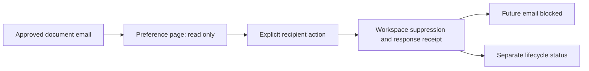

Provider configuration and prices change independently of Guteneo releases.
Maintenance therefore tracks both the implementation contract and fresh evidence
for the exact account, route, currency and validity window. An expired or unknown
price closes new preparation or acceptance; it never becomes zero cost.

This is the maintenance model, not a list of current live rates. The server's
qualified catalog/quote and private dated evidence own actual amounts and
activation. [Channel adapters](/workflows/delivery-channels/) describes transport;
[CI and release evidence](/engineering/ci-and-release/) describes source checks.

<ServiceRelease />

## Private PDF validator qualification

Temporary qualification may stop the private validator and therefore requires
the canonical production document-validation capability to be explicitly
`false`, with production mode and simulation explicitly disabled. When the newer
unit-purchase capability is present, it must also be exactly closed. This supports
a reviewed older release with the stable explicit document gate; missing,
malformed, conflicting, open or unreachable gates refuse qualification. The deployment wrapper and hosted runner share this
closed-feature assertion; normal deployment closes the qualification RPC gate.

The loopback-only bridge needs a fresh owner-private credential, rejects every
browser Origin and strips its local credential before remote service bindings.
Current unit-purchase readiness and antivirus scanning are separate: public
configuration proves neither a real paid check nor an actual hosted scan. The
25 October customer status release shows only bounded public availability and
history; it removes provider and engine qualification rows. The underlying
capability records and private qualification requirements remain separate and
unchanged. A positive public-access result cannot open paid verification, qualify
an antivirus scan or prove delivery. Use the protected operational surface and
dedicated evidence for those questions, with the existing authority limits.

The 25 October release selects one `standard-1` container with five-second idle
sleep after the smaller tier timed out on the near-limit local corpus. Preserve
the unchanged process/response deadlines, pinned engine, exact-byte and privacy
checks; a larger allocation does not establish hosted performance. Before
creating a missing paid service, obtain explicit resource authority, then qualify
actual startup, full reference/large-file corpus, concurrency and idle stop/wake.
Keep local native, hosted amd64 and actual financial observations separate. A
failed hosted gate keeps paid checks closed; normal redeployment must close the
temporary qualification RPC before customer activation. The authenticated pricing
API owns the unit purchase price, and the repository cost model owns dated
resource assumptions; neither a container count nor a local timing is a bill cap.

The first 25 October hosted attempt passed cold engine health in 2960 ms, then
failed graceful stop before the reference corpus: Python as PID 1 ignored
SIGTERM. Preserve that failed observation. The corrected entrypoint handles
SIGTERM/SIGINT and drains bounded work with subprocess/private-file cleanup;
graceful cold-stop and automatic idle assertions remain unchanged. An explicit
force-stop option is confined to the temporary account-private qualification RPC
and authenticated loopback bridge, with the canonical customer feature closed
and the exact release/application/instance identified. SDK `destroy()` is a
recovery operation, never evidence that graceful idle works. Poll the actual
terminal state, then close the temporary RPC, including its force variant,
before activation. The container helper uses runtime-private `#` syntax so the
RPC cannot return its underlying stub.

The later hosted suite completed on 25 October at 20:03 UTC from source
`03daa4136de8999cc79018f33f2a22038917c621`: twelve official references, six
large-file profiles, concurrency/refusal, cleanup and automatic idle stop/wake
passed. Normal deployment then closed the temporary RPC; provider inventory
confirmed the single bounded private EU allocation and absence of public routes.
The [validator contract](https://github.com/nclsppr/guteneo/blob/main/docs/PDF_VALIDATOR.md)
owns the dated timings and deployed identities; the
[pricing contract](https://github.com/nclsppr/guteneo/blob/main/docs/PDF_VERIFICATION_PRICING.md)
owns subsequent application activation. Their separate
26 October configuration observation is not a fresh engine run or customer debit.
Retain the failed first attempt and successful later suite as distinct records,
and requalify relevant runtime changes rather than treating this date as permanent
readiness. Source continuity does not establish future signature freshness,
provider delivery or a fixed infrastructure bill.

Run the local bridge with the repository-root Wrangler used by the guarded
deployment (`node node_modules/wrangler/bin/wrangler.js dev` from the root), not
the older package-local executable. Root 4.149.0 supports the declared 2 October
compatibility date; package 4.132.0 did not during the hosted attempt. Keep the
date, source and qualification assertions intact when correcting a local tool.

## Keep four kinds of evidence separate

| Record                                | Establishes                                                          | Does not establish                                               |
| ------------------------------------- | -------------------------------------------------------------------- | ---------------------------------------------------------------- |
| Official public documentation/price   | Dated published terms and API meaning                                | Account-specific agreement, balance or live route                |
| Authorized private account inspection | Exact account/application/profile configuration at that time         | Successful delivery or final billing                             |
| Qualified immutable policy/quote      | Explicit pricing basis, route, currency, expiry and approved ceiling | A future invoice or permission to send                           |
| Signed outcome and correlated usage   | A bounded observed submission/delivery/cost fact                     | Unobserved reading, an unrelated route or authorization to retry |

Store source date/hash, qualification date and expiry separately. A reinspection
must not rewrite the historical date of an old price or exchange-rate reference.
A commercial fixed FX reference is not a live currency quote. Unknown, absent,
false, zero and provider `null` have different meanings.

## Telnyx: qualify the route and the complete pricing basis

Fax pricing combines page and transmission components. The qualified route binds
sender/account/application/profile, origin classification, destination category
and longest applicable prefix, units, billing intervals, permitted fees, FX and
validity. Country availability alone does not price every special/mobile route.
A missing or revoked more-specific tariff must not fall back to a cheaper broad
country row.

A dated public page rate is distinct from an account-specific negotiated rate.
Likewise, T.38 support, destination permission and an active number do not prove
Local Calling qualification or successful fax delivery. An explicit bounded
operator-test exception remains an exception with its own immutable authority;
it cannot silently become normal provider qualification.

The 27 October source candidate permits a separately authorized renewal of the
existing Luxembourg `+3524` operator test while retaining its amounts, FX and
original source evidence. Only that prefix receives the later pilot deadline;
other Luxembourg pilot routes stay closed at their original deadline. The
[private pilot contract](https://github.com/nclsppr/guteneo/blob/main/docs/TELNYX_READINESS.md#scoped-pilot-renewal--27-october-2026-candidate)
owns the exact deadline, seven-day revision bound and capped scope. Deploy the
matching runtime and migration 0064 before atomically revoking the old revision
and inserting its replacement. This exception does not claim fresh supplier
verification, alter historical quotes, extend an assistant mandate or authorize
transmission. Installation and authenticated preparation are separate evidence.

Prepare from the disclosed qualified estimate and firm customer ceiling. Record
future usage separately; Guteneo's ceiling is not a physical cap on supplier
exposure. Keep reservations for ambiguous outcomes and reconcile against the
fenced attempt/account/provider reference. Do not sum a complete rollup and its
leaf charges twice. Never rewrite an approved quote or debit above its ceiling
because a new rate or late adjustment appears.

## Pingen: preserve the exact document/options quote

Postal calculation depends on the actual provider preparation, destination,
paper, print options and account. A country-wide marketing price is not a
substitute for the final qualified option set. Uploaded bytes, provider draft,
inspection, print preview and sending are distinct steps with distinct authority.

A synthetic draft test does not qualify a customer document, a French postal
product, account credit or real signed delivery callback. `auto_send:false`
preparation must remain unsent until the explicit authorized send path. Changes
to upload origins, webhook scopes or calculator semantics require reinspection
and regression coverage, never broadening scopes as a silent fallback.

For maintenance, confirm the documented bounded account/upload-origin reader,
exact quote inputs/output, tax/currency basis, signed webhook verification and
prepared-document equivalence. Provider credentials and ephemeral upload URLs
stay in private runtime; never copy them into engineering content or logs.

## Resend and SES: distinguish price, shared quota and delivery

Email policies bind an explicit provider/plan/tier, recipient unit, attachment
basis, currency, source date, FX basis and qualification window. A public paid-tier
reference does not become the marginal charge of a free account. Included quotas
are shared by the account, including use outside Guteneo; do not allocate the
entire allowance independently to every workspace.

Account-wide admission policy, minimum submission spacing and provider rate limits
are separate from per-workspace quotas. A verified sender domain or enabled local
flag proves neither installed global quota policy nor signed webhook secret.
Verify callback authentication, duplicate/reordered event handling, sender
identity and actual activation independently. SES sandbox/region and SNS
signature/topic configuration remain distinct from Resend's webhook contract.

A secure-document invitation is still a communication. It needs current transport,
funding, approval and uncertainty controls as other sends. Secure retention
charges are separate from invitation transport: a delivery failure does not
recreate an already committed retention service.

## Refresh safely, then verify the actual effect

1. Identify an approaching expiry, documented API change or observed mismatch.
   Preserve the old evidence and state which new fact is required.
2. Read current official sources and perform only the authorized bounded private
   inspection. Retain sanitized dates/hashes and precise limitations.
3. Prepare a new immutable policy/version and local regression evidence. Preserve
   old quotes, approvals, reservations and settlement history.
4. Update implementation, feature inventory and affected engineering guide when
   semantics, CI or infrastructure changes. Review changed scope and cost.
5. Obtain the applicable operator authorization before installation, paid changes,
   activation or publication. Recheck exact source/configuration afterwards.
6. Prove the deployed capability and, separately, any authorized real journey.
   Missing proof remains visible; do not extend expiry merely to hide a blocker.

There is no automatic price crawler or automatic tariff deployment promised here.
Current gates enforce validity; maintenance owners must monitor windows and use
the reviewed operator procedure. Contract, budget, webhook, scanner, identity and
real delivery evidence can expire or fail independently.

## Maintenance register

This register identifies what must stay current. A trigger is not a claim of
existing automation. Review upcoming expiries before they close a gate and review
provider/security announcements when they change the supported contract. The
scanner workflow and scheduled application/status jobs have explicit cadences;
other rows require deliberate owner review and authorized action.

| Subject                                | Trigger or deadline                                                                                                             | Authoritative source/tool                                                                                                         | Verification after maintenance                                                                                                                                                                                                                           |
| -------------------------------------- | ------------------------------------------------------------------------------------------------------------------------------- | --------------------------------------------------------------------------------------------------------------------------------- | -------------------------------------------------------------------------------------------------------------------------------------------------------------------------------------------------------------------------------------------------------- |
| Telnyx tariff/route                    | Before qualified tariff or sender validity expires; new rate deck, profile, origin or prefix classification                     | `docs/TELNYX_RATE_QUALIFICATION.md`, `TELNYX_READINESS.md`, `LIVE_FAX_QUOTES.md`; bounded `scripts/provider-readiness.mjs` reader | Source hash/date, account/application/profile binding, most-specific route, expiry refusal and unchanged old quotes; real route proof remains separate                                                                                                   |
| Pingen quote/preparation               | Before quote validity ends; changed options, calculator, upload origin, account or postal product                               | `docs/PINGEN_SETUP.md`, `PINGEN_PREFLIGHT.md`, `LIVE_DELIVERY_QUOTES.md`; reviewed synthetic-draft/preflight qualifiers           | Exact document/options/tax/currency/expiry, unsent draft state, final-preview equivalence and separately authorized signed callback/send                                                                                                                 |
| Resend/SES price policy                | Before qualification expiry; plan/tier, attachment basis, account/domain or source-price change                                 | `docs/RESEND_SETUP.md`, `RESEND_PROOF.md`, `SES_SETUP.md`, `LIVE_DELIVERY_QUOTES.md`; server quote policy                         | New dated basis and correct provider identity; separate actual installation, sender verification, quota admission and signed events                                                                                                                      |
| FX and quote clocks                    | Before policy/quote expiry; changed commercial FX assumption or clock drift                                                     | Immutable quote contracts in `packages/domain/src/live-fax-quotes.ts` and `live-delivery-quotes.ts`                               | Preserve historical FX/source date and integer/rational units; new version rather than rewriting approval; expiry tested at review/acceptance/preflight                                                                                                  |
| Shared account quotas                  | Changed provider limit, account-wide traffic, abuse or sustained usage                                                          | Provider-account evidence, D1 quota policy and current capability blockers                                                        | Headroom includes non-Guteneo/Auth0 usage where shared; per-workspace and global admission both enforced; no extra capacity inferred from a new workspace                                                                                                |
| Scanner signatures                     | Runtime rejects signatures older than 72 hours; configured refresh workflow is daily with a separate six-hour maintenance check | `docs/SCANNER_CI.md`, `SCANNER.md`; `apps/scanner/scripts/{ci-refresh,maintenance-status,refresh-definitions}.mjs`                | Exact image/version, real engine health/signature time, clean/EICAR/hash/refusal corpus and hosted freshness; successful build alone is insufficient                                                                                                     |
| Dependencies and processing engines    | Security advisory, supported-runtime change or renderer/scanner/library update                                                  | Lockfiles, dependency audit, scanner/validator suites and renderer corpus; `docs/CI.md`                                           | Fresh installs, pinned engine provenance, relevant real-render tests, language/accessibility parity and exact-source CI; signature refresh is not an engine upgrade                                                                                      |
| Auth0 identity/session                 | Callback/domain/client/scope/action/key/recovery change; policy or session freshness boundary                                   | `docs/ACCOUNT_IDENTITY.md`, `IDENTITY_MCP.md`, current auth guards and reviewed qualification scripts                             | Exact issuer/subject/audience, callback/PKCE, signed claims/time, current connection/membership, logout/recovery and independent browser/native/host journeys                                                                                            |
| Provider webhooks                      | URL, signing key, API version, topic/subscription or event-schema change                                                        | `docs/PROVIDERS.md`, `PINGEN_WEBHOOK_SETUP.md`, `SES_SUBSCRIPTION_CONFIRMATION.md`, `BILLING.md`                                  | Genuine signature/account/topic checks, timestamp/replay/deduplication and reordered events; unsigned HTTP refusal is not a signed-callback success                                                                                                      |
| Backups, wrapping keys and restoration | Retention/schema/key change; planned recovery rehearsal or incident                                                             | `docs/RUNBOOK.md`, `RESTORE_PROOF.md`, `SECURE_DISTRIBUTION_IMPLEMENTATION.md`; local restore integration test                    | Matching objects/hashes/key versions, revocations, approvals, charges, reservations/outbox and independent acquired copies; hosted rehearsal recorded separately                                                                                         |
| Cloudflare resources and costs         | Usage trend, shared-quota pressure, service/region/binding/plan change                                                          | Wrangler configuration, `docs/COSTS.md`, `PDF_VERIFICATION_COSTS.md`, `STATUS_SERVICE.md`; `scripts/costs.ts` and private metrics | Actual billed units and inclusions, bounded queries/jobs/retention, CPU/storage/queue/browser budgets and real location terms; local models are not invoices                                                                                             |
| Stripe prices/taxes/events             | Commercial product/portal/price/tax/refund/API-version or signing-key change                                                    | `docs/BILLING.md`, `MONTHLY_PLAN.md`; browser-admin billing and canonical event projection                                        | Existing plan/entitlement guards, environment separation, signed deduplicated canonical objects and separately qualified commercial/tax setup; no implicit checkout/top-up                                                                               |
| CI/release and monitoring              | Matrix, artifact, Node/browser/toolchain, service or public-check contract changes                                              | `.github/workflows/`, `scripts/ci/verify-results.mjs`, release/verifier scripts                                                   | Exact source, all required reports, sanitized uploads, origin representation preservation, strict GitHub workflow-claim pairs, manifest/served-byte match and current-version freshness; old green reports remain historical                             |
| Customer status presentation           | Public-route, locale, theme or shared-footer change; missing or stale observation                                               | `apps/status/`, `packages/contracts/src/public-footer.json`, `scripts/build-status.mjs`; existing status/history reads            | Four-language state/ARIA/date/number parity, system/light/dark behavior, canonical footer links, unchanged actual/partial/precollection history, source-bound generated assets and separate served verification; presentation never activates a provider |

GitHub report OIDC is separate from Auth0 account login. Review token-format or
CDN-transformation changes against the [testing contract](/engineering/testing/):
maintain exact workflow/commit authority and received-byte checks, then qualify
application responses and status ingestion independently after publication.
The customer status page does not fetch browser or local-qualification reports;
their read/ingestion and source gates remain intact. Its fewer reads and smaller
static inventory do not establish hosted CPU, latency, quota headroom or billing.
Follow the [status build contract](/engineering/ci-and-release/) when a shared
footer edit affects both the application and the independent status release.

## Auth0 maintenance is more than keeping a login page working

Guteneo roles and supervisor options remain current application memberships;
OAuth scopes restrict a specific connection and never replace them. Registered
client scopes, exact callbacks, token audience/resource and canonical issuer must
stay consistent without broadening consent as a recovery tactic. Optional browser
identity aliases do not silently change MCP trust. MCP has a separate trusted
domain setting and an independent canonical/custom discovery preference. The
reviewed alias is bounded to the same tenant; access tokens keep their actual
verified issuer while identity, connection and mandate data keep canonical keys.
Signing keys come from the configured canonical endpoint, never a JWT-selected
URL. Unknown configuration or issuer fails closed, and audience, scopes, lifetime,
verified-account/MFA policy and current role/connection checks remain mandatory.

For a discovery rollback, retain trusted-domain configuration so existing custom
clients keep working; removing trust deliberately rejects those credentials.
Canonical legacy clients remain supported throughout. Review browser callbacks,
OAuth discovery, key rotation, existing connection/mandate revocation and each
host's consent/refresh separately. This application change creates no Auth0
client, scope, grant, DCR/CIMD activation or paid resource. Synthetic signed-token
fixtures and public metadata/key checks establish their bounded contracts, not
connected-host or production proof. The repository's Auth0 custom-domain contract
owns exact activation/rollback settings and dated qualification evidence.

The 27 October configuration correction explicitly selects the verified custom
domain for new browser/native authorization requests as well as MCP discovery.
Keep canonical identity keys and the issuer bound to each pending transaction;
removing the browser preference must not break a callback already in flight.
Auth0's separate tenant-wide `enable_custom_domain_in_emails` flag selects the
custom domain for newly generated identity-email links. Read the ready primary
domain first, patch only that flag, and reread it while checking other flags were
preserved. Keep the template's generated, escaped verification URL intact. An
email flag affects every application on that tenant; it is not a template-local
option. Permission errors or uncertain writes require inspection before retry.

The existing public ChatGPT client now retains both its prior callback and the
exact stable OpenAI callback. Auth0 issuer identification is enabled through
`authorization_response_iss_parameter_supported`; discovery and authorization
responses must agree on the issuer including its trailing slash. Fresh provider
readback and anonymous error-redirect checks passed on 27 October. Those checks
sent no email and exchanged no authorization code: actual email receipt, browser
login and ChatGPT authorization still require their own evidence. Preserve the
separate reviewer client, scopes, grant types and consent/approval boundaries.

The [authoritative Auth0 setup catalog](https://github.com/nclsppr/guteneo/blob/main/docs/AUTH0_SETUP.md)
retains both exact browser hosts: `https://guteneo.com` and
`https://belvedere.guteneo.com`. Client maintenance must preserve each host's
`/auth/callback`, root logout return and web origin. Each host keeps its own
browser session, and Belvédère still checks the current operator identity and
access policy after login.

Validate signed issuer/subject and primary authentication time before recording
identity evidence. Under strong document policy, validate the qualified method
claim as well; an installed Action, enrolled factor or `mfa` flag alone proves no
actual strong ceremony. Under explicitly selected verified-account policy, keep
ordinary assurance factual. Align the durable D1 policy and environment; never
make a mismatch fall back to weaker access.

Signing-key rotation, cached discovery/JWKS, session revocation, identity changes,
recovery and logout need their relevant regression/connected checks. Installation
scripts or tenant configuration are not proof that a real user's callback,
recovery or host OAuth refresh succeeds. Keep any necessary Action/claim changes
reviewable, bound to the intended client, and separate from passkey activation or
paid-plan changes. Private account details and credentials stay outside this site.

## Cloud costs and identity belong in the same review

Workers CPU/requests, D1 rows/storage, R2 operations/storage, Queues, browser
rendering and identity plans have different units and shared inclusions. An R2
storage calculation alone cannot prove total margin, unlimited reading or a bill
cap. Budget repeated reads, durable jobs, audit retention, abuse, recovery,
backups and support. Record representative hosted measurements separately from
local Node timing or synthetic maximal-buffer benchmarks.

See [system architecture](/architecture/system/) for the dependency boundaries,
[background jobs](/engineering/background-jobs/) for ongoing work, and
[security/reliability](/engineering/security-and-reliability/) for fail-closed
operation when a dependency loses qualification.

## Recipient feedback on document notifications

The 26 October 2026 candidate adds a mailbox preference capability to document
email before its immutable approval. The same domain transaction inserts a hashed
capability mapping with the dispatch. Explicit browser confirmation applies the
existing workspace suppression and projects a separate recipient response; a GET
or email scanner has no effect. Provider delivery is neither overwritten nor
interpreted as consent. No provider configuration, alert email or paid service is
introduced. The dependency is migration 0062 plus the existing suppression guards.

Maintain the flow in `docs/EMAIL_RECIPIENT_FEEDBACK.md`: bounded same-origin POST,
workspace-derived scope, idempotent audit and preserved document access. Diagnose
blocked sends through the suppression and recipient-feedback receipt; do not
restore permission on a sender's assertion or retry an uncertain submission.
Local intercepted transport proves content preservation, not production delivery.

## Secure invitations keep hosting and transport separate

Atomic acceptance commits the approved shared/personal retention fee and retains
only the remaining transport amount in the provider reservation. The live bridge
must compare that remainder, rather than the total approved ceiling, while
retaining current tenant, sender, approval, fingerprint and active-attempt checks.
A mismatch is a local refusal before provider submission; it is not evidence
that Resend rejected an email. Reconciliation never retries an uncertain result
or refunds committed hosting.

The local cross-service secure/Resend test uses the actual PDF renderer, isolated
D1/R2, persisted authentication and approval, intercepted provider HTTP and signed
outcome fixtures. Check both exact-ceiling and larger-ceiling reservations, a
negative callback, a lost response, duplicate callbacks and changed monetary
inputs. Keeping adapter tests alone cannot cover a mismatch between the
acceptance ledger and the final transport guard. Source, hosted configuration,
actual sending and inbox receipt require distinct evidence.

## Native monitors for business failures

Cloudflare's native Monitors can query structured Workers Logs and notify by
email/webhook without adding a separate Worker or monitoring subscription.
Monitor failure counters and fixed codes, including signed negative callback
facts whose HTTP receipt is 200. The private
[operations runbook](https://github.com/nclsppr/guteneo/blob/main/docs/OPERATIONS.md)
owns the SQL, measured account inventory, dated official prices and activation
evidence. On 27 October 2026, two owner-authorized failure and missing-cron
monitors were configured and reread; one native sample reached the designated
email destination. This proves notification delivery, not real provider delivery
or an active ChatGPT incident subscription. Existing sampling or missing logs
limits coverage.

Keep approval, quota, outbox, unknown submission and callback reconciliation
separate. A missing cron-completion signal needs its own rule; a transient
publication deferral is not a measured persistent backlog. Use bounded windows,
fixed routes and counts, and keep raw provider errors, content, recipients and
URLs out of notifications. Configure a destination only with explicit authority,
then qualify a synthetic notification and its receipt separately from real
provider delivery.
