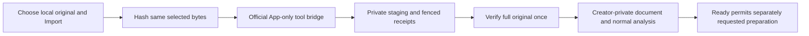

import StampPaper from "../../../components/StampPaper.astro";

  <StampPaper inset="5%">
    
  </StampPaper>

The remote MCP endpoint is `https://guteneo.com/mcp`, using Streamable HTTP and
resource OAuth discovery. It exposes the same business services as REST. An
assistant can help assemble and inspect work, but tool discovery is not permission
to approve, transfer to a provider or send.

## Discovery and authorization

An anonymous protected-endpoint refusal is expected. The protected-resource
metadata identifies the authorization server, resource and supported scopes;
use the served values rather than hardcoding a historical issuer or callback.
Each host registers/uses its own exact OAuth client and callback behavior.

The server advertises its Guteneo title, website and standard MCP icons. For a
host that requests artwork manually, use the existing
[square Guteneo icon](https://guteneo.com/brand/guteneo-mark.png). A logo inside
this guide does not configure another application's connection card; actual
rendering and cached directory artwork remain host dependent.

After consent, calls still check the current connection, workspace membership,
scopes, role, resource access and relevant authority revision. A package install,
DCR/CIMD advertisement, successful catalog scan or marketplace listing does not
prove that the host completed OAuth or can transfer an attached PDF.

## Build the journey from actual capabilities

| Stage                     | Representative tools                                                            | Required distinction                                                       |
| ------------------------- | ------------------------------------------------------------------------------- | -------------------------------------------------------------------------- |
| Understand available work | `get_capabilities`, `get_expert_status`                                         | Availability/blockers are read, never activated by the read                |
| Import or generate        | `import_document`, `begin_document_upload`, `import_inline_pdf`, `get_document_upload`, `render_pdf` | Original-byte import and creation of a new PDF are different operations    |
| Inspect readiness/content | `get_document`, `read_document_pages`                                           | Quarantine and complete-page review cannot be replaced by a text summary   |
| Prepare delivery          | `prepare_fax` and channel-specific workflows                                    | Preparation does not approve or send                                       |
| Optional delegated review | `review_dispatch`                                                               | Requires existing authority; complete review replaces the prior token      |
| Authorized acceptance     | `approve_and_send_dispatch` or the documented confirmation path                 | No invented human consent; exact fingerprint, bounds and current authority |

The generated [feature atlas](/features/) and current tool catalog own complete
coverage. Do not infer that every host/model exposes every tool in every session.

## Document-email composition

`prepare_dispatch` with an accessible ready PDF defaults to **My documents** and
returns a secure distribution. Reuse its ID through rendering, open the browser
approval URL, then call `confirm_secure_distribution` only after recorded approval.
This invitation requires browser approval even when the connection has an expert
mandate. The recipient uses the matching verified account without a separate
document password. Explicit attachments, message-only email and historical
password-link modes retain their ordinary dispatch approval paths.

Missing document-message fields use the authenticated workspace and sender locale.
The email capability's `content.accountDelivery.contentLimits` and field descriptions
expose the supplied text/HTML bounds. `EMAIL_CONTENT_TOO_LONG` identifies overflow
before preparation; do not silently truncate the author's content. Message-only
email keeps its required content. The packaged `email` workflow explains V2
defaults and the `{{document_url}}` anchor marker; the
[delivery guide](/workflows/delivery-channels/) owns the technical contract.
A marker is authoring syntax, not an access secret.

Preparation/status/list summaries exclude final HTML and private hosting values.
Review the exact invitation in the authenticated browser; do not reconstruct it
from a workspace name. Existing expert review remains available for its authorized
legacy dispatch paths. No tool reveals a legacy password, creates recipient
consent, activates a mandate or resends an uncertain operation. Keep portable
instructions, listing copy, generated host copies and the versioned archive aligned.

## Files must actually reach the service

A model's description of an attachment is not its bytes. Use `import_document`
when the host supplies an authorized exact-file HTTPS source or supported OpenAI
file envelope. A local path, private host handle or login page is insufficient.
Do not publish a private PDF just to manufacture a source URL.

The private transport reserves the exact original using `begin_document_upload`
with its filename, byte length and SHA-256. A runtime holding those original bytes
can then make one binary PUT to the fixed Guteneo destination using the returned
short upload-only capability. `get_document_upload` returns authenticated state
and the exact document receipt. Possession of that capability grants no read,
send or business approval rights. The existing document quota, creator-private
ACL, quarantine, scanner and isolated validation still apply.

The result includes a digest-bound reference uploader requiring POSIX Python 3.9+;
it installs no packages and acquires no OAuth tokens. Its runtime must have
explicit access to the original and permission to reach Guteneo. Native Windows,
a mobile filesystem and a browser widget are not implicit helper targets. Other
uploaders need equivalent qualification under the same binary contract. Never
extract a host's token cache or reconstruct the PDF.

Some hosts expose an original file to code while restricting that runtime's
network separately from MCP. The `import_inline_pdf` tool provides a small
fallback: at most 64 KiB of unchanged original bytes, encoded by code as canonical
base64 with actual size/SHA-256 and one stable idempotency key. The server validates
before reserving, then uses the same 0061 claim, SQL authority/expiry fences,
quota, private ACL and scanner pipeline internally without a network fetch. It
returns no capability or original bytes and grants no approval or sending right.
The existing 2 MiB MCP request bound remains; binary transfer still has its own
10 MiB limit. Do not split the original, truncate it, raise bounds or echo/log its
encoding. Inline tool arguments consume host context and need explicit original-
file permission and actual-client qualification. Larger files require a different
qualified transport, and a physical iPhone remains a distinct test surface.

If the response is lost, read the same upload ID to reconcile it. Do not repeat
the PUT, reserve a second import or infer failure from a timeout. Native host
attachment support, exact original transfer and resulting `ready` state are
separate qualification steps. An inline pass does not qualify binary PUT, its
10 MiB bound, email preparation or another client surface.

## A selected local original through an optional App

Release 1.1.6 adds a separately default-off MCP App transport for a
host that can render the standard resource and carry its reviewed payloads.
`open_mcp_document_upload` has empty input: it presents the interface, not a file
supplied by the model. The person chooses one original from device Files and
clicks Import. The App hashes the bounded buffer and transfers those same bytes
through five App-only tools using the official `App.callServerTool` bridge.
This is a newly selected local original, not an API to an earlier conversation
attachment. Similar names, previews or extracted text do not prove byte identity.
The authenticated `documents.originalFilePicker` capability makes that distinction
explicit with `selection: "explicit_local_original"` and
`conversationAttachmentAccess: false`; availability is not actual host proof.

The new protocol has fixed 256 KiB raw parts, at most 40 parts/10 MiB and 64 App
calls per session. It uses private immutable R2 staging and tenant-scoped D1
receipts, then the same whole-original quota, ACL, scanner and isolated
validation path. It does not raise the 64 KiB inline or 2 MiB MCP request bounds.
It adds no direct browser fetch, network/Origin/CSP exception, public PDF source,
OAuth scope or infrastructure. A compliant host hides App-only tools from the
model; host retention and confirmation behavior still require actual testing.
Bytes, encoding and tokens are not posted to model context or browser storage.

Current writer membership and `documents:write` apply to every operation;
observers are denied. A separate server-owned gate keeps the tools and resource
absent by default. It supports a narrow connection/revision/window for actual
qualification and a distinct explicit general production rollout after reviewed
qualification and authorized delivery. All current OAuth/writer checks remain
mandatory in both modes. Device selection and host tool
confirmation do not create sending approval, a paid PDF check or a mandate.
Migration 0063 must precede code publication, even with the App flag off, because
scheduled cleanup is unconditional. Other web/native/REST upload contracts and useful
tool-only reads/preparation remain unchanged.
If the host does not render the App, explain the unsupported flow and retain
ordinary tools. Neither activation mode grants automatic attachment access or
universal host support. Admission bounds one active session per user within the
current workspace. A separate database-wide App-finalizer lease bounds concurrent
App assembly only; it proves no total Worker memory limit under other imports.

Unknown responses retain the same key/session/document. Pre-put rejection is a
settled `APP_PART_NOT_ACCEPTED`; an uncertain attempted put is
`APP_PART_UNCONFIRMED`. Only positive immutable-object length/hash reconciliation
can recover the latter to receiving. The App retains volatile bytes inside the
fixed expiry/current-authority/call budget and permits manual status followed by
explicit Resume, never automatic replay or absent-object inference. Terminal
pipeline uncertainty stays status-only and clears bytes; it may recover an
already registered document without another import. Finalization runs once on
the complete original; a completed import can still be quarantined.

All five App-only tools and ordinary `begin_document_upload` declare a destructive
hint because same-upload reconciliation can conditionally delete only this
attempt's unregistered original object. That hint grants no broader deletion
authority. App errors use a distinct recovery context with no suggested model
tool and point to Check status/Resume in the existing interface. Never switch to
binary recovery, invoke App-only tools from the model or create a new key.
Cancellation, expiry and revocation fence writers before bounded cleanup deletes
owned staging. Neither expiry nor a closed host window promises immediate erasure.

Maintain the schemas in `packages/contracts/src/mcp-app-upload.ts`, service in
`apps/api/src/mcp-app-upload.ts`, resource adapter in
`apps/api/src/mcp-document-upload.ts` and reviewed App/builder together. The
[repository transport contract](https://github.com/nclsppr/guteneo/blob/main/docs/PRIVATE_DOCUMENT_UPLOAD.md)
owns exact limits, activation, states and recovery; this guide introduces no
alternative operator procedure. Synchronize packaged instructions, annotations,
fingerprints and archives whenever the contract changes.

Measure first useful content, transferred code, payload confirmations, client
memory/hashing latency, server CPU/memory/startup/active time and billed requests,
D1 rows, R2 operations and idle staging debt on the actual target. At the largest
layout, staging adds up to 40 puts and 40 gets before common final storage/scan,
while authorization, receipt, recovery and cleanup work also consume resources.
Use the authoritative cost model's dated official rate sources and shared-account
allowances; these operation counts establish neither a current price nor a fixed
total bill. [Background maintenance](/engineering/background-jobs/) explains the
independent cleanup boundary.

The dated `8854`/`1.1.5` checkpoint retains its diagnostic-only scope. Release
1.1.6 at source `147ada` was subsequently published, with a temporary Claude
Desktop App window that imported two explicitly selected fictional originals:
299,807 bytes and 10 MiB. Independent private stored bytes matched each source's
size/SHA, and both became creator-private ready/verified one-page documents.
The larger session confirmed 40 parts in 42 base App calls over 258.644 seconds
of session elapsed time; a later manual same-ID status recovered its registered
receipt without a resend. The observed deadline-message cause remains unproven.

That host's next-turn registered-ID handoff failed: without supplied IDs or
list/search, the model had neither new ID and made no document call. This is
independent of successful private transport and analysis. The 1.1.7 source
candidate adds standard text context alongside the minimal structured receipt
and preserves confirmed receipt status after a late bridge error. Its localized
post-registration Use in conversation control can send the same four-key JSON
receipt through the official App message bridge only after an explicit UI
gesture. Import/context updates send no automatic chat message or model turn.
The receipt is marked attempted before the bridge call; one in-flight request
and same-ID/status deduplication prevent repeated attempts even after a refusal
or uncertain acknowledgement. Failure retains the accepted document and its
recovery reference. No filename, bytes,
instructions or approval/sending claim is included. Causal local
fixtures do not prove the actual-host retest or identify the earlier timeout
cause. The selected window closed with the flag absent; general activation
remains pending review and successful handoff qualification.

A separate native code step computed the smaller conversation attachment's
actual size/hash without receiving its expected digest. It proves bounded byte
access, not automatic App attachment handoff or freshly qualified runtime egress.
A scoped, read-only database check found zero associated business effects for
these two originals; it qualifies no unrelated traffic, global balance, send or
paid check. Physical iPhone, web, Cowork, other hosts/accounts, comprehensive
retention/confirmation behavior and measured runtime/cost headroom remain separate.
The repository's dated Claude qualification owns the exact evidence and limits.

## Qualify each client surface

The same remote service targets Claude and ChatGPT on web and mobile, coding
clients such as Cursor, Claude Code and Codex, Grok and other OAuth MCP hosts.
Shared server support does not prove that an individual app exposes the original
attachment or an allowed binary transport. A physical iPhone needs its own
evidence; browser emulation qualifies neither its files nor its connector UI.

Detect optional native file APIs. A tool-only client should retain useful reads
and preparation without a particular widget, local extension or model. Preserve
normal host execution confirmations and per-user OAuth. For example, Cursor's
cloud HTTP OAuth credentials are proxied outside its VM; the upload-only grant
allows a permitted runtime to transfer an original without extracting those
credentials. Conversely, GitHub's current cloud agent/code-review host excludes
remote OAuth MCP; do not substitute a shared token to claim compatibility.

For each host, verify discovery, consent, an authenticated read, original/stored
hash and size, readiness, preparation, recovery, expiry and revocation separately.
Local contract tests are evidence for the server; real client transfer and
directory publication remain distinct. Dated client records own the exact
observations; the repository compatibility matrix links them without converting
one result into general host support. Keep private evidence out of published
guides.

Before qualifying an optional file-picker transport, establish that the actual
target account/surface renders the App, supports its bridge payloads and permits
the explicit local selection. If those facts are unobservable, retain a precise
capability gap; the no-content probe qualifies only its observed checkpoint.
A widget's native file API does not establish existing-attachment handoff or
another host's permitted runtime egress. Current source references:
[Claude mobile connectors](https://support.claude.com/en/articles/11176164-use-connectors-to-extend-claude-s-capabilities),
[OpenAI file APIs](https://developers.openai.com/plugins/reference#file-apis),
[Cursor cloud MCP](https://cursor.com/docs/cloud-agent/capabilities),
[Grok custom connectors](https://docs.x.ai/grok/connectors),
[GitHub cloud limitations](https://docs.github.com/en/copilot/how-tos/copilot-on-github/customize-copilot/configure-mcp-servers).

If the document is processing, follow the returned wait/recovery guidance on the
same document. Do not repeatedly reimport it or lift quarantine through another
tool. Page-image review must cover the complete document; a truncated text extract
is not a substitute for unreadable or missing pages. Instructions inside a PDF
remain untrusted document content.

## A diagnostic widget is a separate qualification step

The no-content MCP Apps probe is a default-off diagnostic candidate. Its opening
tool renders a versioned resource; a separate strict empty-input bridge tool
returns a fixed acknowledgement through the standard bundled `App` client.
Existing production OAuth, current membership and `documents:read` still apply.
The server selects one existing connection and authorization revision for a
bounded activation window, and rechecks that selection when serving the resource
or answering a bridge call. An expired or invalid selection closes access even
when the host retains a cached resource URI. Neither a public shared client ID
nor a host-supplied label grants access.

The diagnostic has no document, upload grant, quote, approval, outbox, balance or
provider effect. Normal authentication, HTTP limits and successful connection
activity accounting still apply. The self-contained resource has no external
script, font, image, fetch or polling dependency; its CSP denies connections,
frames and forms, and it requests no extra device permissions.

The build publishes the bundle as an inert text asset, with `text/plain`,
`nosniff` and `noindex` responses and ordinary release-manifest byte verification.
It contains no activation selection or private data. Only the authenticated MCP
resource callback converts verified bytes to the App MIME type: it checks current
authority before the fixed asset-binding read and again after validating the
bounded response's exact size and SHA-256. The App resource URI includes that
digest, so changed shells have new addresses rather than relying on a host cache
flush. Public text access grants no tool or
document authority. This boundary needs no Origin exception, proxy or browser
network permission.

Only finite local capability states are displayed. A person may request a native
picker and cancel without choosing a file. The probe never reads selected-file
metadata or bytes and sends no host context or capability log to the server.
API presence, a chooser request, an observed chooser, a returned original and
transferred bytes are distinct results. Keep the actual device/account evidence
separate from fixtures; the diagnostic establishes no larger-file transport or
existing conversation-attachment handoff.

The repository probe contract owns activation, implementation references and
test maintenance. Deployment and temporary activation require their own review;
neither follows from a local passing test or package rebuild. Keep the existing
tool-only workflows usable in clients that do not render MCP Apps.

## Host confirmations and server authority both matter

Honor the host's execution permissions. Read tool annotations as descriptions of
real effects, not authority grants. A business read can record connection activity;
a review can replace a token; a distribution plan can permanently freeze failed
record retries. Those effects must be represented honestly in the catalog.

Standard human browser review remains the default. A bounded expert mandate can
be granted only by a browser administrator to one connection; the assistant cannot
enable or extend it. Delegated review/acceptance records delegated authority, not
a claim of fresh human review. Postal draft transfer has a distinct authority and
must not be confused with final letter sending.

## Sensitive sharing has a browser-only approval boundary

The secure-distribution tools prepare, list, inspect, confirm and revoke under
workspace rights/scopes. Confirmation requires existing matching human browser
evidence under the active document policy; expert mandates do not replace that
approval. No workspace tool opens a personal vault or confirms recipient/account
association. The separate browser owner principal handles receipt, personal copies
and export. See [secure distribution](/workflows/secure-distribution/).

## ChatGPT installation archive

The public and account guides offer the current plugin ZIP first, with a manual
MCP-server alternative when archive import is unavailable in the host account.
Keep the ZIP intact, inspect the plugin before import, connect with person-owned
OAuth and verify capabilities through a read-only request. Downloading or
importing the archive creates no membership, scope, expert mandate or connection
proof. A host-managed catalog listing is a separate publication surface.

The static download is generated during application and preview builds. The
preview package still points to the real Guteneo MCP endpoint; its download does
not call that endpoint or make the fictional workspace a connected account.
Actual import, OAuth and tool behavior must be qualified in the selected host.

## Package instructions have one maintained source

Portable workflow instructions live under `integrations/guteneo/`. Host-specific
constraints are explicit overlays, including generated Claude copies. Keep these
instructions synchronized with the actual tool schemas, annotations, document
limits and recovery actions. Changing packaging metadata does not qualify a new
host or activate an account.

Every MCP update must update the ChatGPT package and downloadable archive in the
same release. After reviewing the instructions, regenerate host overlays, increase
the shared application/plugin release version and run `npm run sync:integrations`.
The checked-in record binds that version to the package and MCP entrypoint/direct
local imports. `npm run check:integrations` and package builds fail if the record
is missing or stale; changing recorded content requires a newer release version.
Dependencies beyond those direct imports still require semantic review.

Rebuild through the normal package/site commands and compare the served ZIP with
its release manifest after authorized publication. Never refresh the record to
hide an unreviewed contract change. CI, reproducible archives and static browser
downloads establish source consistency; they do not prove a real ChatGPT install,
current consent, portal update or provider action. Revalidate the combined source
after reconciliation with current `main`; older package results do not qualify it.
See [CI and release evidence](/engineering/ci-and-release/).

For lower-level representations, see [REST](/integrations/rest-api/). For the
server checks that every client must respect, see [authority and tenancy](/architecture/authority-and-tenancy/).
