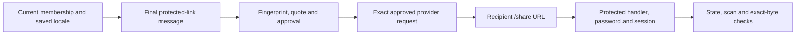

A channel adapter translates an already authorized domain operation into a
provider request. It does not create approval, grant credit, choose a fallback
channel or turn an unknown price into zero. Implementation support and current
account activation must be checked separately.

## The common boundary

Before submission, the shared domain service has persisted the exact content,
recipient, sender, quote/ceiling, valid authority, reservation, outbox and claimed
attempt. The adapter receives that commitment rather than mutable form fields.

Requests are bounded. Lost responses, timeouts or unreadable acknowledgements
after submission can be uncertain; an SDK or queue must not silently create an
independent resend loop. Read/reconcile the same operation according to its
provider semantics. See the [lifecycle](/architecture/dispatch-lifecycle/) for
`submission_unknown` and cancellation limits.

| Channel     | Adapter boundary                                                                                   | Later facts                                                                             |
| ----------- | -------------------------------------------------------------------------------------------------- | --------------------------------------------------------------------------------------- |
| Fax         | Telnyx submission of the approved PDF to the exact authorized number                               | Provider acceptance, transmission outcome and usage settlement are distinct             |
| Email       | Resend/SES construction of approved subject, HTML/text and selected attachment/protected-link mode | Delivery, bounce and complaint have different meanings; acceptance is not inbox receipt |
| Postal mail | Pingen document preparation, format/address review, quote and authorized print/send request        | Printing and handover to post do not promise final recipient delivery                   |

These are implementation families, not a statement that every provider or channel
is enabled for the current account.

## Fax: exact content and qualified pricing

A ready PDF and validated recipient/sender are required. The provider may need
short-lived private access to the approved original at submission; those URLs must
not appear in logs or public documentation. Their existence is not general public
access to the library.

The approved quote has a lifetime, pricing basis and customer ceiling. Configuration
or content changes can invalidate it before consumption. A qualified usage proof
is needed for final financial reconciliation; a transport callback alone is not
that proof. No provider-create idempotency guarantee is invented where the
qualified adapter has none.

## Email: preserve the selected presentation

Email preparation retains its subject, final sanitized HTML/text, recipient and
attachment or protected-link choice in the commitment. A protected link has
bounded access, with password retrieval restricted to an authorized browser
operation; neither an assistant nor a log should receive the password. Its hosting charge follows the existing atomic
billing rules rather than an unrelated client calculation.

The protected-link footer uses the authenticated sender's saved language, with
French fallback, from the shared delivery-message catalog. Its button, password
instructions, formatted expiration and recipient `?lang=` are fixed before the
approval fingerprint. Customer-authored subject/body and PDF bytes remain exact;
a later profile change or idempotent replay never translates an existing dispatch.
Web, native, REST and MCP preparation share this boundary. Expiration dates use
UTC. The Luxembourgish formatter uses declared CLDR month names instead of
relying on runtime Intl support, which can silently fall back to English; test
that path in workerd as well as the Node-based unit suite.

The recipient URL is private application routing despite requiring no account.
The `/share` prefix and its unlock/content children bypass Static Assets and the
public-error renderer; they are excluded from sitemaps and crawling. Worker-first
routing must remain aligned in local and production configurations. A generic
site 404 requires checking that boundary before regenerating a link or resending
mail. Correcting the route preserves existing hosting and password checks.

Administrator, Supervisor and Operator members with current preparation authority
and source access can reveal a password or revoke hosting only through the
CSRF-protected browser operation. Observers and connected assistants cannot use
those operations. The recipient's bounded password session grants no workspace
membership. Expired, revoked or invalid access stays unavailable.

Maintain the shared private-prefix registry and localized catalog with their
production-entry, protected-document and frozen-provider-content regressions.
The 25 October routing/localization correction has local source coverage;
publication, received-message rendering, hosted unlock and actual download need
separate evidence. A passing synthetic provider fixture does not send an email.

Provider signatures and durable event handling drive delivery/suppression facts.
A complaint can arrive after delivery. Marketing remains gated by the actual
unsubscribe/reputation implementation and qualification; a header alone does not
implement a working unsubscribe journey.

## Postal mail: transfer and final sending are separate

Postal preparation checks the final PDF, address layout, paper/print options and
provider profile. An optional address-page operation creates a new document and
requires fresh verification/review. Provider draft transfer is an external side
effect even when no letter has been authorized for sending.

Human or separately delegated transfer authority must therefore precede that
transfer. The final exact quote and final send approval remain additional gates.
Cancellation is provider/state-specific; a cancellation request is not proof that
printing or handover was stopped.

## Current capabilities are the integration contract

Read capabilities and the returned operation state at runtime. Disabled channels,
missing provider configuration, absent trusted pricing, stale scan evidence and
insufficient credit must fail closed. Tests with synthetic provider responses
prove request construction and guards, not a fresh account activation or real
delivery on a destination route.
