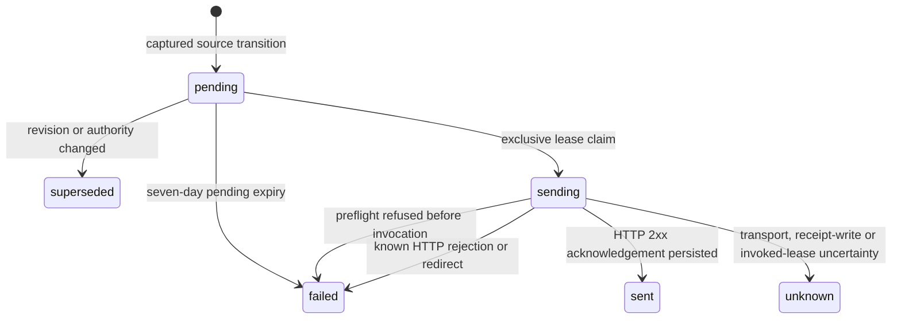

# Customer lifecycle webhooks

This candidate provides opt-in, signed metadata notifications for future
production dispatch state changes. It is separate from provider callbacks,
recipient communications and sending approval. Migration 0079 creates no
endpoint, signing key, external request or production activation.

## Authority and configuration

An authenticated browser administrator configures the current workspace.
Browser Origin/CSRF checks apply to every mutation. The service rechecks the
actual membership, organization mode, browser-session expiry/development status
and account-deletion state at the final SQL write. Native, MCP and system actors
cannot configure or reveal signing material. An assistant does not acquire this
authority from its host's confirmation or an expert sending mandate.

The browser application exposes configuration in Administration → Customer
webhooks. The API paths below are browser-session routes, not bearer-token
integration endpoints. All configuration responses use private/no-store policy.

| Route                                           | Result and recovery                                                                                                                                                                                                                                         |
| ----------------------------------------------- | ----------------------------------------------------------------------------------------------------------------------------------------------------------------------------------------------------------------------------------------------------------- |
| `GET /api/customer-webhooks`                    | Endpoint views, recent delivery counts, overflow count and runtime capabilities. Never signing material.                                                                                                                                                    |
| `POST /api/customer-webhooks`                   | `{name,url,revealSigningSecret:true}` plus a stable `Idempotency-Key`. Creates a paused endpoint and returns its secret once. An unchanged replay returns the endpoint without revealing the secret again; a changed request under that key fails.          |
| `PATCH /api/customer-webhooks/:id`              | `{revision,name?,url?,enabled?}`. An obsolete revision fails with `WEBHOOK_CHANGED`. Read current configuration before another explicit change. A changed URL defaults to paused unless that same request explicitly enables it under all activation gates. |
| `POST /api/customer-webhooks/:id/rotate-secret` | `{revision,revealSigningSecret:true}`. Replaces the secret, advances the revision and pauses delivery. The new secret is returned for that successful operation only.                                                                                       |
| `POST /api/customer-webhooks/:id/revoke`        | `{revision}`. Irreversibly revokes the endpoint and destroys its encrypted signing material. It preserves metadata needed to explain previous attempts.                                                                                                     |
| `GET /api/customer-webhooks/:id/deliveries`     | Bounded newest-first history, optional opaque `cursor` and `limit` from 1–50; default 30. Each cursor remains subordinate to the authenticated workspace and selected endpoint.                                                                             |

Save the one-time secret in the receiving service before explicitly enabling
delivery. If its first response is lost, retry creation with the original key,
then explicitly rotate the secret if necessary. Do not infer or retrieve the
lost value from the endpoint metadata. A replacement and an old paused endpoint
are different identities; creating duplicates is not the recovery path.

Endpoint revisions bind pending work to one configuration. Every configuration
revision supersedes pending notifications from the previous revision. A pause,
revocation or authority change stops subsequent invocations; an HTTP request
whose invocation marker was already committed may still finish. It cannot be
retracted by changing configuration afterward.

The durable grant is workspace configuration, so an ordinary browser logout does
not expire it. Collection and invocation still require the configuring actor's
current administrator membership and no processing/completed account deletion.
Losing administrator authority, removing that membership or leaving production
workspace mode atomically pauses its endpoints and advances their revision.
Restoring the role/membership/mode does not restore the old outbound grant: a
current authenticated browser administrator must explicitly enable the endpoint
again under its new revision.
Deletion processing retires affected endpoint configuration, clears the encrypted
secret, tombstones its name/URL and preserves bounded delivery evidence. Genuine
in-flight invocation uncertainty blocks that destructive transition until its
lifecycle is resolved. See [account deletion](ACCOUNT_DELETION.md).

## Event envelope and privacy

Dispatch insertion and status-change SQL triggers append metadata atomically
with the source change. There is no reconstruction from the last polled status:
intermediate transitions remain separate events even if processing runs later.
Only production dispatches and active, enabled, currently authorized endpoints
participate. Existing historical dispatches are not backfilled when an endpoint
is created or enabled.

One event type is supported:

```json
{
  "id": "evt_dispatch_reference_prepared_2026-11-09T12:00:00.000Z",
  "type": "dispatch.status_changed",
  "occurredAt": "2026-11-09T12:00:00.000Z",
  "organizationId": "workspace_reference",
  "data": {
    "dispatchId": "dispatch_reference",
    "channel": "email",
    "status": "prepared",
    "mode": "production"
  }
}
```

The envelope has identifiers, source time, channel, mode and dispatch state.
It contains no document bytes, document title, recipient, sender address,
subject, message, amount, provider credential, OAuth token or signed URL. An
endpoint's label and URL are configuration, not event payload fields. Status
names retain the [dispatch lifecycle](DISPATCH_STATE_MACHINE.md) meaning:
provider acceptance, postal handover and recipient delivery are distinct facts.

The event ID is stable for the captured source transition, including across
different endpoints. Delivery records have their own IDs and endpoint revision.
A new source transition generates a new event; it does not replay an uncertain
previous callback or resend the underlying dispatch.

## Signature verification and receiver idempotency

Each POST includes:

| Header                      | Meaning                                       |
| --------------------------- | --------------------------------------------- |
| `Guteneo-Webhook-Id`        | Event ID, matching the JSON envelope's `id`.  |
| `Guteneo-Webhook-Timestamp` | Integer Unix seconds for this HTTP attempt.   |
| `Guteneo-Webhook-Signature` | `v1=` followed by lowercase HMAC-SHA-256 hex. |

The signed bytes are the UTF-8 timestamp, a dot, the event ID, another dot and
the **exact raw HTTP body**. The HMAC key is the complete UTF-8 one-time signing
secret, including its `cwhsec_` prefix. Do not decode its suffix or reserialize
the JSON before verification.

For example, a Node receiver can perform the cryptographic check without making
any network request:

```js
import { createHmac, timingSafeEqual } from "node:crypto";

function verifyCallback(rawBody, headers, signingSecret, nowSeconds) {
  const id = headers["guteneo-webhook-id"];
  const timestamp = headers["guteneo-webhook-timestamp"];
  const signature = headers["guteneo-webhook-signature"];
  if (typeof id !== "string" || !/^[A-Za-z0-9_.:-]{1,400}$/.test(id))
    return false;
  if (typeof timestamp !== "string" || !/^[0-9]{1,12}$/.test(timestamp))
    return false;
  if (typeof signature !== "string" || !/^v1=[a-f0-9]{64}$/.test(signature))
    return false;
  const issuedAt = Number(timestamp);
  if (!Number.isSafeInteger(issuedAt) || Math.abs(nowSeconds - issuedAt) > 300)
    return false;
  const expected = createHmac("sha256", signingSecret)
    .update(`${timestamp}.${id}.`, "utf8")
    .update(rawBody)
    .digest();
  return timingSafeEqual(expected, Buffer.from(signature.slice(3), "hex"));
}
```

Bound the incoming body before buffering it. After verifying the signature and
five-minute replay window, parse the envelope, require its matching ID/type and
expected workspace, then durably deduplicate by workspace/event ID. Store that
receipt atomically with the receiver's accepted work before returning 2xx.
Repeated authenticated IDs should return the existing acceptance instead of
repeating downstream effects. A transport acknowledgement is not evidence that
the original dispatch was delivered to its recipient.

Use the attempt timestamp for replay protection. `occurredAt` is the source
event's earlier time and can legitimately precede processing by several days.
Keep the receiver's clock synchronized; do not disable freshness verification to
work around clock drift. Secret rotation invalidates signatures made with the
previous secret, including an old request already in flight.

## Public-network and activation gates

Destinations require direct HTTPS on a public DNS hostname. Literal IP addresses,
private/reserved hostname families, embedded credentials, custom ports, query
strings and fragments are refused. Redirects are never followed, including
redirects to another public host. Inbound browser credentials are never copied
to the outgoing callback.

Hostname syntax validation alone does not establish public network reachability
or prevent DNS rebinding. Hosted Workers must retain the actual
`global_fetch_strictly_public` compatibility flag, which is the egress/DNS
boundary reused from [public PDF import](PUBLIC_PDF_IMPORT.md). The private
`GLOBAL_FETCH_STRICTLY_PUBLIC=true` declaration must reflect that reviewed runtime
configuration; setting a string in an arbitrary local process is not proof of
the platform guarantee. Local execution never enables this network path.

All of these conditions are necessary for processing:

1. Hosted staging/production environment with production application mode and
   the reviewed strictly public global-fetch capability.
2. A dedicated `CUSTOMER_WEBHOOK_ENCRYPTION_KEY`, exactly 64 hexadecimal
   characters encoding a random 32-byte server secret.
3. Explicit `CUSTOMER_WEBHOOKS_ENABLED=true`; absent/false remains off.
4. A separately enabled endpoint with current configuration revision and valid
   current administrator authority, plus a genuine production source dispatch.

Signing secrets are encrypted at rest with AES-256-GCM and associated data bound
to the exact workspace and endpoint. They are not a substitute for TLS, an HSM
attestation or end-to-end encryption. The server can decrypt a secret to sign an
authorized callback. Do not rotate the server encryption key without separately
planning endpoint-secret migration/replacement; unavailable or transplanted
envelopes fail before HTTP invocation. Secret values, endpoint payloads and
transport exception details are not written to audit logs.

## Outbox, limits and uncertainty

The durable lifecycle is:



There is no automatic transition from `unknown`, `failed`, `sent` or
`superseded` back to `pending`. A stable event ID supports receiver deduplication;
it does not authorize another HTTP attempt.

The processor has one bounded pass: at most ten selected deliveries, with at most
two per workspace, a 30-second exclusive lease per claim and a five-second HTTP
deadline. It rechecks configuration revision, production source and current
authority again when committing the irreversible invocation marker. An expired
lease with no marker closes safely as uninvoked failure; an expired invoked
lease becomes unknown. Acknowledgement persistence failure retains uncertainty.
Exception details and arbitrary HTTP response bodies are not persisted.

| Bound                                  | Behavior                                                                                                                                                                                  |
| -------------------------------------- | ----------------------------------------------------------------------------------------------------------------------------------------------------------------------------------------- |
| Five active endpoints per workspace    | New creation refuses excess configuration; a defensive total of 100 retained endpoint records is also enforced.                                                                           |
| 500 pending deliveries per endpoint    | Further source events increment visible `overflowCount` instead of blocking dispatch creation or silently evicting pending work. Reconcile ordinary dispatch tracking for omitted events. |
| Seven days pending                     | Old uninvoked work becomes a failed delivery, without a network attempt.                                                                                                                  |
| Thirty days terminal history           | Bounded maintenance removes old sent/failed/unknown/superseded diagnostics. Historical source transitions are not reconstructed or replayed.                                              |
| 100 rows per maintenance category/pass | Lease expiry, stale authority/revision, pending expiry and terminal purge remain bounded.                                                                                                 |

These limits mean this is an observable, bounded notification stream, not an
unlimited replay log or a promise that every event reaches the receiving service.
Delivery counts describe retained history. Runtime deactivation pauses processing;
it does not grant another attempt or reinterpret an existing sending state as a
confirmed result.

## Source, proof and release boundary

Authoritative implementation:

- `packages/contracts/src/customer-webhooks.ts`: configuration and public metadata contracts.
- `apps/api/src/customer-webhooks.ts`: configuration authority, secret envelopes, signing and bounded processing.
- `apps/api/src/customer-webhook-routes.ts`: browser API projection and bounded JSON parsing.
- `migrations/0079_customer_lifecycle_webhooks.sql`: atomic source capture, tenant relations, immutable metadata, revision supersession and terminal no-replay guards.
- `apps/web/src/customer-webhooks-page.tsx`: explicit administrator controls, one-time secret and delivery history.

Local qualification on 9 November 2026: 38 migrated-D1 integration cases pass in
`tests/integration/customer-webhooks.test.ts`, with injected synthetic transport
only. They cover unsafe URLs, missing activation, session/actor/tenant boundaries,
encrypted secret transplantation, exact HMAC bytes/privacy, concurrent claims,
intermediate source transitions, unchanged idempotent creation, rotation/revocation,
claim-to-invocation authority loss, downgrade/removal/mode restoration without grant
revival, account deletion, lease recovery, a transport
that ignores abort, acknowledgement-write failure, chronological history and the
500-row overflow boundary. Typecheck and scoped lint pass at their recorded
source stages. No real customer callback was invoked.

`tests/e2e/customer-webhooks.spec.ts` contains synthetic browser scenarios for
configuration-off, explicit activation, secret lifetime/storage, lost-response
recovery, stale revisions, authority/identity loss and unknown-history handling.
On 10 November 2026, all 27 scenarios passed across Chromium, mobile Chromium and
iPhone WebKit. `tests/e2e/lifecycle-accessibility.spec.ts` also passed all 24
locale/theme/profile cases, including the actual endpoint controls, one-time
secret and unknown history, with no WCAG A/AA rules disabled. These tests use
intercepted synthetic responses and establish no hosted or live receiver proof.
The combined candidate's validation record owns later full-suite qualification.

Migration ordering, runtime flag review, actual hosted public-egress qualification,
operator key provisioning, explicit activation and an authorized receiving-service
round trip remain separate release steps. Local code, synthetic HTTP responses,
green CI or package generation authorize none of those steps by themselves.
