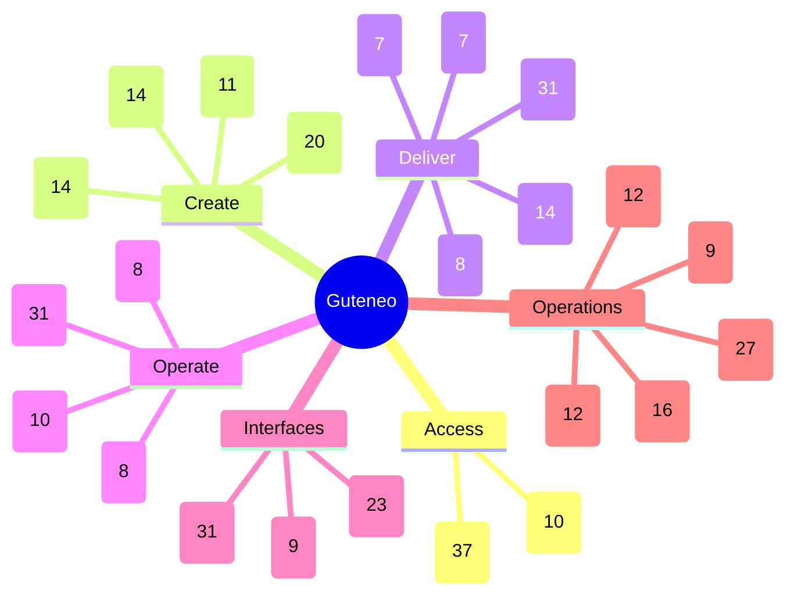

<!-- Generated from feature-map.json by node docs/build-feature-map.mjs -->
# Guteneo feature tree and developer atlas

**23 domains · 369 features · 37 journeys · 76 documented REST operations · 83 MCP tools**
Updated 2026-10-29.

Repository implementation inventory. Availability depends on current capabilities and authority; implementation, activation and deployed proof are distinct.

Start here to find a feature, its authority and its technical owner. Read [repository standards](REPOSITORY_STANDARDS.md) and the [documentation index](README.md) for shared conventions. The [offline visual atlas](FEATURE_MAP.html) provides search; [feature-map.json](feature-map.json) is the single editable source. Regenerate with `npm run docs:build`.

## Feature tree

### Access

- [Access and identity](#identity) — 37 features; browser-session.
- [Team and responsibilities](#team) — 10 features; browser-session.

### Create

- [Documents and protection](#documents) — 20 features; capability-gated.
- [Template studio](#templates) — 14 features; capability-gated.
- [Data and mappings](#datasets) — 11 features; capability-gated.
- [PDF generation and distribution](#generation) — 14 features; capability-gated.

### Deliver

- [Fax](#fax) — 7 features; capability-gated.
- [Postal mail](#postal) — 8 features; capability-gated.
- [Email and protected links](#email) — 14 features; capability-gated.
- [Sensitive distribution and personal documents](#secure-distribution) — 31 features; capability-gated.
- [Dispatch dry run](#dry-run) — 7 features; read-only.

### Operate

- [Campaigns and tracking](#campaigns) — 8 features; capability-gated.
- [Credits and billing](#billing) — 8 features; partial.
- [Workspace layout and browser appearance](#dashboard) — 31 features; browser-session.
- [PDF verification](#pdf-verification) — 10 features; capability-gated.

### Interfaces

- [Assistants and API](#assistants) — 31 features; host-qualified.
- [iPhone and iPad](#native) — 9 features; local-candidate.
- [Public pages, languages and appearance](#public) — 23 features; public.

### Operations

- [Reviewer OAuth qualification](#reviewer-oauth) — 9 features; operator-gated.
- [Operations and reliability](#operations) — 27 features; operator-gated.
- [Belvédère platform oversight](#belvedere) — 12 features; operator-gated.
- [Public service status](#status) — 16 features; public.
- [Engineering documentation](#engineering-docs) — 12 features; public.

## Availability and evidence

This inventory describes repository implementation. Check current account capabilities, authority and dated release/runtime evidence before treating a feature as available. Local tests, deterministic simulation, deployed assets, authenticated clients and real provider delivery are separate evidence.

An availability label describes the access/gating model, never an assertion of live activation. `partial` and `local-candidate` mark material qualification gaps. Read each detailed contract and the dated [release record](LIVE_RELEASE.md); no hard-coded historical release summary is duplicated here.

## Roles and permissions

Four human workshop roles are defined by packages/contracts/src/roles.ts. The assistant column describes a connected OAuth actor, never a fifth membership role. Effective membership, independent supervisor permissions, consented scopes and any bounded expert mandate are rechecked by the server. Installing a package or renewing tokens grants no additional authority. Browser-only account/platform controls remain distinct. Assistant content-exclusion instructions are workflow restrictions, not automatic classification or new server guards. Personal account authority is separate from workspace membership. Template/default email copy and link placeholders grant no approval or recipient consent. Sensitive approval and recipient association always require the browser under the active document policy; an expert mandate cannot replace them.

| Capability | Administrator | Supervisor | Operator | Observer | Connected assistant |
| --- | --- | --- | --- | --- | --- |
| Download an assistant installation archive | Public access; no membership required | Public access; no membership required | Public access; no membership required | Public access; no membership required | No OAuth consent, membership, mandate or sending authority from a download, displayed tool title, schema compatibility or directory listing |
| Use the gated MCP Apps diagnostic | Own eligible OAuth connection only | Own eligible OAuth connection only | Own eligible OAuth connection only | Own eligible OAuth connection only | Current production OAuth + documents:read + exact server-selected connection/revision/window; no content or business authority, with normal authentication/rate/activity accounting |
| Activate the MCP Apps diagnostic | No authority from workshop role | No authority from workshop role | No authority from workshop role | No authority from workshop role | No; distinct authorized operator controls a bounded server setting, never an assistant tool or mandate |
| Read accessible workshop content | Yes | Yes | Yes | Yes | Current member + consented scopes + document access |
| Import and prepare | Yes | Yes | Yes | No | Current member + scopes + qualified channel/transport |
| Reserve/transfer a private original PDF | Own connected OAuth writer + documents:write | Own connected OAuth writer + documents:write | Own connected OAuth writer + documents:write | No | Current writer + documents:write + explicit original-file permission and exact bytes; binary capability bound to one operation/connection/expiry or one inline original up to 64 KiB through the same 0061 fences; no read/send/approval authority |
| Select/import a local original through the gated MCP App | Own eligible current OAuth writer connection only | Own eligible current OAuth writer connection only | Own eligible current OAuth writer connection only | No | Current writer + documents:write + explicit server qualification/general-rollout activation + device selection/Import; both modes retain current production OAuth authority, and App-only staging adds no send/approval/mandate right or access to an earlier conversation attachment |
| Use a registered App receipt in the conversation | Own eligible registered App receipt only | Own eligible registered App receipt only | Own eligible registered App receipt only | No | Only an explicit post-registration UI gesture requests the same four-key document receipt through the official host bridge; no message on import, approval/sending claim, file content, extra scope or automatic attachment access |
| Activate the MCP Apps original transport | No authority from workshop role | No authority from workshop role | No authority from workshop role | No authority from workshop role | No; distinct authorized operator selects bounded qualification or reviewed general rollout, never an assistant tool, permission or mandate |
| Reveal protected-link password or revoke hosting | Current browser preparation authority + source access | Current browser preparation authority + source access | Current browser preparation authority + source access | No | No; password and revocation remain CSRF-protected browser operations |
| Human approval and confirmation | Yes | Approval option | No | No | Cannot assert human consent; standard confirmation requires recorded browser approval |
| Expert review and acceptance | Browser grants a bounded mandate | No mandate administration | No mandate administration | No | Pre-existing active client-bound mandate + current role/scopes + exact review + host confirmations |
| Cancel prepared/queued dispatch | Yes | Approval option | No | No | Current approval authority + scope; never retries an unknown submission |
| Aggregate reports | Yes | Reporting option | No | No | Current role + scopes |
| Manage workshop or members | Browser only | No | No | No | No |
| Manage billing | Current browser administrator | No | No | No | No |
| Purchase a PDF verification | Current browser administrator + exact purchase + PDF access | No | No | No | No financial consent; history read only |
| Read/export PDF verification history | Current PDF access | Current PDF access | Current PDF access | Current PDF access | Current PDF access + documents:read |
| Edit a shared template | Resource edit right | Resource edit right | Resource edit right | No | Current member + template scope + resource right; AI also requires current transfer consent/revision |
| Publish/archive a template | Resource publish right | Resource publish right | Resource publish right | No | Current member + templates:publish + resource right |
| Manage template sharing | Resource share right | Resource share right | Resource share right | No | Current member + templates:share + resource right; revocation disclosed |
| Remove a template | Owner | Owner | Owner | No | Owner + current role/scopes |
| Cancel/retry a generation | Batch owner | Batch owner | Batch owner | No | Owner + generations:write; frozen batches cannot retry |
| Read private generated PDFs | Creator/context access | Creator/context access | Creator/context access | Explicit current document access | Owner/context authority; no general private-library access |
| Profile, language and own sessions | Own account in browser | Own account in browser | Own account in browser | Own account in browser | No browser account administration |
| Read responsible workshop contacts | Authenticated browser | Authenticated browser | Authenticated browser | Authenticated browser | No |
| Read public pages/errors/status | Public; no privilege acquired | Public; no privilege acquired | Public; no privilege acquired | Public; no privilege acquired | Public read only; no extra tool/authority |
| Choose public language and retain a presentation hint | Local browser presentation only; no session required | Local browser presentation only; no session required | Local browser presentation only; no session required | Local browser presentation only; no session required | No account-language setter or extra REST/MCP authority |
| Choose system/light/dark browser appearance | Local browser presentation only | Local browser presentation only | Local browser presentation only | Local browser presentation only | No account preference setter, mandate or extra REST/MCP authority |
| Configure Auth0/DNS/MCP issuer trust/reviewer refresh | No authority from workshop role | No authority from workshop role | No authority from workshop role | No authority from workshop role | No business REST/MCP route; distinct authorised platform operator |
| Open global Belvédère | No authority from workshop role | No authority from workshop role | No authority from workshop role | No authority from workshop role | No; distinct verified browser Watchkeeper |
| Apply assistant content exclusions | No additional rights | No additional rights | No additional rights | No additional rights | Announce exclusions, stop known excluded content, request person-redacted copy; no automatic classification or web bypass |
| Use a personal account and received documents without a workspace | Personal principal, no workspace authority gained | Personal principal, no workspace authority gained | Personal principal, no workspace authority gained | Personal principal, no workspace authority gained | No personal access through workspace Bearer |
| Prepare sensitive distribution | Accessible source + preparation | Accessible source + preparation | Accessible source + preparation | No | Membership + dispatches:prepare + current connection; no invitation secret returned |
| Read a sensitive share and its audit | Current workspace approver | All with approval permission; otherwise own creations | Own creations | No | Same resource access + dispatches:read; no other recipient documents |
| Approve sensitive distribution | Browser + recent document session | Approval permission + browser + recent document session | No | No | No; expert mandate is insufficient |
| Renew an unsubmitted sensitive invitation quote | Browser + source access + recent document session | Approval permission + browser + source access + recent document session | No | No | No; browser-only replacement with fresh human review and no approval transfer |
| Confirm sensitive distribution after human approval | Current browser evidence | Approval permission + current browser evidence | No | No | Approver role + dispatches:send + existing sensitive browser evidence + host confirmation |
| Independently confirm recipient association when required by policy | Browser + document policy + independent verification | Approval permission + browser + document policy + independent verification | No | No | No |
| Revoke shared access without refund | Current authority | Approval permission | No | No | Approver role + dispatches:send; acquired personal copy retained |
| Read/export/delete another person’s personal copy | No, including workspace administrator | No | No | No | No |
| Keep or export one’s own received document | Personal principal + document policy + share permission | Personal principal + document policy + share permission | Personal principal + document policy + share permission | Personal principal + document policy + share permission | No; personal operation outside workspace OAuth |
| Read public browser reports | Public access without workspace privilege | Public access without workspace privilege | Public access without workspace privilege | Public access without workspace privilege | Public read only; no ingestion or business authority |
| Read monthly and daily consumption history | Yes | Reporting option | No | No | Current reporting rights + tenant-scoped REST read; no new MCP billing tool |
| Read private generation correction input | Only own generation under current browser membership | Only own generation under current browser membership | Only own generation under current browser membership | Only own generation under current browser membership; creation still requires its permission | No MCP/native route; shared-template or dispatch-review access grants no source input |

Supervisor approval/reporting options are independent and off by default. Resource ownership/context checks still apply. See [workspace roles](WORKSPACE_ROLES.md), [expert approval](EXPERT_APPROVAL.md) and [studio access](TEMPLATES_DATA_DISTRIBUTION.md).

## Complete feature inventory

### Access and identity

**Availability model:** browser-session. Unified personal account and optional workspace implementation; migrations, aligned document policy, Auth0 configuration and connected production qualification require separate evidence.

**Surfaces:** Personal browser authority and workspace/native sessions; REST/MCP resource OAuth with explicit same-tenant issuer trust, independently selected discovery and canonical identity/connection/mandate keys.

- Auth0 sign-in, verified accounts and explicit MFA policy
- Canonical browser sign-in/callback; retired hosts and preview URLs refuse authentication
- Personal profile and interface language; browser color preference is separate presentation state; the retired Classic layout value stays accepted but no longer changes the web layout
- Session listing, revocation and explicit logout
- Successful logout returns to the public home before Login remounts; failures stay visible and never claim a logout
- Workshop switching with current membership rights
- OAuth connection binding, revocation and consented scopes
- Exact resource-metadata discovery issuer, including its trailing slash; official MCP SDK contract tests without external network
- Account deletion request; complete erasure processing remains unqualified
- Visible signed-in name and login email on desktop/mobile, with the email heading the V2 account menu; current role and permissions belong on My account
- Explicit Auth0 account switching without disabling ordinary SSO
- Tab-focus reconciliation of identity, workshop and saved language
- One authenticated language control in the account; visitor choice stays separate
- Stored Classic/V2 preference (migration 0053) stays readable and accepted for compatibility; the web renders V2 for every account, and identity changes still reconcile language
- Late contact-directory errors provide accessible recovery without interrupting profile editing
- Path-scoped browser reads: hide previous resources, preserve same-path refresh and ignore cancelled late responses/401s
- Direct Auth0 entry from public links and unauthenticated private routes, preserving locale and exact destination
- Deep-link recovery from the valid transaction, excluding callback URLs and private parameters
- Prepared Auth0 brand assets and FR/EN/DE UI; Luxembourgish keeps its Guteneo locale with Auth0 fallback; language activation and publication need separate proof
- Restore explicit visitor language after the initial session check without overwriting current selection or account preference
- Recovery screen only after an error, with explicit retry and no automatic loop; native Auth0 signup, local demo and public fixture remain distinct
- Reread workshop capabilities for a browser session; anonymous reads support recovery and refresh the shared public offer/FAQ after returning home
- Independent browser domain and bounded same-tenant MCP token trust; explicit custom/canonical MCP discovery preference with rollback that retains existing tokens and canonical identity/connection keys
- Additive migration 0054 binds authorisation issuer and identity namespace to PKCE; legacy NULL flows stay canonical and rollback never silently switches provider
- Verified dual-token subject binds to the canonical namespace without email linking or duplicate person/workshop/credits/authority; browser evidence and prepare_only restriction remain
- One Guteneo account without an automatic workspace; idempotent initial administrator/workspace creation only on explicit service use
- Personal browser principal and session without membership, separate from workspace API authority; shared profile name/language and no email-based identity merging
- My documents, Use Guteneo and Account and security share one sign-in; voluntary workspace choice/creation reloads the chosen destination and bootstraps that workspace’s current session, rights and CSRF; the application switcher opens Studio or Correspondence in the current workspace (or workspace choice/creation when none exists), and Use Guteneo appears in personal navigation only without a workspace
- Document policy defaults to strong or explicitly selects verified_account: verified account/address and signed auth_time in an unexpired, unrevoked identity-linked session; no separate document sign-in for verified_account, while strong retains fifteen minutes for reading/association/approval and five for export/deposit/deletion; documentAccessAllowed/documentAccessMode do not imply MFA or strongAuthentication; D1 defaults strong and environment disagreement fails closed
- Document invitation handoff lasts at most ten minutes in the same tab, then is deleted; capture before Auth0 with secret-free returnTo and no arbitrary private query
- Document-service 401 offers explicit recovery without session-bootstrap loops; Auth0 recovery reconciles language and returned identity
- Document-authentication and browser-approval freshness refusals use localized sign-in recovery in all four languages; explicit fresh login preserves the valid current application route and locale without replaying mutations or weakening session-age checks
- Ordinary application entry without workshop membership offers workspace creation or joining through an existing canonical same-origin invitation with the shared raw 43-character base64url token contract, fragment clearing and explicit acceptance; server-generated invitation integration covers the entry, preview and auth handoff, while the stored SHA-256 hash never enters the link; explicit personal document entry remains independent, with no public workspace enumeration
- Production browser configuration selects auth.guteneo.com; the tenant-wide custom-domain email flag and exact authorization-response issuer identification were applied and reread on 27 October, without sending verification mail or qualifying human login
- Normal verified-account browser entry reuses Auth0 SSO within the existing one-hour session bound; signed authentication time is requested without forcing personal-entry max_age=0, and explicit fresh/account-switch behavior remains
- Verified-account personal and document-authentication recovery use ordinary bounded Auth0 SSO without fresh=1; strong and explicit freshness recovery retain forced authentication. Legacy sessions missing signed auth_time require a real new authorization response, never a timestamp reconstructed from session creation; safe return paths, locale, tenant rights and human approval remain unchanged
- Workspace and personal browser sessions project only canAccessBelvedere for navigation; signed privileged browser evidence and current membership remain mandatory, with no authority derived from mutable profile email or workspace role

**Contract:** [ACCOUNT_IDENTITY.md](ACCOUNT_IDENTITY.md) · **Implementation:** [apps/api/src/auth.ts](../apps/api/src/auth.ts)

**Tests:** [tests/unit/auth.test.ts](../tests/unit/auth.test.ts), [tests/unit/account.test.ts](../tests/unit/account.test.ts), [tests/e2e/account-identity.spec.ts](../tests/e2e/account-identity.spec.ts), [tests/e2e/resource-navigation.spec.ts](../tests/e2e/resource-navigation.spec.ts), [tests/unit/web-api-cancellation.test.ts](../tests/unit/web-api-cancellation.test.ts), [tests/e2e/login-entry.spec.ts](../tests/e2e/login-entry.spec.ts), [tests/security/auth0-branding.test.mjs](../tests/security/auth0-branding.test.mjs), [tests/e2e/pdf-validation.spec.ts](../tests/e2e/pdf-validation.spec.ts), [tests/e2e/dashboard.spec.ts](../tests/e2e/dashboard.spec.ts), [tests/e2e/locale-boundaries.spec.ts](../tests/e2e/locale-boundaries.spec.ts), [tests/unit/personal-auth.test.ts](../tests/unit/personal-auth.test.ts), [tests/unit/document-invitation.test.ts](../tests/unit/document-invitation.test.ts), [tests/distribution-e2e/personal-account.e2e.ts](../tests/distribution-e2e/personal-account.e2e.ts), [tests/unit/mcp-auth0-domain.test.ts](../tests/unit/mcp-auth0-domain.test.ts), [tests/unit/postal-authority.test.ts](../tests/unit/postal-authority.test.ts), [tests/integration/expert-status.test.ts](../tests/integration/expert-status.test.ts), [tests/unit/workspace-entry.test.ts](../tests/unit/workspace-entry.test.ts), [tests/integration/workspace-invitations.test.ts](../tests/integration/workspace-invitations.test.ts), [tests/e2e/personal-appearance.spec.ts](../tests/e2e/personal-appearance.spec.ts), [tests/unit/secure-distribution-web.test.ts](../tests/unit/secure-distribution-web.test.ts)

### Team and responsibilities

**Availability model:** browser-session. Implemented; invitations require separately configured delivery.

**Surfaces:** Authenticated browser; invitation emails are authored in English.

- Four human membership roles with independent supervisor approval/reporting options
- Member management, permission changes and atomic access revocation
- Last-administrator protection
- Individual/CSV invitations with batch preview and confirmation
- Verified-email acceptance, expiry and invitation revocation
- Bounded browser-only responsible contacts filtered by current workshop membership
- Login email distinguishes members with the same name; effective permissions stay readable
- Sensitive preparations are visible to their creator and current approvers; operators and observers gain no general access to other preparations
- Sensitive approval and recipient/account association require a browser under the current document policy; OAuth confirmation follows recorded browser evidence, with no expert-mandate substitute
- Workspace roles grant no access to another person’s vault; a recipient gains no membership in the sender’s workspace

**Contract:** [WORKSPACE_ROLES.md](WORKSPACE_ROLES.md) · **Implementation:** [packages/contracts/src/roles.ts](../packages/contracts/src/roles.ts)

**Tests:** [tests/integration/workspace-roles.test.ts](../tests/integration/workspace-roles.test.ts), [tests/unit/account.test.ts](../tests/unit/account.test.ts), [tests/e2e/account-identity.spec.ts](../tests/e2e/account-identity.spec.ts), [tests/integration/secure-approval-boundary.test.ts](../tests/integration/secure-approval-boundary.test.ts), [tests/unit/mcp-secure-distribution.test.ts](../tests/unit/mcp-secure-distribution.test.ts)

### Documents and protection

**Availability model:** capability-gated. Private App transport is published in 1.1.6 at source 147ada, with two actual Claude Desktop selected-original imports, independent exact private R2 bytes, ready/verified one-page analysis and scoped zero associated business effects. The selected window closed with its flag absent. Registered-ID model handoff failed, so general activation and the 1.1.8 native-host correction retest remain pending. Migration 0063 precedes code publication even while the flag is off; other hosts/devices, full retention/confirmation and runtime headroom remain separately qualified.

**Surfaces:** Web/native and existing REST/MCP document access remain unchanged. MCP supports private binary upload up to 10 MiB and inline originals up to 64 KiB; the separately gated App transport published in 1.1.6 selects a new local original and stages it through App-only tools before the same private pipeline. It adds no public REST/browser upload adapter or native-app feature. Actual transport, attachment handoff and physical iPhone require independent qualification.

- Bounded PDF upload and remote import with English API diagnostics and only a sanitized public source hostname
- Search, paginated listing, metadata and page reading
- Quarantine, real antivirus, exact hash and PDF validation
- Resume analysis of the same document without reimport
- Browser-administrator scanner warm-up
- Isolated HTML-to-PDF rendering into an immutable document
- Private storage, quotas, retention and owner-level privacy
- Assistant exclusions announced before content collection/processing; known excluded content is not imported/read even when stored or ready; scanning never proves its absence
- Creator-private MCP original-file reservation with actual basename, integer byte count and SHA-256; unchanged documents:write plus current writer and connection authority
- Upload-only 256-bit capability is returned only by reservation, hashed at rest, limited to five minutes/token expiry and claimed before a 30-second bounded binary PUT; no OAuth token, public PDF link, browser cookie or provider upload authority
- Exact-size/hash private upload feeds the existing antivirus/quarantine/100-page pipeline under the same planned document ID; connection/trust/membership/expiry rechecks and same-ID status recovery refuse blind retries on unknown outcomes
- Host file/code/network access and physical Claude iPhone OAuth/file transfer require separate qualification; attachment previews, extracted text, tool discovery and desktop helpers do not prove original-byte transfer
- Reservation can return deterministic POSIX Python 3.9+ standard-library client code with its SHA-256 for authorized local/cloud execution; status never returns code/capability, and no package install, external script fetch or actual host qualification is implied
- Small-original import_inline_pdf fallback carries one canonical-base64 original of 20–65,536 bytes with actual size/SHA-256 and a stable key through existing OAuth MCP when runtime Guteneo egress is unavailable; validation precedes reservation, internal 0061 claim/expiry/authority/quota/private-ACL/scanner processing is reused without fetch, and encoded context, truncation, same-ID unknown recovery and physical-client qualification remain explicit
- Default-off MCP Apps original-selection transport uses a strict empty opener, explicit device Files selection then Import, local size/SHA over the same selected bytes, and five App-only tools through the official bridge; deployed 1.1.6 has bounded actual Claude Desktop imports of 299,807-byte and 10 MiB originals through exact private storage/ready analysis, not automatic conversation-attachment handoff
- Private immutable R2 staging and tenant-scoped D1 part receipts bound App transport to 256 KiB raw parts, 40 parts/10 MiB, 64 App calls/session, five minutes/original-token expiry, one active session per user within the current workspace, 20 pending/200 MiB reserved staging debt per organization and 200 daily reservations; inline and binary limits remain unchanged
- App part replay, current-authority/expiry fences and same-key/status recovery preserve the original: pre-put denial is APP_PART_NOT_ACCEPTED, uncertain attempted writes retain debt as APP_PART_UNCONFIRMED and recover only through positive immutable-object size/hash evidence, then explicit Resume; final pipeline unknown stays status-only without another import
- A database-wide single App-finalizer lease bounds App assembly only; existing minute cron prioritizes expired leases, fences the original writer first and releases logical capacity without rerunning the pipeline. Cleanup remains at most two sessions/80 parts, waits for original expiry plus 90 seconds, retains unresolved debt/tombstones and never deletes registered/deduplicated originals; total Worker memory is not qualified by this admission limit
- Authenticated documents.originalFilePicker exposes explicit_local_original and conversationAttachmentAccess:false; SDK context updates contain only registered document ID/status and bound original size/SHA, never content/base64/filename/token. Actual 1.1.6 Desktop registered-ID delivery to the model failed; the 1.1.8 source candidate adds standard text alongside structured context plus explicit Use in conversation for the same four-key receipt, with native retests pending and no automatic chat message on import
- MCP_DOCUMENT_UPLOAD_APP is off by default: strict existing-connection/revision JSON supports at most one hour of qualification, while explicit enabled mode supports a separately reviewed general production rollout after actual qualification and authorized delivery; both retain current writer/OAuth guards, observer denial and no browser fetch, Origin/network permission, new scope, approval, paid check, mandate or infrastructure

**Contract:** [SCANNER_RESCAN.md](SCANNER_RESCAN.md) · **Implementation:** [apps/api/src/documents.ts](../apps/api/src/documents.ts)

**Tests:** [tests/integration/documents.test.ts](../tests/integration/documents.test.ts), [tests/unit/mcp-integrations.test.ts](../tests/unit/mcp-integrations.test.ts), [tests/integration/private-document-upload.test.ts](../tests/integration/private-document-upload.test.ts), [tests/unit/private-document-upload-mcp.test.ts](../tests/unit/private-document-upload-mcp.test.ts), [tests/security/private-pdf-client.test.mjs](../tests/security/private-pdf-client.test.mjs), [tests/integration/mcp-app-document-upload.test.ts](../tests/integration/mcp-app-document-upload.test.ts), [tests/unit/mcp-app-upload-contracts.test.ts](../tests/unit/mcp-app-upload-contracts.test.ts), [tests/unit/mcp-app-upload.test.ts](../tests/unit/mcp-app-upload.test.ts), [tests/browser/mcp-document-upload.test.mjs](../tests/browser/mcp-document-upload.test.mjs), [tests/security/mcp-document-upload.test.mjs](../tests/security/mcp-document-upload.test.mjs)

**Documented REST operations**

- `GET /api/documents`
- `POST /api/documents`
- `POST /api/documents/render`
- `GET /api/documents/{id}/content`
- `POST /api/documents/{id}/rescan`
- `GET /api/documents/{id}`
- `PUT /api/document-uploads/{id}/content`

**MCP tools**

- `append_mcp_document_upload`
- `begin_document_upload`
- `begin_mcp_document_upload`
- `cancel_mcp_document_upload`
- `finish_mcp_document_upload`
- `get_document`
- `get_document_upload`
- `get_mcp_document_upload`
- `import_document`
- `import_inline_pdf`
- `list_documents`
- `open_mcp_document_upload`
- `read_document_pages`
- `render_pdf`
- `rescan_document`

### Template studio

**Availability model:** capability-gated. Implemented; AI suggestions require configuration and organisation consent.

**Surfaces:** Web Studio space under /app/studio/…, REST and MCP; optional configured AI proposal service.

- Private, shared and organisation template libraries
- Five synthetic examples: letter, invoice, statement, quote and delivery note
- Private copy or blank creation with the REST/MCP authoring guide
- Word DOCX content import with explicit layout warnings
- Designer variables, tables, columns, logos, formats and conditions
- Visible local PNG/JPEG image import above the visual editor; selected-page insertion preserves original bytes, aspect ratio, unique names and business bindings
- Save, publish and studio navigation wait for committed native property edits; invalid numeric fields and reverting values recover without saving stale geometry
- Business schema, sample data, calculations and totals
- Review AI proposals before explicit application
- Exact PDF preview, immutable versions, publication, duplication and archival
- Independent use, edit, publish and share rights
- Owner-only removal preserving historical PDFs and provenance
- Document-studio exclusions cover DOCX, text, existing templates and business data; stop known excluded content and request a person-redacted copy without web bypass
- AI suggestions revalidate edit rights, membership, OAuth connection, revision and transfer consent before inference and before returning; reject stale proposals without automatic application/publication

**Contract:** [TEMPLATES_DATA_DISTRIBUTION.md](TEMPLATES_DATA_DISTRIBUTION.md) · **Implementation:** [apps/api/src/template-workflow.ts](../apps/api/src/template-workflow.ts)

**Tests:** [tests/unit/template-authoring.test.ts](../tests/unit/template-authoring.test.ts), [tests/unit/mcp-integrations.test.ts](../tests/unit/mcp-integrations.test.ts), [tests/integration/template-workflow.test.ts](../tests/integration/template-workflow.test.ts), [tests/unit/templates-images.test.ts](../tests/unit/templates-images.test.ts), [tests/e2e/template-images.spec.ts](../tests/e2e/template-images.spec.ts)

**Documented REST operations**

- `GET /api/templates/authoring-guide`
- `GET /api/templates/examples`
- `GET /api/templates/examples/{exampleId}`
- `GET /api/templates`
- `POST /api/templates`
- `POST /api/templates/import-docx`
- `GET /api/templates/{id}`
- `DELETE /api/templates/{id}`
- `PATCH /api/templates/{id}`
- `POST /api/templates/{id}/publish`
- `POST /api/templates/{id}/duplicate`
- `POST /api/templates/{id}/share`
- `GET /api/templates/{id}/sharing`
- `POST /api/templates/{id}/archive`
- `POST /api/templates/{id}/preview`
- `POST /api/templates/{id}/suggest`
- `GET /api/templates/{id}/schema`

**MCP tools**

- `archive_template`
- `create_template`
- `delete_template`
- `duplicate_template`
- `get_template`
- `get_template_authoring_guide`
- `get_template_example`
- `get_template_schema`
- `get_template_sharing`
- `import_docx_template`
- `list_template_examples`
- `list_templates`
- `preview_template`
- `publish_template`
- `share_template`
- `suggest_template`
- `update_template`

### Data and mappings

**Availability model:** capability-gated. Implemented; private-source and optional AI-transfer gates apply.

**Surfaces:** Web Studio space under /app/studio/…, REST and MCP; private source/mapping ownership.

- CSV, XLSX, XML and JSON imports with a private original
- MCP JSON dataset metadata declares arrays of objects or named arrays of objects to match existing parsing; nested values, runtime errors/recovery, request/cell bounds and private ownership remain unchanged, without new host-file or AI-transfer authority
- Sheet/header selection and XML record paths
- English generated Data sheet names, with provenance-bound legacy aliases; uploaded XLSX and explicitly named JSON tables require exact mapping and join names
- Profiling, anomalies and paginated inspection
- Resume analysis of the same original
- Versioned field/group/join mappings
- Mapping validation before generation
- Optional AI analysis under browser-administrator policy and transfer consent
- Document-studio exclusions also cover datasets, direct records and AI functions; stop reading/profiling/mapping/generation on known excluded content without collecting its values
- Compatible replacement imports retain the current template/version, field correspondence and valid record selection; cell/person/field errors remain actionable without mutating prior generated content

**Contract:** [DATA_IMPORT.md](DATA_IMPORT.md) · **Implementation:** [apps/api/src/template-workflow.ts](../apps/api/src/template-workflow.ts)

**Tests:** [tests/unit/datasets.test.ts](../tests/unit/datasets.test.ts), [tests/integration/template-workflow.test.ts](../tests/integration/template-workflow.test.ts), [tests/e2e/dataset-mapping-alias.spec.ts](../tests/e2e/dataset-mapping-alias.spec.ts), [tests/unit/mcp-integrations.test.ts](../tests/unit/mcp-integrations.test.ts)

**Documented REST operations**

- `GET /api/datasets`
- `POST /api/datasets`
- `GET /api/datasets/{id}`
- `POST /api/datasets/{id}/retry-analysis`
- `GET /api/datasets/{id}/profile`
- `POST /api/datasets/{id}/analyze`
- `GET /api/mappings`
- `POST /api/mappings`
- `GET /api/mappings/{id}`
- `POST /api/mappings/{id}/validate`

**MCP tools**

- `analyze_dataset`
- `create_mapping`
- `get_dataset`
- `get_dataset_ai_policy`
- `get_mapping`
- `import_dataset`
- `import_json_dataset`
- `list_datasets`
- `list_mappings`
- `profile_dataset`
- `retry_dataset_analysis`
- `validate_mapping`

### PDF generation and distribution

**Availability model:** capability-gated. Implemented; generation, preparation, approval and delivery remain separate.

**Surfaces:** Web Studio under /app/studio/… and Correspondence preparation /app/distribution/new plus frozen detail /app/distribution/:id, REST and MCP; generation is separate from distribution and delivery. Browser-only owner-authorized record-context supplies correction inputs and is excluded from the OAuth OpenAPI paths.

- Single PDF from a business form
- PDF batch from a validated mapping
- Progress, per-record results and source-cell provenance; only local simulation emits finite failure phase/category diagnostics through the captured error channel, never raw errors or customer data; terminal failed/partial XML test results stop polling while preserving both expected exact PDFs and zero sending, and a separate macOS pass does not establish the cause of an earlier Linux failure
- Exact authorized generated-document analysis state distinguishes processing, retryable and blocked results; bounded visible refresh follows pending scans after generation completes without changing readiness, stealing focus or retrying analysis
- Generation cancellation and retry of failed records only
- PDF selection in Studio opens the single Correspondence-owned preparation form with bounded record IDs; arrival revalidates every selected ready result in 50-record pages, performs no navigation write, and Back/Forward/reload preserve the selection
- The first plan permanently freezes the full batch, including excluded failed records; prepare_distribution declares destructiveHint true
- Common recipient or frozen columns with an explicit channel per record
- Resume remaining entries without duplication
- Entry-linked postal preflight with separate review and sending
- Known assistant-excluded content is never generated, previewed, shared or distributed; request a person-redacted version and never treat scanning as proof of absence
- Browser results show bounded name/subject/reference labels without changing record identifiers; the browser-only owner-authorized record-context read supplies labels or one explicit correction input, with current tenant/creator guards and no MCP/native authority
- Import/replacement retain the selected template/version and compatible field mapping/record exclusions; correcting data or a template creates a new generation/version while prior PDFs and prepared manifests retain their exact hashes
- Every new destination starts with zero documents even for one PDF; unsaved preparation may veto departure and late preparation/postal replies cannot navigate obsolete visits; the pre-preparation summary lists exact associations and explains that the first plan freezes the full generation, including excluded failed records

**Contract:** [TEMPLATES_DATA_DISTRIBUTION.md](TEMPLATES_DATA_DISTRIBUTION.md) · **Implementation:** [apps/api/src/template-workflow-routes.ts](../apps/api/src/template-workflow-routes.ts)

**Tests:** [tests/e2e/template-distribution.spec.ts](../tests/e2e/template-distribution.spec.ts), [tests/integration/template-workflow.test.ts](../tests/integration/template-workflow.test.ts), [tests/unit/document-analysis-projection.test.ts](../tests/unit/document-analysis-projection.test.ts), [tests/e2e/generation-analysis.spec.ts](../tests/e2e/generation-analysis.spec.ts), [tests/e2e/template-xml-multichannel.spec.ts](../tests/e2e/template-xml-multichannel.spec.ts), [tests/unit/mcp-annotation-audit.test.ts](../tests/unit/mcp-annotation-audit.test.ts), [tests/unit/mcp-integrations.test.ts](../tests/unit/mcp-integrations.test.ts), [tests/e2e/studio-continuity.spec.ts](../tests/e2e/studio-continuity.spec.ts), [tests/e2e/studio-distribution-handoff.spec.ts](../tests/e2e/studio-distribution-handoff.spec.ts)

**Documented REST operations**

- `GET /api/generation-jobs`
- `POST /api/generation-jobs`
- `GET /api/generation-jobs/{id}`
- `GET /api/generation-jobs/{id}/results`
- `GET /api/generation-jobs/{id}/provenance`
- `POST /api/generation-jobs/{id}/cancel`
- `POST /api/generation-jobs/{id}/retry`
- `POST /api/distribution-plans`
- `POST /api/distribution-plans/{id}/resume`
- `POST /api/distribution-plans/{id}/entries/{entryId}/postal-preflight`
- `GET /api/distribution-plans/{id}`

**MCP tools**

- `cancel_generation_job`
- `create_distribution_postal_preflight`
- `generate_documents`
- `get_distribution_plan`
- `get_generation_job`
- `get_generation_provenance`
- `get_generation_results`
- `list_generation_jobs`
- `prepare_distribution`
- `resume_distribution`
- `retry_generation_records`

### Fax

**Availability model:** capability-gated. Implemented; live tariff, sender, approval, credits and provider gates apply.

**Surfaces:** Web, REST, MCP and native preparation/tracking; browser or existing delegated approval.

- Exact PDF, recipient number and qualified sender
- Dated provider quote with bounded renewal
- Candidate scoped +3524 operator-tariff renewal preserves prices, source dates, seven-day validity and EUR2 cap; migration 0064, matching runtime and separate installation required
- Estimated range, approved ceiling and credit balance in euros
- Preparation, human review, approval and confirmation
- Tracking, receipts, usage settlement and unknown outcomes
- Unsendable reviewer mode stops before approval

**Contract:** [LIVE_FAX_QUOTES.md](LIVE_FAX_QUOTES.md) · **Implementation:** [packages/domain/src/index.ts](../packages/domain/src/index.ts)

**Tests:** [tests/e2e/fax-pricing.spec.ts](../tests/e2e/fax-pricing.spec.ts)

**Documented REST operations**

- `POST /api/dispatches/{id}/renew-quote`

**MCP tools**

- `prepare_fax`

### Postal mail

**Availability model:** capability-gated. Implemented; qualified profile, distinct transfer authority, quote and final approval are mandatory.

**Surfaces:** Web, REST and MCP with separate postal transfer authority.

- Sender, address, country and qualified provider requirements
- Left/right address window and explicitly requested address page
- Paper, colour, simplex/duplex and delivery-service options
- PDF preflight, address rendering and review
- Distinct authority for PDF transfer to obtain a quote
- Exact quote, expiry and final review
- Confirmation, calendar cutoffs and provider tracking
- Status projection and reconciliation of unknown outcomes

**Contract:** [MCP_POSTAL_JOURNEY.md](MCP_POSTAL_JOURNEY.md) · **Implementation:** [apps/api/src/postal.ts](../apps/api/src/postal.ts)

**Tests:** [tests/e2e/postal-final-send.spec.ts](../tests/e2e/postal-final-send.spec.ts)

**Documented REST operations**

- `GET /api/senders`
- `POST /api/postal/preflights`
- `GET /api/postal/preflights/{id}`
- `GET /api/postal/preflights/{id}/address.png`
- `POST /api/postal/preflights/{id}/quote`
- `GET /api/postal/requirements`
- `POST /api/postal/address-pages`

**MCP tools**

- `configure_postal_sender`
- `create_postal_address_page`
- `get_postal_preflight`
- `get_postal_requirements`
- `get_postal_setup`
- `preflight_postal_pdf`
- `quote_postal_draft`
- `transfer_postal_draft`

### Email and protected links

**Availability model:** capability-gated. Implemented email candidate; dated operator qualification is separate from deployment, global D1 quota policy, signed webhooks and actual delivery.

**Surfaces:** Individual web and MCP default to secure account delivery; REST uses /api/secure-distributions. Explicit attachments and legacy password links, campaigns and native message-only wire contracts remain compatible. Recipient access stays in the personal browser.

- Individual web/MCP PDF email defaults to My documents: one verified recipient account, no separate password; optional subject/body, localized workspace V2 template and custom HTML href={{document_url}}; final message is frozen before browser approval; account text/HTML limits are exposed in capabilities and preparation descriptions with field-specific overflow errors before rendering
- Text/HTML email without a file, with a PDF attachment or with a protected link
- Recipient-request attestation and transactional requirements
- Explicit quote and per-document hosting charge
- Protected-link footer and expiration date use the authenticated sender account language (French fallback), with four-language catalog, UTC date formatting and declared Luxembourgish months independent of runtime Intl support; recipient link locale freezes before fingerprinting; no translation of entered content or rewrite of approved/sent messages
- Private /share route and unlock/content children bypass Static Assets and public-error rendering; existing links retain hosting and access checks, with no sitemap inclusion or automatic resend
- Accessible ready document emails can omit subject/body independently for localized authenticated-workspace defaults (body only when both text and HTML are absent; HTML otherwise derives text); message-only email still requires content and caller HTML cannot select workspace identity
- Web individual/campaign forms omit blank document-message fields; individual account-button helpers use the notification locale and preserve authored HTML; the shared draft preview retains directly loaded or uploaded document titles outside the first list page without invented access URLs
- Branded default document-email template or custom HTML with safe inline email styles; exact account-invitation or explicit legacy protected-link anchor href={{document_url}} resolves server-side without a duplicate CTA; markerless custom HTML gets a styled fallback and both retain access instructions before quote/fingerprint, with malformed/unsupported markers rejected and private URL/password summary masking retained
- Private link, expiry and browser-only password entry
- Download without a recipient account under access controls
- Preparation, approval, tracking and provider policy
- Resend/SES availability is gated separately from activation; public price references and operator account limits have dated qualification, while account-wide quota policy, webhook/secret and delivery require independent installation and verification
- Default email quotes the frozen document title in HTML and plain text and includes Discover guteneo plus explicit unsubscribe/report controls; hashed mailbox capabilities suppress only their originating workspace through transaction-time eligibility fences, with separate recipientFeedback status, idempotent lifecycle receipts and stable satisfied-replay timestamps

**Contract:** [PROTECTED_EMAIL.md](PROTECTED_EMAIL.md) · **Implementation:** [apps/api/src/protected-documents.ts](../apps/api/src/protected-documents.ts)

**Tests:** [tests/integration/protected-documents.test.ts](../tests/integration/protected-documents.test.ts), [tests/integration/resend-email.test.ts](../tests/integration/resend-email.test.ts), [tests/unit/delivery-messages.test.ts](../tests/unit/delivery-messages.test.ts), [tests/unit/email-content.test.ts](../tests/unit/email-content.test.ts), [tests/security/email-content-runtime.test.mjs](../tests/security/email-content-runtime.test.mjs), [tests/unit/mcp-email.test.ts](../tests/unit/mcp-email.test.ts), [tests/unit/live-capabilities.test.ts](../tests/unit/live-capabilities.test.ts), [tests/integration/mobile.test.ts](../tests/integration/mobile.test.ts), [tests/security/openapi.test.mjs](../tests/security/openapi.test.mjs), [tests/security/public-assets.test.mjs](../tests/security/public-assets.test.mjs), [tests/e2e/protected-email.spec.ts](../tests/e2e/protected-email.spec.ts), [tests/e2e/protected-recipient.spec.ts](../tests/e2e/protected-recipient.spec.ts), [tests/e2e/email-recipient-attestation.spec.ts](../tests/e2e/email-recipient-attestation.spec.ts), [tests/e2e/email-preferences.spec.ts](../tests/e2e/email-preferences.spec.ts), [tests/unit/secure-distribution-core.test.ts](../tests/unit/secure-distribution-core.test.ts), [tests/unit/mcp-secure-distribution.test.ts](../tests/unit/mcp-secure-distribution.test.ts)

### Sensitive distribution and personal documents

**Availability model:** capability-gated. Implemented candidate with migrations 0055–0059 and separate deterministic strong/verified_account qualification. Default strong, explicitly selected verified_account, aligned environment/D1 policy and human approval remain mandatory; real Auth0, provider delivery, publication and external-client proof are separate.

**Surfaces:** Workspace and personal web UI in FR/EN/DE/LB with shared V2 primitives; workspace REST/MCP and assistant packages under scopes. Recipient access, sensitive approval and explicit quote renewal are browser-only; workspace Bearer tokens cannot open the personal vault. Native and real host support need surface-specific qualification.

- One Guteneo account receives, keeps documents and uses services, with zero workspaces permitted
- Prepare a verified PDF for one named recipient; immutable permissions, term, tax-exclusive price and notification language; revoke unexpired legacy draft/active hosting first, and use a dedicated source after any referenced postal derivation, legacy send, postal preflight or provider draft
- Bounded durable private rendering serves authorized page images and accessible text; the reader never delivers the original PDF
- Shared terms of 7/30/90/365 days and personal-copy terms of 365/1095 days; personal-copy options are funded at activation even when unused
- Versioned prices and separate invitation transport; activated retention commitments are nonrefundable even after revocation
- Review final pages/text, recipient, message, permissions and quote before browser approval under the active policy; email-request attestation remains separate; the fifteen-minute expiry cap uses the recorded approval creation time across asynchronous validation, with all stricter session/quote/review limits retained
- Atomic activation and outbox insertion require sensitive browser evidence even through REST/MCP confirmation; expert delegation cannot approve this flow
- Browser-only explicit quote recovery replaces an eligible unsubmitted distribution from its exact stored source, recipient, policy, notification and ceiling; guarded cancellation and a durable marker retain history, deterministic replay returns the same replacement, and new human review is required before activation
- Opaque invitation moves through same-tab handoff and a POST exchange, never authentication returnTo, logs, MCP responses or public captures
- New immutable verified_email policy binds the matching verified address and stable account at claim under fresh-session checks; independent or missing historical policy still requires workspace confirmation
- My documents separates Shared with me and Saved copies, with bounded server filtering/search and pagination over authorized documents
- Private pages and text load on demand; document policy, recent session and current grant are rechecked before each delivery
- Paginated workspace audit distinguishes server/browser provenance and actor account without claiming physical identity; detailed access events retain ninety days, immutable receipts remain separate, visible refresh is bounded and no full reading, disk save or screenshot is proven
- Optional original export is explicit and requires five-minute authentication freshness under the current policy; requested download and started transfer are distinct events
- Idempotent personal deposit uses bounded durable jobs, visible automatic progress and recovery after tab closure; success appears only after activation
- Acquired copies survive workspace revocation or departure; personal export/deletion/history are private from the sender; cancelling deletion retains the copy, confirming removes reading/export, and deletion/expiry prevents redeposit through the same invitation without an extra charge
- Services remain available through the same account, with voluntary workspace choice/creation, no mandatory purchase and no confidential-content targeting
- Existing REST/MCP and assistant packages expose catalog, preparation, listing, detail, confirmation after browser evidence and revocation under current rights/scopes
- Workspace tools expose neither personal principal, recipient association nor personal-vault content
- Activation fails closed until keys, renderer, scanner, provider and aligned document policy are qualified; V1 excludes ordinary attachments, legacy postal transformations, cropping, analysis and password access after sensitive reference, even after failure/revocation; only a dedicated invitation without source attachment is eligible, with bidirectional service/SQL race guards; local email flags and dated provider qualification prove no installed quota policy, signed webhook or delivery
- Secure distribution navigation follows Documents while Overview and Assistants lead; list/preparation/detail retain a coherent title and active entry; document-authentication and approval-freshness refusals offer localized explicit fresh sign-in returning to the valid existing share route, without SSO loops, private form storage or automatic approval
- Workspace preparation explicitly paginates PDF sources and explains that an authorized personal copy can be exported even when the shared original cannot
- Association attestation binds the displayed account, address and request; changing the candidate requires new independent verification
- Personal-list 401/403 clears loaded metadata and cursors; stale pagination responses cannot restore an old list after refresh
- Direct personal routes start their own small shell and authenticated personal session before the document list without waiting for workshop bootstrap; old workshop reads are aborted and fenced from applying identity/language after navigation, and return rereads current workshop authority
- Personal focus/visibility session reconciliation is bounded and cleaned up; changed identity remounts document state, obsolete results are ignored and list retry does not reload a still-valid session; recipient/document-policy/server authorization remains unchanged
- Secure distribution list, composer, detail and reader reuse the shared V2 workspace/personal surfaces, typography, controls, facts and responsive spacing; each authorization boundary remains unchanged
- Personal section changes retain the mounted authenticated shell while capturing and removing each new invitation before children render; no redundant personal-session bootstrap precedes the next page. Initial entry, bounded visible-tab revalidation, identity-change remounts and current server authorization remain required
- Provider preflight validates the transport reservation after deducting already committed secure retention/personal-copy charges from the immutable total ceiling; it retains all active attempt, approval, sender and tenant checks
- One explicit priced browser Send action records approval then activation after two attestations; a failed response requires read-only Check status before same-key recovery, without effect-driven writes or another MCP confirmation after active readback
- Local D1/R2 regressions cover revocation of metadata/images/text/permitted-original/deposit, decryption races, concurrent deposit and duplicate-copy workers; durable copies converge on exact bytes and single receipts without reviving revoked shared access

**Contract:** [SECURE_DISTRIBUTION_JOURNEYS.md](SECURE_DISTRIBUTION_JOURNEYS.md) · **Implementation:** [apps/api/src/secure-distributions.ts](../apps/api/src/secure-distributions.ts)

**Tests:** [tests/unit/personal-auth.test.ts](../tests/unit/personal-auth.test.ts), [tests/unit/document-invitation.test.ts](../tests/unit/document-invitation.test.ts), [tests/unit/mcp-secure-distribution.test.ts](../tests/unit/mcp-secure-distribution.test.ts), [tests/integration/secure-approval-boundary.test.ts](../tests/integration/secure-approval-boundary.test.ts), [tests/distribution-e2e/personal-account.e2e.ts](../tests/distribution-e2e/personal-account.e2e.ts), [tests/distribution-e2e/distribution-pricing.e2e.ts](../tests/distribution-e2e/distribution-pricing.e2e.ts), [tests/distribution-e2e/distribution-lifecycle.e2e.ts](../tests/distribution-e2e/distribution-lifecycle.e2e.ts), [tests/e2e/assistant-hub.spec.ts](../tests/e2e/assistant-hub.spec.ts), [tests/unit/secure-distribution-web.test.ts](../tests/unit/secure-distribution-web.test.ts), [tests/distribution-verified-e2e/lifecycle.e2e.ts](../tests/distribution-verified-e2e/lifecycle.e2e.ts), [tests/e2e/personal-document-performance.spec.ts](../tests/e2e/personal-document-performance.spec.ts), [tests/unit/secure-distribution-core.test.ts](../tests/unit/secure-distribution-core.test.ts), [tests/unit/auth-navigation-recovery.test.ts](../tests/unit/auth-navigation-recovery.test.ts), [tests/e2e/secure-distribution-recovery.spec.ts](../tests/e2e/secure-distribution-recovery.spec.ts), [tests/integration/secure-resend-journey.test.ts](../tests/integration/secure-resend-journey.test.ts), [tests/e2e/secure-distribution-send.spec.ts](../tests/e2e/secure-distribution-send.spec.ts)

**Documented REST operations**

- `GET /api/secure-distributions`
- `POST /api/secure-distributions`
- `GET /api/secure-distributions/catalog`
- `GET /api/secure-distributions/{id}`
- `POST /api/secure-distributions/{id}/confirm`
- `POST /api/secure-distributions/{id}/revoke`

**MCP tools**

- `confirm_secure_distribution`
- `get_secure_distribution`
- `list_secure_distributions`
- `prepare_secure_distribution`
- `revoke_secure_distribution`

### Dispatch dry run

**Availability model:** read-only. Implemented partial validation; neither acceptance nor delivery is executed.

**Surfaces:** REST GET and MCP, plus bounded operator runner; current read authority only.

- Validate an existing dispatch within authenticated-workshop and current document authority
- Read preparation guards, absence of attempts, quote validity and channel restrictions
- Partial/blocked result; acceptance and delivery are never executed and simulation stays separate
- Create, renew and consume no quote; preserve expiry; no approval, reservation, outbox or provider attempt
- REST GET/MCP automation with dispatches:read grants no preparation or approval authority
- Business read-only semantics remain distinct from HTTP counters and persisted MCP connection activity
- The test:prod:dry-run runner reads 1–10 existing dispatches sequentially on the canonical origin using an injected read token and emits recent redacted partial evidence

**Contract:** [PRODUCTION_DRY_RUN.md](PRODUCTION_DRY_RUN.md) · **Implementation:** [packages/domain/src/index.ts](../packages/domain/src/index.ts)

**Tests:** [tests/integration/dispatch-validation.test.ts](../tests/integration/dispatch-validation.test.ts), [tests/unit/mcp-dispatch-validation.test.ts](../tests/unit/mcp-dispatch-validation.test.ts), [tests/unit/production-dry-run.test.ts](../tests/unit/production-dry-run.test.ts)

**Documented REST operations**

- `GET /api/dispatches/{id}/dry-run`

**MCP tools**

- `dry_run_dispatch`

### Campaigns and tracking

**Availability model:** capability-gated. Implemented; role, exact-document and channel gates apply.

**Surfaces:** Web, REST and MCP; reporting and approval rights are independently checked.

- Named campaign with CSV recipients
- Row validation, errors and duplicate detection
- Prepare individual dispatches with the selected document
- Dispatch list/detail with prices and statuses
- Aggregate reporting and usage according to current rights
- Eligible cancellation and review of uncertain operations
- Channel/ceiling administration without blind retries
- Path-scoped browser refresh prevents stale resources or cancelled 401s from replacing a newer session

**Contract:** [API_CONTRACT.md](API_CONTRACT.md) · **Implementation:** [apps/api/src/index.ts](../apps/api/src/index.ts)

**Tests:** [tests/integration/domain-invariants.test.ts](../tests/integration/domain-invariants.test.ts), [tests/e2e/resource-navigation.spec.ts](../tests/e2e/resource-navigation.spec.ts), [tests/unit/web-api-cancellation.test.ts](../tests/unit/web-api-cancellation.test.ts)

**Documented REST operations**

- `GET /api/dispatches`
- `POST /api/dispatches`
- `GET /api/dispatches/{id}`
- `POST /api/dispatches/{id}/confirm`
- `POST /api/dispatches/{id}/cancel`
- `GET /api/campaigns`
- `POST /api/campaigns`
- `GET /api/campaigns/{id}`
- `POST /api/recipients/validate`

**MCP tools**

- `approve_and_send_dispatch`
- `cancel_dispatch`
- `confirm_dispatch`
- `get_dispatch_status`
- `list_dispatches`
- `prepare_dispatch`
- `review_dispatch`

### Credits and billing

**Availability model:** partial. Credits, ledger, monthly history and annual activity are published. Dated 25 October authenticated evidence restored the known September history without changing its visible balance; a fresh f946 account read and universal historical no-loss audit are not claimed. Commercial top-up remains unqualified; see WELCOME_CREDIT.md.

**Surfaces:** Browser administration; shared backend ledger. No assistant billing administration.

- One-time shared welcome balance in euros
- Available, reserved and consumed balances; top-up remains unqualified
- Atomic reservation with acceptance and outbox insertion
- Provider settlement and retained reserves for unknown outcomes
- Administrator credit/billing inspection
- Prepared Stripe integration with separate commercial qualification
- Read-only tenant-scoped monthly consumption history; current/latest/explicit UTC month selection preserves previous usage and simulation boundaries
- GitHub-style annual daily activity grid from exact UTC posted debits, selectable years/day detail, keyboard navigation and contained phone scrolling; reservations and simulation remain distinct

**Contract:** [WELCOME_CREDIT.md](WELCOME_CREDIT.md) · **Implementation:** [apps/api/src/billing.ts](../apps/api/src/billing.ts)

**Tests:** [tests/unit/billing.test.ts](../tests/unit/billing.test.ts), [tests/integration/welcome-credit.test.ts](../tests/integration/welcome-credit.test.ts), [tests/e2e/usage-history.spec.ts](../tests/e2e/usage-history.spec.ts), [tests/e2e/usage-activity.spec.ts](../tests/e2e/usage-activity.spec.ts), [tests/integration/live-delivery-quotes.test.ts](../tests/integration/live-delivery-quotes.test.ts), [tests/integration/protected-documents.test.ts](../tests/integration/protected-documents.test.ts), [tests/unit/pdf-validation-pricing.test.ts](../tests/unit/pdf-validation-pricing.test.ts), [tests/unit/secure-distribution-core.test.ts](../tests/unit/secure-distribution-core.test.ts), [tests/unit/auth.test.ts](../tests/unit/auth.test.ts)

**Documented REST operations**

- `GET /api/usage`
- `GET /api/usage/activity`

### Assistants and API

**Availability model:** host-qualified. Contracts/packages and 1.1.6 publication have bounded actual Claude Desktop selected-original storage/readiness proof, owned by CLAUDE_QUALIFICATION.md. Registered-ID delivery to the model failed; the 1.1.8 source candidate adds text context and receipt resilience with actual-host retest pending. The selected window is closed and general activation remains pending. Other hosts/devices, OAuth refresh, archive installation and marketplace publication retain separate evidence requirements.

**Surfaces:** Public/account browser guides and generated static downloads; REST/OpenAPI, MCP and host-specific packages. Compatible-host MCP Apps have separately gated no-content diagnostic and selected-local-original transport resources; tool-only workflows remain useful. Archive/App access creates no OAuth consent, membership, mandate or channel activation; native host installation, file payloads and attachment handoff remain separately qualified.

- Discover actual account capabilities and limits
- REST/OpenAPI and Streamable HTTP MCP catalogues
- Standard MCP server title, developer websiteUrl and unchanged PNG512 icons; RFC9728 resource_documentation and visible guide logo, with host-controlled display and a manual canonical image URL
- Current host-specific OAuth and original-file transport compatibility matrix for Claude and ChatGPT web/iPhone, Cursor desktop/cloud, Grok, Copilot, Gemini and other clients; installation/catalog presence never establishes a pass
- Import through the actual host transport: CLAUDE_QUALIFICATION.md preserves the historical 1,268-byte inline/prepare-only observations and the later deployed 1.1.6 Desktop selected-original imports of 299,807 bytes/10 MiB through exact creator-private stored bytes and ready analysis. Binary PUT, other preparations and other surfaces remain separate; the new registered-ID model handoff failed and general activation is pending
- Optional no-content MCP Apps diagnostic is absent by default; MCP_UI_CAPABILITY_PROBE.md owns its exact-connection/revision and at-most-one-hour activation contract, current production OAuth/documents:read, versioned UI resource, strict empty bridge acknowledgement, zero external dependencies/permissions and unchanged authentication/rate/activity accounting
- Diagnostic UI reports finite local secure-context and picker-API states using the standard bundled MCP Apps App client; the dated 8854/1.1.5 Claude Desktop Free observation covers a rendered widget, empty bridge call and actual native chooser cancelled without file selection/read/upload, with the temporary gate removed; it proves no large-payload transfer, existing-attachment access, web or physical-device pass
- A separate default-off selected-original App transport published in 1.1.6 uses current documents:write and writer authority, explicit device-file selection/Import and five App-only staging tools; PRIVATE_DOCUMENT_UPLOAD.md owns bounds, recovery, maintenance and activation, separately from the no-content probe
- Source inventory includes 75 ordinary tools, two optional no-content probe tools and six optional original-picker tools: 83 reviewed tools on full synthetic activation, not 83 tools universally visible to real clients
- All five App-only upload tools and ordinary begin_document_upload declare destructiveHint:true for potential same-upload reconciliation that deletes only this attempt's unregistered object; App error recovery has tool:null and uses the existing App Check status/explicit Resume, never model invocation of App-only tools or binary switching
- Confirmed App document receipts retain their accepted ID/status after a late bridge error, with unavailable bridge actions disabled and no reimport; standard text/structured context and a localized explicit Use in conversation message carry only documentId/status/size/sha256, with one in-flight request, same-ID/status attempt deduplication including refused/uncertain results and failure preserving truth; pinned App descriptor bytes/hash/resource URI are direct MCP fingerprint inputs under the normal synchronized-version guard
- Document, template, dataset, generation and preparation tools
- Browser review before sending; scopes never elevate membership rights
- Optional bounded expert delegation for one OAuth client; browser deep links use committed route selection and focus unavailable notices after navigation without disclosing foreign records or mutating authority
- Complete review replaces the previous token for this dispatch/connection; review_dispatch declares destructiveHint true
- Only a browser administrator grants/revokes a mandate
- Six portable package workflows with English metadata, deterministic archives and inventory checks; portal review/publication remains separately evidenced
- Manual host-specific installation packages; downloading grants no OAuth consent
- ChatGPT guide defaults to a generated plugin ZIP with a manual MCP alternative, shared across public/account views in four languages; native download links need no business API request or new authority
- ChatGPT archive preconfigures its registered public OAuth client with no secret, custom-domain endpoints and existing scopes; the manual guide reads the same ID; stable callback requires exact issuer identification, while DCR/CIMD and actual host consent remain separately qualified
- Explicit MCP annotations disclose overwrites, archival, sharing revocation, generation cancellation, review-token replacement and batch freezing
- Every advertised tool has four annotation booleans and per-tool evidence, audited through actual tools/list
- Every registered tool exposes its existing display title through annotations.title, including conditional tools; directory-compatible JSON dataset metadata preserves current business gates, while actual portal scan, each-tool host qualification, submission and public listing require separate evidence
- Declarative tool descriptions state the operation, inputs/results, side effects, risks and factual prerequisites without assistant behavior instructions, cross-tool orchestration or external behavioral rules; package skills and MCP prompts retain workflow guidance, with unchanged runtime guards, scopes and annotation booleans
- readOnlyHint/idempotentHint remain false where successful production calls persist visible connection activity; the side effect is disclosed centrally
- Assistant restrictions cover files, text, templates, datasets, records, existing PDFs/reports; person-redacted recovery adds no automatic classification or new server guard
- Single source version synchronises application, serverInfo and release/package manifests; builds reject version/connection drift
- MCP bodies limited to 2 MiB and 120,000 elements; existing 100,000-cell business limit remains
- Reproducible standalone Claude Code and relative-source local marketplace archives; six workflows without OpenAI metadata or tool preauthorisation
- MCP custom-domain discovery and signed issuer snapshot preserve canonical data keys, legacy credentials, current postal/expert fences and unchanged scopes; host consent and refresh remain separately qualified
- Every MCP change reviews and versions the ChatGPT package in the same release; CI/build compare recorded package and MCP direct-import fingerprints, then regenerate the downloadable archive and exact manifest hash; indirect behavior and actual host installation require separate review

**Contract:** [MCP_CLIENT_COMPATIBILITY.md](MCP_CLIENT_COMPATIBILITY.md) · **Implementation:** [apps/api/src/mcp.ts](../apps/api/src/mcp.ts)

**Tests:** [tests/unit/mcp-integrations.test.ts](../tests/unit/mcp-integrations.test.ts), [tests/unit/mcp-annotation-audit.test.ts](../tests/unit/mcp-annotation-audit.test.ts), [tests/unit/mcp-ui-probe.test.ts](../tests/unit/mcp-ui-probe.test.ts), [tests/unit/mcp-app-upload.test.ts](../tests/unit/mcp-app-upload.test.ts), [tests/unit/mcp-app-upload-contracts.test.ts](../tests/unit/mcp-app-upload-contracts.test.ts), [tests/browser/mcp-document-upload.test.mjs](../tests/browser/mcp-document-upload.test.mjs), [tests/security/mcp-document-upload.test.mjs](../tests/security/mcp-document-upload.test.mjs), [tests/security/mcp-ui-probe.test.mjs](../tests/security/mcp-ui-probe.test.mjs), [tests/integration/expert-approval.test.ts](../tests/integration/expert-approval.test.ts), [tests/unit/auth.test.ts](../tests/unit/auth.test.ts), [tests/integration/template-workflow.test.ts](../tests/integration/template-workflow.test.ts), [tests/unit/pdf-validation.test.ts](../tests/unit/pdf-validation.test.ts), [tests/security/integration-package.test.mjs](../tests/security/integration-package.test.mjs), [tests/security/claude-plugin.test.mjs](../tests/security/claude-plugin.test.mjs), [tests/security/integration-sync.test.mjs](../tests/security/integration-sync.test.mjs), [tests/security/preview-release-assets.test.mjs](../tests/security/preview-release-assets.test.mjs), [tests/preview-e2e/assistant-hub.spec.ts](../tests/preview-e2e/assistant-hub.spec.ts), [tests/e2e/assistant-hub.spec.ts](../tests/e2e/assistant-hub.spec.ts)

**Documented REST operations**

- `GET /api/capabilities`

**MCP tools**

- `get_capabilities`
- `get_expert_status`
- `open_mcp_ui_probe`
- `check_mcp_ui_probe_bridge`

### Reviewer OAuth qualification

**Availability model:** operator-gated. Operator tooling implemented; applying Auth0 changes requires explicit authority and a reviewed fingerprint.

**Surfaces:** Authorised operator CLI; GET inspection by default, explicit fingerprint-bound apply.

- Read-only inspection of the exact existing OpenAI reviewer client, historical callback, owner, scopes, API, connections and both Actions’ draft/deployed versions
- Redacted state/change plan and fingerprint without tokens, client secrets or private content
- Apply only after explicit authority with --apply --expect and reviewed fingerprint; provision no client/account
- Deploy both exact Actions before API offline_access and reviewer refresh grant, preserving ownClients, unrelated clients, bindings and consent
- Bounded rotating refresh: 30-day idle, 90-day absolute, 3-second leeway; API access token at most 3,600 seconds
- Stop on drift before each write, collision, another renewable Guteneo client or unknown Action; no automatic write retry
- For partial state, inspect again, review a fresh fingerprint and apply only remaining steps; unknown provider outcomes never trigger blind recovery
- prepare-chatgpt-reviewer --qualify-client --expect-renewal checks the complete exact state with GET only; never auto-provisions or completes partial migration
- Real reconnection, refresh and revocation need separate qualification; prepare_only, sending configuration, approval and mandates remain unchanged

**Contract:** [LLM_SETUP.md](LLM_SETUP.md) · **Implementation:** [scripts/enable-openai-review-renewal.mjs](../scripts/enable-openai-review-renewal.mjs)

**Tests:** [tests/security/openai-review-renewal.test.mjs](../tests/security/openai-review-renewal.test.mjs), [tests/security/chatgpt-reviewer-setup.test.mjs](../tests/security/chatgpt-reviewer-setup.test.mjs), [tests/security/claude-renewal.test.mjs](../tests/security/claude-renewal.test.mjs)

### iPhone and iPad

**Availability model:** local-candidate. Native candidate; physical-device, signing and distribution qualification remain separate.

**Surfaces:** Native SwiftUI client and versioned mobile API; authenticated browser for final approval.

- System authentication with dedicated mobile sessions
- Adaptive iPhone/iPad navigation and accessibility; English source keys with 261 preserved four-language native translations
- Profile, language and account-deletion request
- PDF import, inspection and search
- Fax/email preparation and tracking
- Final review in an authenticated browser; native sessions cannot grant consent
- Signing, physical-device, TestFlight and App Store qualification remain separate
- Read preferredDashboardAppearance in account/session without a native setting/PATCH
- Swift opens canonical /auth/mobile/authorize; the server selects the configured browser domain and preserves mobile PKCE return, distinct from the native callback

**Contract:** [IOS_API.md](IOS_API.md) · **Implementation:** [apps/api/src/mobile.ts](../apps/api/src/mobile.ts)

**Tests:** [tests/e2e/mobile-account.spec.ts](../tests/e2e/mobile-account.spec.ts), [tests/integration/mobile.test.ts](../tests/integration/mobile.test.ts)

### Public pages, languages and appearance

**Availability model:** public. The 25 October public hierarchy, four detail routes, shared footer, four-language static generation and appearance were published from main 03daa4136de8999cc79018f33f2a22038917c621. Canonical served assets and four-language public layout/link checks passed. The 27 October stable-language, public-session removal and initial-example-CSS correction is a local candidate; its measured build graph adds 1092 gzip CSS bytes without another initial stylesheet request. Current-source browser checks, CI and publication remain separately evidenced. The separate preview retains an isolated provider asset-delivery failure; indexing, provider and real financial qualification remain separate. The 28 October navigation candidate removes repeated document/app startup between public pages; local measurements, CI and publication remain separate.

**Surfaces:** Public browser/static documents and four-language frontend/video catalogues; request-language negotiation adds no REST/MCP operation or native capability. Preview has no business bindings. Authenticated account language, membership and approval remain separately guarded.

- Concise homepage introduces document preparation, explicit review and channel choice; durable How it works, Getting started, Pricing and PDF checks routes retain the full existing offer, examples, guides and conditions
- Four-language assistant hub and manual installation guides; shared public/workshop marks retain transparent exteriors in both themes, with CSS inversion only for monochrome ChatGPT, GitHub Copilot and Cursor in explicit/system dark mode, unchanged color artwork and source bytes, and no added JavaScript or image request; OAuth, workflows and publication have separate qualification
- Package download and version/SHA-256 manifest; compare published and local candidate versions; download grants no consent
- Journal, articles, legal notices and privacy
- French, English, German and Luxembourgish frontend/video localisation
- Separate saved personal preference and anonymous visitor choice
- Public language is fixed before visible content: supported explicit URL wins over the bounded nonsecret selection/account cookie, then Accept-Language and generic French fallback; cookie hints grant no account or business authority, visitor storage resumes after logout, and a small head script migrates older localStorage-only mismatches before paint
- Twelve localised films, posters, captions and actual durations
- Every registered main-site public route has generic and French/English/German/Luxembourgish initial HTML, canonical metadata, language alternatives and sitemap entries from one route registry; internal/private paths stay excluded
- Public pages make no workshop session probe or late account-language replacement; negotiated static HTML varies on Cookie and Accept-Language with private revalidation caching, while explicit-language cache policy, exact bytes, ETag and no-transform remain intact
- Fictional public preview isolated from the backend; tab-only email accepts omitted custom HTML, formats plain text locally and uses the shared template/French fallback for fictional PDF message defaults; custom HTML requires supplied plaintext, without real links, hosting, provider calls or production-sanitizer qualification
- Multilingual social cards and reader sharing controls
- Public error documents retain real HTTP status with 17 dedicated four-language messages and 4xx/5xx fallback; only eligible public failures, no status-selector/demo endpoint
- The homepage restores the existing four-language Ideas travel closing invitation, first-dispatch installation link and large stamp/postmark above its exclusive panorama with three original birds. The identical common PublicFooter remains on every public React route, including home, with its compact stamp/postmark, two original decorative swallows, sixteen links and colophon; no decoration enters the logged-in application
- Shared public navigation uses one 1440 px maximum outer frame with matching responsive header/main/footer gutters and narrower readable prose inside. The four-group/sixteen-link catalog supplies canonical four-language links for React, status and public HTTP errors; keyboard/Escape/focus behavior and explicit language across origins remain. Resources places localized Engineering documentation after Developers; all footer consumers retain https://engineering.guteneo.com/ without a language query because its guides are English-authored
- English source copy with context-aware translations; shared app primitives and one authoritative documentation/feature tree
- Six legacy homepage fragments keep meaningful destinations, focus and next links; Support retains all eight FAQ answers including postal-processing and PDF limitations
- Public details join the initial application code graph to avoid a first-tap waterfall while complete initial HTML remains visible; required public/detail and guided-example styles belong to the initial CSS graph, delayed or failed JavaScript preserves the static page, and the fictional diagram/example creates no business request or approval
- The public header exposes only a localized light/dark action icon at every viewport, defaults to the operating system and supports activation before React through the head bootstrap. Shared origin preference and fixed royal-blue chrome remain; standalone HTML reads only a bounded host-only nonsecret enum cookie with script-free system fallback. Native theme-media and ArticlePicture select original transparent dark portrait and responsive RGBA art. White paper stays inside each asset’s actual inner blue frame with transparent exterior/perforations, without a universal inset rule or outer white contour; original light art and opaque stamp remain unchanged
- One approved simple browser-icon family from apps/web/public serves product, status, engineering and standalone authentication/Belvedere/protected/error HTML; the shared exact-byte helper binds independent build source scopes and retains the existing canonical hosted-login favicon URL; read-only provider inspection found that URL already aligned, with no remote mutation or deployment claim
- Self-hosted interface fonts use optional display and three emitted-asset preloads, preserving the approved type when ready while keeping already-visible text geometry stable when font delivery is slow; delayed-font tests qualify desktop and mobile browsers separately, and shared public heading wrapping and responsive wordmark/action bounds preserve narrow layouts with unavailable-font metrics
- Ordinary same-origin links between registered public pages retain one browser document and loaded application; all small public page components are available on the first interactive click without HTML, route-code, session or private-data prefetch. Canonical English URLs, four-language presentation, static direct entries, history, anchors, focus and destination metadata remain coherent; unavailable initial JavaScript retains the complete static page. Pointer route focus does not frame script-focused containers; keyboard route focus underlines the new main title in the brand blue while interactive controls retain their focus indicators
- Public film play controls are disabled in server HTML until the client handler mounts; releasing route code starts no movie, and the first enabled click keeps playback/fullscreen in the native gesture with the resolved locale

**Contract:** [MULTILINGUAL.md](MULTILINGUAL.md) · **Implementation:** [packages/contracts/src/public-site.json](../packages/contracts/src/public-site.json)

**Tests:** [tests/e2e/locale-boundaries.spec.ts](../tests/e2e/locale-boundaries.spec.ts), [tests/preview-e2e/public-render-stability.spec.ts](../tests/preview-e2e/public-render-stability.spec.ts), [tests/unit/locale-bootstrap.test.ts](../tests/unit/locale-bootstrap.test.ts), [tests/unit/public-locale-negotiation.test.ts](../tests/unit/public-locale-negotiation.test.ts), [tests/preview-e2e/language-navigation.spec.ts](../tests/preview-e2e/language-navigation.spec.ts), [tests/preview-e2e/assistant-hub.spec.ts](../tests/preview-e2e/assistant-hub.spec.ts), [tests/preview-e2e/public-menu-escape.spec.ts](../tests/preview-e2e/public-menu-escape.spec.ts), [tests/unit/public-assets.test.ts](../tests/unit/public-assets.test.ts), [tests/security/public-assets.test.mjs](../tests/security/public-assets.test.mjs), [tests/unit/public-http-error.test.ts](../tests/unit/public-http-error.test.ts), [tests/preview-e2e/homepage.spec.ts](../tests/preview-e2e/homepage.spec.ts), [tests/preview-e2e/homepage-film.spec.ts](../tests/preview-e2e/homepage-film.spec.ts), [tests/preview-e2e/seo.spec.ts](../tests/preview-e2e/seo.spec.ts), [tests/preview-e2e/theme.spec.ts](../tests/preview-e2e/theme.spec.ts), [tests/unit/standalone-theme.test.ts](../tests/unit/standalone-theme.test.ts), [tests/preview-e2e/public-artwork.spec.ts](../tests/preview-e2e/public-artwork.spec.ts), [tests/unit/public-preview.test.ts](../tests/unit/public-preview.test.ts), [tests/preview-e2e/preview.spec.ts](../tests/preview-e2e/preview.spec.ts), [tests/preview-e2e/mobile-workspace.spec.ts](../tests/preview-e2e/mobile-workspace.spec.ts), [tests/unit/public-footer.test.ts](../tests/unit/public-footer.test.ts), [tests/security/brand-icons.test.mjs](../tests/security/brand-icons.test.mjs), [tests/preview-e2e/font-render-stability.spec.ts](../tests/preview-e2e/font-render-stability.spec.ts), [tests/unit/public-navigation.test.ts](../tests/unit/public-navigation.test.ts), [tests/preview-e2e/public-navigation.spec.ts](../tests/preview-e2e/public-navigation.spec.ts)

### Workspace layout and browser appearance

**Availability model:** browser-session. The 29 October 2026 Studio space, the application/workspace switchers and the four-application ownership check are a local source candidate requiring CI and publication evidence. The 29 October 2026 Classic retirement is a local source candidate requiring CI and publication evidence: every account sees V2, and the stored preference stays accepted without changing the web layout. The initial 25 October theme integration and removal of decorative panels were published from main 03daa4136de8999cc79018f33f2a22038917c621. The personal Classic/V2 account and Belvédère visual follow-up requires its own exact-source release proof and grants no new business authority. The shared outlined personal-context navigation refinement is a local source candidate requiring its own rendered and publication evidence. The 29 October compact V2 navigation and account-menu refinement is a local source candidate requiring CI and publication evidence.

**Surfaces:** Authenticated web V2 only; native reads the stored preference without a setter; no new business API/MCP authority.

- Full real-web V2 views with the same account, tenant, resources and operations; Classic was retired on 29 October 2026
- Account at navigation bottom, language and color controls side by side in account customization; mobile identity remains visible with the menu closed; the V2 account row opens a disclosure menu with name/email, profile, the shared labelled light/dark action, account switching, service status and sign-out, closing on Escape with focus returned and keeping 44 px touch targets; role and detailed permissions live on My account; native mobile details closes synchronously on Escape before a queued toggle reaches React, preserving summary focus and keyboard activation
- Personal users.preferred_dashboard_appearance, migration 0053: V2 persisted for new accounts; stored values, including classic, stay readable and accepted for compatibility without changing the web layout, and no migration rewrites them
- Personal documents use the V2 shell filling the available width with responsive gutters and readable internal form measures, with lightweight independent navigation; personal and workshop customization reuse small shared language/theme controls, preserving personal-only access and existing guarded PATCH authority
- Strict browser account PATCH with current authority, Origin/CSRF and field-name audit; every role changes only its own preference
- Old appearance=classic/v2 and legacy atelier links remain harmless: the web ignores them, opens V2 and persists nothing; it no longer reads or writes a browser layout cache
- Existing activity/alerts precede introduction, otherwise a complete welcome; content preview precedes approval in reading/tab order
- Stable PDF frame above dispatch-review and document-page verification-purchase consent across lazy module loading/render/error, keyboard-accessible internal scrolling and unchanged consent/data authority
- Consistent documents, preparation, review, tracking, assistants, account, studio, PDF verification, credits, tables and forms; secure-document price panels retain their padding and consent with a fine one-pixel cobalt side rule; Belvédère shares the V2 visual vocabulary while retaining distinct platform authority and read-only data; recursive diagnostics keep outer key/value columns and stack nested fields without zero-width values or page overflow
- One brand signature, workshop in navigation and no redundant V2 footer; service status in the account menu and browser timezone near dates
- One page title, contextual detail back link and task-specific primary action as the screen's only filled button; global New dispatch keeps one secondary, permission-aware place on every V2 page and is repeated in the Overview/Dispatches heading only on narrow screens
- Compact V2 desktop navigation keeps every destination in view from 864 px high with 34 px pointer rows, fades a cut-off entry while the list still scrolls, draws keyboard focus inside clipped rows and gives each destination one distinct icon; touch layouts keep 44 px targets
- Generation introduction focuses on finding PDFs and makes clear that generation sends nothing
- Official identity and real documents, metrics and controls remain; decorative DashboardArtwork panels and swallow styling are retired from overview, empty Documents and assistant introduction, without replacement illustrations
- Four-language labels; simulation notices only for simulated sessions
- Same four roles, supervisor options, private access and consents; no new mandate, channel or business API/MCP tool
- Native account/session reads include appearance without a setter; existing name/language browser PATCH and native language PATCH remain compatible
- Two separate switchers open the shared V2 sidebar: the application switcher (Studio, Correspondence, My documents; in every application) and, in Studio and Correspondence only, the workspace switcher (current workspace, other memberships, create or join). The workspace list is read only when its panel opens, belongs to one account/workspace/authority identity so a late or earlier list is never shown, is read again after a refused membership, honours the existing unsaved-work veto before switching, and both panels close on Escape (including after a Safari pointer click), an outside pointer or any navigation; triggers are 40/36 px for desktop pointers and 44 px on touch screens; identity actions stay in the account menu
- Studio space in the same workspace session: Templates, Data and Generations live under /app/studio/… with permanent client aliases for earlier Studio links that keep the query; prepared batches (/app/distribution/…) stay with Dispatches; the workshop navigation keeps Assistants immediately after Overview and shows New dispatch only in the workshop
- One application route table (apps/web/src/app-routes.ts) owns spaces, Studio addresses, aliases, the current navigation entry and route-code preloading
- Shared native file input with four-language authored chooser/empty text and literal filenames, keyboard validation and exact-byte upload semantics
- Desktop Safari select height and protected-link hint spacing; visible keyboard focus, selection and forced-colors states remain readable in both palettes
- Public and personal headers and Belvédère page actions share one localized light/dark action icon at every viewport, defaulting to the operating system; the authenticated personal V2 shell fills the available width with responsive gutters and follows workshop geometry without changing personal navigation, identity, document access or logout. Browser theme is independent of account language and role; document/PDF/email content retains original light-paper appearance and bytes
- Template-designer controls adopt the resolved shared palette in place while original template content, output geometry, bindings and PDF bytes retain their document contract
- V2 protected-email choice, review summary, email preview and PDF viewer frame share the existing 10 px panel corners; 7 px controls and original square PDF paper retain their distinct roles without extra API reads
- Requested workshop route code loads in parallel with its initial authenticated session, without speculative hover/focus imports or private-data reads; failed route code preserves navigation and current identity with a localized explicit reload, while late imports cannot replace a newer route; transitions temporarily fence retained main content with inert/busy while navigation remains available, preserving existing vetoes and preventing post-check edits; child route readers share one committed context and subscription, account deep-link notices receive focus after the fence clears, and document-close focus returns only to a connected trigger after commit; pointer-focused containers have no page-sized outline, keyboard-focused main titles use a brand-blue underline, and interactive-control focus indicators remain unchanged
- My documents loads as its own application chunk while a visit-scoped personal session starts in parallel; hidden/obsolete entry results are discarded and current identity/cancellation fences remain
- WorkspaceIdentity shares profile/theme/account-switch/status/logout controls with My documents and canonical Belvedere; personal account switching sanitizes private return queries, Escape restores focus and navigation/identity replacement close menus
- Exact complete-label revisions unify workspace terminology in French, English, German and Luxembourgish while preserving legacy lookup keys, explicit contexts, names and interpolated content
- All four application import exceptions are removed: personal lazy entry, correspondence preference helper, shared entry-link style and locale-change event replace the former eager/cross-layer dependencies
- Explicit route-code recovery refreshes only failed same-origin public JS/CSS assets before reloading, with no credentials/referrer/private query, at most eight requests, an eight-MiB per-response read bound and five-second timeout; no background retry or business endpoint is added

**Contract:** [DASHBOARD_V2.md](DASHBOARD_V2.md) · **Implementation:** [apps/web/src/account-page.tsx](../apps/web/src/account-page.tsx)

**Tests:** [tests/unit/account.test.ts](../tests/unit/account.test.ts), [tests/integration/mobile.test.ts](../tests/integration/mobile.test.ts), [tests/preview-e2e/dashboard-v2.spec.ts](../tests/preview-e2e/dashboard-v2.spec.ts), [tests/e2e/dashboard-v2.spec.ts](../tests/e2e/dashboard-v2.spec.ts), [tests/e2e/protected-email.spec.ts](../tests/e2e/protected-email.spec.ts), [tests/e2e/account-identity.spec.ts](../tests/e2e/account-identity.spec.ts), [tests/e2e/team-invitations.spec.ts](../tests/e2e/team-invitations.spec.ts), [tests/e2e/template-images.spec.ts](../tests/e2e/template-images.spec.ts), [tests/preview-e2e/theme.spec.ts](../tests/preview-e2e/theme.spec.ts), [tests/e2e/personal-appearance.spec.ts](../tests/e2e/personal-appearance.spec.ts), [tests/e2e/personal-document-performance.spec.ts](../tests/e2e/personal-document-performance.spec.ts), [tests/belvedere-e2e/control-tower.spec.ts](../tests/belvedere-e2e/control-tower.spec.ts), [tests/e2e/pdf-validation.spec.ts](../tests/e2e/pdf-validation.spec.ts), [tests/e2e/workspace-route-performance.spec.ts](../tests/e2e/workspace-route-performance.spec.ts), [tests/preview-e2e/mobile-workspace.spec.ts](../tests/preview-e2e/mobile-workspace.spec.ts), [tests/e2e/locale-boundaries.spec.ts](../tests/e2e/locale-boundaries.spec.ts), [tests/e2e/login-entry.spec.ts](../tests/e2e/login-entry.spec.ts), [tests/e2e/studio-space.spec.ts](../tests/e2e/studio-space.spec.ts), [tests/unit/app-routes.test.ts](../tests/unit/app-routes.test.ts), [tests/e2e/personal-entry-race.spec.ts](../tests/e2e/personal-entry-race.spec.ts), [tests/unit/message-terminology.test.ts](../tests/unit/message-terminology.test.ts), [tests/unit/route-code-recovery.test.ts](../tests/unit/route-code-recovery.test.ts)

### PDF verification

**Availability model:** capability-gated. Individual-purchase capability enabled in the 25 October release and observed on f946 main at 26 October 01:47 UTC; private hosted corpus, scanner, application configuration and actual customer purchase remain separate evidence. No new subscription or recurring renewal. See PDF_ACCESSIBILITY.md and PDF_VERIFICATION_PRICING.md.

**Surfaces:** Web browser administrator purchases; REST and MCP retain current document-scoped history reads and cannot create assistant financial consent.

- Individual exact-PDF/profile purchase from available account credits; current integer EUR price and excluding-tax terms come from the authenticated pricing endpoint
- Current browser administrator alone accepts the immutable purchase; assistants, native callers and other members cannot create financial consent; the document preview reserves its frame through loading/rendering so price consent remains stationary, with no purchase from viewing or scrolling
- Atomic reservation and one settled charge for a complete valid report; engine failure releases the reservation without a settled debit
- New subscriptions and automatic recurring renewals are retired; immutable legacy actions and charges are retained, and posted charge history remains visible under current reporting authority
- Pinned private veraPDF for PDF/UA-1/-2 and PDF/A-1b/2b/3b/4, with official positive/negative corpus, signal-aware bounded cleanup and separate offline/hosted graceful-stop qualification
- Exact-byte reports, history and JSON export under current PDF access, independent of a monthly entitlement
- Required human review; a valid report with failed conformance checks is billable, while operational failure is not a conformity verdict
- One explicit activation flag, private validator and production scanner gates; activation after hosted qualification, never legal certification
- PDF-accessibility exclusions apply to originals and existing reports; person-redacted recovery without web bypass
- Same-key recovery for uncertain network responses does not purchase or execute twice; a new independent check requires a new explicit purchase

**Contract:** [PDF_ACCESSIBILITY.md](PDF_ACCESSIBILITY.md) · **Implementation:** [apps/api/src/pdf-validation.ts](../apps/api/src/pdf-validation.ts)

**Tests:** [tests/unit/pdf-validation-pricing.test.ts](../tests/unit/pdf-validation-pricing.test.ts), [tests/e2e/pdf-validation.spec.ts](../tests/e2e/pdf-validation.spec.ts), [tests/unit/pdf-validation.test.ts](../tests/unit/pdf-validation.test.ts), [tests/preview-e2e/geo.spec.ts](../tests/preview-e2e/geo.spec.ts), [tests/preview-e2e/seo.spec.ts](../tests/preview-e2e/seo.spec.ts), [tests/unit/live-capabilities.test.ts](../tests/unit/live-capabilities.test.ts), [apps/pdf-validator/tests/qualification.test.mjs](../apps/pdf-validator/tests/qualification.test.mjs), [apps/pdf-validator/tests/container-lifecycle.test.mjs](../apps/pdf-validator/tests/container-lifecycle.test.mjs), [apps/pdf-validator/tests/worker.test.mjs](../apps/pdf-validator/tests/worker.test.mjs), [apps/pdf-validator/tests/test_server.py](../apps/pdf-validator/tests/test_server.py), [tests/unit/mcp-integrations.test.ts](../tests/unit/mcp-integrations.test.ts)

**Documented REST operations**

- `GET /api/pdf-validation/pricing`
- `GET /api/documents/{id}/validation`
- `POST /api/documents/{id}/validation`

**MCP tools**

- `get_pdf_validation`
- `validate_pdf`

### Operations and reliability

**Availability model:** operator-gated. Implemented operational tooling; changes require explicit authority and exact-source proof.

**Surfaces:** Authorised operator/CI tooling and private services; anonymous monitoring has no workshop authority.

- Interactive/bulk queues, transactional outbox and idempotence
- Authenticated provider callbacks and logs without sensitive content
- Private read-only Telnyx operator inspection reports bounded callback status/canonical-match booleans without raw URLs or credential extraction; fresh provider state requires separate proof
- Reconciliation, bounded recovery and dead-letter queues
- Ordered D1 migrations, integrity and restore bookmark
- Private scanner, renderer and validator releases from clean main; root-Wrangler loopback qualification bridge with temporary secret, Origin refusal and no secret transfer; deployment wrapper and hosted runner share strict production pdfValidation.available=false on canonical guteneo.com before container qualification; explicit private forced-stop recovery never replaces graceful idle proof, and runtime-private helpers cannot return a container stub
- Backend/security/browser suites and exhaustive CI. Dated 26 October main run 40254684422 on f94664ff77c532c0c6b352109f565f6768091c2b passed 22 jobs: 1,131 discovered browser identities, 1,112 passed and 19 declared skips, plus 2,802 unit/integration assertions; this establishes source/fixture qualification, not authenticated clients or business delivery. CI.md owns current execution and qualification limits. The standard-1 validator remains max 1 with 5-second idle; its separately dated hosted corpus covers 100 pages/9.887 MiB and does not establish an infrastructure bill
- Manual CI reruns retain all immutable artifacts; deterministic current-run metadata selection downloads the latest logical artifact by exact ID, with scoped read permission and unchanged complete-result gates; CI.md owns provenance, refusal and recovery
- Release from clean, synchronized, verified main
- Release manifests contain canonical public assets with exact byte hashes; shared application/preview redirects preserve old page/download links without duplicate alias files; unexpected redirects fail served verification; retired workers.dev/preview closure has separate evidence
- Local production monitor uses bounded anonymous canonical reads and retired-host refusal checks, page hashes, private-access refusal and 120-second staleness; partial feature proof, no sends or permanent task
- Idempotent cursor-wrap purge with tenant-bound tombstones/success audit and R2/audit failure recovery without recounting completed purges
- Targeted CI checkout preserves suites and published media; excludes immutable work archives and prefers official Ubuntu mirrors without dropping tests
- Explicitly authorised daily antivirus maintenance and six-hour exact hosted-health/signature/token watchdog; visible failure without customer scans/sends; GitHub outage requires independent monitoring
- One source version with release comparison; dependency updates qualified by audit/tests/exact build without paid configuration
- Dated high/critical registry advisory gate via audit:dependencies does not guarantee unknown-defect absence
- Repository standards and automated checks require English authored sources, valid English routes and synchronized feature/developer documentation
- Separate secure render/deposit queue work, bounded lease reconciliation and shared/personal retention cleanup; revocation, erasure, acquisition and immutable evidence remain distinct
- Documented provider/tariff maintenance separates official price, private account observation, immutable quote and actual outcome; expiry blocks new work without rewriting approved commitments
- Live deployment completes only after anonymous exact-release verification; a post-deploy verification failure remains a failed release without automatic redeploy or rollback
- Fixed secure-distribution and private page-render route labels plus one SECURE_PREPARATION_FAILED signal per durable preparation failure, including exhausted jobs; no content, recipients, business IDs or raw errors enter logs
- Signed negative Resend/SES/Telnyx/Pingen receipts emit one fixed failure signal after the durable projection claim, including recovery after prior event application; receipt HTTP 200 does not hide the operational signal
- Native Cloudflare failure and missing-cron Monitors were configured and reread on 27 October 2026 with an owner-designated email destination; configured delivery and actual receipt remain separate evidence
- Prepared separate operator-only direct MCP Events incident schema and agent instructions define signed delivery, durable deduplication and bounded autonomous diagnosis/tests/draftPRs; no operator bridge, subscription, new permission or agent run is activated
- Chromium-dependent secure Resend journey runs once in the existing browser-equipped security job, outside ordinary Vitest shards; dependency-driven routing checks and aggregate inventory preserve complete coverage
- CI builds the final non-preview frontend once before unchanged Worker dry runs, executes documentation guards once through docs:check and places the once-only MCP Apps SDK fixtures on desktop Chromium shard three; complete suites, immutable evidence and required main/PR gates remain unchanged, with hosted timing qualification separate
- Prepared dependency redelivery qualifies a genuine merged Dependabot root npm update only after complete exact-current-main CI, serialized clean-main publication and canonical served-byte verification; a dedicated application token was installed on 29 October with expiry on 27 January 2027; hosted release activation still requires merged workflow and exact-source proof; MCP dependencies require synchronized reviewed plugin publication, unsupported MCP/PDFme versions remain held and routine major toolchain migrations require review

**Contract:** [CI.md](CI.md) · **Implementation:** [scripts/deploy-public.mjs](../scripts/deploy-public.mjs)

**Tests:** [tests/security/ci-artifacts.test.mjs](../tests/security/ci-artifacts.test.mjs), [tests/security/ci-results.test.mjs](../tests/security/ci-results.test.mjs), [tests/security/ci-browser-results.test.mjs](../tests/security/ci-browser-results.test.mjs), [tests/security/main-only-release.test.mjs](../tests/security/main-only-release.test.mjs), [tests/security/pdf-validator-release.test.mjs](../tests/security/pdf-validator-release.test.mjs), [apps/pdf-validator/tests/probe-credentials.test.mjs](../apps/pdf-validator/tests/probe-credentials.test.mjs), [tests/security/production-monitor.test.mjs](../tests/security/production-monitor.test.mjs), [tests/security/observability.test.mjs](../tests/security/observability.test.mjs), [tests/integration/documents.test.ts](../tests/integration/documents.test.ts), [tests/unit/telnyx-readiness.test.ts](../tests/unit/telnyx-readiness.test.ts), [apps/scanner/tests/maintenance-status.test.mjs](../apps/scanner/tests/maintenance-status.test.mjs), [apps/scanner/tests/qualification-artifact.test.mjs](../apps/scanner/tests/qualification-artifact.test.mjs), [tests/security/verify-release.test.mjs](../tests/security/verify-release.test.mjs), [tests/security/preview-release-assets.test.mjs](../tests/security/preview-release-assets.test.mjs), [tests/unit/public-routes.test.ts](../tests/unit/public-routes.test.ts), [tests/integration/secure-resend-journey.test.ts](../tests/integration/secure-resend-journey.test.ts), [tests/unit/providers-webhooks.test.ts](../tests/unit/providers-webhooks.test.ts), [tests/security/dependency-release.test.mjs](../tests/security/dependency-release.test.mjs), [tests/unit/dependency-compatibility.test.ts](../tests/unit/dependency-compatibility.test.ts)

**Documented REST operations**

- `GET /api/health`

### Belvédère platform oversight

**Availability model:** operator-gated. Dedicated-host release and authenticated overview verified on 25 October from 03daa4136de8999cc79018f33f2a22038917c621; later 06d92 V2 publication and seven-section native Safari navigation are dated proof. Public routing/refusals were observed on f946 at 26 October 01:47 UTC; an authenticated journey on that newer source is not claimed. Private read-only authority remains separate from workshop roles.

**Surfaces:** Private verified Watchkeeper browser only; no workshop/native/OAuth/MCP authority.

- Private read-only Watchkeeper authority bound to verified browser identity and server-secret address, separate from workshop roles
- Dedicated protected platform host at its root with exact Auth0 callback, host-only browser cookies and no customer API/signup/OAuth authority; compatible private entry retained and denied-identity recovery requests an explicit fresh login
- Seven views: overview, workshops, members, dispatches, connections, finances and infrastructure
- Optional country observations with bounded deduplication, new sessions after workshop changes and 90-day retention
- Distinct promotional credits, dispatch/hosting/individual PDF purchases and legacy subscription charges, actual receipts and supplier costs
- Server-side Cloudflare connectors with explicit availability; never invent cost or profit
- Additive migration 0052 and deterministic loopback-only preview; hosted activation is separate
- Account-selected four-language UI on direct entry and tab focus, including exact known source-authored finance explanations with distinct accounting meanings; unknown data remains verbatim and no private language selector is added
- V2 workshop visual vocabulary with independent platform navigation, shared single system-default light/dark action, readable tables/globe and keyboard mobile drawer; theme changes preserve filters without business reads/writes or layout-preference changes
- Canonical /belvedere and its protected child reads reuse the existing canonical host-only browser session; signed-evidence/current-membership guards remain mandatory and the private legacy entry/dedicated host remain protected
- Session responses expose only canAccessBelvedere for shared application navigation, never a private slug or token; personal projection additionally checks the matching current workspace browser session/evidence
- Canonical entry uses shared application/account controls, demand-loaded seven-view UI and interactive globe; observation filters never switch operational membership

**Contract:** [BELVEDERE.md](BELVEDERE.md) · **Implementation:** [apps/api/src/belvedere.ts](../apps/api/src/belvedere.ts)

**Tests:** [tests/unit/belvedere.test.ts](../tests/unit/belvedere.test.ts), [tests/unit/belvedere-host.test.ts](../tests/unit/belvedere-host.test.ts), [tests/unit/auth-telemetry.test.ts](../tests/unit/auth-telemetry.test.ts), [tests/belvedere-e2e/control-tower.spec.ts](../tests/belvedere-e2e/control-tower.spec.ts), [tests/unit/belvedere-finance.test.ts](../tests/unit/belvedere-finance.test.ts), [tests/belvedere-e2e/locale.spec.ts](../tests/belvedere-e2e/locale.spec.ts), [tests/unit/belvedere-locale.test.ts](../tests/unit/belvedere-locale.test.ts), [tests/belvedere-e2e/canonical-session.spec.ts](../tests/belvedere-e2e/canonical-session.spec.ts)

### Public service status

**Availability model:** public. Customer UI independently published from 03daa4136de8999cc79018f33f2a22038917c621 on 25 October; all thirteen served assets and retained 7/30/365-day history were verified again at 26 October 01:57 UTC. Runtime/source asset continuity is distinct from the latest natural 01:45 observation of application c81ea94; no f946 collector observation or status redeployment is claimed. Local checks, browser-report ingestion and authenticated business qualification remain separate; see STATUS_SERVICE.md. The shared-footer engineering entry is a local candidate requiring a separate status release. The 28 October loading/runtime and period-cache release was published from a93e7334f603b818a689385f73c33757cdfeea38 with 19 public status assets and five matching brand icons verified. Twelve anonymous before/after contexts record the loading behavior separately from private workflows. Its production browser report passed all fourteen UI journeys but the literal HTML-language guard falsely rejected seven HTTP checks; the semantic-parser follow-up remains a separate candidate until exact-source CI and publication.

**Surfaces:** Customer-only public browser page and existing read-only GET /api/status, /api/history and /api/e2e-status; the customer UI reads only availability/history. Bounded GitHub OIDC report ingestion remains separate from workspace membership, business REST/MCP authority and native capabilities.

- Independent status.guteneo.com service with fourteen bounded anonymous canonical checks every fifteen minutes and no business bindings/secrets
- Actual 7/30/365-day history defaults to thirty days, separates received success from expected-slot coverage and renders unknown/precollection days without reconstruction; annual calendar-month aggregates retain all 365 daily rows and explicit partial-data counts
- Only complete fresh and internally consistent public observations show availability; actual failed checks identify their group, while missing, invalid, unreadable, future, stale or contradictory evidence makes current availability unknown and removes earlier green badges
- Customer-only public interface presents observation time, Public website, Service response, Access protection and accessible history; technical probe, provider/engine qualification, local-proof, GitHub-report and Operations tabs are removed without changing backend evidence or business activation
- Local qualification still tests production-mode domain/PDF paths with external network denied and final providers simulated; source-bound inclusion and release verification remain intact even though the customer UI no longer fetches or displays the dated report
- System/light/dark appearance uses origin-scoped guteneo.theme, shared preference/resolved datasets and theme-change/storage events, with CSS system fallback when scripts are disabled; status writes no cookie or account preference, retains royal-blue browser chrome and supports contrast, forced colors and reduced motion; seasonal presentation is removed
- English source catalog provides complete French, English, German and Luxembourgish static/dynamic/ARIA/metadata text; one supported normalized lang parameter wins, then the status origin saved choice, first supported browser language and French fallback; invalid/duplicate explicit parameters select no locale; in-place changes preserve the selected history and canonical localized destinations
- Dedicated status release retains clean-main, status-only migrations and source/asset checks; the shared footer JSON joins the status source fingerprint, the generated four-language footer.js joins the asset manifest, and incomplete footer labels fail the build; the shared brand-icon helper and five authoritative product icon paths also join its source fingerprint, with exact icon bytes copied into output and declared by the status head
- Separate public browser reports run on GitHub main every six hours: fourteen desktop/simulated-mobile Chromium journeys and fourteen fixed HTTP contracts, without business operations; the Node driver requests identity/no-transform, preserves strict received-byte/SHA checks without automatic retries and emits bounded public diagnostics outside the signed report; canonical public HTML origin responses also declare no-transform while preserving existing cache directives, bytes, ETag and encoding, without widening private/API policies; HTML language validation shares a bounded opening-element parser, permits additional/reordered attributes and retains wrong/missing/duplicate/malformed-language failures after exact byte/hash verification, with the parser included in the status source fingerprint
- Public GET /api/e2e-status exposes execution, tested/observed commit, eight-hour freshness, twenty-eight checks and history; absent/stale/version-mismatched proof stays neutral without degrading Cron availability
- Bounded report ingestion uses GitHub OIDC bound to body and allowed workflow; sanitized output contains no content, account, screenshot or token, and requires no business secret; failures expose only the allowed stage, HTTP status and response code, never OIDC URLs or free-form upstream errors; direct-job workflow claims must be jointly absent or match the exact canonical main workflow and runner commit, with foreign/partial/empty/null pairs denied; only an actual 401 REPORT_REJECTED permits a bounded six-second boolean diagnostic and one signature verification, without requesting another token, retrying ingestion or changing the original result
- Authenticated distribution and receipt remain unqualified until dedicated accounts and a real journey under the active document policy are qualified; that separate report scope is not fetched by the customer status page and does not degrade Cron availability
- The common public footer derives four groups and sixteen canonical destinations from the same four-language public-footer.json as React; the lightweight status build and loopback preview generate one adapter without React or a second checked-in catalog. Its stamp exactly copies the approved transparent-outer-edge derivative, retaining printed white interior and preserving the separate opaque official source; the header retains white paper inside its actual inner blue frame and transparent exterior/perforations with ivory dark lettering, and status includes no city panorama
- The customer page makes two initial dynamic reads, /api/status and the selected /api/history window, and no /api/e2e-status or qualification.json read; explicit refresh and visible fifteen-minute follow-up preserve bounded anonymous reads, while language/theme changes require no additional data read
- The unchanged status API retains bounded business-coverage projection and distinguishes configured, disabled and untested paid-PDF capability separately from antivirus/import/rendering; configuration never proves hosted scanning, engine execution, purchase or provider delivery
- One minified deferred browser bundle reuses the authored message, shared-footer, localization and application sources with early script/font hints and optional font display. A bounded three-window fifteen-minute same-UTC-day history cache deduplicates period reads, explicit and automatic refresh bypass it, obsolete requests are aborted, and annual daily rows are built only when opened without changing coverage or unknown/stale semantics

**Contract:** [STATUS_SERVICE.md](STATUS_SERVICE.md) · **Implementation:** [apps/status/worker.ts](../apps/status/worker.ts)

**Tests:** [tests/integration/status-service.test.ts](../tests/integration/status-service.test.ts), [tests/security/status-release.test.mjs](../tests/security/status-release.test.mjs), [tests/security/test-offline.test.mjs](../tests/security/test-offline.test.mjs), [tests/status-e2e/status.spec.ts](../tests/status-e2e/status.spec.ts), [tests/status-e2e/production-e2e.spec.ts](../tests/status-e2e/production-e2e.spec.ts), [tests/integration/production-e2e-status.test.ts](../tests/integration/production-e2e-status.test.ts), [tests/unit/production-e2e-runtime.test.ts](../tests/unit/production-e2e-runtime.test.ts), [tests/unit/public-assets.test.ts](../tests/unit/public-assets.test.ts), [tests/security/public-assets.test.mjs](../tests/security/public-assets.test.mjs), [tests/unit/production-e2e-oidc-diagnostics.test.ts](../tests/unit/production-e2e-oidc-diagnostics.test.ts), [tests/unit/status-locale.test.ts](../tests/unit/status-locale.test.ts), [tests/status-e2e/performance.spec.ts](../tests/status-e2e/performance.spec.ts)

### Engineering documentation

**Availability model:** public. Implemented documentation candidate; production publication requires an explicitly authorized, independently verified release.

**Surfaces:** Public static engineering documentation with responsive 720/1440-pixel character-scene exports and small explanatory notes; no business API or authentication surface.

- Dedicated engineering.guteneo.com reading surface built with Cloudflare Nimbus; customer documentation retains docs.guteneo.com; the shared four-language public footer links to the exact English-site URL under Resources after Developers without inventing localized engineering routes
- Curated English architecture, workflow and integration guides with local search, Markdown copies and assistant-readable indexes
- Single-source feature tree with role permissions and customer journeys; feature changes update the registry and developer guide together
- Brand-colored Mermaid and isometric architecture diagrams with textual equivalents and explicit external provider boundaries
- Approved video Gutenberg character identity in small explanatory notes and three wide scenes: doctor for PDF diagnostics, architect for diagrams and archivist for the feature tree; no city panoramas or miniature stamp notes; header branding preserves original portrait alpha and its existing approved five-percent StampPaper white interior without an outer contour; other assets follow their actual inner blue frames rather than copying that inset, with ink-black light-mode and approved ivory dark-mode lettering, with reduced-motion support
- Asset-only publication from clean main matching fresh origin/main and the reviewed commit, with source snapshots and complete output hashes revalidated after browser checks; no business bindings or delivery authority; static no-transform responses preserve reviewed HTML/artwork bytes while hash-named Astro assets retain immutable caching; engineering checks all five public and built browser-icon files against the approved product family, with its helper/source paths bound to the release snapshot and unchanged matching Nimbus SVG plus ICO/PNG/Apple fallbacks
- Discoverable architecture diagram gallery with three brand-colored Mermaid flows, source downloads and accessible textual explanations
- Curated Belvédère administration, data-model, release and troubleshooting guides that preserve authority, evidence and recovery boundaries
- Maintained GitHub job/artifact/release explanation, fresh dependency boundaries and separate application/native/engineering evidence; every Ubuntu package installation, including engineering browsers, first prefers the runner's recognized official HTTPS archives while retaining signed package verification and the Azure fallback, and an unexpected mirror configuration fails closed
- Curated Cloudflare/Auth0/transport dependencies, background jobs, tariff maintenance, design/i18n/accessibility, AI contribution and reproducible video/voice production guides
- Origin-scoped system/light/dark selection uses guteneo.theme with pre-paint resolution, cross-tab/system updates and optional migration of a prior ui-mode choice; Nimbus data-mode styling, fixed blue chrome, script-free system fallback and readable ivory dark branding grant no account or operational authority
- Three isolated browser shards for each desktop/mobile Chromium and iPhone WebKit profile, same-revision build artifacts and independent complete test-ID inventory accounting; exact skip declarations must remain in the discovered inventory and obsolete desktop exceptions are removed when workspace navigation runs on both profiles; no missing/duplicate shard, skipped required job, automatic retry or merged-main publication shortcut; V2 consent and fax-ceiling first fields share one trusted touch/keyboard or desktop fill with exact value/focus and pre-submit checks; V2 retains unchanged real GET responses and exact dispatch recipient, while fax preserves its original timing, typed decimal comma, normalized phone and 150-cent POST without refilling, logging recipients or claiming either unexplained historical Linux input loss was repaired

**Contract:** [ENGINEERING_SITE.md](ENGINEERING_SITE.md) · **Implementation:** [apps/engineering/astro.config.ts](../apps/engineering/astro.config.ts)

**Tests:** [tests/security/engineering-site.test.mjs](../tests/security/engineering-site.test.mjs), [tests/engineering-e2e/site.spec.ts](../tests/engineering-e2e/site.spec.ts), [tests/security/engineering-release.test.mjs](../tests/security/engineering-release.test.mjs), [tests/engineering-e2e/theme.spec.ts](../tests/engineering-e2e/theme.spec.ts), [tests/security/ci-artifacts.test.mjs](../tests/security/ci-artifacts.test.mjs), [tests/security/ci-results.test.mjs](../tests/security/ci-results.test.mjs), [tests/security/ci-browser-results.test.mjs](../tests/security/ci-browser-results.test.mjs), [tests/security/brand-icons.test.mjs](../tests/security/brand-icons.test.mjs)

## Customer journeys and recovery

### J01 · Discover and sign in

**Actor:** Visitor → verified account owner, with optional workspace membership. **Branch:** Access.

Open the concise public homepage with its approved browser icon in its preselected URL/cookie/browser language, without a session probe or late translation → choose visitor language or the header appearance icon → read How it works, Getting started, Pricing or PDF checks and the complete Support FAQ through canonical shared navigation with initial styles and same-document page changes preserving language, metadata, focus and browser history → open Engineering documentation from the shared Resources footer for English technical guides → use the existing localized closing invitation and first-dispatch link above the home-only panorama → enter canonical Auth0 → register one personal account with V2 appearance → ordinary /app entry without membership opens Services with create/join workspace choice; explicit personal-document entry stays personal → create a workspace or review and accept an administrator invitation → verify current identity, saved account language and rights before useful private content. Return to the valid destination. Explicit logout opens the public home and restores the separate visitor choice. On workshop entry, download only the requested screen code alongside session verification; mount private content only after current authority resolves.

**Failure/recovery:** Refuse invalid callback state, unknown issuer/subject or expired invitation. Recovery retries are explicit. Invalid/duplicate presentation hints fall back safely and grant no identity; explicit public language cannot be replaced by a conflicting late account read. Legacy storage migration excludes private/recovery URLs. Package download, optional Auth0 branding/domain and actual host sign-in each need separate proof. Public route presentation, a localized status link and the fictional example grant no approval or provider activation; failed detail loading retains complete styled static information. Modified/external/private/download links retain native behavior; unavailable initial JavaScript retains complete static HTML and native links without a blank loading page. Failed workshop code keeps the authenticated shell available and offers explicit page reload, with no automatic replay of writes. Public readiness cannot mount private sign-in before session resolution or create a duplicate hosted handoff.

[Detailed contract](ACCOUNT_IDENTITY.md).

### J02 · Administer a team

**Actor:** Browser administrator. **Branch:** Access.

Open members → invite individually or preview CSV → select role and supervisor options → confirm → track invitations → change/revoke rights. Members without management use workshop contacts.

**Failure/recovery:** Protect the last administrator. Rights changes revoke access/pending approvals. Directory errors announce manual recovery without stealing focus or losing profile input.

[Detailed contract](WORKSPACE_ROLES.md).

### J03 · Prepare a fax

**Actor:** Administrator, supervisor or operator; current approver for acceptance. **Branch:** Deliver.

Import/reuse the exact ready PDF → collect E.164 recipient/sender/ceiling → obtain the actual quote → show estimate and separate ceiling → human browser approval or existing expert review → confirm → track delivery and usage settlement separately.

**Failure/recovery:** Keep reviewer quotes unsendable. Expired operator tariffs require a separately authorized scoped replacement after matching runtime/SQL support; old price evidence stays dated and no mandate is renewed. Renew only an eligible prepared unattempted quote with exact original parameters and stable key, then obtain fresh approval. Unknown submissions require reconciliation, never resend.

[Detailed contract](LIVE_FAX_QUOTES.md).

### J04 · Prepare and send postal mail

**Actor:** Preparer → current approver. **Branch:** Deliver.

Read postal setup/requirements → collect missing sender/recipient/options → optionally create an address page from the original → read the final PDF → preflight → separately authorise transfer → obtain the exact provider quote → final approval/send → track.

**Failure/recovery:** Respect address window/profile and scan gates. A failed/unknown transfer cannot be reset with another key. A prepared provider draft is not a sent letter; ordinary post has no invented proof of receipt.

[Detailed contract](POSTAL_STREAMLINED.md).

### J05 · Prepare an email

**Actor:** Preparer → current approver. **Branch:** Deliver.

Collect recipient and ready PDF → default to My documents, with an explicit attachment alternative → optionally supply subject/message/custom HTML with {{document_url}}, otherwise use localized workspace V2 defaults → prepare secure distribution → follow rendering on the same ID → browser review exact email, PDF, policy and quote → attest the email request → approve and confirm → track. Message-only and explicit legacy modes retain ordinary dispatch approval. → recipient may explicitly unsubscribe/report through the footer; track the response separately from delivery and access.

**Failure/recovery:** Never infer recipient consent. Protected passwords stay in the sender browser and are shared separately. Provider acceptance/delivery/PDF reading are different facts; unknown outcomes require reconciliation. Later workspace/profile changes do not rewrite frozen content or resend existing mail. Missing/invalid documents do not permit defaults; malformed or wrong-mode button markers require corrected preparation. Account content overflow identifies the field and limit before rendering; generated buttons follow the notification locale even when interface and account language differ. For secure account invitations only, use explicit browser quote recovery from the original eligible unsubmitted share; review the replacement price again. Fresh sign-in preserves the existing safe share path and grants no approval.

[Detailed contract](PROTECTED_EMAIL.md).

### J06 · Create a reusable template

**Actor:** Preparer with current resource rights. **Branch:** Create.

Read authoring guide or a synthetic example → create/private-copy or import DOCX content → edit schema/layout and optionally embed a local PNG/JPEG logo or image on the selected page → save committed native property edits → inspect warnings/exact PDF preview → review optional AI proposal → publish an immutable version → configure independent sharing rights.

**Failure/recovery:** DOCX is content import, not faithful Word layout reproduction. Invalid/unsupported images preserve the template and permit another choice; pending invalid property edits block saving until corrected. expectedRevision fences concurrent edits. AI requires configured consent and current authority before transfer/return; stale proposals do not apply. Known assistant-excluded content stops processing. An accepted cold-route transition temporarily fences the old editor against new input until commit; existing unsaved-work vetoes still run before acceptance.

[Detailed contract](TEMPLATES_DATA_DISTRIBUTION.md).

### J07 · Turn data into PDFs

**Actor:** Preparer owning the private source. **Branch:** Create.

Choose a published template → import CSV/XLSX/XML/JSON while preserving that choice → verify/profile exact original → define versioned field mapping and validate each row/cell → generate distinct PDFs → inspect business name/subject/reference and provenance. In the browser, replace compatible source data without losing the mapping; preserve only verifiable exclusions and explicitly review unmatched rows. Correct one result with its exact historical template version, or explicitly create a new template version; each correction creates a new generation and leaves prior PDF bytes/hashes and prepared manifests intact.

**Failure/recovery:** Resume the same original after transient analysis failure. Resolve mapping/type/join issues explicitly. Generation completion does not establish PDF readiness; follow the bounded security-analysis refresh and review retryable or blocked results explicitly. AI is optional and separately consented; generation creates no dispatch or credit reservation. An accepted cold-route transition temporarily fences the old editor against new input until commit; existing unsaved-work vetoes still run before acceptance. Private correction input is browser-owner-only under current membership; template sharing and dispatch review do not expose it. Query changes and Back/Forward cannot reuse another record’s unsaved data; leaving an unsaved correction requires explicit review.

[Detailed contract](TEMPLATES_DATA_DISTRIBUTION.md).

### J08 · Distribute a PDF batch

**Actor:** Preparer → current approver. **Branch:** Deliver.

Select generated PDFs by their business labels in Studio → open Correspondence /app/distribution/new with generation and selected record IDs → revalidate every selected ready result in bounded 50-record pages → explicitly choose each document for each new destination, starting with zero documents even for one selected PDF → inspect exact associations and full-generation freeze consequence → prepare the immutable manifest at /app/distribution/:id → resume remaining entries → complete linked postal preflight where needed → review/approve each exact dispatch. Back/Forward/reload preserve the selected IDs, unsaved changes can veto departure, and navigation alone creates no plan or dispatch.

**Failure/recovery:** An unavailable or inaccessible selected record blocks preparation rather than dropping part of the selection. A response from an obsolete visit cannot navigate after departure or a workspace/account change, including a return to the same URL. A frozen batch cannot retry even excluded failed records; create a new generation batch when needed. Multiple channels require explicitMultichannel. No manifest operation implies consent, transfer or sending.

[Detailed contract](TEMPLATES_DATA_DISTRIBUTION.md).

### J09 · Supervise or observe work

**Actor:** Authorised supervisor or observer. **Branch:** Operate.

Read accessible documents/dispatches → inspect tracking → use aggregate reports only with the independent reporting right → review attention items before further action.

**Failure/recovery:** Preparation, approval and reporting are independent permissions. Observers stay read-only. Private originals/generated PDFs retain owner/context checks, regardless of workshop read access.

[Detailed contract](WORKSPACE_ROLES.md).

### J10 · Work with an assistant

**Actor:** Existing Guteneo member and a host-supported OAuth client. **Branch:** Interfaces.

Choose the host-specific guide → for ChatGPT download/import the plugin ZIP or choose manual MCP with the supplied public client ID and empty secret when unavailable → compare package version/hash and actual tool titles/schemas/descriptions → follow the maintained workflow skills/prompts under actual host rules and consent OAuth → verify read-only account capabilities/current mandate → use only available file transport/tools → prepare → review through browser or pre-existing bounded delegation → track.

**Failure/recovery:** Archive download/import, directory metadata or a portal scan creates no connection proof, extra role, scope or mandate. Directory publication and every-tool test attestation need separate evidence. Missing host upload support uses the manual guide; OAuth failures require the actual registered client/callback and exact issuer response; update stale imports and preserve reviewer identity, never use a shared token or advertise unavailable DCR. Announce excluded-content rules before collection and stop known excluded content. Respect host confirmations and no automatic unknown-outcome retries.

[Detailed contract](LLM_SETUP.md).

### J11 · Use iPhone or iPad

**Actor:** Member using the native candidate. **Branch:** Interfaces.

Start system authentication on the canonical backend → use dedicated mobile session → import/inspect/search PDFs → prepare fax/email → open authenticated browser for final review → read tracking.

**Failure/recovery:** Native sessions cannot approve or send. Account erasure processing, physical-device sign-in, signing, TestFlight and App Store distribution require separate qualification.

[Detailed contract](IOS_API.md).

### J12 · Manage credits

**Actor:** Browser administrator. **Branch:** Operate.

Read welcome/available/reserved/consumed balances → inspect the annual UTC consumption grid and selected-day totals → open the latest recorded usage month or select current/previous UTC month → inspect usage/billing → reserve the exact approved ceiling atomically with acceptance/outbox → settle using qualified provider evidence.

**Failure/recovery:** Welcome credit is one-time, not monthly. Top-up is not commercially qualified. Unknown outcomes retain reserves; fax delivery alone does not settle verified usage. An empty current month does not mean lost history; failed period reads offer retry without replacing ledger or balance.

[Detailed contract](WELCOME_CREDIT.md).

### J13 · Purchase a PDF verification

**Actor:** Current browser administrator for a purchase; current PDF reader for history. **Branch:** Operate.

Read current capability and price → select the ready immutable PDF and PDF/UA or PDF/A profile → explicitly accept this exact purchase → reserve available account credit atomically → run the private engine → settle once for a complete valid report → inspect report/history/JSON and complete human review.

**Failure/recovery:** Require current PDF authority, browser administrator purchase consent, available credit and scanner/private validator. Engine failure creates no settled charge; a valid failing-conformance report is billable. Recover uncertain responses with the same key. A new check needs a new purchase. Existing reports retain their document access policy without monthly subscription.

[Detailed contract](PDF_ACCESSIBILITY.md).

### J14 · Receive a protected PDF

**Actor:** External recipient. **Branch:** Deliver.

Open the private /share link through the protected handler → read the localized page and enter the separately supplied password → download the unchanged PDF while access remains valid; no recipient account required.

**Failure/recovery:** Expiry, revocation, invalid credentials or unavailable storage refuse access. Never reveal passwords through assistant tools/chat or infer PDF reading from email delivery. A generic site 404 requires route/hosting diagnosis; do not create a replacement send or bypass access checks.

[Detailed contract](PROTECTED_DOCUMENTS.md).

### J15 · Release a change

**Actor:** Developer and explicitly authorised release operator. **Branch:** Operations.

Update feature tree/developer contracts/source/tests together → regenerate and check atlas → check canonical build assets and compatibility redirects → run exact-source checks → review → obtain explicit merge/release authority → publish from clean synchronized main → verify public manifest/assets and separately qualify authenticated/runtime behavior.

**Failure/recovery:** Dirty source, drift, failing checks, missing configuration/scan or absent authority blocks release. Manual reruns must select the latest same-run evidence deterministically without deleting failed attempts, falling back to older passing reports or bypassing complete-result verification. Private-engine graceful-stop or idle failures keep customer activation closed; explicit force-stop recovery is not qualification. Unexpected redirects or changed/missing advertised bytes fail served verification; correct the source and repeat the reviewed release sequence without weakening verification. CI, local fixtures, production HTTP and real provider/client proof remain distinct.

[Detailed contract](MAIN_RELEASE.md).

### J16 · Verify identity and find a responsible contact

**Actor:** Browser member in the current workshop. **Branch:** Access.

Read visible name/login email (in V2, open the account menu) → open account profile for role → inspect effective permissions and workshop responsible contacts → edit own name/language or explicitly switch account.

**Failure/recovery:** Provider login email is read-only identity data. Missing address/contact errors stay explicit. Reconcile identity after tab focus and ignore cancelled stale reads without interrupting editing.

[Detailed contract](ACCOUNT_IDENTITY.md).

### J17 · Inspect the platform in Belvédère

**Actor:** Explicitly authorised browser Watchkeeper with verified identity. **Branch:** Operations.

Open Belvedere from the application switcher only when the server projects capability, or use canonical /belvedere (absent to visitors without a session) / the protected compatibility entry → reuse a valid canonical browser session or follow normal identity recovery after expiry → repeat current signed platform guard on every read → inspect seven read-only views and interactive globe; dedicated host remains isolated.

**Failure/recovery:** Workshop administrator/OAuth/assistant roles grant no platform authority. Unknown costs/profit stay unavailable. Preview fixtures and hosted observations are separate.

[Detailed contract](BELVEDERE.md).

### J18 · Inspect production without sending

**Actor:** Local operator using public anonymous reads. **Branch:** Operations.

Run the bounded local monitor → read canonical health/releases/pages/private refusals and retired-origin closure → inspect timestamped hashes and partial per-feature proof → stop when finished.

**Failure/recovery:** At 120 seconds evidence becomes stale. Public success does not qualify authenticated workflows, scanner/provider delivery or a permanent monitoring service.

[Detailed contract](PRODUCTION_REVIEW_2026_10_09.md).

### J19 · Dry-run an existing dispatch

**Actor:** Current dispatch reader; OAuth assistant with dispatches:read. **Branch:** Deliver.

Select an existing accessible dispatch → call read-only dry run → inspect state/attempt/quote/document/recipient gates → follow explicit partial or blocked guidance.

**Failure/recovery:** Create/renew/consume no quote, reserve no quota/credit, enqueue nothing and contact no provider. Expiry stays expired. Successful validation grants no sending authority.

[Detailed contract](PRODUCTION_DRY_RUN.md).

### J20 · Read public availability and history

**Actor:** Anonymous browser reader or public-information consumer, with no workshop or platform authority. **Branch:** Operations.

Open public status from its URL or common footer with the same approved product browser icon → read current summary, observation time and three public-access groups → choose 7/30/365 days → select a day/month or expand all daily records → distinguish received success, partial coverage and unknown/precollection periods → refresh existing evidence or use a canonical localized footer destination. Language/theme controls retain the selected history and create no business operation.

**Failure/recovery:** Missing, invalid, unreadable, contradictory, implausibly future or stale evidence makes current availability unknown; an earlier successful observation never stays green as a current result. An actual fresh failed check identifies its group. A history error supplies no percentage. Public reads trigger no collection, test, approval or transmission; local simulation and configuration never prove business delivery.

[Detailed contract](STATUS_SERVICE.md).

### J21 · Open the single V2 application layout

**Actor:** Authenticated browser member with any stored layout value. **Branch:** Operate.

Enter personal documents or the workshop, including through an old appearance=classic or atelier link → render the V2 shell whatever the stored preference → open account customization with language and color controls only → save language through the existing context-specific profile endpoint, which omits the layout field → reload, switch identity or enter the other application context → reconcile language without workshop bootstrap in personal documents.

**Failure/recovery:** A stored classic value or an old link never restores the retired layout and is never rewritten; business authority remains identical. Immediate system/light/dark browser appearance is a separate preference and never claims an account profile save.

[Detailed contract](DASHBOARD_V2.md).

### J22 · Qualify reviewer OAuth refresh

**Actor:** Explicitly authorised Auth0 platform operator; account owner for real OAuth consent. **Branch:** Operations.

Inspect exact existing client/API/Actions with GET → review redacted state/change fingerprint → under explicit authority apply ordered missing steps → qualify exact renewal state → separately observe real consent/refresh/revocation.

**Failure/recovery:** Stop on drift, unknown Action/client or uncertain write. Never provision duplicate clients or auto-complete partial state. prepare_only restrictions, sends and expert mandates remain unchanged.

[Detailed contract](LLM_SETUP.md).

### J23 · Maintain private scanner signatures

**Actor:** Authorised operator and explicitly scoped dedicated GitHub Actions credential. **Branch:** Operations.

Inspect exact hosted qualification/private health/signature freshness/token expiry → rebuild/release from reviewed clean source under explicit authority → verify the loaded definitions and watchdog evidence.

**Failure/recovery:** Stop on main/protected-source/CI/inventory drift. A successful build is not fresh loaded scanner proof. No customer scans/sends; independent monitoring must cover GitHub failure.

[Detailed contract](SCANNER_CI.md).

### J24 · Use the Guteneo Auth0 browser and MCP domains

**Actor:** Authorised platform operator for reviewed domain/trust/discovery configuration; person for browser sign-in or host OAuth consent. **Branch:** Access.

Qualify the exact same-tenant alias and signing keys → deploy reviewed code and explicit MCP trust/discovery settings → host reads exact issuer metadata and completes its own consent/PKCE exchange → validate signed issuer/audience/subject → use the same canonical identity/workshop/connection. Roll discovery back independently while retaining established token trust.

**Failure/recovery:** Unknown domain/configuration/issuer, bad signature/audience/time/nonce or differing browser subjects fail closed. Never link identities by email or select JWKS from token claims. Existing canonical clients remain valid. Removing custom trust deliberately rejects custom tokens and is distinct from discovery rollback; no new scope, client, grant, approval or mandate is created.

[Detailed contract](AUTH0_CUSTOM_DOMAIN.md).

### J25 · Recover from a public HTTP error

**Actor:** Browser visitor with no additional workshop authority. **Branch:** Interfaces.

Request an eligible public HTML document → retain real error status → show localized message/accessible artwork in system or the bounded host-only theme choice → use canonical shared footer or an explicit home/help/assistant/developer/status recovery link.

**Failure/recovery:** Private/API/auth/MCP, JSON/PDF/binary/event-stream, explicit downloads and range protocols retain their contracts. Missing media/translation remains closed; reflect no private URI/query/body and never invent success. An appearance cookie contains only an allowlisted nonsecret enum and grants no document/session access.

[Detailed contract](PUBLIC_HTTP_ERRORS.md).

### J26 · Receive a sensitive document with one Guteneo account

**Actor:** Personal recipient with matching verified address and current-policy session; workspace approver only for independent policies. **Branch:** Active individual invitation, personal principal and current document policy; association confirmed before content.

Open the invitation → capture/remove its fragment token before any HTTP login URL → same-tab ten-minute handoff → Auth0 sign-in/registration and secret-free return → open the document with verified account/address and a recent session → atomically bind the stable account for verified_email, or await workspace confirmation only for independent/historical policies → read authorized pages/text and find the share in My documents. Receipt creates no workspace, purchase or marketing consent. Personal section navigation retains the authenticated shell; a new invitation is captured and removed before its route renders, and every data delivery still checks current authority.

**Failure/recovery:** Wrong account, expired token, revoked access or insufficient policy evidence exposes no sensitive title/original. Explicitly switch account or reopen the link; if storage is blocked, sign in then reopen without a secret returnTo. A 401 offers explicit recovery without loops. No physical identity or complete reading is promised. A changed association candidate requires fresh attestation. Personal-list 401/403 clears metadata/cursors and ignores late obsolete responses. Verified-account recovery uses ordinary one-hour Auth0 SSO; missing signed auth_time in a legacy cookie is not backfilled. Strong/default recovery retains its existing forced freshness. Recovery grants no approval or additional recipient rights.

[Detailed contract](SECURE_DISTRIBUTION_JOURNEYS.md).

### J27 · Prepare and activate sensitive distribution

**Actor:** Authorized preparer → browser approver under the active document policy → authorized confirmer. **Branch:** Web/REST/MCP/packages prepare and follow; sensitive approval and quote renewal are browser-only.

Open Secure distribution after Documents, keeping Overview/Assistants first and the active entry coherent → select an accessible ready PDF up to 100 pages/10 MiB → one recipient → 7/30/90/365 days → optional original export/personal copy → optional subject/message/custom HTML or localized workspace V2 defaults, plus approved binding policy → idempotent preparation → follow preparing under the same ID → review final pages/text, recipient, rights, message and tax-exclusive total including transport → separately attest the email request → one priced browser Send action records approval then activation with the existing verified session; MCP reads active state and tracks without another confirmation → inspect paginated provenance/actor audit with ninety-day detailed access and separate immutable receipts. Revocation blocks future access without refund. Explicit source pagination reaches older PDFs; permitted personal copies remain exportable even when the shared original is not. Provider submission retains only transport in its reservation after committing retention fees; signed outcomes update invitation tracking separately from shared access.

**Failure/recovery:** Unqualified source, integrity, scan, rendering, authority, price, credit or configuration closes the flow. Revoke unexpired legacy draft/active hosting first. A prior postal derivation, legacy send, postal preflight or provider draft requires a dedicated source even after cancellation/failure. Sensitive reference permanently excludes ordinary email/fax/postal attachments, legacy transforms, cropping, analysis and password reads; only the dedicated sourceless invitation remains eligible. Bidirectional service/SQL guards close concurrent legacy writes and provider-transfer races. No original/legacy-link fallback. An expired or changed invitation quote offers explicit browser renewal only for an eligible unsubmitted original; preserve stored inputs and ceiling, resume the same deterministic replacement after failure, then review and approve again. Accepted/attempted work never renews. Expert mandates and assistant-asserted consent cannot approve. Unknown outcomes reread the same ID without new orders or blind provider retry. Localized Sign in again voluntarily opens the existing hosted login: DOCUMENT_AUTHENTICATION_REQUIRED uses ordinary bounded SSO, while strong, explicit freshness and browser-approval refusals retain fresh=1. Recovery preserves the valid existing share path and locale while stripping query/secondary fragments, with no private form storage, automatic write replay or weaker session checks. Recipient invitation secrets stay outside returnTo. Dated Resend qualification/local email flags establish no installed global D1 quotas, webhook/secret or delivery. Secure preparation failures emit a fixed operational signal once; delivery failures and unknown results require inspecting the existing invitation dispatch, without resending or refunding committed hosting. Expired/revoked sessions require ordinary login; verified_account has no separate 15/5-minute authentication gate, while strong retains its existing windows. After a failed browser final action, explicitly check the same status before same-key recovery; status refresh sends nothing.

[Detailed contract](SECURE_DISTRIBUTION_JOURNEYS.md).

### J28 · Keep, export and delete a personal copy

**Actor:** Recipient owner with a recent policy-compliant session, independent of the original workspace. **Branch:** Independent copy funded at share activation and acquired only after durable deposit activation.

In an active share allowing deposit, read independent retention/export terms → explicitly Keep a copy → follow the same bounded persistent operation → wait for active copy → open Saved copies → export with five-minute authentication freshness → view personal history or explicitly confirm deletion. The same account also opens Guteneo services.

**Failure/recovery:** Revocation before acquisition prevents acquisition; later revocation cannot delete the copy. After timeout/tab closure, resume the same operation without a second copy/charge. No success before activation. Personal deletion removes neither workspace source nor exported files; later private reads are not reported to the workspace. Deletion/expiry prevents redeposit through the same invitation, including direct calls, without fake preparation, recreation or debit.

[Detailed contract](SECURE_DISTRIBUTION_JOURNEYS.md).

### J29 · Move from received documents to services with the same account

**Actor:** Guteneo account owner with zero or more memberships. **Branch:** Personal-to-workspace navigation, without another registration or separate sender account.

Start in My documents → choose Studio or Correspondence in the application switcher, or open Use Guteneo when no workspace exists → choose Prepare a dispatch or New share → select a current membership or request the initial workspace → idempotent creation, initial administrator and closed channels → reload the chosen destination and reread server session/workspace/rights/CSRF → continue normal preparation using the same name/language/identity. Local browser regression creates an administrator workspace then selects another as operator, with real screen/profile changes in both contexts.

**Failure/recovery:** Receipt never permits entry into the sender’s workspace; an organizationId without membership is denied. Creation/selection failure stays visible in the personal area without false navigation. Success retains no previous workspace session/authority. Registration implies no purchase, subscription, confidential-content targeting or marketing email; promised document access remains independent of conversion. An obsolete workspace bootstrap cannot overwrite a personal route, and returning to service use reads fresh workspace authority.

[Detailed contract](SECURE_DISTRIBUTION_JOURNEYS.md).

### J30 · Read version-bound browser reports through the public report API

**Actor:** Anonymous reader; authorized GitHub runner only for report ingestion, without membership. **Branch:** Separate browser monitor → public report API → version and freshness.

Scheduled/manual main workflow → twenty-eight fixed public checks with Node identity/no-transform requests, canonical HTML origin no-transform responses and strict received-size/SHA comparison, without business login/sending → sanitized report with body-bound OIDC → technical consumer reads GET /api/e2e-status for execution date, tested/observed commits, checks and history. The customer status page no longer fetches or presents these reports. Fourteen Cron checks remain independent; authenticated coverage still requires dedicated identities and a qualified connected journey under the active document policy.

**Failure/recovery:** Absent, stale, incomplete, invalid or version-mismatched reports remain neutral with explicit limits. An observed discrepancy stays in that report. Public reads launch no test. Incorrect OIDC identity, body hash or GitHub context denies ingestion. Local checks establish no paid operation, business authentication, communication, publication or delivery. Failure diagnostics are bounded to HTTP/OIDC/ingestion stages and allowed codes outside the signed body. No silent retry replaces a failed observation; an artifact written before ingestion does not prove the report was stored. HTML transformation remains a complete verification failure; a client request cannot replace the origin response rule. Direct-job workflow claim pairs must match the canonical main workflow and expected commit, or both be absent for legacy tokens. Local diagnostics after an actual ingestion rejection cannot turn it into success. Application HTML preservation and status-service claim verification require separate publication and hosted proof.

[Detailed contract](STATUS_SERVICE.md).

### J31 · Understand and change a feature

**Actor:** Reader → contributor. **Branch:** Engineering.

Open the engineering site → find a feature in the generated tree → read its architecture and workflow guide → reproduce the behavior locally → update the authoritative feature source and developer guide together → run documentation and relevant behavior checks.

**Failure/recovery:** Stale generated pages and broken internal links fail validation. Restricted runbooks and dated private evidence remain in the repository. Publication needs explicit authorization and separate hosted verification.

[Detailed contract](ENGINEERING_SITE.md).

### J32 · Choose browser appearance

**Actor:** Anonymous or signed-in browser reader; no role or additional authority required. **Branch:** Interfaces.

Start with the operating-system palette unless a valid local choice exists → use the shared public/personal header or Belvédère page-action localized light/dark action icon at any viewport, or its labelled form in the V2 workshop account menu, with public activation available before React, or a three-way account setting where that surface exposes one → apply the resolved palette in place → retain the local origin preference when storage is available → follow system or same-origin storage changes. Main-site standalone HTML uses only the host-only enum cookie; status and engineering retain independent origin state. Native public pictures select matching dark art; header/app white paper stays inside each actual inner blue frame with transparent exterior/perforations. Public/workshop assistant marks have no added white backing; monochrome marks invert in explicit/system dark mode while colored sources stay unchanged. Document/PDF/email surfaces keep original content appearance.

**Failure/recovery:** Blocked persistence still permits an in-page choice. Invalid or duplicate cookies fall back to system without interpolation or account lookup. Script-free CSS follows system; language, identity, drafts, approval and provider gates remain independent. Local browser-engine evidence establishes no physical-device Safari or deployed-host pass.

[Detailed contract](THEMES.md).

### J33 · Open personal documents without an unrelated workspace wait

**Actor:** Authenticated personal account owner, with or without a workspace. **Branch:** Access.

Open My documents directly or through the application switcher → request personal route code and one visit-scoped personal session in parallel → discard hidden/obsolete prefetches → read the authorized list without workspace bootstrap → open shared account utilities without extra reads. Revalidate on focus/account change and discard prior identity/documents; a new workspace visit rechecks workspace authority.

**Failure/recovery:** Personal policy and recipient bindings are never skipped. Cancelled or late workspace/account results cannot restore earlier identity, language or documents; expired sessions use established recovery. The five-context synthetic timing comparison is bounded local instrumentation, not production latency, real-client access or provider delivery proof.

[Detailed contract](FRONTEND_PERFORMANCE.md).

### J34 · Upload a private original through a connected assistant

**Actor:** Current OAuth writer (administrator, supervisor or operator) with documents:write and explicit original-file handling authorization; actual host byte-transfer capability required. **Branch:** Documents.

Qualify actual host access to the selected original and its native, permitted binary or bounded inline transport → compute actual original filename, byte count and SHA-256 with code → preserve an available native file envelope, otherwise reserve through begin_document_upload and make one permitted fixed binary PUT, or use one import_inline_pdf invocation with canonical original base64 up to 64 KiB when runtime egress is unavailable → read get_document_upload on the same upload ID under current OAuth authority → inspect the same creator-private document after ordinary scanner/quarantine processing. If a lost inline response contains no ID, recover the strict same key/metadata through begin_document_upload before status; never automatically repeat the encoded import. Later preparation, approval and sending follow separate journeys.

**Failure/recovery:** Reject invalid/noncanonical base64, inline overflow, original size/hash mismatch, unknown/used/expired capability, binary cookies/Authorization/Origin/query/encoding, changed issuer trust/client/connection/revision/membership, overflow and timeout. Validate inline bytes before creating a reservation; the existing 2 MiB MCP request limit is unchanged and does not imply a 10 MiB inline route. Never publish, split inline calls, truncate or reconstruct a private PDF; J37 owns the distinct App-only staging protocol. Recovery retains the same key/upload/document and never blindly retries an unknown outcome or logs original bytes/capabilities. No sending, purchase or human/delegated approval is created. Web/Desktop/Code evidence does not qualify Claude on iPhone.

[Detailed contract](PRIVATE_DOCUMENT_UPLOAD.md).

### J35 · Decline or report document email

**Actor:** Holder of the recipient preference capability; sender reads only their authorized delivery status. **Branch:** Recipient-only browser action; scoped REST/MCP readback, no assistant preference tool.

Open the email footer preference link → capture and remove fragment token without sign-in or API reads → explicitly unsubscribe or report → same-origin bounded POST → atomic originating-workspace suppression and lifecycle receipt → show Unsubscribed or Email reported separately from delivery and existing document rights.

**Failure/recovery:** Invalid/draft/cancelled capabilities reveal no address or title. GET/scanners do not write. Reopen or retry the same link after failure. Other workspaces and already received documents remain unaffected; reports cannot be downgraded and unknown provider outcomes never auto-retry. A cancellation between capability lookup and commit fails the transaction-time eligibility fences without a preference write; satisfied replays preserve the update timestamp.

[Detailed contract](EMAIL_RECIPIENT_FEEDBACK.md).

### J36 · Check an assistant host's MCP Apps capabilities

**Actor:** Authorized operator for temporary diagnostic activation; owner of that exact existing OAuth connection, with current membership and documents:read, for the host interaction. **Branch:** Interfaces.

Review the diagnostic source/package and explicit target/window → operator selects one current connection and authorization revision for at most one hour → person opens open_mcp_ui_probe in the actual host → inspect finite local render/secure-context/picker-API states → request the fixed acknowledgement through check_mcp_ui_probe_bridge → optionally request the native chooser from a user gesture and cancel without selecting a file → retain the actual visible result separately → remove activation or let the window expire.

**Failure/recovery:** Absent, malformed, early, expired or mismatched activation makes tools and the resource unavailable; current OAuth, scope, membership and connection revision remain mandatory, including for a cached URI. The probe sends no host context, file metadata or file bytes and creates no document, import/upload grant, quote, approval, charge, outbox or provider operation. Existing authentication/rate/activity accounting remains. Unsupported rendering/bridge/picker is an explicit diagnostic limit, not permission to widen access or relax network/Origin policy. The dated Desktop widget/empty-bridge/native-chooser-cancellation observation proves no selected original, existing-attachment access, larger-file transfer, web or physical-iPhone pass.

[Detailed contract](MCP_UI_CAPABILITY_PROBE.md).

### J37 · Import a selected local original through an MCP App

**Actor:** Person using a compatible host and their eligible OAuth connection; current administrator, supervisor or operator with documents:write and explicit original-file permission; distinct authorized operator controls bounded qualification or reviewed general activation. **Branch:** Documents; gated MCP App only, existing web/native/REST upload contracts unchanged.

Review source/package and actual host checkpoint → apply migration 0063 before code publication even with the App flag off → activate an exact connection/revision window of at most one hour for qualification, or a separately explicit general rollout after reviewed actual qualification and authorized delivery → open open_mcp_document_upload with empty input → person chooses one allowed local PDF from device Files, reviews content exclusions and explicitly clicks Import → App computes actual size/SHA over the same bounded buffer → begin_mcp_document_upload freezes metadata/authority/layout → serialized append_mcp_document_upload calls stage verified fixed parts through the official App bridge → finish_mcp_document_upload verifies the assembled original once and enters the shared private scanner/quarantine pipeline → retain the same creator-private document and publish only its ID/status/size/SHA through text/structured SDK context; only an explicit Use in conversation UI gesture can also post that same minimal JSON receipt through the official App message bridge → verify the actual model receives the registered ID, rather than inferring handoff from the widget receipt → follow existing same-document analysis; prepare only when ready, requested and the exact ID is available. Remove temporary qualification activation afterwards. This is a new local selection, not automatic handoff of a conversation attachment.

**Failure/recovery:** Absent/invalid activation, mismatched/expired qualification, observer role, missing scope, changed connection/revision/issuer/membership, token/session expiry, quota/debt/call limits, noncanonical or conflicting parts and full-size/hash/PDF mismatch fail closed. General mode retains current production OAuth/writer guards; without MCP Apps explain the unsupported flow and retain ordinary tools. Bounds remain 256 KiB/part, 40 parts/10 MiB, 64 App calls, five minutes/original token expiry, one active session per user within the current workspace, 20 pending/200 MiB organization debt and 200 daily reservations. APP_PART_NOT_ACCEPTED is a settled pre-put refusal. APP_PART_UNCONFIRMED allows only manual same-ID status with volatile buffer retained inside fixed expiry/budget/current authority; only positive immutable-object length/hash evidence can enable explicit Resume. Missing objects never authorize replay. Final pipeline uncertainty is status-only and clears bytes; no new key, transport switch or reimport. The App-specific recovery has tool:null rather than instructing model/binary calls. Cancel/expiry/revocation fence writers; bounded cron also reclaims expired global App-finalizer capacity without deleting an original, while staging waits for original expiry plus 90 seconds and unresolved puts retain debt/tombstones. No direct browser fetch, egress/Origin/CSP exception, public PDF, bytes/base64/token in model context/storage/logs, paid check, approval, send or mandate. Release 1.1.6 has bounded actual Claude Desktop selected-original 299,807-byte/10 MiB storage/readiness and manual same-ID receipt recovery without resend, plus zero associated business effects for those two originals. The model then had neither new ID and made zero get_document calls: registered-ID handoff failed and general activation stays pending. The 1.1.8 source fixes preserve accepted receipts after late bridge errors and add text-plus-structured context plus a user-gesture-only minimal-receipt message with local fixtures; import sends no automatic chat message, repeated pending/acknowledged/refused/uncertain attempts are deduplicated for the same ID/status and message failure retains the document; the actual retest remains required, and neither fix proves the earlier deadline cause. Web/iPhone/other hosts, automatic attachment handoff, full retention/confirmation and runtime headroom remain separately unqualified.

[Detailed contract](PRIVATE_DOCUMENT_UPLOAD.md).

## Required maintenance

Every feature addition, change or removal must update feature-map.json, affected permissions/journeys, the developer guide and the detailed technical contract in the same PR. Include entry conditions, authority, result, errors/recovery, surfaces, privacy, activation gates, source and tests. Update OpenAPI/MCP contracts where relevant, regenerate both atlas views, and run npm run docs:check. The generator rejects missing or stale advertised REST/MCP operations. Review remains responsible for semantic coverage and factual status. These raw atlas files stay in the repository. The separate engineering site publishes only curated guides and the explicit generated feature projection; regenerate that projection with npm run docs:build.

[Developer API guide](DEVELOPER_API.md) · [REST contract](API_CONTRACT.md) · [OpenAPI](../apps/web/public/openapi.json) · [MCP annotations](../integrations/chatgpt/tool-annotations.md) · [CI](CI.md) · [Dated test evidence](TEST_RESULTS.md).
