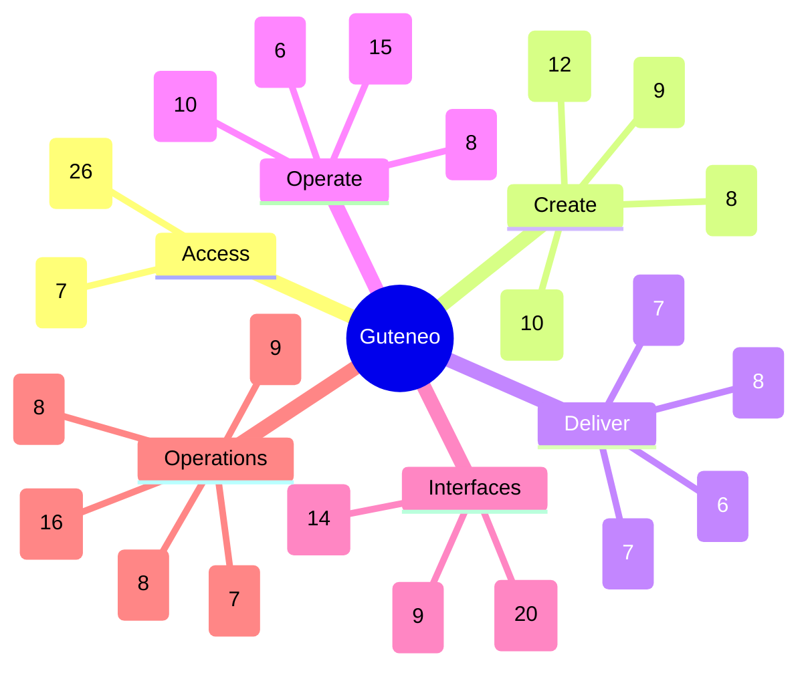

<!-- Generated from feature-map.json by node docs/build-feature-map.mjs -->
# Guteneo feature tree and developer atlas

**22 domains · 230 features · 26 journeys · 67 documented REST operations · 67 MCP tools**
Updated 2026-10-24.

Repository implementation inventory. Availability depends on current capabilities and authority; implementation, activation and deployed proof are distinct.

Start here to find a feature, its authority and its technical owner. Read [repository standards](REPOSITORY_STANDARDS.md) and the [documentation index](README.md) for shared conventions. The [offline visual atlas](FEATURE_MAP.html) provides search; [feature-map.json](feature-map.json) is the single editable source. Regenerate with `npm run docs:build`.

## Feature tree

### Access

- [Access and identity](#identity) — 26 features; browser-session.
- [Team and responsibilities](#team) — 7 features; browser-session.

### Create

- [Documents and protection](#documents) — 8 features; capability-gated.
- [Template studio](#templates) — 12 features; capability-gated.
- [Data and mappings](#datasets) — 9 features; capability-gated.
- [PDF generation and distribution](#generation) — 10 features; capability-gated.

### Deliver

- [Fax](#fax) — 6 features; capability-gated.
- [Postal mail](#postal) — 8 features; capability-gated.
- [Email and protected links](#email) — 7 features; capability-gated.
- [Dispatch dry run](#dry-run) — 7 features; read-only.

### Operate

- [Campaigns and tracking](#campaigns) — 8 features; capability-gated.
- [Credits and billing](#billing) — 6 features; partial.
- [Workspace appearance](#dashboard) — 15 features; browser-session.
- [Horizon PDF diagnostics](#horizon) — 10 features; capability-gated.

### Interfaces

- [Assistants and API](#assistants) — 20 features; host-qualified.
- [iPhone and iPad](#native) — 9 features; local-candidate.
- [Public pages and languages](#public) — 14 features; public.

### Operations

- [Reviewer OAuth qualification](#reviewer-oauth) — 9 features; operator-gated.
- [Operations and reliability](#operations) — 16 features; operator-gated.
- [Belvédère platform oversight](#belvedere) — 7 features; operator-gated.
- [Public service status](#status) — 8 features; public.
- [Engineering documentation](#engineering-docs) — 8 features; public.

## Availability and evidence

This inventory describes repository implementation. Check current account capabilities, authority and dated release/runtime evidence before treating a feature as available. Local tests, deterministic simulation, deployed assets, authenticated clients and real provider delivery are separate evidence.

An availability label describes the access/gating model, never an assertion of live activation. `partial` and `local-candidate` mark material qualification gaps. Read each detailed contract and the dated [release record](LIVE_RELEASE.md); no hard-coded historical release summary is duplicated here.

## Roles and permissions

Four human workshop roles are defined by packages/contracts/src/roles.ts. The assistant column describes a connected OAuth actor, never a fifth membership role. Effective membership, independent supervisor permissions, consented scopes and any bounded expert mandate are rechecked by the server. Installing a package or renewing tokens grants no additional authority. Browser-only account/platform controls remain distinct. Assistant content-exclusion instructions are workflow restrictions, not automatic classification or new server guards.

| Capability | Administrator | Supervisor | Operator | Observer | Connected assistant |
| --- | --- | --- | --- | --- | --- |
| Read accessible workshop content | Yes | Yes | Yes | Yes | Current member + consented scopes + document access |
| Import and prepare | Yes | Yes | Yes | No | Current member + scopes + qualified channel/transport |
| Human approval and confirmation | Yes | Approval option | No | No | Cannot assert human consent; standard confirmation requires recorded browser approval |
| Expert review and acceptance | Browser grants a bounded mandate | No mandate administration | No mandate administration | No | Pre-existing active client-bound mandate + current role/scopes + exact review + host confirmations |
| Cancel prepared/queued dispatch | Yes | Approval option | No | No | Current approval authority + scope; never retries an unknown submission |
| Aggregate reports | Yes | Reporting option | No | No | Current role + scopes |
| Manage workshop or members | Browser only | No | No | No | No |
| Billing or Horizon subscription | Browser only, explicit recurring consent | No | No | No | No |
| Run a Horizon diagnostic | Active plan + PDF access | Active plan + PDF access | Active plan + PDF access | No | Active plan + PDF access + documents:write |
| Read/export Horizon history | Current PDF access | Current PDF access | Current PDF access | Current PDF access | Current PDF access + documents:read |
| Edit a shared template | Resource edit right | Resource edit right | Resource edit right | No | Current member + template scope + resource right; AI also requires current transfer consent/revision |
| Publish/archive a template | Resource publish right | Resource publish right | Resource publish right | No | Current member + templates:publish + resource right |
| Manage template sharing | Resource share right | Resource share right | Resource share right | No | Current member + templates:share + resource right; revocation disclosed |
| Remove a template | Owner | Owner | Owner | No | Owner + current role/scopes |
| Cancel/retry a generation | Batch owner | Batch owner | Batch owner | No | Owner + generations:write; frozen batches cannot retry |
| Read private generated PDFs | Creator/context access | Creator/context access | Creator/context access | Explicit current document access | Owner/context authority; no general private-library access |
| Profile, language, own sessions and appearance | Own account in browser | Own account in browser | Own account in browser | Own account in browser | No browser account administration or appearance setter |
| Read responsible workshop contacts | Authenticated browser | Authenticated browser | Authenticated browser | Authenticated browser | No |
| Read public pages/errors/status | Public; no privilege acquired | Public; no privilege acquired | Public; no privilege acquired | Public; no privilege acquired | Public read only; no extra tool/authority |
| Configure Auth0/DNS/reviewer refresh | No authority from workshop role | No authority from workshop role | No authority from workshop role | No authority from workshop role | No business REST/MCP route; distinct authorised platform operator |
| Open global Belvédère | No authority from workshop role | No authority from workshop role | No authority from workshop role | No authority from workshop role | No; distinct verified browser Watchkeeper |
| Apply assistant content exclusions | No additional rights | No additional rights | No additional rights | No additional rights | Announce exclusions, stop known excluded content, request person-redacted copy; no automatic classification or web bypass |

Supervisor approval/reporting options are independent and off by default. Resource ownership/context checks still apply. See [workspace roles](WORKSPACE_ROLES.md), [expert approval](EXPERT_APPROVAL.md) and [studio access](TEMPLATES_DATA_DISTRIBUTION.md).

## Complete feature inventory

### Access and identity

**Availability model:** browser-session. Implemented browser identity; optional Auth0/DNS configuration and hosted qualification remain separately gated.

**Surfaces:** Authenticated browser; MCP resource OAuth discovery; native identity/session contracts. Optional custom domain affects browser sign-in only.

- Auth0 sign-in, verified accounts and explicit MFA policy
- Canonical browser sign-in/callback; retired hosts and preview URLs refuse authentication
- Workshop creation with its initial administrator
- Personal profile, interface language and saved Classic/V2 appearance
- Session listing, revocation and explicit logout
- Successful logout returns to the public home before Login remounts; failures stay visible and never claim a logout
- Workshop switching with current membership rights
- OAuth connection binding, revocation and consented scopes
- Exact resource-metadata discovery issuer, including its trailing slash; official MCP SDK contract tests without external network
- Account deletion request; complete erasure processing remains unqualified
- Visible signed-in name, login email and current role on desktop/mobile
- Explicit Auth0 account switching without disabling ordinary SSO
- Tab-focus reconciliation of identity, workshop and saved language
- One authenticated language control in the account; visitor choice stays separate
- Account Classic/V2 preference, migration 0053 and reconciliation after identity changes
- Late contact-directory errors provide accessible recovery without interrupting profile editing
- Path-scoped browser reads: hide previous resources, preserve same-path refresh and ignore cancelled late responses/401s
- Direct Auth0 entry from public links and unauthenticated private routes, preserving locale and exact destination
- Deep-link recovery from the valid transaction, excluding callback URLs and private parameters
- Prepared Auth0 brand assets and FR/EN/DE UI; Luxembourgish keeps its Guteneo locale with Auth0 fallback; language activation and publication need separate proof
- Restore explicit visitor language after the initial session check without overwriting current selection or account preference
- Recovery screen only after an error, with explicit retry and no automatic loop; native Auth0 signup, local demo and public fixture remain distinct
- Reread workshop capabilities for a browser session; anonymous reads support recovery and refresh the shared public offer/FAQ after returning home
- Optional auth.guteneo.com browser domain for the existing Auth0 tenant; MCP issuer/discovery/tokens remain canonical
- Additive migration 0054 binds authorisation issuer and identity namespace to PKCE; legacy NULL flows stay canonical and rollback never silently switches provider
- Verified dual-token subject binds to the canonical namespace without email linking or duplicate person/workshop/credits/authority; browser evidence and prepare_only restriction remain

**Contract:** [ACCOUNT_IDENTITY.md](ACCOUNT_IDENTITY.md) · **Implementation:** [apps/api/src/auth.ts](../apps/api/src/auth.ts)

**Tests:** [tests/unit/auth.test.ts](../tests/unit/auth.test.ts), [tests/unit/account.test.ts](../tests/unit/account.test.ts), [tests/e2e/account-identity.spec.ts](../tests/e2e/account-identity.spec.ts), [tests/e2e/resource-navigation.spec.ts](../tests/e2e/resource-navigation.spec.ts), [tests/unit/web-api-cancellation.test.ts](../tests/unit/web-api-cancellation.test.ts), [tests/e2e/login-entry.spec.ts](../tests/e2e/login-entry.spec.ts), [tests/security/auth0-branding.test.mjs](../tests/security/auth0-branding.test.mjs), [tests/e2e/horizon-pdf.spec.ts](../tests/e2e/horizon-pdf.spec.ts), [tests/e2e/dashboard.spec.ts](../tests/e2e/dashboard.spec.ts), [tests/e2e/locale-boundaries.spec.ts](../tests/e2e/locale-boundaries.spec.ts)

### Team and responsibilities

**Availability model:** browser-session. Implemented; invitations require separately configured delivery.

**Surfaces:** Authenticated browser; invitation emails are authored in English.

- Four human membership roles with independent supervisor approval/reporting options
- Member management, permission changes and atomic access revocation
- Last-administrator protection
- Individual/CSV invitations with batch preview and confirmation
- Verified-email acceptance, expiry and invitation revocation
- Bounded browser-only responsible contacts filtered by current workshop membership
- Login email distinguishes members with the same name; effective permissions stay readable

**Contract:** [WORKSPACE_ROLES.md](WORKSPACE_ROLES.md) · **Implementation:** [packages/contracts/src/roles.ts](../packages/contracts/src/roles.ts)

**Tests:** [tests/integration/workspace-roles.test.ts](../tests/integration/workspace-roles.test.ts), [tests/unit/account.test.ts](../tests/unit/account.test.ts), [tests/e2e/account-identity.spec.ts](../tests/e2e/account-identity.spec.ts)

### Documents and protection

**Availability model:** capability-gated. Implemented; exact-byte, scanner and owner-access gates apply.

**Surfaces:** Web, REST and MCP with current document authority; native import/inspection subset.

- Bounded PDF upload and remote import with English API diagnostics and only a sanitized public source hostname
- Search, paginated listing, metadata and page reading
- Quarantine, real antivirus, exact hash and PDF validation
- Resume analysis of the same document without reimport
- Browser-administrator scanner warm-up
- Isolated HTML-to-PDF rendering into an immutable document
- Private storage, quotas, retention and owner-level privacy
- Assistant exclusions announced before content collection/processing; known excluded content is not imported/read even when stored or ready; scanning never proves its absence

**Contract:** [SCANNER_RESCAN.md](SCANNER_RESCAN.md) · **Implementation:** [apps/api/src/documents.ts](../apps/api/src/documents.ts)

**Tests:** [tests/integration/documents.test.ts](../tests/integration/documents.test.ts), [tests/unit/mcp-integrations.test.ts](../tests/unit/mcp-integrations.test.ts)

**Documented REST operations**

- `GET /api/documents`
- `POST /api/documents`
- `POST /api/documents/render`
- `GET /api/documents/{id}/content`
- `POST /api/documents/{id}/rescan`
- `GET /api/documents/{id}`

**MCP tools**

- `get_document`
- `import_document`
- `list_documents`
- `read_document_pages`
- `render_pdf`
- `rescan_document`

### Template studio

**Availability model:** capability-gated. Implemented; AI suggestions require configuration and organisation consent.

**Surfaces:** Web, REST and MCP; optional configured AI proposal service.

- Private, shared and organisation template libraries
- Five synthetic examples: letter, invoice, statement, quote and delivery note
- Private copy or blank creation with the REST/MCP authoring guide
- Word DOCX content import with explicit layout warnings
- Designer variables, tables, columns, logos, formats and conditions
- Business schema, sample data, calculations and totals
- Review AI proposals before explicit application
- Exact PDF preview, immutable versions, publication, duplication and archival
- Independent use, edit, publish and share rights
- Owner-only removal preserving historical PDFs and provenance
- Document-studio exclusions cover DOCX, text, existing templates and business data; stop known excluded content and request a person-redacted copy without web bypass
- AI suggestions revalidate edit rights, membership, OAuth connection, revision and transfer consent before inference and before returning; reject stale proposals without automatic application/publication

**Contract:** [TEMPLATES_DATA_DISTRIBUTION.md](TEMPLATES_DATA_DISTRIBUTION.md) · **Implementation:** [apps/api/src/template-workflow.ts](../apps/api/src/template-workflow.ts)

**Tests:** [tests/unit/template-authoring.test.ts](../tests/unit/template-authoring.test.ts), [tests/unit/mcp-integrations.test.ts](../tests/unit/mcp-integrations.test.ts), [tests/integration/template-workflow.test.ts](../tests/integration/template-workflow.test.ts)

**Documented REST operations**

- `GET /api/templates/authoring-guide`
- `GET /api/templates/examples`
- `GET /api/templates/examples/{exampleId}`
- `GET /api/templates`
- `POST /api/templates`
- `POST /api/templates/import-docx`
- `GET /api/templates/{id}`
- `DELETE /api/templates/{id}`
- `PATCH /api/templates/{id}`
- `POST /api/templates/{id}/publish`
- `POST /api/templates/{id}/duplicate`
- `POST /api/templates/{id}/share`
- `GET /api/templates/{id}/sharing`
- `POST /api/templates/{id}/archive`
- `POST /api/templates/{id}/preview`
- `POST /api/templates/{id}/suggest`
- `GET /api/templates/{id}/schema`

**MCP tools**

- `archive_template`
- `create_template`
- `delete_template`
- `duplicate_template`
- `get_template`
- `get_template_authoring_guide`
- `get_template_example`
- `get_template_schema`
- `get_template_sharing`
- `import_docx_template`
- `list_template_examples`
- `list_templates`
- `preview_template`
- `publish_template`
- `share_template`
- `suggest_template`
- `update_template`

### Data and mappings

**Availability model:** capability-gated. Implemented; private-source and optional AI-transfer gates apply.

**Surfaces:** Web, REST and MCP; private source/mapping ownership.

- CSV, XLSX, XML and JSON imports with a private original
- Sheet/header selection and XML record paths
- English generated Data sheet names, with explicit legacy mapping aliases and exact uploaded-name precedence
- Profiling, anomalies and paginated inspection
- Resume analysis of the same original
- Versioned field/group/join mappings
- Mapping validation before generation
- Optional AI analysis under browser-administrator policy and transfer consent
- Document-studio exclusions also cover datasets, direct records and AI functions; stop reading/profiling/mapping/generation on known excluded content without collecting its values

**Contract:** [DATA_IMPORT.md](DATA_IMPORT.md) · **Implementation:** [apps/api/src/template-workflow.ts](../apps/api/src/template-workflow.ts)

**Tests:** [tests/unit/datasets.test.ts](../tests/unit/datasets.test.ts), [tests/unit/mcp-integrations.test.ts](../tests/unit/mcp-integrations.test.ts)

**Documented REST operations**

- `GET /api/datasets`
- `POST /api/datasets`
- `GET /api/datasets/{id}`
- `POST /api/datasets/{id}/retry-analysis`
- `GET /api/datasets/{id}/profile`
- `POST /api/datasets/{id}/analyze`
- `GET /api/mappings`
- `POST /api/mappings`
- `GET /api/mappings/{id}`
- `POST /api/mappings/{id}/validate`

**MCP tools**

- `analyze_dataset`
- `create_mapping`
- `get_dataset`
- `get_dataset_ai_policy`
- `get_mapping`
- `import_dataset`
- `import_json_dataset`
- `list_datasets`
- `list_mappings`
- `profile_dataset`
- `retry_dataset_analysis`
- `validate_mapping`

### PDF generation and distribution

**Availability model:** capability-gated. Implemented; generation, preparation, approval and delivery remain separate.

**Surfaces:** Web, REST and MCP; generation is separate from distribution and delivery.

- Single PDF from a business form
- PDF batch from a validated mapping
- Progress, per-record results and source-cell provenance
- Generation cancellation and retry of failed records only
- PDF selection and separate distribution-plan preparation
- The first plan permanently freezes the full batch, including excluded failed records; prepare_distribution declares destructiveHint true
- Common recipient or frozen columns with an explicit channel per record
- Resume remaining entries without duplication
- Entry-linked postal preflight with separate review and sending
- Known assistant-excluded content is never generated, previewed, shared or distributed; request a person-redacted version and never treat scanning as proof of absence

**Contract:** [TEMPLATES_DATA_DISTRIBUTION.md](TEMPLATES_DATA_DISTRIBUTION.md) · **Implementation:** [apps/api/src/template-workflow-routes.ts](../apps/api/src/template-workflow-routes.ts)

**Tests:** [tests/e2e/template-distribution.spec.ts](../tests/e2e/template-distribution.spec.ts), [tests/integration/template-workflow.test.ts](../tests/integration/template-workflow.test.ts), [tests/unit/mcp-annotation-audit.test.ts](../tests/unit/mcp-annotation-audit.test.ts), [tests/unit/mcp-integrations.test.ts](../tests/unit/mcp-integrations.test.ts)

**Documented REST operations**

- `GET /api/generation-jobs`
- `POST /api/generation-jobs`
- `GET /api/generation-jobs/{id}`
- `GET /api/generation-jobs/{id}/results`
- `GET /api/generation-jobs/{id}/provenance`
- `POST /api/generation-jobs/{id}/cancel`
- `POST /api/generation-jobs/{id}/retry`
- `POST /api/distribution-plans`
- `POST /api/distribution-plans/{id}/resume`
- `POST /api/distribution-plans/{id}/entries/{entryId}/postal-preflight`
- `GET /api/distribution-plans/{id}`

**MCP tools**

- `cancel_generation_job`
- `create_distribution_postal_preflight`
- `generate_documents`
- `get_distribution_plan`
- `get_generation_job`
- `get_generation_provenance`
- `get_generation_results`
- `list_generation_jobs`
- `prepare_distribution`
- `resume_distribution`
- `retry_generation_records`

### Fax

**Availability model:** capability-gated. Implemented; live tariff, sender, approval, credits and provider gates apply.

**Surfaces:** Web, REST, MCP and native preparation/tracking; browser or existing delegated approval.

- Exact PDF, recipient number and qualified sender
- Dated provider quote with bounded renewal
- Estimated range, approved ceiling and credit balance in euros
- Preparation, human review, approval and confirmation
- Tracking, receipts, usage settlement and unknown outcomes
- Unsendable reviewer mode stops before approval

**Contract:** [LIVE_FAX_QUOTES.md](LIVE_FAX_QUOTES.md) · **Implementation:** [packages/domain/src/index.ts](../packages/domain/src/index.ts)

**Tests:** [tests/e2e/fax-pricing.spec.ts](../tests/e2e/fax-pricing.spec.ts)

**Documented REST operations**

- `POST /api/dispatches/{id}/renew-quote`

**MCP tools**

- `prepare_fax`

### Postal mail

**Availability model:** capability-gated. Implemented; qualified profile, distinct transfer authority, quote and final approval are mandatory.

**Surfaces:** Web, REST and MCP with separate postal transfer authority.

- Sender, address, country and qualified provider requirements
- Left/right address window and explicitly requested address page
- Paper, colour, simplex/duplex and delivery-service options
- PDF preflight, address rendering and review
- Distinct authority for PDF transfer to obtain a quote
- Exact quote, expiry and final review
- Confirmation, calendar cutoffs and provider tracking
- Status projection and reconciliation of unknown outcomes

**Contract:** [MCP_POSTAL_JOURNEY.md](MCP_POSTAL_JOURNEY.md) · **Implementation:** [apps/api/src/postal.ts](../apps/api/src/postal.ts)

**Tests:** [tests/e2e/postal-final-send.spec.ts](../tests/e2e/postal-final-send.spec.ts)

**Documented REST operations**

- `GET /api/senders`
- `POST /api/postal/preflights`
- `GET /api/postal/preflights/{id}`
- `GET /api/postal/preflights/{id}/address.png`
- `POST /api/postal/preflights/{id}/quote`
- `GET /api/postal/requirements`
- `POST /api/postal/address-pages`

**MCP tools**

- `configure_postal_sender`
- `create_postal_address_page`
- `get_postal_preflight`
- `get_postal_requirements`
- `get_postal_setup`
- `preflight_postal_pdf`
- `quote_postal_draft`
- `transfer_postal_draft`

### Email and protected links

**Availability model:** capability-gated. Implemented; provider activation, recipient attestation and browser-only password access apply.

**Surfaces:** Web, REST, MCP and native preparation/tracking; protected password is browser-only.

- Text/HTML email without a file, with a PDF attachment or with a protected link
- Recipient-request attestation and transactional requirements
- Explicit quote and per-document hosting charge
- Private link, expiry and browser-only password entry
- Download without a recipient account under access controls
- Preparation, approval, tracking and provider policy
- Resend/SES availability is gated; provider activation is separate

**Contract:** [PROTECTED_EMAIL.md](PROTECTED_EMAIL.md) · **Implementation:** [apps/api/src/protected-documents.ts](../apps/api/src/protected-documents.ts)

**Tests:** [tests/integration/protected-documents.test.ts](../tests/integration/protected-documents.test.ts)

### Dispatch dry run

**Availability model:** read-only. Implemented partial validation; neither acceptance nor delivery is executed.

**Surfaces:** REST GET and MCP, plus bounded operator runner; current read authority only.

- Validate an existing dispatch within authenticated-workshop and current document authority
- Read preparation guards, absence of attempts, quote validity and channel restrictions
- Partial/blocked result; acceptance and delivery are never executed and simulation stays separate
- Create, renew and consume no quote; preserve expiry; no approval, reservation, outbox or provider attempt
- REST GET/MCP automation with dispatches:read grants no preparation or approval authority
- Business read-only semantics remain distinct from HTTP counters and persisted MCP connection activity
- The test:prod:dry-run runner reads 1–10 existing dispatches sequentially on the canonical origin using an injected read token and emits recent redacted partial evidence

**Contract:** [PRODUCTION_DRY_RUN.md](PRODUCTION_DRY_RUN.md) · **Implementation:** [packages/domain/src/index.ts](../packages/domain/src/index.ts)

**Tests:** [tests/integration/dispatch-validation.test.ts](../tests/integration/dispatch-validation.test.ts), [tests/unit/mcp-dispatch-validation.test.ts](../tests/unit/mcp-dispatch-validation.test.ts), [tests/unit/production-dry-run.test.ts](../tests/unit/production-dry-run.test.ts)

**Documented REST operations**

- `GET /api/dispatches/{id}/dry-run`

**MCP tools**

- `dry_run_dispatch`

### Campaigns and tracking

**Availability model:** capability-gated. Implemented; role, exact-document and channel gates apply.

**Surfaces:** Web, REST and MCP; reporting and approval rights are independently checked.

- Named campaign with CSV recipients
- Row validation, errors and duplicate detection
- Prepare individual dispatches with the selected document
- Dispatch list/detail with prices and statuses
- Aggregate reporting and usage according to current rights
- Eligible cancellation and review of uncertain operations
- Channel/ceiling administration without blind retries
- Path-scoped browser refresh prevents stale resources or cancelled 401s from replacing a newer session

**Contract:** [API_CONTRACT.md](API_CONTRACT.md) · **Implementation:** [apps/api/src/index.ts](../apps/api/src/index.ts)

**Tests:** [tests/integration/domain-invariants.test.ts](../tests/integration/domain-invariants.test.ts), [tests/e2e/resource-navigation.spec.ts](../tests/e2e/resource-navigation.spec.ts), [tests/unit/web-api-cancellation.test.ts](../tests/unit/web-api-cancellation.test.ts)

**Documented REST operations**

- `GET /api/dispatches`
- `POST /api/dispatches`
- `GET /api/dispatches/{id}`
- `POST /api/dispatches/{id}/confirm`
- `POST /api/dispatches/{id}/cancel`
- `GET /api/campaigns`
- `POST /api/campaigns`
- `GET /api/campaigns/{id}`
- `POST /api/recipients/validate`

**MCP tools**

- `approve_and_send_dispatch`
- `cancel_dispatch`
- `confirm_dispatch`
- `get_dispatch_status`
- `list_dispatches`
- `prepare_dispatch`
- `review_dispatch`

### Credits and billing

**Availability model:** partial. Credits and ledger implemented; commercial top-up remains unqualified.

**Surfaces:** Browser administration; shared backend ledger. No assistant billing administration.

- One-time shared welcome balance in euros
- Available, reserved and consumed balances; top-up remains unqualified
- Atomic reservation with acceptance and outbox insertion
- Provider settlement and retained reserves for unknown outcomes
- Administrator credit/billing inspection
- Prepared Stripe integration with separate commercial qualification

**Contract:** [WELCOME_CREDIT.md](WELCOME_CREDIT.md) · **Implementation:** [apps/api/src/billing.ts](../apps/api/src/billing.ts)

**Tests:** [tests/unit/billing.test.ts](../tests/unit/billing.test.ts)

**Documented REST operations**

- `GET /api/usage`

### Assistants and API

**Availability model:** host-qualified. Implemented contracts/packages; actual host compatibility, OAuth and marketplace publication need separate evidence.

**Surfaces:** Web guides, REST/OpenAPI, MCP and host-specific installation packages.

- Discover actual account capabilities and limits
- REST/OpenAPI and Streamable HTTP MCP catalogues
- ChatGPT, Claude web/Desktop/Code, Grok web/Build, Cursor and Copilot installation guides; OAuth qualification is per surface
- Import through the file transport actually supported by the host
- Document, template, dataset, generation and preparation tools
- Browser review before sending; scopes never elevate membership rights
- Optional bounded expert delegation for one OAuth client
- Complete review replaces the previous token for this dispatch/connection; review_dispatch declares destructiveHint true
- Only a browser administrator grants/revokes a mandate
- Six portable package workflows with English metadata, deterministic archives and inventory checks; portal review/publication remains separately evidenced
- Manual host-specific installation packages; downloading grants no OAuth consent
- Exact registered callback/client per host; DCR/CIMD advertising alone never proves installation
- Explicit MCP annotations disclose overwrites, archival, sharing revocation, generation cancellation, review-token replacement and batch freezing
- Every advertised tool has four annotation booleans and per-tool evidence, audited through actual tools/list
- readOnlyHint/idempotentHint remain false where successful production calls persist visible connection activity; the side effect is disclosed centrally
- Assistant restrictions cover files, text, templates, datasets, records, existing PDFs/reports; person-redacted recovery adds no automatic classification or new server guard
- Single source version synchronises application, serverInfo and release/package manifests; builds reject version/connection drift
- MCP bodies limited to 2 MiB and 120,000 elements; existing 100,000-cell business limit remains
- Reproducible standalone Claude Code and relative-source local marketplace archives; six workflows without OpenAI metadata or tool preauthorisation
- Developer guidance distinguishes canonical REST/MCP resource/issuer from optional browser Auth0 domain

**Contract:** [V1_RELEASE_CANDIDATE.md](V1_RELEASE_CANDIDATE.md) · **Implementation:** [apps/api/src/mcp.ts](../apps/api/src/mcp.ts)

**Tests:** [tests/unit/mcp-integrations.test.ts](../tests/unit/mcp-integrations.test.ts), [tests/unit/mcp-annotation-audit.test.ts](../tests/unit/mcp-annotation-audit.test.ts), [tests/integration/expert-approval.test.ts](../tests/integration/expert-approval.test.ts), [tests/unit/auth.test.ts](../tests/unit/auth.test.ts), [tests/integration/template-workflow.test.ts](../tests/integration/template-workflow.test.ts), [tests/unit/pdf-validation.test.ts](../tests/unit/pdf-validation.test.ts), [tests/security/integration-package.test.mjs](../tests/security/integration-package.test.mjs), [tests/security/claude-plugin.test.mjs](../tests/security/claude-plugin.test.mjs)

**Documented REST operations**

- `GET /api/capabilities`

**MCP tools**

- `get_capabilities`
- `get_expert_status`

### Reviewer OAuth qualification

**Availability model:** operator-gated. Operator tooling implemented; applying Auth0 changes requires explicit authority and a reviewed fingerprint.

**Surfaces:** Authorised operator CLI; GET inspection by default, explicit fingerprint-bound apply.

- Read-only inspection of the exact existing OpenAI reviewer client, historical callback, owner, scopes, API, connections and both Actions’ draft/deployed versions
- Redacted state/change plan and fingerprint without tokens, client secrets or private content
- Apply only after explicit authority with --apply --expect and reviewed fingerprint; provision no client/account
- Deploy both exact Actions before API offline_access and reviewer refresh grant, preserving ownClients, unrelated clients, bindings and consent
- Bounded rotating refresh: 30-day idle, 90-day absolute, 3-second leeway; API access token at most 3,600 seconds
- Stop on drift before each write, collision, another renewable Guteneo client or unknown Action; no automatic write retry
- For partial state, inspect again, review a fresh fingerprint and apply only remaining steps; unknown provider outcomes never trigger blind recovery
- prepare-chatgpt-reviewer --qualify-client --expect-renewal checks the complete exact state with GET only; never auto-provisions or completes partial migration
- Real reconnection, refresh and revocation need separate qualification; prepare_only, sending configuration, approval and mandates remain unchanged

**Contract:** [LLM_SETUP.md](LLM_SETUP.md) · **Implementation:** [scripts/enable-openai-review-renewal.mjs](../scripts/enable-openai-review-renewal.mjs)

**Tests:** [tests/security/openai-review-renewal.test.mjs](../tests/security/openai-review-renewal.test.mjs), [tests/security/chatgpt-reviewer-setup.test.mjs](../tests/security/chatgpt-reviewer-setup.test.mjs), [tests/security/claude-renewal.test.mjs](../tests/security/claude-renewal.test.mjs)

### iPhone and iPad

**Availability model:** local-candidate. Native candidate; physical-device, signing and distribution qualification remain separate.

**Surfaces:** Native SwiftUI client and versioned mobile API; authenticated browser for final approval.

- System authentication with dedicated mobile sessions
- Adaptive iPhone/iPad navigation and accessibility; English source keys with 261 preserved four-language native translations
- Profile, language and account-deletion request
- PDF import, inspection and search
- Fax/email preparation and tracking
- Final review in an authenticated browser; native sessions cannot grant consent
- Signing, physical-device, TestFlight and App Store qualification remain separate
- Read preferredDashboardAppearance in account/session without a native setting/PATCH
- Swift opens canonical /auth/mobile/authorize; the server selects the configured browser domain and preserves mobile PKCE return, distinct from the native callback

**Contract:** [IOS_API.md](IOS_API.md) · **Implementation:** [apps/api/src/mobile.ts](../apps/api/src/mobile.ts)

**Tests:** [tests/e2e/mobile-account.spec.ts](../tests/e2e/mobile-account.spec.ts), [tests/integration/mobile.test.ts](../tests/integration/mobile.test.ts)

### Public pages and languages

**Availability model:** public. Public UI/localised content implemented; current candidate changes are local until released.

**Surfaces:** Public browser/static documents and four-language frontend/video catalogues; preview has no business bindings.

- Product presentation, feature/role explanations and assistant guides
- Four-language assistant hub and manual installation guides; OAuth, workflows and publication have separate qualification
- Package download and version/SHA-256 manifest; compare published and local candidate versions; download grants no consent
- Journal, articles, legal notices and privacy
- French, English, German and Luxembourgish frontend/video localisation
- Separate saved personal preference and anonymous visitor choice
- Twelve localised films, posters, captions and actual durations
- Static pages, canonical URLs, sitemap and language alternatives
- Fictional public preview isolated from the backend
- Multilingual social cards and reader sharing controls
- Public error documents retain real HTTP status with 17 dedicated four-language messages and 4xx/5xx fallback; only eligible public failures, no status-selector/demo endpoint
- Original responsive navigation/access/service artwork, retained masters/provenance and accessible text independent of bitmap
- Shared public header/footer/legal navigation; English canonical paths and anchors with explicit legacy path and public-hash aliases
- English source copy with context-aware translations; shared app primitives and one authoritative documentation/feature tree

**Contract:** [MULTILINGUAL.md](MULTILINGUAL.md) · **Implementation:** [packages/contracts/src/public-site.json](../packages/contracts/src/public-site.json)

**Tests:** [tests/e2e/locale-boundaries.spec.ts](../tests/e2e/locale-boundaries.spec.ts), [tests/preview-e2e/language-navigation.spec.ts](../tests/preview-e2e/language-navigation.spec.ts), [tests/preview-e2e/assistant-hub.spec.ts](../tests/preview-e2e/assistant-hub.spec.ts), [tests/unit/public-assets.test.ts](../tests/unit/public-assets.test.ts), [tests/security/public-assets.test.mjs](../tests/security/public-assets.test.mjs), [tests/unit/public-http-error.test.ts](../tests/unit/public-http-error.test.ts)

### Workspace appearance

**Availability model:** browser-session. Implemented Classic/V2 personal appearance without new business authority.

**Surfaces:** Authenticated web Classic/V2; native reads preference without a setter; no new business API/MCP authority.

- Full real-web Classic/V2 views with the same account, tenant, resources and operations
- Account at navigation bottom, appearance beside language, applied after a successful profile save; mobile identity/role remain visible with the menu closed
- Personal users.preferred_dashboard_appearance, migration 0053, classic default and cross-workshop/session/device reconciliation
- Strict browser account PATCH with current authority, Origin/CSRF and field-name audit; every role changes only its own preference
- Temporary appearance=v2/classic override accepts legacy atelier URLs, never persists server-side and clears after explicit appearance save or identity change; local cache is non-authoritative
- Existing activity/alerts precede introduction, otherwise a complete welcome; content preview precedes approval in reading/tab order
- Stable PDF review frame across loading/render/error, keyboard-accessible internal scrolling and unchanged consent/data authority
- Consistent documents, preparation, review, tracking, assistants, account, studio, Horizon, credits, tables and forms; Belvédère remains a distinct platform surface
- One brand signature, workshop in navigation and no redundant V2 footer; service status near account and browser timezone near dates
- One page title, contextual detail back link and task-specific primary action; global New dispatch stays secondary and permission-aware
- Generation introduction focuses on finding PDFs and makes clear that generation sends nothing
- Official portrait/wordmark, approved engravings and blue swallows used sparingly on home, empty documents and assistants
- Four-language labels; simulation notices only for simulated sessions
- Same four roles, supervisor options, private access and consents; no new mandate, channel or business API/MCP tool
- Native account/session reads include appearance without a setter; existing name/language browser PATCH and native language PATCH remain compatible

**Contract:** [DASHBOARD_V2.md](DASHBOARD_V2.md) · **Implementation:** [apps/web/src/account-page.tsx](../apps/web/src/account-page.tsx)

**Tests:** [tests/unit/account.test.ts](../tests/unit/account.test.ts), [tests/integration/mobile.test.ts](../tests/integration/mobile.test.ts), [tests/unit/dashboard-appearance.test.ts](../tests/unit/dashboard-appearance.test.ts), [tests/preview-e2e/dashboard-v2.spec.ts](../tests/preview-e2e/dashboard-v2.spec.ts), [tests/e2e/dashboard-v2.spec.ts](../tests/e2e/dashboard-v2.spec.ts), [tests/e2e/protected-email.spec.ts](../tests/e2e/protected-email.spec.ts)

### Horizon PDF diagnostics

**Availability model:** capability-gated. Implemented diagnostics/subscription contracts; runtime capability, private validator and scanner gates apply.

**Surfaces:** Web, REST and MCP diagnostics; browser administrator alone manages recurring subscription.

- EUR30 monthly subscription from available credits, including remaining welcome credits for the first period; private /app/plan entry
- Immutable recurring consent by a browser administrator
- Cancellation, renewal and suspension without debt; top-up remains unavailable
- 100 attempts per calendar month under atomic quota
- Pinned private veraPDF for PDF/UA-1/-2 and PDF/A-1b/2b/3b/4, with official positive/negative corpus and separate offline/hosted qualification
- Exact-byte reports, history and JSON export
- Web/MCP diagnostics with required human review; same-key recovery for uncertain network responses and new-key independent checks
- Public/server availability share HORIZON_ENABLED, private validator and production scanner gates; activation after hosted qualification, never legal certification
- PDF-accessibility exclusions apply to originals and existing reports; person-redacted recovery without web bypass
- Home → signed-in workspace → home preserves private capability reads and performs one fresh public read after failure, without writes or stale availability inference

**Contract:** [PDF_ACCESSIBILITY.md](PDF_ACCESSIBILITY.md) · **Implementation:** [apps/api/src/pdf-validation.ts](../apps/api/src/pdf-validation.ts)

**Tests:** [tests/unit/monthly-plan.test.ts](../tests/unit/monthly-plan.test.ts), [tests/e2e/horizon-pdf.spec.ts](../tests/e2e/horizon-pdf.spec.ts), [tests/unit/pdf-validation.test.ts](../tests/unit/pdf-validation.test.ts), [tests/preview-e2e/geo.spec.ts](../tests/preview-e2e/geo.spec.ts), [tests/preview-e2e/seo.spec.ts](../tests/preview-e2e/seo.spec.ts), [tests/unit/live-capabilities.test.ts](../tests/unit/live-capabilities.test.ts), [apps/pdf-validator/tests/qualification.test.mjs](../apps/pdf-validator/tests/qualification.test.mjs), [apps/pdf-validator/tests/container-lifecycle.test.mjs](../apps/pdf-validator/tests/container-lifecycle.test.mjs), [apps/pdf-validator/tests/worker.test.mjs](../apps/pdf-validator/tests/worker.test.mjs), [apps/pdf-validator/tests/test_server.py](../apps/pdf-validator/tests/test_server.py), [tests/unit/mcp-integrations.test.ts](../tests/unit/mcp-integrations.test.ts)

**Documented REST operations**

- `GET /api/documents/{id}/validation`
- `POST /api/documents/{id}/validation`

**MCP tools**

- `get_pdf_validation`
- `validate_pdf`

### Operations and reliability

**Availability model:** operator-gated. Implemented operational tooling; changes require explicit authority and exact-source proof.

**Surfaces:** Authorised operator/CI tooling and private services; anonymous monitoring has no workshop authority.

- Interactive/bulk queues, transactional outbox and idempotence
- Authenticated provider callbacks and logs without sensitive content
- Private read-only Telnyx operator inspection reports bounded callback status/canonical-match booleans without raw URLs or credential extraction; fresh provider state requires separate proof
- Reconciliation, bounded recovery and dead-letter queues
- Ordered D1 migrations, integrity and restore bookmark
- Private scanner, renderer and validator releases from clean main; loopback qualification bridge with temporary secret, Origin refusal and no secret transfer; validator operators check Horizon closed on canonical guteneo.com only
- Backend/security/browser suites and exhaustive CI; basic validator max 1, 5-second idle, qualified JVM corpus to 100 pages/9.887 MiB; measured local CPU savings do not prove hosted cost
- Release from clean, synchronized, verified main
- Release manifests, asset hashes and canonical remote health; retired workers.dev/preview closure has separate evidence
- Local production monitor uses bounded anonymous canonical reads and retired-host refusal checks, page hashes, private-access refusal and 120-second staleness; partial feature proof, no sends or permanent task
- Idempotent cursor-wrap purge with tenant-bound tombstones/success audit and R2/audit failure recovery without recounting completed purges
- Targeted CI checkout preserves suites and published media; excludes immutable work archives and prefers official Ubuntu mirrors without dropping tests
- Explicitly authorised daily antivirus maintenance and six-hour exact hosted-health/signature/token watchdog; visible failure without customer scans/sends; GitHub outage requires independent monitoring
- One source version with release comparison; dependency updates qualified by audit/tests/exact build without paid configuration
- Dated high/critical registry advisory gate via audit:dependencies does not guarantee unknown-defect absence
- Repository standards and automated checks require English authored sources, valid English routes and synchronized feature/developer documentation

**Contract:** [PRODUCTION_REVIEW_2026_10_09.md](PRODUCTION_REVIEW_2026_10_09.md) · **Implementation:** [scripts/deploy-public.mjs](../scripts/deploy-public.mjs)

**Tests:** [tests/security/main-only-release.test.mjs](../tests/security/main-only-release.test.mjs), [tests/security/pdf-validator-release.test.mjs](../tests/security/pdf-validator-release.test.mjs), [apps/pdf-validator/tests/probe-credentials.test.mjs](../apps/pdf-validator/tests/probe-credentials.test.mjs), [tests/security/production-monitor.test.mjs](../tests/security/production-monitor.test.mjs), [tests/security/observability.test.mjs](../tests/security/observability.test.mjs), [tests/integration/documents.test.ts](../tests/integration/documents.test.ts), [tests/unit/telnyx-readiness.test.ts](../tests/unit/telnyx-readiness.test.ts), [apps/scanner/tests/maintenance-status.test.mjs](../apps/scanner/tests/maintenance-status.test.mjs), [apps/scanner/tests/qualification-artifact.test.mjs](../apps/scanner/tests/qualification-artifact.test.mjs), [tests/security/verify-release.test.mjs](../tests/security/verify-release.test.mjs)

**Documented REST operations**

- `GET /api/health`

### Belvédère platform oversight

**Availability model:** operator-gated. Private platform authority, separate from workshop roles; hosted activation is separately qualified.

**Surfaces:** Private verified Watchkeeper browser only; no workshop/native/OAuth/MCP authority.

- Private read-only Watchkeeper authority bound to verified browser identity and server-secret address, separate from workshop roles
- Seven views: overview, workshops, members, dispatches, connections, finances and infrastructure
- Optional country observations with bounded deduplication, new sessions after workshop changes and 90-day retention
- Distinct promotional credits, dispatch/hosting/Horizon usage, actual receipts and supplier costs
- Server-side Cloudflare connectors with explicit availability; never invent cost or profit
- Additive migration 0052 and deterministic loopback-only preview; hosted activation is separate
- Account-selected four-language UI on direct entry and tab focus; no additional private language selector

**Contract:** [BELVEDERE.md](BELVEDERE.md) · **Implementation:** [apps/api/src/belvedere.ts](../apps/api/src/belvedere.ts)

**Tests:** [tests/unit/belvedere.test.ts](../tests/unit/belvedere.test.ts), [tests/unit/auth-telemetry.test.ts](../tests/unit/auth-telemetry.test.ts), [tests/belvedere-e2e/control-tower.spec.ts](../tests/belvedere-e2e/control-tower.spec.ts), [tests/unit/belvedere-finance.test.ts](../tests/unit/belvedere-finance.test.ts), [tests/belvedere-e2e/locale.spec.ts](../tests/belvedere-e2e/locale.spec.ts), [tests/unit/belvedere-locale.test.ts](../tests/unit/belvedere-locale.test.ts)

### Public service status

**Availability model:** public. Independent public observations; HTTP success is not provider-delivery evidence.

**Surfaces:** Independent public browser and anonymous read-only /api/status and /api/history; no business authority.

- Independent status.guteneo.com service with fourteen bounded anonymous canonical checks every fifteen minutes and no business bindings/secrets
- D1 7/30/365-day history separates observed success and slot coverage; daily aggregates, unknown missing days and no reconstructed past
- Public summary covers only recent checks; mismatches stay visible and missing/invalid/unavailable/stale (>30 minutes) measurements make current state unknown; public reads never collect probes
- Service view shows freshness/groups/history; Checks separates detailed observations, local proof and journey coverage; Operations states limits/actions, without customer data or command IDs
- Local qualification separately tests the real domain/PDFs with external network denied and final providers simulated; timestamped redacted evidence never becomes delivery proof or a production incident
- Branded footer and bounded seasonal decoration, optional and respecting reduced motion
- English authored status copy with English/French browser selection and a shared locale catalog; historical French feature labels remain accepted alongside canonical English reports
- Dedicated release from clean main with source checks, manifest and status-only D1 migrations

**Contract:** [STATUS_SERVICE.md](STATUS_SERVICE.md) · **Implementation:** [apps/status/worker.ts](../apps/status/worker.ts)

**Tests:** [tests/integration/status-service.test.ts](../tests/integration/status-service.test.ts), [tests/security/status-release.test.mjs](../tests/security/status-release.test.mjs), [tests/security/test-offline.test.mjs](../tests/security/test-offline.test.mjs), [tests/status-e2e/status.spec.ts](../tests/status-e2e/status.spec.ts)

### Engineering documentation

**Availability model:** public. Implemented documentation candidate; production publication requires an explicitly authorized, independently verified release.

**Surfaces:** Public static engineering documentation; no business API or authentication surface.

- Dedicated engineering.guteneo.com reading surface built with Cloudflare Nimbus; customer documentation retains docs.guteneo.com
- Curated English architecture, workflow and integration guides with local search, Markdown copies and assistant-readable indexes
- Single-source feature tree with role permissions and customer journeys; feature changes update the registry and developer guide together
- Brand-colored Mermaid and isometric architecture diagrams with textual equivalents and explicit external provider boundaries
- Approved Gutenberg character identity, restrained printshop details and reduced-motion support; transparent header branding with ink-black lettering in light mode and explicitly approved ivory lettering in dark mode
- Asset-only publication without application, tenant, document or communication bindings; local validation and hosted proof remain separate
- Discoverable architecture diagram gallery with three brand-colored Mermaid flows, source downloads and accessible textual explanations
- Curated Belvédère administration, data-model, release and troubleshooting guides that preserve authority, evidence and recovery boundaries

**Contract:** [ENGINEERING_SITE.md](ENGINEERING_SITE.md) · **Implementation:** [apps/engineering/astro.config.ts](../apps/engineering/astro.config.ts)

**Tests:** [tests/security/engineering-site.test.mjs](../tests/security/engineering-site.test.mjs), [tests/engineering-e2e/site.spec.ts](../tests/engineering-e2e/site.spec.ts)

## Customer journeys and recovery

### J01 · Discover and sign in

**Actor:** Visitor → verified member. **Branch:** Access.

Open the public site → select a visitor language → read the offer/assistant guide → enter canonical Auth0 sign-in → create/join a workshop → verify identity and current rights. Return to the exact valid destination. Explicit logout opens the public home.

**Failure/recovery:** Refuse invalid callback state, unknown issuer/subject or expired invitation. Recovery retries are explicit. Package download, optional Auth0 branding/domain and actual host sign-in each need separate proof.

[Detailed contract](ACCOUNT_IDENTITY.md).

### J02 · Administer a team

**Actor:** Browser administrator. **Branch:** Access.

Open members → invite individually or preview CSV → select role and supervisor options → confirm → track invitations → change/revoke rights. Members without management use workshop contacts.

**Failure/recovery:** Protect the last administrator. Rights changes revoke access/pending approvals. Directory errors announce manual recovery without stealing focus or losing profile input.

[Detailed contract](WORKSPACE_ROLES.md).

### J03 · Prepare a fax

**Actor:** Administrator, supervisor or operator; current approver for acceptance. **Branch:** Deliver.

Import/reuse the exact ready PDF → collect E.164 recipient/sender/ceiling → obtain the actual quote → show estimate and separate ceiling → human browser approval or existing expert review → confirm → track delivery and usage settlement separately.

**Failure/recovery:** Keep reviewer quotes unsendable. Renew only an eligible prepared unattempted quote with exact original parameters and stable key, then obtain fresh approval. Unknown submissions require reconciliation, never resend.

[Detailed contract](LIVE_FAX_QUOTES.md).

### J04 · Prepare and send postal mail

**Actor:** Preparer → current approver. **Branch:** Deliver.

Read postal setup/requirements → collect missing sender/recipient/options → optionally create an address page from the original → read the final PDF → preflight → separately authorise transfer → obtain the exact provider quote → final approval/send → track.

**Failure/recovery:** Respect address window/profile and scan gates. A failed/unknown transfer cannot be reset with another key. A prepared provider draft is not a sent letter; ordinary post has no invented proof of receipt.

[Detailed contract](POSTAL_STREAMLINED.md).

### J05 · Prepare an email

**Actor:** Preparer → current approver. **Branch:** Deliver.

Collect recipient, requested message and ceiling → choose no file, ready PDF attachment or protected link → obtain the quote → review final content/options → record recipient-request attestation and browser/existing delegated approval → confirm → track.

**Failure/recovery:** Never infer recipient consent. Protected passwords stay in the sender browser and are shared separately. Provider acceptance/delivery/PDF reading are different facts; unknown outcomes require reconciliation.

[Detailed contract](PROTECTED_EMAIL.md).

### J06 · Create a reusable template

**Actor:** Preparer with current resource rights. **Branch:** Create.

Read authoring guide or a synthetic example → create/private-copy or import DOCX content → edit schema/layout → inspect warnings/exact PDF preview → review optional AI proposal → publish an immutable version → configure independent sharing rights.

**Failure/recovery:** DOCX is content import, not faithful Word layout reproduction. expectedRevision fences concurrent edits. AI requires configured consent and current authority before transfer/return; stale proposals do not apply. Known assistant-excluded content stops processing.

[Detailed contract](TEMPLATES_DATA_DISTRIBUTION.md).

### J07 · Turn data into PDFs

**Actor:** Preparer owning the private source. **Branch:** Create.

Import CSV/XLSX/XML/JSON → verify/profile the exact original → select sheet/header/record path → define deterministic versioned mappings → validate every row → select published template → generate → inspect results and provenance.

**Failure/recovery:** Resume the same original after transient analysis failure. Resolve mapping/type/join issues explicitly. AI is optional and separately consented; generation creates no dispatch or credit reservation.

[Detailed contract](TEMPLATES_DATA_DISTRIBUTION.md).

### J08 · Distribute a PDF batch

**Actor:** Preparer → current approver. **Branch:** Deliver.

Choose generated PDFs and frozen channel/recipient data → disclose that the first distribution plan permanently freezes the entire batch → prepare the manifest → resume remaining entries → complete linked postal preflight where needed → review/approve each exact dispatch.

**Failure/recovery:** A frozen batch cannot retry even excluded failed records; create a new generation batch when needed. Multiple channels require explicitMultichannel. No manifest operation implies consent, transfer or sending.

[Detailed contract](TEMPLATES_DATA_DISTRIBUTION.md).

### J09 · Supervise or observe work

**Actor:** Authorised supervisor or observer. **Branch:** Operate.

Read accessible documents/dispatches → inspect tracking → use aggregate reports only with the independent reporting right → review attention items before further action.

**Failure/recovery:** Preparation, approval and reporting are independent permissions. Observers stay read-only. Private originals/generated PDFs retain owner/context checks, regardless of workshop read access.

[Detailed contract](WORKSPACE_ROLES.md).

### J10 · Work with an assistant

**Actor:** Existing Guteneo member and a host-supported OAuth client. **Branch:** Interfaces.

Choose the host-specific installation guide → compare package version/hash → consent OAuth under actual host rules → read capabilities/current mandate → use only available file transport/tools → prepare → review through browser or pre-existing bounded delegation → track.

**Failure/recovery:** Host installation, token refresh and scopes grant no extra role or mandate. Announce excluded-content rules before collection and stop known excluded content. Respect host confirmations and no automatic unknown-outcome retries.

[Detailed contract](LLM_SETUP.md).

### J11 · Use iPhone or iPad

**Actor:** Member using the native candidate. **Branch:** Interfaces.

Start system authentication on the canonical backend → use dedicated mobile session → import/inspect/search PDFs → prepare fax/email → open authenticated browser for final review → read tracking.

**Failure/recovery:** Native sessions cannot approve or send. Account erasure processing, physical-device sign-in, signing, TestFlight and App Store distribution require separate qualification.

[Detailed contract](IOS_API.md).

### J12 · Manage credits

**Actor:** Browser administrator. **Branch:** Operate.

Read welcome/available/reserved/consumed balances → inspect usage/billing → reserve the exact approved ceiling atomically with acceptance/outbox → settle using qualified provider evidence.

**Failure/recovery:** Welcome credit is one-time, not monthly. Top-up is not commercially qualified. Unknown outcomes retain reserves; fax delivery alone does not settle verified usage.

[Detailed contract](WELCOME_CREDIT.md).

### J13 · Diagnose a PDF with Horizon

**Actor:** Browser administrator for subscription; authorised preparer/assistant for checks; current PDF reader for history. **Branch:** Operate.

Read current capabilities → administrator reviews EUR30 recurring-credit subscription → use ready original with selected PDF/UA or PDF/A flavour → consume atomic calendar-month quota → inspect exact-byte report/history/JSON → complete human review.

**Failure/recovery:** Require active entitlement, current PDF authority, scanner/private validator and quota. Automatic checks are not certification. Reuse the key to recover an uncertain request; a new independent check uses a new key.

[Detailed contract](PDF_ACCESSIBILITY.md).

### J14 · Receive a protected PDF

**Actor:** External recipient. **Branch:** Deliver.

Open the private link → enter the separately supplied password → download the unchanged PDF while access remains valid; no recipient account required.

**Failure/recovery:** Expiry, revocation, invalid credentials or unavailable storage refuse access. Never reveal passwords through assistant tools/chat or infer PDF reading from email delivery.

[Detailed contract](PROTECTED_DOCUMENTS.md).

### J15 · Release a change

**Actor:** Developer and explicitly authorised release operator. **Branch:** Operations.

Update feature tree/developer contracts/source/tests together → regenerate and check atlas → run exact-source checks → review → obtain explicit merge/release authority → publish from clean synchronized main → verify public manifest/assets and separately qualify authenticated/runtime behavior.

**Failure/recovery:** Dirty source, drift, failing checks, missing configuration/scan or absent authority blocks release. CI, local fixtures, production HTTP and real provider/client proof remain distinct.

[Detailed contract](MAIN_RELEASE.md).

### J16 · Verify identity and find a responsible contact

**Actor:** Browser member in the current workshop. **Branch:** Access.

Read visible name/login email/role → open account profile → inspect effective permissions and workshop responsible contacts → edit own name/language or explicitly switch account.

**Failure/recovery:** Provider login email is read-only identity data. Missing address/contact errors stay explicit. Reconcile identity after tab focus and ignore cancelled stale reads without interrupting editing.

[Detailed contract](ACCOUNT_IDENTITY.md).

### J17 · Inspect the platform in Belvédère

**Actor:** Explicitly authorised browser Watchkeeper with verified identity. **Branch:** Operations.

Open the server-secret platform address → inspect read-only overview/workshops/members/dispatches/connections/finances/infrastructure → read available provider measurements and their limits.

**Failure/recovery:** Workshop administrator/OAuth/assistant roles grant no platform authority. Unknown costs/profit stay unavailable. Preview fixtures and hosted observations are separate.

[Detailed contract](BELVEDERE.md).

### J18 · Inspect production without sending

**Actor:** Local operator using public anonymous reads. **Branch:** Operations.

Run the bounded local monitor → read canonical health/releases/pages/private refusals and retired-origin closure → inspect timestamped hashes and partial per-feature proof → stop when finished.

**Failure/recovery:** At 120 seconds evidence becomes stale. Public success does not qualify authenticated workflows, scanner/provider delivery or a permanent monitoring service.

[Detailed contract](PRODUCTION_REVIEW_2026_10_09.md).

### J19 · Dry-run an existing dispatch

**Actor:** Current dispatch reader; OAuth assistant with dispatches:read. **Branch:** Deliver.

Select an existing accessible dispatch → call read-only dry run → inspect state/attempt/quote/document/recipient gates → follow explicit partial or blocked guidance.

**Failure/recovery:** Create/renew/consume no quote, reserve no quota/credit, enqueue nothing and contact no provider. Expiry stays expired. Successful validation grants no sending authority.

[Detailed contract](PRODUCTION_DRY_RUN.md).

### J20 · Read service status and evidence

**Actor:** Anonymous visitor, customer or on-call reader. **Branch:** Operations.

Open public status → inspect freshness and public groups → compare observed success and history coverage → read Checks for separate local evidence → read Operations for limits/actions.

**Failure/recovery:** Missing/invalid/unavailable/stale evidence makes current state unknown. Public reads do not trigger collection; local simulation never becomes production delivery proof.

[Detailed contract](STATUS_SERVICE.md).

### J21 · Save and restore workspace appearance

**Actor:** Authenticated browser member changing their own preference. **Branch:** Operate.

Open account → choose Classic/V2 beside language → save successfully → reload or change workshop/device → reconcile the saved personal preference with current identity.

**Failure/recovery:** Temporary atelier overrides never claim a server save and clear after explicit save/identity change. Old cache cannot override the current person; business authority remains identical.

[Detailed contract](DASHBOARD_V2.md).

### J22 · Qualify reviewer OAuth refresh

**Actor:** Explicitly authorised Auth0 platform operator; account owner for real OAuth consent. **Branch:** Operations.

Inspect exact existing client/API/Actions with GET → review redacted state/change fingerprint → under explicit authority apply ordered missing steps → qualify exact renewal state → separately observe real consent/refresh/revocation.

**Failure/recovery:** Stop on drift, unknown Action/client or uncertain write. Never provision duplicate clients or auto-complete partial state. prepare_only restrictions, sends and expert mandates remain unchanged.

[Detailed contract](LLM_SETUP.md).

### J23 · Maintain private scanner signatures

**Actor:** Authorised operator and explicitly scoped dedicated GitHub Actions credential. **Branch:** Operations.

Inspect exact hosted qualification/private health/signature freshness/token expiry → rebuild/release from reviewed clean source under explicit authority → verify the loaded definitions and watchdog evidence.

**Failure/recovery:** Stop on main/protected-source/CI/inventory drift. A successful build is not fresh loaded scanner proof. No customer scans/sends; independent monitoring must cover GitHub failure.

[Detailed contract](SCANNER_CI.md).

### J24 · Use the Guteneo Auth0 browser domain

**Actor:** Authorised platform operator for setup/release; person for ordinary browser sign-in. **Branch:** Access.

Review exact Auth0/DNS/domain plan → explicitly configure/publish after qualification → start canonical browser/mobile-authorize flow → verify signed tokens → restore the same canonical subject/workshop and valid deep link.

**Failure/recovery:** Unknown domain/transaction, wrong issuer/nonce or differing subject fails closed. Never link identities by email. MCP resource/issuer stay canonical; rollback does not silently switch identities.

[Detailed contract](AUTH0_CUSTOM_DOMAIN.md).

### J25 · Recover from a public HTTP error

**Actor:** Browser visitor with no additional workshop authority. **Branch:** Interfaces.

Request an eligible public HTML document → retain real error status → show localised message/accessible artwork → choose an explicit home/help/assistant/developer/status recovery link.

**Failure/recovery:** Private/API/auth/MCP, JSON/PDF/binary/event-stream, explicit downloads and range protocols retain their contracts. Missing media/translation remains closed; reflect no private URI/query/body and never invent success.

[Detailed contract](PUBLIC_HTTP_ERRORS.md).

### J26 · Understand and change a feature

**Actor:** Reader → contributor. **Branch:** Engineering.

Open the engineering site → find a feature in the generated tree → read its architecture and workflow guide → reproduce the behavior locally → update the authoritative feature source and developer guide together → run documentation and relevant behavior checks.

**Failure/recovery:** Stale generated pages and broken internal links fail validation. Restricted runbooks and dated private evidence remain in the repository. Publication needs explicit authorization and separate hosted verification.

[Detailed contract](ENGINEERING_SITE.md).

## Required maintenance

Every feature addition, change or removal must update feature-map.json, affected permissions/journeys, the developer guide and the detailed technical contract in the same PR. Include entry conditions, authority, result, errors/recovery, surfaces, privacy, activation gates, source and tests. Update OpenAPI/MCP contracts where relevant, regenerate both atlas views, and run npm run docs:check. The generator rejects missing or stale advertised REST/MCP operations. Review remains responsible for semantic coverage and factual status. These raw atlas files stay in the repository. The separate engineering site publishes only curated guides and the explicit generated feature projection; regenerate that projection with npm run docs:build.

[Developer API guide](DEVELOPER_API.md) · [REST contract](API_CONTRACT.md) · [OpenAPI](../apps/web/public/openapi.json) · [MCP annotations](../integrations/chatgpt/tool-annotations.md) · [CI](CI.md) · [Dated test evidence](TEST_RESULTS.md).
