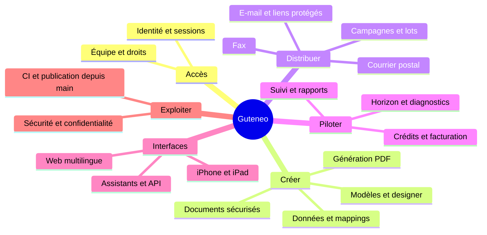

<!-- Generated from feature-map.json by node docs/build-feature-map.mjs -->
# Guteneo · atlas technique

> **21 domaines · 193 fonctionnalités · 22 parcours** — mis à jour le 2026-10-23.
> Documentation du dépôt uniquement. Implémentation ≠ activation ≠ preuve de publication.

Vue visuelle hors ligne : ouvrir [FEATURE_MAP.html](FEATURE_MAP.html) dans un navigateur. Source éditable : [feature-map.json](feature-map.json). Régénérer avec `node docs/build-feature-map.mjs`.

## Vue d’ensemble

## Droits en un coup d’œil

Le contrat définit quatre rôles humains. La cinquième colonne décrit l’assistant connecté, un acteur OAuth, sans ajouter de rôle de membership. Installer un paquet ou renouveler un jeton ne modifie ni la membership, ni les scopes consentis, ni l’autorité d’approbation ; les réglages Auth0 sont une opération de plateforme distincte. Le candidat du 20 octobre corrige uniquement les annotations et descriptions MCP : remplacement du jeton de revue et gel du lot signalés à l’hôte, sans changer cette matrice ni les gardes serveur. Le candidat 0.3.5 du 23 octobre ajoute des consignes de confidentialité au parcours assistant : exclure les données de carte soumises à PCI DSS, les données de santé protégées (PHI), les identifiants gouvernementaux, les secrets d’authentification et les données personnelles sensibles. Ce sont des instructions de traitement et de reprise, pas une détection automatique de ces catégories ni une nouvelle garde serveur, un rôle, un scope ou un droit navigateur/natif/REST.

| Capacité | Administrateur | Superviseur | Opérateur | Observateur | Assistant connecté |
| --- | --- | --- | --- | --- | --- |
| Installer un paquet / consentir à sa connexion personnelle | Selon règles de l’hôte ; consentement personnel | Selon règles de l’hôte ; consentement personnel | Selon règles de l’hôte ; consentement personnel | Selon règles de l’hôte ; consentement personnel | Consentement humain requis ; installation sans autorité métier supplémentaire |
| Configurer le renouvellement Auth0 du reviewer | Aucun droit issu du rôle atelier | Aucun droit issu du rôle atelier | Aucun droit issu du rôle atelier | Aucun droit issu du rôle atelier | Aucune route métier REST/MCP ; opérateur Auth0 autorisé distinct et autorisation explicite |
| Lire contenus accessibles | Oui | Oui | Oui | Oui | Selon membre + scopes ; installation et renouvellement sans élévation de rôle ; parcours assistant arrêté si contenu connu comme exclu, même déjà présent ; aucune détection automatique ajoutée |
| Parcourir le PDF dans la revue navigateur stable | Selon accès documentaire courant | Selon accès documentaire courant | Selon accès documentaire courant ; sans approbation | Selon accès documentaire courant ; lecture seule | Revue navigateur par humain ; aucun nouveau droit MCP |
| Contrôler à blanc un envoi existant | Selon accès à l’envoi | Selon accès à l’envoi | Selon accès à l’envoi | Selon accès à l’envoi | Membre + dispatches:read + accès à l’envoi ; aucune approbation |
| Importer / préparer | Oui | Oui | Oui | Non | Selon membre + scopes ; fichier et canal effectivement qualifiés ; gel du lot par distribution signalé à l’hôte ; parcours assistant arrêté si contenu connu comme exclu, même déjà présent ; aucune détection automatique ajoutée |
| Approuver / confirmer / annuler | Oui | Option Approbation | Non | Non | Mandat expert distinct uniquement ; remplacement du jeton de revue signalé à l’hôte, sans nouvelle autorité |
| Rapports agrégés | Oui | Option Rapports | Non | Non | Selon membre + scopes |
| Gérer atelier / membres | Oui | Non | Non | Non | Non |
| Gérer facturation / souscrire Horizon | Navigateur ; consentement pour souscrire | Non | Non | Non | Non |
| Déclencher un diagnostic Horizon | Plan actif + accès PDF | Plan actif + accès PDF | Plan actif + accès PDF | Non | Plan actif + accès PDF + documents:write ; clé métier conservée ; parcours assistant arrêté si contenu connu comme exclu, même déjà présent ; aucune détection automatique ajoutée |
| Lire / exporter l’historique Horizon | Selon accès PDF | Selon accès PDF | Selon accès PDF | Selon accès PDF | Accès PDF + documents:read ; parcours assistant arrêté si contenu connu comme exclu, même déjà présent ; aucune détection automatique ajoutée |
| Accorder / renouveler mandat expert | Navigateur | Non | Non | Non | Non ; connexion OAuth et installation ne créent aucun mandat |
| Modifier modèle partagé | Droits sur ressource | Droits sur ressource | Droits sur ressource | Non | Membre + scopes + ressource ; confirmation hôte pour écrasement ; parcours assistant arrêté si contenu connu comme exclu, même déjà présent ; aucune détection automatique ajoutée |
| Archiver modèle | Droit publier sur ressource | Droit publier sur ressource | Droit publier sur ressource | Non | Membre + templates:publish + ressource ; effet destructif signalé |
| Modifier partage du modèle | Droit partager sur ressource | Droit partager sur ressource | Droit partager sur ressource | Non | Membre + templates:share + ressource ; révocation signalée ; parcours assistant arrêté si contenu connu comme exclu, même déjà présent ; aucune détection automatique ajoutée |
| Annuler génération | Propriétaire du lot | Propriétaire du lot | Propriétaire du lot | Non | Propriétaire + generations:write ; annulation signalée |
| Supprimer modèle | Propriétaire | Propriétaire | Propriétaire | Non | Propriétaire + scopes |
| Voir PDF généré privé | Créateur seulement | Créateur seulement | Créateur seulement | Selon accès autorisé | Selon propriétaire et contexte ; parcours assistant arrêté si contenu connu comme exclu, même déjà présent ; aucune détection automatique ajoutée |
| Profil / langue / ses sessions | Personnel | Personnel | Personnel | Personnel | Pas d’administration navigateur |
| Sauvegarder Classique / V2 de son compte | Navigateur, préférence personnelle | Navigateur, préférence personnelle | Navigateur, préférence personnelle | Navigateur, préférence personnelle | Non ; aucun outil ajouté |
| Navigation V2, compte mobile et lien public de statut | Navigateur, sans droit supplémentaire | Navigateur, sans droit supplémentaire | Navigateur, sans droit supplémentaire | Navigateur, sans droit supplémentaire | Pas de nouveau contrôle ni outil MCP |
| Action principale V2 : importer / préparer | Selon droits courants | Selon droits courants | Selon droits courants | Non | Contrats existants hors présentation web |
| Lire profil et contacts de son atelier ; erreur annuaire sans détourner le focus | Navigateur | Navigateur | Navigateur | Navigateur | Non |
| Modifier son nom et sa langue | Navigateur | Navigateur | Navigateur | Navigateur | Non |
| Ouvrir Belvédère global | Aucun droit par rôle atelier | Aucun droit par rôle atelier | Aucun droit par rôle atelier | Aucun droit par rôle atelier | Non |
| Lire le moniteur public local | Anonyme, aucun droit acquis | Anonyme, aucun droit acquis | Anonyme, aucun droit acquis | Anonyme, aucun droit acquis | Lectures publiques seulement |
| Lire le statut hébergé et son historique | Lecture anonyme seulement, aucun droit acquis | Lecture anonyme seulement, aucun droit acquis | Lecture anonyme seulement, aucun droit acquis | Lecture anonyme seulement, aucun droit acquis | Lecture publique anonyme seulement |
| Appliquer les exclusions du parcours assistant | Aucun droit supplémentaire | Aucun droit supplémentaire | Aucun droit supplémentaire | Aucun droit supplémentaire | Consignes des skills et descriptions MCP ; catégories exclues annoncées avant traitement, copie retirée de ces données par la personne ; pas de contournement web, de nouveau scope ou de garde serveur automatique |

Les deux options du superviseur sont indépendantes et fermées par défaut. Le rôle appartient à un atelier ; changer de rôle révoque les accès et les approbations encore en attente. Les scopes OAuth n’élèvent jamais les droits. La lecture de l’atelier n’ouvre pas les données ou PDF privés d’un autre créateur. Une demande liée peut donner une revue bornée aux approbateurs actuels ; elle n’ouvre pas la bibliothèque privée. Voir [le contrat des rôles](WORKSPACE_ROLES.md) et [le contrat du studio](TEMPLATES_DATA_DISTRIBUTION.md).

## Arbre exhaustif des fonctionnalités

### 01 · Accès et identité

**État :** Connexion implémentée · correction de découverte de l’issuer préparée localement, déploiement à vérifier.

Contrat : [ACCOUNT_IDENTITY.md](ACCOUNT_IDENTITY.md) · Source : [apps/api/src/auth.ts](../apps/api/src/auth.ts).

**Surfaces :** Web navigateur et découverte OAuth de la ressource MCP ; contrats natifs existants préservés ; aucun nouveau droit REST/MCP. **Tests :** [tests/unit/auth.test.ts](../tests/unit/auth.test.ts), [tests/unit/account.test.ts](../tests/unit/account.test.ts), [tests/e2e/account-identity.spec.ts](../tests/e2e/account-identity.spec.ts).

- Connexion Auth0, compte vérifié et politique MFA
- Connexion navigateur et callback Auth0 sur guteneo.com uniquement ; ancien hôte applicatif et previews URL fermés
- Création d’atelier et administrateur initial
- Profil personnel, langue et apparence d’Atelier enregistrées pour la personne
- Sessions web : consultation, révocation et déconnexion
- Changement d’atelier avec droits courants
- Connexions OAuth : rattachement, révocation et scopes
- Découverte OAuth par métadonnées de ressource : issuer Auth0 exact, slash final conservé ; contrat testé par le SDK MCP officiel sans réseau externe
- Demande de suppression du compte ; traitement complet restant à qualifier
- Compte connecté visible : nom, adresse de connexion et rôle courant sur desktop et mobile
- Changement de compte explicite via réauthentification Auth0 sans supprimer le SSO habituel
- Retour d’onglet : identité, atelier et langue enregistrée dans le compte réconciliés
- Langue des vues connectées réglable seulement dans le compte ; choix visiteur séparé
- Apparence Classique/V2 près de la langue ; migration 0053, compte en bas de navigation et préférence serveur réconciliée après changement d’identité
- Erreur tardive de l’annuaire : alerte et reprise accessibles sans prendre le focus ni interrompre la saisie du profil, en Classique et V2

### 02 · Équipe et responsabilités

**État :** Implémenté · disponibilité à vérifier.

Contrat : [WORKSPACE_ROLES.md](WORKSPACE_ROLES.md) · Source : [packages/contracts/src/roles.ts](../packages/contracts/src/roles.ts).

**Surfaces :** Navigateur authentifié. **Tests :** [tests/integration/workspace-roles.test.ts](../tests/integration/workspace-roles.test.ts), [tests/unit/account.test.ts](../tests/unit/account.test.ts), [tests/e2e/account-identity.spec.ts](../tests/e2e/account-identity.spec.ts).

- Quatre rôles humains et options indépendantes du superviseur
- Gestion des membres, changement de droits et révocation atomique
- Protection du dernier administrateur
- Invitation individuelle ou CSV ; aperçu et confirmation du lot
- Acceptation à adresse vérifiée, expiration et révocation des invitations
- Contacts navigateur des responsables de l’atelier, bornés et filtrés sur la membership courante
- Adresses de connexion pour distinguer les membres homonymes ; droits effectifs lisibles

### 03 · Documents et sécurité

**État :** Implémenté · disponibilité à vérifier.

Contrat : [SCANNER_RESCAN.md](SCANNER_RESCAN.md) · Source : [apps/api/src/documents.ts](../apps/api/src/documents.ts).

**Surfaces :** Web / REST / MCP ; restriction du parcours assistant MCP documentée dans le paquet, sans nouveau contrôle automatique web/natif/REST. **Tests :** [tests/integration/documents.test.ts](../tests/integration/documents.test.ts), [tests/unit/mcp-integrations.test.ts](../tests/unit/mcp-integrations.test.ts).

- Dépôt PDF et import distant borné
- Recherche, liste paginée, lecture des métadonnées et pages
- Quarantaine, antivirus réel, empreinte et validation PDF
- Reprise d’analyse du même document, sans réimport
- Préchauffage scanner par administrateur navigateur
- Rendu HTML en PDF isolé et document immuable
- Stockage privé, quotas, rétention et confidentialité par propriétaire
- Parcours assistant : annoncer les catégories exclues avant demande ou traitement ; ne pas importer ou lire un contenu connu comme exclu, même déjà stocké ou déclaré prêt ; antivirus et état ready ne prouvent pas l’absence de ces données

### 04 · Studio de modèles

**État :** Implémenté · disponibilité à vérifier.

Contrat : [TEMPLATES_DATA_DISTRIBUTION.md](TEMPLATES_DATA_DISTRIBUTION.md) · Source : [apps/api/src/template-workflow.ts](../apps/api/src/template-workflow.ts).

**Surfaces :** Web / REST / MCP ; restriction du parcours assistant MCP documentée dans le paquet, sans nouveau contrôle automatique web/natif/REST. **Tests :** [tests/unit/template-authoring.test.ts](../tests/unit/template-authoring.test.ts), [tests/unit/mcp-integrations.test.ts](../tests/unit/mcp-integrations.test.ts).

- Bibliothèque privée, partagée ou organisation
- Cinq exemples : lettre, facture, relevé, devis, livraison
- Copie privée ou création vierge ; guide de création REST/MCP
- Import Word DOCX et avertissements
- Designer : variables, tableaux, colonnes, logo, formats et conditions
- Schéma métier, jeux d’essai, calculs et totaux
- Suggestions IA revues puis appliquées explicitement
- Aperçu PDF exact, versions, publication, duplication et archivage
- Partage : utilisation, édition, publication et partage indépendants
- Suppression par propriétaire ; conservation des PDF et de la provenance
- Skill document-studio : avant DOCX, texte, modèle existant ou données métier, annoncer les exclusions ; si leur présence est connue, ne pas lire, importer, générer, prévisualiser, partager ni distribuer ; demander une copie retirée de ces données par la personne, sans contournement web

### 05 · Données et mappings

**État :** Implémenté · disponibilité à vérifier.

Contrat : [DATA_IMPORT.md](DATA_IMPORT.md) · Source : [apps/api/src/template-workflow.ts](../apps/api/src/template-workflow.ts).

**Surfaces :** Web / REST / MCP ; restriction du parcours assistant MCP documentée dans le paquet, sans nouveau contrôle automatique web/natif/REST. **Tests :** [tests/unit/datasets.test.ts](../tests/unit/datasets.test.ts), [tests/unit/mcp-integrations.test.ts](../tests/unit/mcp-integrations.test.ts).

- Import CSV, XLSX, XML et JSON ; original privé
- Choix des feuilles, en-têtes ou chemin de records XML
- Profilage, anomalies et lecture paginée
- Reprise de l’analyse du même original
- Mapping versionné : champs, regroupements et jointures
- Validation du mapping avant génération
- Analyse IA facultative ; politique et transfert autorisés par administrateur navigateur
- Skill document-studio : CSV/XLSX/XML/JSON, datasets, records directs et fonctions IA soumis aux mêmes exclusions ; arrêter lecture, profilage, mapping et génération en présence connue, sans demander les valeurs exclues

### 06 · Génération et distribution

**État :** Implémenté · disponibilité à vérifier.

Contrat : [TEMPLATES_DATA_DISTRIBUTION.md](TEMPLATES_DATA_DISTRIBUTION.md) · Source : [apps/api/src/template-workflow-routes.ts](../apps/api/src/template-workflow-routes.ts).

**Surfaces :** Web / REST / MCP ; restriction du parcours assistant MCP documentée dans le paquet, sans nouveau contrôle automatique web/natif/REST. **Tests :** [tests/e2e/template-distribution.spec.ts](../tests/e2e/template-distribution.spec.ts), [tests/integration/template-workflow.test.ts](../tests/integration/template-workflow.test.ts), [tests/unit/mcp-annotation-audit.test.ts](../tests/unit/mcp-annotation-audit.test.ts), [tests/unit/mcp-integrations.test.ts](../tests/unit/mcp-integrations.test.ts).

- PDF unitaire depuis formulaire métier
- Lot de PDF depuis mapping validé
- Progression, résultats par record et provenance des cellules
- Annulation de génération et reprise des seuls records échoués
- Sélection des PDF et préparation d’un plan de distribution
- Le premier plan fige tout le lot et interdit la reprise des records échoués, même exclus ; prepare_distribution annonce destructiveHint true
- Destinataire commun ou colonnes figées ; canal explicite par record
- Reprise des entrées restantes sans duplication
- Contrôle postal lié à l’entrée ; revue et envoi séparés
- Parcours assistant : ne pas générer, prévisualiser, partager ou distribuer des contenus connus comme exclus ; demander une version nettoyée par la personne avant tout nouveau traitement, sans prétendre qu’un scan établit cette absence

### 07 · Fax

**État :** Implémenté · disponibilité à vérifier.

Contrat : [LIVE_FAX_QUOTES.md](LIVE_FAX_QUOTES.md) · Source : [packages/domain/src/index.ts](../packages/domain/src/index.ts).

**Surfaces :** Web / REST / MCP. **Tests :** [tests/e2e/fax-pricing.spec.ts](../tests/e2e/fax-pricing.spec.ts).

- PDF exact, numéro et expéditeur qualifié
- Devis fournisseur daté et renouvellement borné
- Fourchette estimée, plafond approuvé et crédits en euros
- Préparation, revue humaine, approbation et confirmation
- Suivi, reçus, règlement et issue inconnue
- Mode reviewer non envoyable : arrêt avant approbation

### 08 · Courrier postal

**État :** Implémenté · disponibilité à vérifier.

Contrat : [MCP_POSTAL_JOURNEY.md](MCP_POSTAL_JOURNEY.md) · Source : [apps/api/src/postal.ts](../apps/api/src/postal.ts).

**Surfaces :** Web / REST / MCP. **Tests :** [tests/e2e/postal-final-send.spec.ts](../tests/e2e/postal-final-send.spec.ts).

- Expéditeur, adresse, pays et exigences du fournisseur
- Fenêtre gauche/droite et page d’adresse explicite
- Options papier, couleur, recto/verso et service
- Contrôle PDF, rendu d’adresse et revue
- Autorisation distincte du transfert du PDF pour devis
- Devis exact, expiration et revue finale
- Confirmation, coupures calendaires et suivi fournisseur
- Projection des statuts et rapprochement des issues inconnues

### 09 · E-mail et liens protégés

**État :** Implémenté · disponibilité à vérifier.

Contrat : [PROTECTED_EMAIL.md](PROTECTED_EMAIL.md) · Source : [apps/api/src/protected-documents.ts](../apps/api/src/protected-documents.ts).

**Surfaces :** Web / REST / MCP. **Tests :** [tests/integration/protected-documents.test.ts](../tests/integration/protected-documents.test.ts).

- Message texte/HTML sans fichier, avec PDF ou lien protégé
- Attestation du destinataire et exigences transactionnelles
- Devis et supplément d’hébergement explicités
- Lien privé, expiration et mot de passe saisi dans le navigateur
- Téléchargement sans compte destinataire et contrôles d’accès
- Préparation, approbation, suivi et politique fournisseur
- Resend/SES : disponibilité contrôlée, activation séparée

### 10 · Contrôle à blanc des envois

**État :** Publié le 10 octobre dans c953596 ; refus anonyme 401/no-store vérifié ; parcours authentifié non qualifié en production.

Contrat : [PRODUCTION_DRY_RUN.md](PRODUCTION_DRY_RUN.md) · Source : [packages/domain/src/index.ts](../packages/domain/src/index.ts).

**Surfaces :** REST / MCP / CLI ; aucun nouveau bouton web, écran natif ou route mobile dédiée. **Tests :** [tests/integration/dispatch-validation.test.ts](../tests/integration/dispatch-validation.test.ts), [tests/unit/mcp-dispatch-validation.test.ts](../tests/unit/mcp-dispatch-validation.test.ts), [tests/unit/production-dry-run.test.ts](../tests/unit/production-dry-run.test.ts).

- Validation d’un envoi existant, limitée à l’atelier authentifié et à l’accès documentaire courant
- Lecture des gardes de préparation, absence de tentative, devis et restrictions applicables au canal
- Résultat partiel ou bloqué ; acceptation et livraison toujours non exécutées, simulation distincte de la production
- Aucun devis créé, renouvelé ou consommé ; expiration conservée ; aucune approbation, réservation, outbox ou tentative fournisseur
- Automatisable via REST GET ou MCP avec dispatches:read ; aucune autorité de préparation ou d’approbation ajoutée
- Lecture seule métier ; compteurs HTTP et observabilité MCP distincts, annotations de lecture observée conservées
- Runner test:prod:dry-run : 1–10 envois existants, GET séquentiels canonique, jeton de lecture injecté, preuve récente expurgée ; résultat toujours partiel

### 11 · Campagnes et supervision

**État :** Implémenté · disponibilité à vérifier.

Contrat : [API_CONTRACT.md](API_CONTRACT.md) · Source : [apps/api/src/index.ts](../apps/api/src/index.ts).

**Surfaces :** Web / REST / MCP. **Tests :** [tests/integration/domain-invariants.test.ts](../tests/integration/domain-invariants.test.ts).

- Campagne nommée et destinataires CSV
- Validation des lignes, erreurs et doublons
- Préparation d’envois avec le document sélectionné
- Liste et détail des envois, prix et statuts
- Rapports agrégés et consommation selon droits
- Annulation admissible et revue des opérations incertaines
- Administration des canaux et plafonds sans relance aveugle

### 12 · Crédits et facturation

**État :** Implémenté · disponibilité à vérifier.

Contrat : [WELCOME_CREDIT.md](WELCOME_CREDIT.md) · Source : [apps/api/src/billing.ts](../apps/api/src/billing.ts).

**Surfaces :** Navigateur authentifié. **Tests :** [tests/unit/billing.test.ts](../tests/unit/billing.test.ts).

- Solde de bienvenue commun en euros et attribution unique
- Disponible, réservé et consommé ; absence de recharge qualifiée
- Réservation atomique avec acceptation et outbox
- Règlement fournisseur et réserves sur issues inconnues
- Consultation administrative des crédits et facturation
- Connecteur Stripe préparé ; qualification commerciale séparée

### 13 · Assistants et API

**État :** État daté du 23 octobre dans MCP_ANNOTATION_REMEDIATION.md : PR65 fusionnée et application publiée ; PR67 fusionnée non encore déployée ; paquet 0.3.5 et 32 tests préparés, autorisation de publication obtenue. Configuration MCP du portail indisponible : import 0.3.5, nouveau scan et resoumission non établis. Les tests locaux ne qualifient pas les parcours réels ni le renouvellement OAuth dans l’hôte..

Contrat : [LLM_SETUP.md](LLM_SETUP.md) · Source : [apps/api/src/mcp.ts](../apps/api/src/mcp.ts).

**Surfaces :** Web / REST / MCP distant et paquets clients locaux ; accès disque/adaptateur local configuré séparément ; aucune nouvelle autorité native ; restriction du parcours assistant MCP documentée dans le paquet, sans nouveau contrôle automatique web/natif/REST. **Tests :** [tests/unit/mcp-integrations.test.ts](../tests/unit/mcp-integrations.test.ts), [tests/unit/mcp-annotation-audit.test.ts](../tests/unit/mcp-annotation-audit.test.ts), [tests/integration/expert-approval.test.ts](../tests/integration/expert-approval.test.ts), [tests/unit/auth.test.ts](../tests/unit/auth.test.ts), [tests/integration/template-workflow.test.ts](../tests/integration/template-workflow.test.ts), [tests/unit/pdf-validation.test.ts](../tests/unit/pdf-validation.test.ts).

- Découverte des capacités et limites du compte
- Catalogue REST/OpenAPI et MCP Streamable HTTP
- Guides d’installation ChatGPT, Claude web/Desktop et Code, Grok web et Build, Cursor et Copilot ; connexion OAuth à qualifier par surface
- Import adapté au transport fichier effectivement disponible
- Documents, modèles, données, génération et préparation via outils
- Revue navigateur avant envoi ; scopes sans élévation de rôle
- Délégation experte bornée à un client OAuth, optionnelle
- Nouvelle revue complète : remplacement du jeton précédent de l’envoi pour cette connexion, refus de l’ancien jeton et destructiveHint true sur review_dispatch
- Mandat accordé/révoqué par administrateur navigateur seulement
- Candidat local plugin 0.3.5 : six skills, manifestes portables et descriptions anglaises ; schéma, inventaire de 19 fichiers, CRC et archive déterministe contrôlés ; import refusé par le portail 0.3.2 Changes required / Not published tant que son MCP existant n’est pas reconfiguré
- Installation manuelle : plugin MCP personnel ChatGPT ; ZIP Claude et chargement Code ; connecteur/paquet candidat Grok Build ; dossier local Cursor ; modèles Copilot distincts
- Enregistrement OAuth : callback exact et client réel par hôte ; annonce DCR/CIMD sans qualification ne prouve pas une installation automatique
- Annotations MCP explicites : écrasement, archivage, révocation de partage, annulation de génération, remplacement du jeton de revue et gel du lot signalés à l’hôte
- 67 outils avec quatre booléens et justifications par outil ; audit réel tools/list via npm run audit:mcp, candidat local et état du portail séparés
- readOnlyHint et idempotentHint false conservés : activité visible de connexion persistée après succès en production, effet divulgué centralement dans les descriptions ; aucune donnée ou destination nouvelle
- Consignes 0.3.5 document-studio et pdf-accessibility : restrictions connues sur fichiers, texte, modèles, datasets, records, PDF et rapports existants ; arrêt puis copie expurgée par la personne, jamais collecte des valeurs exclues ni dépôt web pour contourner ; aucune classification automatique ou nouvelle garde serveur

### 14 · Qualification OAuth du reviewer

**État :** Migrateur local et tests de sécurité préparés ; callback exact corrigé après GET live · aucun réglage Auth0 de production appliqué, aucun renouvellement réel attesté.

Contrat : [LLM_SETUP.md](LLM_SETUP.md) · Source : [scripts/enable-openai-review-renewal.mjs](../scripts/enable-openai-review-renewal.mjs).

**Surfaces :** CLI opérateur Auth0 autorisé ; aucune route métier web/native/REST/MCP supplémentaire et aucun droit issu d’un rôle atelier. **Tests :** [tests/security/openai-review-renewal.test.mjs](../tests/security/openai-review-renewal.test.mjs), [tests/security/chatgpt-reviewer-setup.test.mjs](../tests/security/chatgpt-reviewer-setup.test.mjs), [tests/security/claude-renewal.test.mjs](../tests/security/claude-renewal.test.mjs).

- Inspection GET seule par défaut : client reviewer OpenAI existant exact, callback historique /connector/oauth/aAwc9dso12_L conservé sans écriture, propriétaire, scopes/API, connexions et versions draft/déployées des deux Actions
- Plan expurgé et empreinte de l’état et des changements ; aucun jeton, secret client ou contenu privé exposé
- Application après autorisation explicite seulement, avec --apply --expect et empreinte revue ; aucun client ni compte provisionné
- Déployer les deux Actions exactes avant offline_access de l’API puis grant refresh du seul reviewer ; conserver ownClients, clients tiers, associations, bindings et consentement
- Refresh rotatif borné : 30 jours d’inactivité, 90 jours absolus, tolérance de 3 secondes ; access token API au plus 3 600 secondes
- Dérive avant chaque écriture, collision, autre client Guteneo renouvelable ou Action inconnue : arrêt ; aucune écriture retentée automatiquement
- État partiel connu : inspecter de nouveau, revoir l’empreinte fraîche et appliquer seulement les étapes restantes ; issue fournisseur inconnue sans reprise aveugle
- prepare-chatgpt-reviewer --qualify-client --expect-renewal : qualification GET seule de l’état complet exact ; aucun auto-provisionnement ni achèvement de migration partielle
- Reconnexion, renouvellement et révocation réels restent à qualifier ; aucune modification de restriction prepare_only, de configuration d’envoi, d’approbation ou de mandat

### 15 · Compagnon iPhone et iPad

**État :** Implémenté · disponibilité à vérifier.

Contrat : [IOS_API.md](IOS_API.md) · Source : [apps/api/src/mobile.ts](../apps/api/src/mobile.ts).

**Surfaces :** iOS / API mobile / revue navigateur. **Tests :** [tests/e2e/mobile-account.spec.ts](../tests/e2e/mobile-account.spec.ts), [tests/integration/mobile.test.ts](../tests/integration/mobile.test.ts).

- Authentification système et sessions mobiles dédiées
- Navigation adaptative iPhone/iPad et accessibilité
- Profil, langue et demande de suppression du compte
- Import, inspection et recherche PDF
- Préparation fax/e-mail et suivi
- Revue finale dans navigateur authentifié ; pas de consentement natif
- Signature, appareil physique, TestFlight et App Store à qualifier
- Lecture de preferredDashboardAppearance dans compte/session ; aucun réglage ni PATCH natif de cette préférence web

### 16 · Expérience publique et langues

**État :** Implémenté · disponibilité à vérifier.

Contrat : [MULTILINGUAL.md](MULTILINGUAL.md) · Source : [packages/contracts/src/public-site.json](../packages/contracts/src/public-site.json).

**Surfaces :** Web public / maquette. **Tests :** [tests/e2e/locale-boundaries.spec.ts](../tests/e2e/locale-boundaries.spec.ts), [tests/preview-e2e/language-navigation.spec.ts](../tests/preview-e2e/language-navigation.spec.ts), [tests/preview-e2e/assistant-hub.spec.ts](../tests/preview-e2e/assistant-hub.spec.ts).

- Présentation, fonctionnalités, rôles et guides assistants
- Hub assistants et guides FR/EN/DE/LB préparés localement : lien ZIP et étapes manuelles ChatGPT/Claude/Grok/Cursor ; OAuth, skills et publication qualifiés séparément
- Téléchargement du paquet et manifeste version/SHA-256 : comparer la version publiée au candidat local avant installation ; aucun téléchargement ne consent à OAuth
- Journal, articles, notices légales et confidentialité
- Français, anglais, allemand et luxembourgeois
- Préférence personnelle et choix anonyme
- Douze films localisés, affiches, sous-titres et durées réelles
- Pages statiques, canonical, sitemap et langues alternatives
- Maquette publique fictive isolée du backend
- Cartes de partage multilingues et boutons lecture : intégrés à main par PR #43

### 17 · Atelier V2 et apparence personnelle

**État :** Simplification V2 du 14 octobre : 18 cas navigateur et 40 tests locale/apparence réussis, build/typecheck/lint/atlas validés, six mesures de ressources locales ; CI du commit exact, publication et contrôle authentifié hébergé restent à qualifier ; preuves antérieures datées dans DASHBOARD_V2.md.

Contrat : [DASHBOARD_V2.md](DASHBOARD_V2.md) · Source : [apps/web/src/account-page.tsx](../apps/web/src/account-page.tsx).

**Surfaces :** Atelier web et profil navigateur ; lecture additive compte/session natifs ; REST métier et MCP sans nouveau pouvoir ; maquette fictive isolée. **Tests :** [tests/unit/account.test.ts](../tests/unit/account.test.ts), [tests/integration/mobile.test.ts](../tests/integration/mobile.test.ts), [tests/unit/dashboard-appearance.test.ts](../tests/unit/dashboard-appearance.test.ts), [tests/preview-e2e/dashboard-v2.spec.ts](../tests/preview-e2e/dashboard-v2.spec.ts), [tests/e2e/dashboard-v2.spec.ts](../tests/e2e/dashboard-v2.spec.ts), [tests/e2e/protected-email.spec.ts](../tests/e2e/protected-email.spec.ts).

- Version complète de l’Atelier web réel : mêmes compte, tenant, ressources et opérations ; aucun environnement métier fictif parallèle
- Compte en bas de navigation ; Version de l’atelier près de la langue, Classique ou V2 appliquée après sauvegarde réussie du profil ; identité et rôle accessibles sur mobile même lorsque le menu est fermé
- Préférence personnelle users.preferred_dashboard_appearance, migration 0053, défaut classic ; même personne entre ateliers, sessions et appareils après relecture
- PATCH navigateur du compte : preferredDashboardAppearance strict, Origin/CSRF, autorité courante et audit de noms de champs ; tous les rôles peuvent modifier seulement leur propre choix
- URL atelier=v2 ou atelier=classic : forçage temporaire sans sauvegarde serveur ; supprimé après sauvegarde d’un choix d’apparence explicite ou changement d’identité détecté ; cache local non autoritaire
- Accueil avec alertes et activité avant introduction si historique ; accueil complet sinon ; aperçu du contenu avant accord dans l’ordre de lecture et clavier
- Revue Classique/V2 : cadre PDF stable au chargement, au rendu et en erreur ; défilement interne accessible au clavier, sans déplacement des consentements ni modification des octets ou de l’autorité
- Présentation cohérente documents, préparation, revue, suivi, assistants, compte, Studio, Horizon, crédits, tableaux et formulaires ; Belvédère conserve sa présentation distincte
- Coque V2 allégée : une signature Guteneo, atelier dans la navigation, suppression du pied de page redondant ; statut du service près du compte et fuseau du navigateur près des dates
- Titre de page unique hors navigation ; retour contextuel sur les détails ; action principale de la tâche mise en avant, Nouvel envoi global secondaire et absent sur accueil/préparation/envois qui ont leur entrée locale, toujours selon les droits
- Générations : introduction centrée sur les PDF retrouvés et absence d’envoi automatique ; détails techniques conservés dans le parcours documentaire
- Portrait officiel, mot-symbole noir minuscules, trois gravures et hirondelles bleues approuvées ; décorations discrètes limitées à accueil, documents vides et assistants
- Libellés FR/EN/DE/LB ; aucune mention expérimentale sur V2 réelle ; bandeaux de simulation maintenus uniquement pour les sessions simulées
- Mêmes quatre rôles, options indépendantes du superviseur, accès privés et consentements ; aucun nouveau mandat, canal, endpoint métier ou outil MCP
- Lectures natives compte/session enrichies sans setter natif d’apparence ; anciens PATCH navigateur nom/langue compatibles, PATCH natif de langue préservé ; la simplification web ne crée aucune nouvelle surface native/REST/MCP

### 18 · Horizon et diagnostic PDF

**État :** Ouverture sur crédits autorisée · qualification hébergée et activation à confirmer.

Contrat : [PDF_ACCESSIBILITY.md](PDF_ACCESSIBILITY.md) · Source : [apps/api/src/pdf-validation.ts](../apps/api/src/pdf-validation.ts).

**Surfaces :** Web / REST / MCP ; restriction du parcours assistant MCP documentée dans le paquet, sans nouveau contrôle automatique web/natif/REST. **Tests :** [tests/unit/monthly-plan.test.ts](../tests/unit/monthly-plan.test.ts), [tests/e2e/horizon-pdf.spec.ts](../tests/e2e/horizon-pdf.spec.ts), [tests/unit/pdf-validation.test.ts](../tests/unit/pdf-validation.test.ts), [tests/preview-e2e/geo.spec.ts](../tests/preview-e2e/geo.spec.ts), [tests/preview-e2e/seo.spec.ts](../tests/preview-e2e/seo.spec.ts), [tests/unit/live-capabilities.test.ts](../tests/unit/live-capabilities.test.ts), [apps/pdf-validator/tests/qualification.test.mjs](../apps/pdf-validator/tests/qualification.test.mjs), [apps/pdf-validator/tests/container-lifecycle.test.mjs](../apps/pdf-validator/tests/container-lifecycle.test.mjs), [apps/pdf-validator/tests/worker.test.mjs](../apps/pdf-validator/tests/worker.test.mjs), [apps/pdf-validator/tests/test_server.py](../apps/pdf-validator/tests/test_server.py), [tests/unit/mcp-integrations.test.ts](../tests/unit/mcp-integrations.test.ts).

- Formule mensuelle 30 € sur crédits disponibles ; première période finançable par crédits promotionnels restants ; entrée privée /app/plan
- Consentement récurrent immutable par administrateur navigateur
- Résiliation, renouvellement et suspension sans dette ; recharge encore indisponible
- 100 tentatives par mois calendaire ; quota atomique
- veraPDF privé épinglé : PDF/UA-1/-2 et PDF/A-1b/2b/3b/4 ; corpus officiel positif/négatif, qualification hors réseau puis hébergée
- Rapport sur octets exacts, historique et export JSON
- Diagnostic via web/MCP et revue humaine obligatoire ; reprise explicite d’une issue réseau incertaine avec la même clé, contrôle indépendant avec une nouvelle clé
- Disponibilité publique et serveur partagent HORIZON_ENABLED, validateur privé et scanner en production ; lecture publique unique ; ouverture après qualification hébergée ; pas une certification légale
- Skill pdf-accessibility : annoncer les exclusions avant demande ; si elles sont connues dans le PDF ou le rapport, ne pas importer, lire, valider ou récupérer leur contenu ; copie retirée des données exclues par la personne, sans contournement web

### 19 · Exploitation et fiabilité

**État :** Implémenté · disponibilité à vérifier.

Contrat : [PRODUCTION_REVIEW_2026_10_09.md](PRODUCTION_REVIEW_2026_10_09.md) · Source : [scripts/deploy-public.mjs](../scripts/deploy-public.mjs).

**Surfaces :** CLI / CI / services privés ; vue locale anonyme sans droit supplémentaire web/native/REST/MCP. **Tests :** [tests/security/main-only-release.test.mjs](../tests/security/main-only-release.test.mjs), [tests/security/pdf-validator-release.test.mjs](../tests/security/pdf-validator-release.test.mjs), [apps/pdf-validator/tests/probe-credentials.test.mjs](../apps/pdf-validator/tests/probe-credentials.test.mjs), [tests/security/production-monitor.test.mjs](../tests/security/production-monitor.test.mjs), [tests/security/observability.test.mjs](../tests/security/observability.test.mjs), [tests/integration/documents.test.ts](../tests/integration/documents.test.ts), [tests/unit/telnyx-readiness.test.ts](../tests/unit/telnyx-readiness.test.ts).

- Files interactives, lots, outbox transactionnelle et idempotence
- Callbacks fournisseur authentifiés et journaux sans contenu sensible
- Inspection Telnyx opérateur privée en lecture seule : callbacks principal/secours projetés en statuts bornés et booléens de correspondance canonique, sans URL brute ni extraction des credentials ; état fournisseur frais à qualifier après publication
- Rapprochement, reprise bornée et files mortes
- Migrations D1 ordonnées, intégrité et bookmark de restauration
- Services privés scanner, renderer et validateur ; déploiement depuis main propre sans route publique ni observabilité ; pont de qualification local avec secret temporaire, refus Origin et aucun transfert du secret ; les opérateurs deploy-pdf-validator.mjs et qualify-hosted.mjs vérifient Horizon fermé uniquement sur guteneo.com
- Tests backend, sécurité, navigateurs et CI exhaustive ; validateur basic max. 1, veille 5 s, JVM qualifiée sur 100 pages / 9,887 Mio ; CPU local −47 %, coût par diagnostic et qualification hébergée distincts
- Publication depuis main propre, synchronisé et vérifié
- Manifestes de release, empreintes des assets et santé distante sur guteneo.com ; preuve distincte de fermeture de workers.dev et des previews URL applicatifs
- Moniteur local de production : lectures anonymes bornées sur le domaine canonique et contrôle de fermeture de l’ancien hôte, hashes de pages, refus des accès privés, état périmé après 120 s et qualification partielle par fonction ; aucun envoi ni tâche permanente
- Purge idempotente après retour du curseur : tombstone et audit de succès liés au tenant ; reprise après panne R2 ou audit sans recompter les purges terminées
- CI à checkout ciblé conservant toutes les suites et médias publiés ; archives de travail exclues des runners

### 20 · Belvédère et supervision plateforme

**État :** Intégré au candidat ; activation et publication non qualifiées.

Contrat : [BELVEDERE.md](BELVEDERE.md) · Source : [apps/api/src/belvedere.ts](../apps/api/src/belvedere.ts).

**Surfaces :** Navigateur Veilleur seulement ; aucune autorité atelier/native/OAuth/MCP supplémentaire. **Tests :** [tests/unit/belvedere.test.ts](../tests/unit/belvedere.test.ts), [tests/unit/auth-telemetry.test.ts](../tests/unit/auth-telemetry.test.ts), [tests/belvedere-e2e/control-tower.spec.ts](../tests/belvedere-e2e/control-tower.spec.ts), [tests/unit/belvedere-finance.test.ts](../tests/unit/belvedere-finance.test.ts), [tests/belvedere-e2e/locale.spec.ts](../tests/belvedere-e2e/locale.spec.ts), [tests/unit/belvedere-locale.test.ts](../tests/unit/belvedere-locale.test.ts).

- Autorité Veilleur privée et lecture seule : session/identité vérifiées, adresse serveur secrète, autorisation distincte des rôles atelier
- Sept vues : ateliers, membres, envois, connexions, finances et infrastructure avec vue d’ensemble
- Observation facultative des connexions par pays, déduplication bornée et nouvelles sessions après changement d’atelier ; rétention de 90 jours
- Crédits promotionnels, consommations des envois/hébergement/Horizon, encaissements et coûts fournisseurs distincts
- Connecteurs Cloudflare côté serveur avec états explicites, sans coût ni marge inventés
- Migration additive 0052 ; aperçu déterministe limité au loopback ; activation hébergée séparée
- Quatre langues suivant le compte, y compris ouverture directe et retour d’onglet ; aucun sélecteur privé supplémentaire

### 21 · État public du service

**État :** Séparation état public/couverture implémentée ; preuves locales du 10 octobre 2026 : 27 tests UI réussis, 3 réexécutions ciblées de la cadence réussies, 98 tests fonctionnels réussis sur 6 suites. Preuve historique distincte : service publié le 10 octobre dans c953596, premier cron à 02:45:05.570 UTC, 14/14 contrôles publics réussis ; cette observation ne qualifie ni la nouvelle UI ni les parcours métier.

Contrat : [STATUS_SERVICE.md](STATUS_SERVICE.md) · Source : [apps/status/worker.ts](../apps/status/worker.ts).

**Surfaces :** Page publique autonome et GET anonymes /api/status, /api/history en lecture seule ; aucune authentification requise, aucun droit atelier, nouvelle capacité REST/MCP métier ou interface native. **Tests :** [tests/integration/status-service.test.ts](../tests/integration/status-service.test.ts), [tests/security/status-release.test.mjs](../tests/security/status-release.test.mjs), [tests/security/test-offline.test.mjs](../tests/security/test-offline.test.mjs), [tests/status-e2e/status.spec.ts](../tests/status-e2e/status.spec.ts).

- Service indépendant status.guteneo.com : quatorze lectures anonymes bornées du domaine canonique, toutes les quinze minutes, sans bindings ni secret métier
- Historique D1 7/30/365 jours : réussite des contrôles observés et couverture des créneaux distinctes, synthèses quotidiennes, journées vides inconnues, aucune reconstitution antérieure
- Quatorze contrôles récents réussis donnent un bilan positif limité au périmètre public ; un écart reste visible dans le bilan et le groupe concerné. Mesure absente, invalide, indisponible ou périmée (seuil de trente minutes) : état actuel inconnu et anciens résultats neutralisés ; aucune lecture publique ne déclenche une collecte
- Vue Service : fraîcheur, groupes Site et pages publiques, Services web et Protection des accès, puis historique. Vue Vérifications : contrôles détaillés, preuve locale et couverture des parcours ; fonctions hors périmètre ou non activées en badges neutres, sans dégrader le bilan public. Vue Exploitation : limites et actions ; aucune donnée client ni identifiant de commande
- Qualification locale séparée : tests du vrai domaine et PDF locaux avec réseau externe interdit, fournisseurs finaux simulés, rapport expurgé horodaté ; aucune preuve locale ou absence de couverture ne devient une preuve de livraison ou un incident de production
- Footer de marque et effets saisonniers décoratifs bornés, désactivables et respectant la réduction de mouvement
- Publication dédiée depuis main propre avec manifeste, contrôles de source et migrations D1 statut exclusivement

## Parcours clients et reprise sur erreur

### J01 · Découvrir puis entrer

**Acteur :** Visiteur → membre. **Branche :** INVITATIONS / IDENTITY.

Ouvrir guteneo.com → choisir français, anglais, allemand ou luxembourgeois → consulter l’offre et le hub assistants → choisir le guide de son hôte et, si utile, récupérer le ZIP en comparant version/SHA-256 au manifeste → se connecter avec identité vérifiée sur l’origine canonique → créer ou rejoindre un atelier → lire ses droits → vérifier nom/adresse/rôle dans la navigation → ouvrir le profil ou choisir Changer de compte si nécessaire. Dans le candidat V2, ouvrir Mon compte en bas de navigation → Version de l’atelier près de la langue → enregistrer Classique ou V2 ; même identité et atelier courant. Un lien ?atelier=v2#/app force seulement la présentation temporairement. En V2, un atelier sans historique conserve les étapes d’accueil complètes ; un atelier ayant des envois présente d’abord son travail en cours. En V2, la marque et le nom d’atelier restent dans la navigation ; le titre principal oriente la page sans répétition de titre dans une barre supérieure. Le compte et son rôle restent accessibles quand le menu mobile est fermé.

**Blocage / reprise :** Ancien hôte applicatif workers.dev et previews URL fermés : utiliser guteneo.com. Le candidat local 0.3.5 ne remplace pas automatiquement le ZIP effectivement servi ; guide, téléchargement et fixtures ne prouvent ni installation OAuth réelle ni publication en catalogue. Invitation expirée ou adresse différente : refuser ; aucune création implicite d’autorité. Adresse indisponible : afficher explicitement ; changement de compte soumis au callback canonique signé et à la politique Auth0. La préférence de présentation appartient au compte authentifié ; un ancien cache local ne doit pas prévaloir sur la personne courante. Les preuves historiques de migration et de publication sont distinctes de la validation du candidat de simplification.

Référence : [ACCOUNT_IDENTITY.md](ACCOUNT_IDENTITY.md).

### J02 · Administrer une équipe

**Acteur :** Administrateur navigateur. **Branche :** ÉQUIPE.

Membres → inviter une personne ou prévisualiser le CSV → choisir rôle/options → confirmer le lot → suivre les invitations → modifier ou révoquer les accès. Les adresses distinguent les homonymes ; un membre sans gestion ouvre ses contacts de l’atelier. La coque web V2 facultative conserve ces mêmes actions et le rôle courant. En V2, l’action de gestion demeure attachée à la page et soumise au rôle administrateur ; le raccourci global Nouvel envoi est secondaire.

**Blocage / reprise :** Préserver le dernier administrateur ; changement de droits déconnecte et invalide les approbations en attente. Le choix V2 ne modifie ni membership ni option du superviseur. Une erreur tardive de l’annuaire reste annoncée avec reprise manuelle, sans détourner le focus du contrôle en cours ni perdre la saisie.

Référence : [WORKSPACE_ROLES.md](WORKSPACE_ROLES.md).

### J03 · Préparer un fax

**Acteur :** Administrateur / superviseur / opérateur. **Branche :** DOCUMENTS → FAX.

Dans le parcours assistant, annoncer les catégories exclues avant de demander ou traiter les contenus ; vérifier les droits courants sans prétendre détecter automatiquement ces catégories. Importer PDF → attendre ready → choisir destinataire/expéditeur → devis et plafond → préparer → passer à un approbateur habilité → confirmer → suivre le même envoi. Avant revue, une lecture REST/MCP facultative contrôle à blanc l’envoi existant et son devis, sans le renouveler. Avec V2 facultative, utiliser les mêmes pages documents, préparation, revue et suivi, avec le même identifiant et la même API. Dans la revue, l’aperçu du contenu précède les actions d’approbation dans l’ordre de lecture et de clavier. Dans la revue navigateur Classique/V2, parcourir le PDF dans un cadre stable accessible au clavier ; le chargement et les erreurs ne déplacent pas les consentements. En V2, la préparation garde une action principale locale, un retour contextuel et tous les récapitulatifs document/destinataire/prix nécessaires au consentement.

**Blocage / reprise :** Quarantaine, devis expiré, canal fermé ou crédits insuffisants : corriger avant envoi ; outcome unknown : rapprocher. Le contrôle reste partiel ou bloqué et ne vaut ni approbation ni preuve de livraison. Changer de présentation ne prépare ni ne confirme un fax et ne remplace pas le consentement ; opérations réelles signalées sur session réelle. Un chargement ou une erreur PDF ne coche aucune case et ne modifie ni les droits courants ni les gardes d’approbation. Si des données exclues sont connues, arrêter les opérations de contenu de ce parcours, y compris sur une ressource déjà présente ; demander une version dont la personne a retiré ces données avant partage, sans demander les valeurs exclues ni proposer un dépôt web de contournement. Un scan antivirus réussi n’atteste pas leur absence ; les gardes serveur et droits des autres surfaces ne sont pas modifiés par cette consigne.

Référence : [LIVE_FAX_QUOTES.md](LIVE_FAX_QUOTES.md).

### J04 · Envoyer un courrier postal

**Acteur :** Préparateur → approbateur. **Branche :** DOCUMENTS → POSTAL.

Dans le parcours assistant, annoncer les catégories exclues avant de demander ou traiter les contenus ; vérifier les droits courants sans prétendre détecter automatiquement ces catégories. PDF → adresse et options/fenêtre → préflight → revue et autorisation distincte du transfert → devis exact → revue finale → confirmation → suivi. Après préparation, le contrôle à blanc REST/MCP relit l’envoi et le devis existants sans nouveau transfert Pingen. Avec V2 facultative, les mêmes préflights, transfert, devis et revue restent nécessaires. Dans la revue, l’aperçu du contenu précède les actions d’approbation dans l’ordre de lecture et de clavier. Dans la revue navigateur Classique/V2, parcourir le PDF dans un cadre stable accessible au clavier ; le chargement et les erreurs ne déplacent pas les consentements. En V2, les actions de préflight, de transfert et de confirmation restent distinctes et attachées à leur étape ; alléger la coque ne supprime aucun récapitulatif de consentement.

**Blocage / reprise :** PDF inadmissible, adresse non validée ou transfert inconnu : conserver IDs, ne pas retransférer automatiquement. Le devis expire normalement ; ce contrôle ne crée ni transfert ni consentement et ne reprend aucune issue inconnue. Le choix V2 ne vaut jamais consentement au transfert du PDF, à l’approbation ou à l’envoi. Un chargement ou une erreur PDF ne coche aucune case et ne modifie ni les droits courants ni les gardes d’approbation. Si des données exclues sont connues, arrêter les opérations de contenu de ce parcours, y compris sur une ressource déjà présente ; demander une version dont la personne a retiré ces données avant partage, sans demander les valeurs exclues ni proposer un dépôt web de contournement. Un scan antivirus réussi n’atteste pas leur absence ; les gardes serveur et droits des autres surfaces ne sont pas modifiés par cette consigne.

Référence : [POSTAL_STREAMLINED.md](POSTAL_STREAMLINED.md).

### J05 · Préparer un e-mail

**Acteur :** Préparateur → approbateur. **Branche :** E-MAIL.

Dans le parcours assistant, annoncer les catégories exclues avant de demander ou traiter les contenus ; vérifier les droits courants sans prétendre détecter automatiquement ces catégories. Lire capacités → mode sans fichier/PDF/lien → destinataire, texte et options → devis → préparation → revue humaine → confirmation admissible → suivi. Le contrôle à blanc REST/MCP d’une demande existante relit le devis et les gardes applicables du destinataire et du lien protégé, sans envoi. Avec V2, la saisie, la préparation et la revue utilisent les mêmes composants et API métier ; enregistrer Classique dans Mon compte pour un retour durable. Dans la revue, l’aperçu du contenu précède les actions d’approbation dans l’ordre de lecture et de clavier. Dans la revue navigateur Classique/V2, parcourir le PDF dans un cadre stable accessible au clavier ; le chargement et les erreurs ne déplacent pas les consentements. En V2, l’action principale reste celle de l’étape de préparation ou de revue ; le retour contextuel et les résumés document/destinataire/prix restent disponibles.

**Blocage / reprise :** Canal désactivé/non qualifié ou review_prepare_only : arrêt ; mot de passe exclusivement navigateur. Aucun devis renouvelé ou consommé ; acceptation et livraison restent non exécutées. Enregistrer l’apparence soumet seulement le profil, jamais le formulaire de préparation, l’acceptation du devis ou un envoi. Un chargement ou une erreur PDF ne coche aucune case et ne modifie ni les droits courants ni les gardes d’approbation. Si des données exclues sont connues, arrêter les opérations de contenu de ce parcours, y compris sur une ressource déjà présente ; demander une version dont la personne a retiré ces données avant partage, sans demander les valeurs exclues ni proposer un dépôt web de contournement. Un scan antivirus réussi n’atteste pas leur absence ; les gardes serveur et droits des autres surfaces ne sont pas modifiés par cette consigne.

Référence : [PROTECTED_EMAIL.md](PROTECTED_EMAIL.md).

### J06 · Créer un modèle réutilisable

**Acteur :** Préparateur avec droits de ressource. **Branche :** MODÈLES.

Dans le parcours assistant, annoncer les catégories exclues avant de demander ou traiter les contenus ; vérifier les droits courants sans prétendre détecter automatiquement ces catégories. Exemple/copie privée, page vierge ou DOCX → designer et schéma → données d’essai → aperçu PDF → publier une version → partager les droits précis. La présentation V2 du Studio, de ses tableaux et formulaires conserve les mêmes données et droits. En V2, création et édition sont hiérarchisées dans la page ; les détails disposent d’un retour contextuel, sans répéter le titre de section dans la coque.

**Blocage / reprise :** Révision concurrente : recharger ; suppression propriétaire seulement ; PDF antérieurs conservés. Via MCP, présenter écrasement du brouillon, archivage ou révocation de partage et respecter les confirmations hôte ; aucune permission élargie. Aucun droit de ressource n’est accordé par la préférence V2. Si des données exclues sont connues, arrêter les opérations de contenu de ce parcours, y compris sur une ressource déjà présente ; demander une version dont la personne a retiré ces données avant partage, sans demander les valeurs exclues ni proposer un dépôt web de contournement. Un scan antivirus réussi n’atteste pas leur absence ; les gardes serveur et droits des autres surfaces ne sont pas modifiés par cette consigne. Le périmètre comprend DOCX, modèle existant, données d’essai, aperçu et partage (skill document-studio).

Référence : [TEMPLATES_DATA_DISTRIBUTION.md](TEMPLATES_DATA_DISTRIBUTION.md).

### J07 · Transformer des données en PDF

**Acteur :** Préparateur propriétaire des données. **Branche :** DONNÉES → GÉNÉRATION.

Dans le parcours assistant, annoncer les catégories exclues avant de demander ou traiter les contenus ; vérifier les droits courants sans prétendre détecter automatiquement ces catégories. Import CSV/XLSX/XML/JSON → analyse et profil → choisir mapping → valider → générer → consulter résultats/provenance → reprendre les seuls records échoués avant la création d’un plan de distribution. La coque web V2 facultative conserve ce parcours métier existant ; aucune copie fictive des données n’est créée. En V2, Générations met en avant Créer un document, rappelle que générer ne déclenche aucun envoi et réserve les précisions techniques au détail ; le fuseau du navigateur accompagne les dates.

**Blocage / reprise :** Original privé ; IA seulement sous politique autorisée ; PDF générés privés même face à un autre administrateur. Annulation explicite : arrêter le lot sans effacer ses PDF ; le même lot annulé ne se reprend pas. MCP signale cette annulation comme destructive. Dès le premier plan de distribution, tout le lot est figé : GENERATION_FROZEN interdit la reprise des échecs, même exclus du plan ; créer un nouveau lot pour les éléments à régénérer. La préférence de présentation ne modifie ni accès privé, ni transfert IA, ni génération. Si des données exclues sont connues, arrêter les opérations de contenu de ce parcours, y compris sur une ressource déjà présente ; demander une version dont la personne a retiré ces données avant partage, sans demander les valeurs exclues ni proposer un dépôt web de contournement. Un scan antivirus réussi n’atteste pas leur absence ; les gardes serveur et droits des autres surfaces ne sont pas modifiés par cette consigne. Le périmètre comprend import, lecture, profilage, mapping, génération et fonctions IA sur CSV/XLSX/XML/JSON ou records directs (skill document-studio).

Référence : [TEMPLATES_DATA_DISTRIBUTION.md](TEMPLATES_DATA_DISTRIBUTION.md).

### J08 · Distribuer un lot

**Acteur :** Préparateur → approbateur. **Branche :** DISTRIBUTION.

Dans le parcours assistant, annoncer les catégories exclues avant de demander ou traiter les contenus ; vérifier les droits courants sans prétendre détecter automatiquement ces catégories. Reprendre d’abord les échecs de génération souhaités → sélectionner les PDF → présenter le gel définitif de tout le lot, y compris des records exclus → respecter la confirmation hôte MCP → figer destinations/options/canal → préparer le plan → traiter préflights postaux → revoir chaque demande → confirmer → suivre. Les demandes déjà préparées peuvent être contrôlées à blanc une par une via leur identifiant REST/MCP. Les revues et le suivi peuvent employer la présentation V2 facultative, avec les mêmes demandes préparées. Dans la revue navigateur Classique/V2, parcourir le PDF dans un cadre stable accessible au clavier ; le chargement et les erreurs ne déplacent pas les consentements. En V2, préparer et confirmer restent des actions propres à leur étape ; le raccourci global Nouvel envoi est secondaire et ne concurrence pas l’action du lot.

**Blocage / reprise :** Génération/préparation sans envoi ; reprise de préparation ne reconfirme pas un envoi accepté. prepare_distribution annonce destructiveHint true car le plan interdit toute reprise de génération du lot ; GENERATION_FROZEN impose un nouveau lot pour les éléments à régénérer. resume_distribution poursuit seulement les préparations du plan figé. Cette lecture n’exécute ni réservation ni outbox et ne qualifie pas le lot de bout en bout. Le choix d’apparence ne confirme ni un envoi ni un lot. Un chargement ou une erreur PDF ne coche aucune case et ne modifie ni les droits courants ni les gardes d’approbation. Si des données exclues sont connues, arrêter les opérations de contenu de ce parcours, y compris sur une ressource déjà présente ; demander une version dont la personne a retiré ces données avant partage, sans demander les valeurs exclues ni proposer un dépôt web de contournement. Un scan antivirus réussi n’atteste pas leur absence ; les gardes serveur et droits des autres surfaces ne sont pas modifiés par cette consigne.

Référence : [TEMPLATES_DATA_DISTRIBUTION.md](TEMPLATES_DATA_DISTRIBUTION.md).

### J09 · Superviser et observer

**Acteur :** Superviseur habilité / observateur. **Branche :** SUIVI.

Liste des envois → détail, montants et statuts → approbation si option accordée → rapports si option accordée → signaler une issue incertaine. → consulter le profil et les contacts : administrateur pour droits/facturation, superviseur réellement habilité pour approbation. Tout lecteur d’un envoi accessible peut consulter son contrôle à blanc REST/MCP, y compris l’observateur. Dans V2 facultative, retrouver les mêmes envois, détails et restrictions ; rapports affichés seulement selon l’autorité courante. Sur un atelier V2 déjà actif, alertes et activité récente passent avant les éléments d’introduction, avec indicateurs toujours soumis au droit de rapports. Dans la revue navigateur Classique/V2, parcourir le PDF dans un cadre stable accessible au clavier ; le chargement et les erreurs ne déplacent pas les consentements. En V2, le titre, l’activité et l’action autorisée de la page priment ; les détails proposent un retour contextuel et les dates indiquent le fuseau du navigateur.

**Blocage / reprise :** Observateur : lecture seule des contenus accessibles ; prix individuels visibles même sans rapports agrégés. Contacts absents ou erreur réseau : état explicite/relecture ; pas de rôle ni de consentement inventé. Une preuve partielle ne donne pas le droit d’approuver ; accès documentaire privé et autorité courante restent requis. V2 ne donne ni préparation à l’observateur, ni rapports ou approbation au superviseur sans l’option correspondante. Un chargement ou une erreur PDF ne coche aucune case et ne modifie ni les droits courants ni les gardes d’approbation. Une erreur tardive de l’annuaire reste annoncée avec reprise manuelle, sans détourner le focus du contrôle en cours ni perdre la saisie.

Référence : [WORKSPACE_ROLES.md](WORKSPACE_ROLES.md).

### J10 · Travailler avec un assistant

**Acteur :** Membre avec compte Guteneo existant et droits courants + client OAuth selon les règles de l’hôte. **Branche :** MCP / REST.

Dans le parcours assistant, annoncer les catégories exclues avant de demander ou traiter les contenus ; vérifier les droits courants sans prétendre détecter automatiquement ces catégories. Choisir le guide et vérifier la version du paquet → installer le MCP personnel ChatGPT, le ZIP/connecteur Claude ou sa variante Code, le connecteur Grok web ou le paquet candidat Grok Build, ou le dossier local Cursor → connecter personnellement Guteneo avec un client et un callback réels, PKCE S256 et consentement OAuth → découvrir les outils et lire get_capabilities → vérifier rôle/scopes, compte et canaux disponibles → chercher/importer/créer selon le transfert de fichier réellement qualifié → préparer → ouvrir la revue humaine → suivre les IDs et nextActions. Après expiration ou modification des permissions, reconnecter puis refaire une lecture ; renouvellement et révocation sont qualifiés séparément par hôte. Les annotations signalent les effets destructifs sans modifier les gardes serveur. Sous mandat expert déjà actif, présenter le remplacement du jeton de revue, lire toutes les pages avec review_dispatch puis conserver le dernier jeton complet ; préparer une distribution exige d’expliquer le gel de tout le lot. Après préparation, dry_run_dispatch avec dispatches:read relit les gardes de l’envoi existant sans renouveler son devis ni créer une approbation. L’espace assistants et la revue navigateur peuvent utiliser V2 ; aucun champ de requête métier, endpoint métier ou outil MCP ne change. Le profil navigateur ajoute seulement la préférence personnelle. Dans l’accueil V2 d’un atelier déjà actif, un raccourci compact mène aux connexions ; l’accueil sans historique conserve l’aide complète. Dans la revue navigateur Classique/V2, parcourir le PDF dans un cadre stable accessible au clavier ; le chargement et les erreurs ne déplacent pas les consentements. Dans le navigateur V2, la navigation et les actions de connexion suivent la même hiérarchie que les autres pages ; le compte, le rôle et le lien public de statut restent accessibles, sans nouvel outil assistant.

**Blocage / reprise :** Issuer différent, slash compris, callback refusé, client statique non enregistré ou scopes absents : corriger la configuration adaptée à l’hôte ; DCR/CIMD annoncé ne prouve pas l’enregistrement automatique. Refresh dans ChatGPT relit les métadonnées, sans prouver le renouvellement du jeton. Sans transfert qualifié et uniquement pour un contenu admissible, déposer le PDF dans Guteneo ; fichier privé, expiré, redirigé ou en quarantaine refusé. Installation, scan et tests locaux ne prouvent ni consentement, ni renouvellement, ni publication du candidat 0.3.5. Conserver seulement une preuve datée expurgée, sans jeton, contenu privé ni URL signée. Aucun consentement implicite d’envoi ; mandat expert navigateur distinct, borné et révocable. L’activité de connexion peut être enregistrée : readOnlyHint/idempotentHint false ; destructiveHint et openWorldHint dépendent des effets propres à chaque outil. EXPERT_REVIEW_INVALID peut signaler un jeton remplacé : consulter le même envoi et reprendre une revue complète si nécessaire, sans interpréter ce refus comme une absence d’envoi antérieur. Issue inconnue sans renvoi automatique. La présentation V2 ne crée, ne renouvelle et n’étend aucun mandat ; elle n’autorise aucun envoi par l’assistant. Un chargement ou une erreur PDF ne coche aucune case et ne modifie ni les droits courants ni les gardes d’approbation. Si des données exclues sont connues, arrêter les opérations de contenu de ce parcours, y compris sur une ressource déjà présente ; demander une version dont la personne a retiré ces données avant partage, sans demander les valeurs exclues ni proposer un dépôt web de contournement. Un scan antivirus réussi n’atteste pas leur absence ; les gardes serveur et droits des autres surfaces ne sont pas modifiés par cette consigne.

Référence : [LLM_SETUP.md](LLM_SETUP.md).

### J11 · Utiliser iPhone ou iPad

**Acteur :** Membre sur client natif. **Branche :** NATIF → NAVIGATEUR.

Connexion système → compte/langue → import ou lecture PDF → préparation fax/e-mail → revue navigateur → retour au suivi. Le client natif lit la préférence d’apparence personnelle dans compte/session sans contrôle de modification ; la revue navigateur utilise la préférence de la personne après authentification. Dans la revue navigateur Classique/V2, parcourir le PDF dans un cadre stable accessible au clavier ; le chargement et les erreurs ne déplacent pas les consentements. Les retours vers la revue web V2 sur mobile conservent le compte accessible, le retour contextuel et les actions de l’étape ; le client natif ne reçoit aucun changement de présentation.

**Blocage / reprise :** Session native ne peut ni approuver ni envoyer ; suppression du compte est une demande, pas une preuve d’effacement. Le PATCH natif refuse preferredDashboardAppearance ; le seul PATCH natif de langue le conserve. Cette lecture n’ajoute aucun consentement ou droit natif. Un chargement ou une erreur PDF ne coche aucune case et ne modifie ni les droits courants ni les gardes d’approbation.

Référence : [IOS_API.md](IOS_API.md).

### J12 · Gérer les crédits

**Acteur :** Administrateur navigateur. **Branche :** FACTURATION.

Lire solde disponible/réservé/consommé → préparer au plafond → confirmer avec réservation atomique → suivre règlement et consommation. Le contrôle à blanc d’un envoi existant ne réserve et ne consomme aucun crédit. La coque web V2 facultative conserve les données financières et le contrat d’acceptation existants. En V2, les actions financières restent locales à la page et aux droits courants ; les montants et récapitulatifs nécessaires ne sont pas retirés au titre de la déduplication.

**Blocage / reprise :** Pas de recharge réputée disponible ; réserves protégées tant que l’issue fournisseur est inconnue. Il ne vérifie pas le solde ou les quotas disponibles et ne remplace pas la transaction d’acceptation. Le changement de présentation ne réserve ni ne consomme de crédits.

Référence : [WELCOME_CREDIT.md](WELCOME_CREDIT.md).

### J13 · Diagnostiquer un PDF avec Horizon

**Acteur :** Administrateur navigateur pour abonnement ; administrateur, superviseur, opérateur ou assistant autorisé pour diagnostic ; lecteur autorisé du PDF pour historique. **Branche :** HORIZON · OUVERTURE SUR CRÉDITS.

Dans le parcours assistant, annoncer les catégories exclues avant de demander ou traiter les contenus ; vérifier les droits courants sans prétendre détecter automatiquement ces catégories. Consulter la disponibilité réelle → lire prix et crédits restants → consentir au débit de 30 € et au renouvellement dans le navigateur administrateur → choisir PDF prêt/profil → lancer diagnostic → rapport/historique/export → revue humaine → gérer résiliation. L’historique reste consultable après expiration du forfait, selon l’accès courant au PDF. La coque web V2 facultative conserve l’accès au parcours Horizon existant, sans en changer la disponibilité. En V2, l’action disponible pour le diagnostic ou le forfait conserve la priorité locale et ses gardes ; le raccourci global Nouvel envoi demeure secondaire.

**Blocage / reprise :** Disponibilité non confirmée ou configuration incomplète : aucune souscription ; crédit insuffisant : aucun débit et renouvellement suspendu sans dette ; bonus promotionnel unique, recharge indisponible ; issue réseau incertaine : aucune reprise automatique, même clé lors de la reprise explicite ; contrôle indépendant après succès : nouvelle clé ; 100 tentatives/mois. Le diagnostic MCP annonce idempotentHint=false pour l’activité de connexion ; sa clé conserve la non-duplication métier, sans nouveau débit implicite. V2 n’active ni abonnement, ni diagnostic, ni canal et ne remplace aucun consentement récurrent. Si des données exclues sont connues, arrêter les opérations de contenu de ce parcours, y compris sur une ressource déjà présente ; demander une version dont la personne a retiré ces données avant partage, sans demander les valeurs exclues ni proposer un dépôt web de contournement. Un scan antivirus réussi n’atteste pas leur absence ; les gardes serveur et droits des autres surfaces ne sont pas modifiés par cette consigne. Le périmètre comprend import, lecture, validation et récupération d’un rapport existant (skill pdf-accessibility).

Référence : [PDF_ACCESSIBILITY.md](PDF_ACCESSIBILITY.md).

### J14 · Recevoir un PDF protégé

**Acteur :** Destinataire externe. **Branche :** RÉCEPTION.

Ouvrir le lien → saisir le mot de passe → télécharger le PDF dans la période autorisée.

**Blocage / reprise :** Lien expiré, révoqué ou mot de passe invalide : refuser ; le fichier téléchargé ne devient pas lui-même chiffré.

Référence : [PROTECTED_DOCUMENTS.md](PROTECTED_DOCUMENTS.md).

### J15 · Publier une évolution

**Acteur :** Développeur / opérateur de release. **Branche :** RELEASE.

Mettre à jour arbre, droits et parcours → tests/PR → merge explicitement autorisé → CI sur main → migrations/services qualifiés → deploy:live explicitement autorisé sur guteneo.com uniquement → vérifier manifeste, assets et santé canoniques → qualifier séparément la fermeture de workers.dev et des previews URL applicatifs. Pour la remédiation du rejet 0.3.2 signalé le 20 octobre : exécuter npm run audit:mcp et les tests comportementaux, comparer les quatre booléens et justifications des 67 outils au tools/list du serveur déployé puis au scan du portail, conserver une preuve datée avant resoumission autorisée. Le dossier MCP_ANNOTATION_REMEDIATION.md distingue chaque étape et les limites. Pour le candidat plugin 0.3.5 : comparer archive/version/SHA-256, qualifier l’installation, le consentement, le renouvellement et la révocation par hôte ; soumission, revue, approbation et publication en catalogue restent des étapes distinctes. La correction locale de l’issuer et le migrateur reviewer ne publient ni n’activent ces étapes. Inspection Telnyx privée : lire les statuts et correspondances canoniques après publication, sans mutation fournisseur. Pour Horizon : qualifier avec un pont CLI local et un secret temporaire privé → arrêter le container → fermer les RPC → activer seulement après preuves hébergées. Pour la V2 personnelle : appliquer et vérifier la migration 0053 avant le code qui lit sa colonne → confirmer le défaut Classique et la sauvegarde de préférence sur le domaine canonique après publication. Pour la simplification V2 du 14 octobre, qualifier en plus la hiérarchie des actions, l’absence de répétitions dans la coque, les retours des détails, le statut et le fuseau, sur ordinateur et mobile ; publier seulement après validation du commit exact. Vérifier aussi les consignes de données exclues des skills document-studio/pdf-accessibility, leur matrice et les parcours générés ; distinguer instructions du paquet, contrôles serveur et qualification réelle.

**Blocage / reprise :** Autorisation ou authentification Cloudflare absente : bloquer publication ; commit testé et déployé doivent correspondre. Paquet local valide ou scan du reviewer : aucune preuve de publication en catalogue ; le portail existant est observé le 23 octobre en 0.3.2 Changes required / Not published, avec configuration MCP indisponible et import 0.3.5 refusé ; aucun nouveau scan, resoumission ou publication n’est déduit du paquet local. Auth0 : inspecter et revoir l’état exact avant toute application autorisée ; aucun réglage de production effectué par la préparation locale. Ancien hôte applicatif et previews URL ouverts : fermeture non qualifiée ; aucune comparaison d’assets attendue sur un hôte fermé. Pont Horizon : origine navigateur ou secret absent/faux refusés avant les bindings ; secret exclu des arguments, logs, preuves et appels distants ; supprimer le fichier local après qualification. Migration 0053 absente ou non qualifiée : ne pas publier le code qui dépend de la colonne. Les anciens tests de présentation locale ne qualifient pas le nouveau parcours de compte ; autorisation de fusion, CI et preuves distantes restent distinctes.

Référence : [MAIN_RELEASE.md](MAIN_RELEASE.md).

### J16 · Vérifier son compte et contacter un responsable

**Acteur :** Membre navigateur dans son atelier courant. **Branche :** IDENTITÉ → RESPONSABILITÉS.

Depuis guteneo.com, lire nom/adresse/rôle → profil → modifier nom/langue → consulter droits effectifs et contacts → ouvrir volontairement mailto ou changer de compte avec Auth0 et retour canonique. Depuis le compte en bas de navigation, sélectionner Classique ou V2 à côté de la langue → Enregistrer les modifications → appliquer après succès serveur ; retrouver cette préférence de personne sur ses autres ateliers et appareils après relecture de session. En V2, le compte personnel reste accessible au bas de la navigation sur ordinateur et menu fermé sur mobile ; État du service est regroupé avec Changer de compte dans les utilitaires du bloc d’identité, sans répéter marque ni atelier dans un pied de page.

**Blocage / reprise :** Email en lecture seule ; aucun auto-changement de rôle. Contacts limités à 50 et à l’atelier courant, hors demandeur. Aucun envoi automatique, aucun annuaire assistant ; erreur visible et reprise manuelle. La sélection seule ne modifie rien côté serveur ; le PATCH de profil sauvegarde la préférence personnelle, avec Origin/CSRF et revalidation de l’autorité. Échec visible, aucun succès inventé. Un changement d’identité abandonne l’ancien forçage URL et applique la préférence de la nouvelle personne. Une erreur tardive de l’annuaire reste annoncée avec reprise manuelle, sans détourner le focus du contrôle en cours ni perdre la saisie.

Référence : [ACCOUNT_IDENTITY.md](ACCOUNT_IDENTITY.md).

### J17 · Superviser la plateforme avec Belvédère

**Acteur :** Veilleur navigateur avec identité vérifiée explicitement autorisée. **Branche :** PLATEFORME PRIVÉE.

Ouvrir adresse privée → garde actuelle session/identité → préférence de langue du compte → vues globales en lecture seule → distinguer les modes et les sources financières → examiner mesures Cloudflare selon configuration.

**Blocage / reprise :** Autre identité, rôle atelier seul, assistant, adresse incorrecte ou configuration absente : refus sans divulgation. Migration 0052 et configuration privée requises ; aucune donnée fournisseur simulée présentée comme réelle.

Référence : [BELVEDERE.md](BELVEDERE.md).

### J18 · Vérifier la production sans envoyer

**Acteur :** Opérateur local ; lectures anonymes publiques, aucune autorité atelier ou Veilleur acquise. **Branche :** EXPLOITATION.

Lancer monitor:prod ou monitor:prod:live → contrôler source et 17 preuves publiques → distinguer fonctions désactivées/non testées → consulter les métriques privées avec son propre accès → arrêter le processus après revue.

**Blocage / reprise :** Réponse incohérente, absence de scanner/identité ou protection anonyme rompue : attention et sortie non nulle. État périmé après 120 secondes ; reprise bornée chaque minute. Aucune authentification synthétique, activation, délégation, communication ni facturation automatique. Les données métier privées ne sont pas lues ; les canaris distants restent une proposition séparée.

Référence : [PRODUCTION_REVIEW_2026_10_09.md](PRODUCTION_REVIEW_2026_10_09.md).

### J19 · Contrôler à blanc un envoi existant

**Acteur :** Lecteur actuel de l’envoi parmi les quatre rôles ; assistant OAuth avec dispatches:read. **Branche :** ENVOIS → VALIDATION SANS EXPÉDITION.

Sélectionner un envoi déjà préparé et accessible → GET /api/dispatches/:id/dry-run ou dry_run_dispatch → conserver heure, empreinte et mode → distinguer gardes validées, bloquées et non exécutées → relire le même identifiant si nécessaire, sans renouveler son devis. Automatisation possible : test:prod:dry-run sur 1–10 IDs choisis, jeton borné fourni par l’environnement et sortie expurgée ; aucun cron de dry-run créé.

**Blocage / reprise :** Accès atelier/document refusé : aucune preuve métier. Envoi déjà engagé, devis expiré ou révoqué, préparation réservée à la revue ou garde bloquante : arrêt explicite ; aucune correction ou relance automatique. Résultat global partial ou blocked, jamais preuve d’acceptation ou de livraison. Pas de nouveau bouton web/natif. Contrat déployé dans c953596 et refus anonyme vérifié ; parcours authentifié non qualifié en production, aucun dry-run authentifié exécuté et aucune livraison effectuée pour cette qualification.

Référence : [PRODUCTION_DRY_RUN.md](PRODUCTION_DRY_RUN.md).

### J20 · Consulter la situation et les preuves du service

**Acteur :** Client, équipe ou astreinte ; accès public anonyme en lecture seule, sans privilège atelier. **Branche :** STATUT PUBLIC → PREUVES → EXPLOITATION.

Ouvrir status.guteneo.com depuis Guteneo → dans Service, vérifier date et fraîcheur puis lire le bilan des quatorze contrôles publics et les trois groupes surveillés → consulter les synthèses quotidiennes sur 7/30/365 jours et la couverture des créneaux → ouvrir Vérifications pour les contrôles détaillés, la qualification locale et la couverture des parcours, présentées séparément → consulter Exploitation pour les limites et la prochaine action. Un bilan public positif reste limité aux contrôles exécutés ; les parcours hors périmètre ou non activés portent des badges neutres. Depuis la V2 authentifiée, le lien État du service se trouve dans la zone du compte ; Classique conserve son accès existant. Cette entrée reste une navigation vers le service public, sans lecture métier supplémentaire.

**Blocage / reprise :** Contrôle en écart : alerte dans le bilan et le groupe concerné, détail consultable dans Vérifications. Mesure absente, ancienne, indisponible ou illisible : état actuel inconnu et résultats précédents datés, sans succès courant. Jours sans mesure en gris ; aucune disponibilité extrapolée. Une couverture métier absente ne signifie pas une panne et ne dégrade pas le bilan public ; les tests locaux ne deviennent pas une preuve de livraison. Les lectures n’exécutent aucun scénario, ne consomment aucun devis et ne déclenchent aucun envoi. Tests locaux de cette présentation et observation distante historique restent des preuves distinctes.

Référence : [STATUS_SERVICE.md](STATUS_SERVICE.md).

### J22 · Qualifier le renouvellement OAuth du reviewer

**Acteur :** Opérateur Auth0 autorisé, distinct des quatre rôles de membership ; titulaire du compte pour le consentement OAuth réel. **Branche :** PLATEFORME AUTH0 → REVIEWER MCP.

Disposer de la session du tenant Auth0 exact et du reviewer OpenAI déjà enregistré avec son callback exact historique /connector/oauth/aAwc9dso12_L → inspecter en GET avec enable-openai-review-renewal → lire le plan expurgé et son empreinte, les deux Actions draft/live et les gardes → obtenir l’autorisation explicite du changement précis → appliquer uniquement --apply --expect EMPREINTE_REVUE → déployer les deux Actions conservant ownClients avant offline_access de l’API puis le grant/politique rotative du seul reviewer, 30 jours d’inactivité et 90 jours absolus → réinspecter l’état complet → qualifier en GET avec prepare-chatgpt-reviewer --qualify-client CALLBACK_EXACT --expect-renewal EMPREINTE_FINALE → reconnecter personnellement dans l’hôte et qualifier lecture, renouvellement réel et révocation sans envoi. Aucun de ces réglages n’est appliqué par la préparation locale du candidat.

**Blocage / reprise :** Empreinte différente, callback générique, callback/propriétaire inattendu, source inconnue, collision, autre client Guteneo avec refresh actif ou dérive avant une écriture : arrêter sans élargir la configuration. Après échec ou issue inconnue, aucune mutation retentée : inspecter l’état réel, revoir une empreinte fraîche et reprendre uniquement un état partiel canonique. La qualification --expect-renewal refuse un reviewer absent ou une migration incomplète et reste GET seule. Aucun client créé ni client tiers, secret, association, mandat, approbation ou restriction prepare_only modifié ; aucune autorité Auth0 acquise par le rôle atelier ou par l’installation du plugin. Tests locaux et état configuré ne prouvent pas le renouvellement ni la révocation réels ; exclure jetons, codes, secrets et URL signées des preuves.

Référence : [LLM_SETUP.md](LLM_SETUP.md).

### J21 · Choisir l’Atelier V2 dans son compte et retrouver sa préférence

**Acteur :** Membre navigateur authentifié parmi les quatre rôles, pour son propre compte et avec son autorité courante. **Branche :** COMPTE PERSONNEL → APPARENCE ATELIER.

Après migration et publication qualifiées, ouvrir Mon compte depuis le bas de la navigation → dans Mon profil, choisir Classique ou V2 à côté de la langue → Enregistrer les modifications → appliquer après succès et lire la confirmation → retrouver la même préférence entre ateliers, sessions et appareils après relecture authentifiée. Un lien atelier=v2 ou atelier=classic force temporairement la présentation sans écriture ; la sauvegarde d’un choix d’apparence explicite et le changement d’identité abandonnent le forçage. Utiliser les mêmes documents, préparations, revues et suivis avec leurs droits ; atelier actif centré sur son activité, accueil complet si vide, aperçu avant accord au clavier. Dans la revue navigateur Classique/V2, parcourir le PDF dans un cadre stable accessible au clavier ; le chargement et les erreurs ne déplacent pas les consentements. La coque V2 conserve une signature Guteneo, le nom de l’atelier dans la navigation et l’identité personnelle dans le compte ; sans pied de page redondant. Les listes ont leur titre principal, les détails un retour contextuel, les dates leur fuseau et chaque tâche son action principale ; le raccourci global Nouvel envoi est secondaire. Vérifier ces repères sur ordinateur et mobile, menu ouvert et fermé.

**Blocage / reprise :** Valeur inconnue, ciblage étranger, CSRF invalide ou membership révoquée : refus sans modification partielle ; erreur de sauvegarde visible. Cache local bloqué : la session serveur reste l’autorité. Identité différente : ne pas conserver l’ancien forçage. Aucun consentement, envoi ou mandat créé par cette préférence. Lecture native additive, setter natif refusé, aucun outil MCP ajouté. Qualification historique du 11 octobre : 91 tests backend ciblés, 7 tests d’apparence et 29 cas navigateur locaux ; ces résultats ne qualifient pas le candidat de simplification du 14 octobre. Les 23 anciens cas UI restent des preuves antérieures distinctes. Une sauvegarde de nom ou langue sans choix explicite d’apparence ne persiste ni ne retire un forçage URL. Un chargement ou une erreur PDF ne coche aucune case et ne modifie ni les droits courants ni les gardes d’approbation. Correctif de stabilité du PDF : 36 cas locaux réussis sur trois navigateurs, sans communication réelle ; preuve antérieure distincte du candidat courant. Le test du lien temporaire attend la confirmation visible de sauvegarde après le corps du PATCH et la relecture du compte, puis conserve les assertions strictes d’URL et de préférence serveur. Les 15 cas du fichier dashboard-v2.spec.ts passent après cette synchronisation ; la CI du commit courant reste requise. Une erreur tardive de l’annuaire reste annoncée avec reprise manuelle, sans détourner le focus du contrôle en cours ni perdre la saisie. Une action absente pour défaut de droit ne devient pas disponible par sa présentation. La disparition du pied de page ne doit pas supprimer le lien de statut, le fuseau utile ou l’accès mobile au compte. Qualification locale du candidat : 18 cas navigateur sans échec/skip/instabilité sur trois projets, quinze routes en Classique/V2 au viewport natif et à 320 px, plus 40 tests locale/apparence ; CI exacte et publication restent à qualifier, voir DASHBOARD_V2.md.

Référence : [DASHBOARD_V2.md](DASHBOARD_V2.md).

## Frontières d’activation et preuves

- Un merge ne prouve ni un déploiement ni l’ouverture d’un canal. Lire les capacités du compte, le manifeste public et la version distante.
- Les PR #38, #41, #43, #47 et #48 sont fusionnées dans main ; la publication c5cc0dd et les migrations 0050–0051 sont vérifiées. L’ouverture d’Horizon sur crédits est autorisée ; la qualification hébergée et la publication de son activation restent des preuves distinctes.
- Horizon requiert service privé qualifié, scanner et activation explicite. Souscription : administrateur navigateur, 30 € de crédits disponibles et consentement récurrent. Le bonus promotionnel est unique et la recharge indisponible. Diagnostic : droits, propriété, abonnement et quota courants. Voir [la décision d’ouverture](HORIZON_OPENING_2026_10_03.md).
- Invitations, e-mail, fournisseurs réels et IA ont leurs propres conditions. Ne pas activer ces services pour rendre une démonstration possible.
- Une simulation ne qualifie pas un envoi réel. Une issue inconnue exige un rapprochement ; pas de nouvelle tentative aveugle.
- Tests et qualification : [CI](CI.md), [TEST_RESULTS](TEST_RESULTS.md), [MAIN_RELEASE](MAIN_RELEASE.md). Les résultats datés restent historiques.

## Maintenance obligatoire

Chaque PR qui ajoute, modifie ou retire une fonction met à jour cet arbre, les droits et les parcours concernés dans le même changement. Décrire entrée, étapes, sortie, erreurs/reprise, canaux, données privées, activation et preuve de test. Ajouter un lien vers le contrat détaillé, le code et les tests pertinents. Régénérer Markdown et HTML, puis vérifier liens, mise en page et cohérence avec le code. La CI exécute node docs/build-feature-map.mjs --check : vues synchronisées, matrice cohérente, références existantes et parcours complets ; la revue contrôle la couverture sémantique. Aucun de ces fichiers n’est relié au build ou à la navigation du site officiel.
