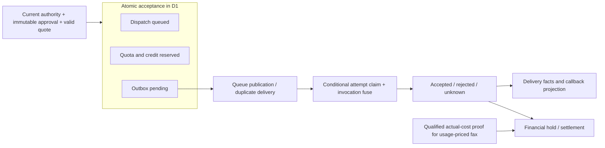

# Implicit state-machine inventory

Audited 8 November 2026 from freshly fetched `origin/main`, commit
`e0df725a2d791ef9a629d7ea91f11674d4138575` (version 1.1.32).
This is a static architecture inventory, not a change to application behavior or a
replacement for the linked [architecture](ARCHITECTURE.md), [data model](DATA_MODEL.md)
and topic contracts. The original dirty checkout was preserved; this report lives
on `codex/implicit-state-machines-20261108` in an isolated worktree.

This inventory preserves the discovery snapshot at the commit above, including
its then-unimplemented transitions. The subsequent authorized implementation,
retained mechanisms and current qualification belong to
[State-machine execution and acceptance](STATE_MACHINE_EXECUTION.md). Historical
line anchors below refer to the audited base rather than the changed candidate.

The [9 November follow-up](STATE_MACHINE_REAUDIT_2026_11_09.md) starts from
merged main, rechecks this coverage and records additional reproduced transition
races without changing this historical discovery snapshot.

## Result and counting rule

**113 app-owned lifecycle groups** are mapped below, plus one separately marked
external Stripe status projection and four families of repository automation.
This is a count of documented lifecycle groups, not a mathematically unique count
of minimal state machines or a count of runtime records. Independent persistent
resources are separate entries; closely coupled local phases and repeated loading
controllers are grouped. Nested session eligibility and scan ownership are retained
as named submachines because they independently invalidate otherwise identical
visible states. Public preview and the MCP diagnostic app are explicitly marked.

“Implicit” means that understanding the complete allowed transitions requires
combining setters, guarded writes, SQL triggers/views, row presence, clocks,
leases, immutable receipts, revisions or external events. A `status` enum does
not make the complete machine explicit. **Hybrid** entries already have explicit
state names or local guards but a dispersed full graph. Partially explicit and
externally owned entries are included to show their coupling, rather than being
misrepresented as purely implicit code. Conceptual state names describe effective
states; only code-formatted persisted literals are intended as exact enum values.

| Area | Entries | Count |
| --- | --- | ---: |
| Dispatch, approval, queue, provider outcomes, money | D1–D12 | 12 |
| Identity, sessions, workspace and invitations | AUTH-01–AUTH-12 | 12 |
| Documents, uploads, protected/secure access and copies | DOC-01–DOC-17 | 17 |
| Local Stripe binding and reconciliation | BILL-01–BILL-02 | 2 |
| Studio persistence, generation and optional AI | T01–T07 | 7 |
| Postal preparation and provider-reference maintenance | P01–P15 | 15 |
| Private runtime, erasure, telemetry and public status | R01–R07 | 7 |
| Web, iOS, MCP Apps, preview and status client controllers | C01–C41 | 41 |
| **App-owned total** | | **113** |
| External Stripe status projection (excluded above) | BILL-03 | 1 |

Read the [dispatch inventory](#dispatch-approval-and-money),
[authority inventory](#authority), [document inventory](#documents-and-secure-access),
[billing inventory](#billing), [Studio inventory](#studio-persistence-and-background-generation),
[postal/provider inventory](#postal-preparation-and-provider-policy-maintenance),
[runtime inventory](#runtime-erasure-and-service-status-lifecycles),
[client inventory](#client-orchestration) and
[automation appendix](#repository-automation-outside-the-application-runtime-count).

## Original proposal and subsequent implementation

The authored [engineering state-machine guide](../apps/engineering/src/content/docs/architecture/state-machines.mdx)
curates this map for publication without copying the raw inventory or private
proof. The original proposed sequence was: define the dispatch event/guard/effect/recovery
contract; characterize concurrent and uncertain paths through existing services
and migrated D1; extract typed decisions with current SQL boundaries preserved;
then address secure sharing, uploads, postal and Studio separately. Campaign
completion, dead-letter resolution and deletion processing required separately
specified product semantics. The user subsequently authorized this implementation;
the [execution record](STATE_MACHINE_EXECUTION.md) tracks it against every group.

The engineering testing, background-work, data-model, secure-workflow and shared
diagram explanations are synchronized with the resulting transition contracts.
Publication requires its own authorized release; a local generated page is not
served-route evidence.

## Highest-value modeling targets

| Priority | Boundary | Why a single status is insufficient | Entries |
| --- | --- | --- | --- |
| 1 | Dispatch, irreversible invocation and financial settlement | Approval can expire while prepared; queue delivery may duplicate; delivery success can precede actual-cost settlement; uncertainty never authorizes another send. | D1–D3, D5–D11 |
| 2 | Secure preparation, activation, identity binding and independent retained copy | Prepared can lack a dispatch; activation charges before invitation receipt; revoking a share does not revoke an already published personal copy. | DOC-07, DOC-11–DOC-16, R04, C12–C13, C22–C24 |
| 3 | Private and MCP multipart original transfer | Capability consumption, writer lease, part storage, document receipt, PDF readiness and host handoff have separate completion conditions. | DOC-01–DOC-06, C36–C37 |
| 4 | Postal review, transfer, quote and human send | Address-page generation, PDF scan, crop proof, transfer consent, provider draft, quote and final approval are separate gates with different retry rules. | P01–P04, D2, D11, C07, C09–C11 |
| 5 | Studio generation and distribution freeze | Job completion, generated-record success, verified document readiness, frozen recipient associations and sending approval are independent. | T01–T07, C16–C21 |
| 6 | Provider maintenance and alerts | Technical freshness cannot renew authority or consent; unknown inspection cannot mean inactive; notices have their own irreversible attempt. | P05–P13 |

These priorities describe modeling and maintenance value, not confirmed defects.
A useful next implementation would expose pure transition/guard descriptions and
exercise representative paths against existing SQL and service behavior. Preserve
the current atomic database boundaries rather than moving business correctness
into a client chart. Useful model properties include no resend after an unknown
provider outcome, immutable approval binding, no cross-tenant transition, stale
lease/revision rejection, monotonic event projection, and ledger conservation.

The dispatch path illustrates why these are coupled machines rather than one enum:

Delivery events and financial settlement remain independently observable.

## Confirmed lifecycle gaps and important distinctions

- `campaigns.status='completed'` is permitted by schema, but the application
  writers only freeze membership and attach its manifest (D4).
- `dead_letters.resolved_at` is stored/read, but no application resolution writer
  was found (D5).
- Account deletion declares requested/processing/completed; application code
  implements request/readback and completed-account refusal, without a processor
  that writes processing/completed (AUTH-12).
- Legacy monthly Horizon plan records remain in schema, but subscribe/renew is
  retired by `migrations/0060_pdf_validation_per_check.sql:1`; these are historical
  records, not an active subscription machine to invent.
- Upload complete does not mean PDF ready; provider receipt projected does not
  mean provider event linked/applied; generated does not mean verified; delivered
  does not mean financially settled. These are existing distinct contracts.
- No independent secure OTP challenge lifecycle was found: protected links use
  password/session access; secure recipient access uses verified identity/session
  and binding. The external authenticator's internals are outside this audit.

## Coverage and verification

The audit examined first-party API/domain/contracts/provider code, all web source
file names and lifecycle candidates, native iOS core/views, both MCP Apps, private
document/scanner/PDF-validator services, the separate public status service and
its client, public preview fixtures, migrations and release/qualification scripts.
A heuristic prefilter over 351 TS/TSX/JS/MJS/Python/Swift/SQL source files selected
219 lifecycle candidates; this was a discovery aid, not a claim that keywords
prove a machine. Status public assets, SQL migrations and operational scripts were
also reviewed outside that prefilter. Each substantive entry gives implementation
anchors, guards/recovery and existing test pointers where found.

All **74 application migrations** were replayed in a fresh in-memory SQLite
instance, yielding **134 current tables**. This helped distinguish current schema
from replaced/backup tables. The table coverage appendix below maps persistent
lifecycle carriers, including fields with no `status` column. The separate status
service has its own migration set. Application/test code was not changed. Existing
test pointers are traceability, not a claim that those tests ran in this audit.
No production/provider/browser session was inspected and no real communication,
merge, deployment or infrastructure provisioning occurred.

Static review cannot prove that every dynamically reachable state combination has
been enumerated. The inventory covers statically identified first-party lifecycle
families at the pinned commit; it does not reconstruct third-party SDK/Auth0/provider
internal graphs. Documentation validation and reference-check results are recorded
at the end.

## Dispatch, approval and money

### D1. Dispatch orchestration and delivery projection

**Representation:** `DispatchStatus` plus `channel`, `mode`, provider/provider_id, active_attempt_id and lease_until. States: prepared, queued, submitting, submission_unknown, accepted, delivered, failed, cancelled, bounced, complained, printed, handed_to_post (`packages/domain/src/index.ts:123`).

**Transitions:** preparation inserts prepared; confirmation moves prepared→queued; processor atomically claims queued→submitting with fresh attempt and 120-second lease; provider accepted/unknown/rejected yields accepted/submission_unknown/failed; lease expiration yields submission_unknown. Cancellation only prepared/queued→cancelled; already-cancelled repeats are idempotent. Signed channel-specific facts move forward by rank: accepted20; printed30; failed35 (fax/email) or45(postal); handed_to_post40; delivered50; bounced55; complained60. Callback order may skip intermediate states. Delivered is not the final possible email state; bounced/complained outrank it. A late delivered can supersede failed. Cancelled ranks100 and cannot be overwritten. Submission uncertainty never loops to queued or creates another attempt.

**Guards/effects:** immutable content/fingerprint, current membership, live quote, approval, sender/document/channel/suppression checks; acceptance creates quota reservation and outbox atomically in SQL. Evidence: `packages/domain/src/index.ts:1849` confirmation, `:2142` cancellation, `:2451` processing, `:2810` ranked provider projection, `:2930` expiry; `migrations/0001_core.sql:29` immutable payload and `:31` acceptance trigger. Later triggers add live/funding/secure gates; do not treat 0001 alone as current full acceptance contract.

**Tests:** `tests/integration/domain-invariants.test.ts:161` atomic confirmation, `:234` unknown non-retry, `:258` orphan/order monotonicity, `:431` cancellation, `:530` lease expiration; `tests/integration/queue.test.ts:267` duplicate queue delivery. **Classification:** dispersed, with explicit local rank table; highest-value extraction into named transition commands plus executable invariant/model tests.

### D2. Approval validity, independent of visible dispatch status

**Representation:** absence/presence of `approvals`; fingerprint, approval_kind (browser/expert), expires_at; secure_approval_evidence_id and underlying current session/authentication validity. prepared-unapproved, prepared-validly-approved, prepared-expired/invalid are all the same dispatch status. `approveWithAuthority` upserts approval without changing prepared.

**Events:** authenticated browser approval or separately verified delegation issues/replaces approval; clock, quote expiry, changed authority/session/policy invalidates it; confirmation consumes its authority for acceptance without deleting approval. TTL = minimum of 15 minutes, quote expiry, delegated review expiry, and secure session/authentication limits. Production email requires recipientRequested attestation. Secure distribution always requires browser approval, including under expert mandate.

**Guards/effects:** exact fingerprint, current membership and permission fenced into write; secure browser evidence, valid quote/protection and policy. Evidence: `packages/domain/src/index.ts:1477` browser entry, `:1492` expert entry, `:1508` common machine, `:1616` bounded expiry, `:1680` approval insertion, `:1940` acceptance fence; `migrations/0057_secure_approval_evidence.sql`, `migrations/0059_document_authentication_policy.sql`. **Tests:** `tests/integration/domain-invariants.test.ts:141`, `:451`, `:465`; `tests/integration/secure-approval-boundary.test.ts`; `tests/integration/dispatch-validation.test.ts:561` observational validation preserves approval. **Classification:** implicit derived validity, security-critical.

### D3. Expert mandate and delegated review/acceptance

**Representation:** mandate enabled+revision+expires_at, exact OAuth connection status/updated_at, admin membership, channels and per-operation/daily limits. Derived states absent/off, enabled-current, expired, invalidated/disabled. Browser admin grant/edit creates revision; disable/revoke/reconnect/account move increments revision and prevents silent revival. Reconnecting does not reactivate old authority.

**Nested review protocol:** no page progress → sequential page batches (`next_page`, exact PDF/hash/fingerprint/policy revision, bounded expiry) → all pages presented → hashed short-lived review token → approved under exact review → immutable acceptance receipt. Page1 can restart; later batches require predecessor progress, and stale PDF/connection/policy/time invalidates it. Presenting all pages attests availability, not comprehension. A new review replaces old token. Review expiry is minimum of five-minute window/policy/token/quote expiry. A repeated accepted send must match original connection/revision receipt; a different client cannot borrow review. Accepted budget remains consumed after cancellation; this is authority accounting distinct from customer money holds.

**Guards/effects:** `apps/api/src/account.ts:425`, `:466` grant/edit, `:486` disable; `apps/api/src/expert-approval.ts:38` authority, `:111` review, `:188` review expiry, `:309` acceptance; `apps/api/src/expert-review-pages.ts:184`, `:237`, `:302`, `:347`; `migrations/0024_expert_approvals.sql:26` connection invalidation, `:31` active view, `:47` valid review view, `:77` acceptance guard; `migrations/0029_expert_review_pages.sql:3`. **Tests:** `tests/integration/expert-approval.test.ts:314` default-off, `:345` replaced review token, `:409` one acceptance, `:512` no revival, `:552` concurrent budget, `:572` retained usage, `:635` revocation fence; `tests/integration/expert-review-pages.test.ts`. **Classification:** implicit composite authority lifecycle with explicit SQL views/triggers. Do not merge this with human approval or postal transfer consent.

### D4. Campaign membership freeze

**Representation:** campaigns.status draft/frozen/completed and manifest_hash nullable. Actual runtime: draft with growing prepared members → frozen without manifest → frozen with hash of sorted member IDs/fingerprints. First member approval freezes; subsequent members cannot be inserted; no runtime thaw. Evidence: `packages/domain/src/index.ts:1256` draft membership check, `:1649` freeze, `:1728` manifest read/hash, `:1736` write, `:2163` draft creation; `migrations/0001_core.sql:7`, `:30`. **Test:** `tests/integration/domain-invariants.test.ts:379` immutable fields/frozen membership.

**Confirmed modeling gap:** schema permits completed (`migrations/0001_core.sql:7`) but runtime search finds no writer for campaigns→completed; only `UPDATE campaigns` sites are DomainService `:1649` and `:1736`. Thus do not draw frozen→completed as implemented or claim an automatic campaign-completion phase. This is a lifecycle gap, not a confirmed security defect.

### D5. Durable outbox publication and queue consumption

**Representation:** no outbox → pending → published/published_at. Acceptance inserts pending in same transaction as reservation. Publisher scans fair per-tenant window, invokes queue publisher then marks published; crash between these operations can publish twice. Queue acknowledgement/retry/dead-letter disposition is an operational submachine: gates closed→retry300s, exception→retry30s, malformed/DLQ→durable dead-letter then ack, known no-op/success/unknown→ack. A queue retry is not permission to re-invoke a provider; dispatch/attempt guards own that boundary.

Evidence: `migrations/0001_core.sql:17`, `:37`; `packages/domain/src/index.ts:2414`; `apps/api/src/index.ts:1482` consumer, `:1537` dead-letter insert, `:1574` closed-gate retry, `:1600` actual process/ack. **Tests:** `tests/integration/domain-invariants.test.ts:200`; `tests/integration/queue.test.ts:142`, `:173`, `:197`, `:267`.

**Confirmed modeling gap:** dead_letters schema stores resolved_at (`migrations/0003_operations.sql:2`), admin reads it (`packages/domain/src/index.ts:2398`) but no runtime UPDATE/resolution writer found across app/package source. Current implemented lifecycle is captured retained unresolved record; recovery/resolved marker is not established.

### D6. Attempt ownership, invocation fuse and uncertainty

**Representation:** attempts.status started/accepted/rejected/unknown, bridge_claimed_at nullable, provider_id and enclosing dispatch active_attempt_id+lease. Atomic dispatch claim creates one started attempt. All preflight checks must pass before setting durable bridge_claimed_at. This irreversible NULL→timestamp compare-and-set is the second duplicate barrier. Claim failure returns unknown/ATTEMPT_ALREADY_INVOKED. Provider invocation/response then sets accepted/rejected/unknown; known accepted without provider ID is downgraded to unknown; conflicting response reference preserves existing reference and uncertainty. Lease expiration converts started→unknown, never retries physical send. A late successful response can update an unknown attempt accepted; callback projection can bind a dispatch without requiring attempt status to change (financial transport triggers separately consume that evidence).

Evidence: `packages/domain/src/index.ts:2451`, `:2591`, `:2602`, `:2637`, `:2670`, `:2708`, `:2930`; `apps/api/src/live-providers.ts:404` fuse, `:828` repeated-invocation response; `migrations/0007_live_drafts.sql` adds bridge marker. **Tests:** `tests/integration/domain-invariants.test.ts:234`, `:530`, `:563`, `:588`; `tests/unit/live-providers.test.ts`. **Classification:** implicit composite with compare-and-set; keep separate from dispatch visible outcome.

### D7. Verified receipt / orphan provider-event reconciliation

**Representation:** signature-verified provider_receipts pending/projected/unrecognized; nested provider_events unbound/unapplied (organization_id/dispatch_id/applied_at NULL) → applied. Unknown event shape is retained unrecognized. Recognized receipt becomes projected after idempotent domain ingestion, even when ingested event remains orphan: projected receipt means durable ingestion, not linked/applied business fact. Later known provider reference or trusted early client ref binds event; reconcileOrphans replays it in occurrence order. Channel allowlist and provider/reference identity guard projection; duplicate provider event ID cannot replace stored payload.

Evidence: `apps/api/src/webhooks.ts:26`, `:64`, `:75`, `:210`, `:252`; `packages/domain/src/index.ts:2727` dedup/binding, `:2810` apply, `:2904` orphans. **Tests:** `tests/integration/domain-invariants.test.ts:258`, `:355`, `:563`, `:588`; `tests/unit/providers-webhooks.test.ts`; `tests/integration/welcome-credit.test.ts:753`. **Classification:** two nested persistence phases in one ingestion lifecycle; no central graph.

### D8. Monthly quota hold and final usage

**Representation:** usage monthly counters and reservations absent/reserved/confirmed/released. prepared→queued atomically creates reserved+outbox and increments reserved counters; success/charge settlement moves to confirmed, definite pre-send cancel/rejection to released. Unknown and actual-usage fax accepted/delivered can remain reserved awaiting cost evidence. Reservation belongs to original month even if reconciliation occurs after month rollover. `ensureCreditPeriod` derives a new month from prior configured caps without refilling lifetime credit or reopening operator zeros.

Evidence: `migrations/0001_core.sql:15`, `:31`; current confirmations/releases `migrations/0023_fax_usage_pricing.sql:197`, `:205`, `:210`, `:215`; `packages/domain/src/welcome-credit.ts:55`. **Tests:** `tests/integration/domain-invariants.test.ts:161`, `:183`; `tests/integration/welcome-credit.test.ts:1057`; `tests/integration/fax-usage-pricing.test.ts:398`. **Classification:** explicit state column, implicit trigger-coupled transitions. Separate from lifetime money ledger and account provider capacity.

### D9. Lifetime customer credit reservation and actual settlement

**Representation:** single immutable production signup grant and append-only ledger; derived balance not_granted/available/exhausted/simulation (`packages/domain/src/welcome-credit.ts:9`). Each dispatch hold absent→reserved→settled/released. Settlement posts immutable cumulative fractional charge; refund of unused ceiling is not erasing settled spend. Cancel before attempt or proven provider rejection may release; failed delivery alone, or unknown provider result, cannot imply free operation. Fixed-price live email/postal settles after positive acceptance. Usage-priced fax holds after acceptance/delivery until exact operator evidence proves actual final supplier usage (including zero), then one immutable fax_usage_settlements insertion closes both financial and monthly holds. Repeated identical proof is idempotent; different proof conflicts. PDF/secure/protected service charges share this ledger but own separate lifecycles.

Evidence: `migrations/0014_welcome_credit.sql:3`, `:19`, `:46`, `:52`, `:68`, `:69`; current acceptance `migrations/0056_secure_distributions.sql:188`; current fax settlement `migrations/0023_fax_usage_pricing.sql:151`, `:171`, `:190`, `:197`; `packages/domain/src/live-fax-usage.ts:503`. **Tests:** `tests/integration/welcome-credit.test.ts:545`, `:640`, `:666`, `:753`, `:873`, `:937`, `:1007`, `:1274`; `tests/integration/fax-usage-pricing.test.ts:249`, `:310`, `:336`, `:356`, `:375`, `:431`. **Classification:** composite ledger/hold machine, highest-value explicit contract; delivery success and financial finality are independent.

### D10. Provider account transport capacity (SES and Resend variants)

**Representation:** ses_send_reservations or resend_send_reservations absent→reserved→accepted/unknown/rejected; qualified/revoked/expired account limit policy plus account-wide quota/rate/mutex predicates. SES scoped by stable AWS account+region, Resend by account. Reserved grants a single transport invocation after bridge claim; prior same-attempt reservation returns unknown, never sends again. Unknown keeps quota liability indefinitely; positive bound acceptance moves unknown→accepted; accepted/rejected immutable. Accepted ages out of daily/month windows; unknown does not. SES defaults conservative sandbox caps; Resend requires qualified explicit capacity and rechecks source contradictions before invocation. This is not tenant money accounting.

Evidence: `apps/api/src/ses-send-limits.ts:29`, `:78`, `:179`; `migrations/0017_ses_send_limits.sql:19`, `:31`, `:35`, `:42`; `apps/api/src/resend-send-limits.ts:27`, `:89`, `:134`, `:166`; `migrations/0039_resend_email_transport.sql:34`, `:36`, `:37`, `:38`. **Tests:** `tests/unit/ses-send-limits.test.ts`; Resend integration coverage lives in `tests/integration/resend-email.test.ts:1118`. **Classification:** same lifecycle pattern in separate provider implementations; do not double-count reserved/unknown as states of dispatch.

### D11. Quote eligibility and renewal lineage

**Representation:** immutable quote+policy/tariff+provider binding+expires_at; implicit missing/valid/expired/revoked-or-binding-invalid. Quote can become invalid through clock or policy mutation while dispatch stays prepared. Validation is checked at preparation, approval, atomic acceptance and final provider preflight, without renewing human approval. Fax quote renewal is a replacement aggregate: only prepared, unattempted, unfunded invalid quote can create one idempotent `fax-renew:sourceId` successor and cancel old prepared dispatch in same batch. Same exact PDF/recipient/sender/options/ceiling; successor is individual, even if old belonged to frozen campaign. Approval is not inherited.

Evidence: `packages/domain/src/live-fax-quotes.ts:269`, `packages/domain/src/live-fax-usage.ts:427`, `packages/domain/src/live-delivery-quotes.ts:577`; `packages/domain/src/index.ts:777` renewal guards, `:1350` renewal SQL fence, `:1368` old cancellation, `:1401` audit; `migrations/0066_continuous_review_preparation.sql` handles reviewer-specific expiry contract. **Tests:** `tests/integration/trusted-fax-quotes.test.ts`, `tests/integration/fax-usage-pricing.test.ts:521`, `tests/integration/dispatch-validation.test.ts:523`. **Classification:** time/foreign-binding-derived machine; provider freshness inventory covers policy renewal, which is separate from this per-dispatch quote.

### D12. Recipient feedback and tenant suppression

**Representation:** dispatch.recipient_feedback NULL→unsubscribed→reported (reported absorbing), with tenant suppression absent→present reason unsubscribe/hard_bounce/complaint/provider_suppression. Human recipient feedback via exact hashed token or signed provider permanent-bounce/complaint evidence adds suppression; soft bounces do not. Feedback status is independent of delivery status; reporting does not rewrite delivered to failed/complained. Dispatch acceptance and final processor both recheck suppression. No app unsuppress writer found in this scope.

Evidence: `apps/api/src/email-recipient-feedback.ts:66`, `:72`, `:102`; `migrations/0062_email_recipient_feedback.sql:2`, `:16`; `packages/domain/src/index.ts:2223`, `:2496`, `:2864`, `:2952`; `migrations/0039_resend_email_transport.sql:42`. **Tests:** `tests/integration/domain-invariants.test.ts:506`, `:615`; `tests/unit/secure-distribution-core.test.ts:2320`; `tests/e2e/email-preferences.spec.ts`. **Classification:** small monotonic machine plus suppression register; lower extraction priority than financial/authority coupling.

## Authority

### AUTH-01 — Browser OAuth/PKCE transaction (implicit row-presence machine)

- States: [absent] → [pending transaction + browser cookie] → [consumed]; [pending] → [expired]. Issuer, nonce, verifier, return path, account context and invitation hash are frozen in the row.
- Triggers/guards: `/auth/login` or `/auth/signup` writes a ten-minute transaction; callback hashes state+browser cookie, atomically DELETEs matching unexpired row RETURNING its data **before** token exchange. Replays and wrong browser cannot consume it. Token exchange/claim failure requires a new sign-in, rather than reviving consumed state. Claims bind ID/access subjects, nonce, verified email and active identity policy.
- Evidence: `apps/api/src/auth.ts:1444`, `apps/api/src/auth.ts:1490`, `apps/api/src/auth.ts:1581`, `apps/api/src/auth.ts:1611`, `apps/api/src/auth.ts:1678`; expiry cleanup `apps/api/src/maintenance.ts:158`. Tests: `tests/unit/auth.test.ts`, `tests/unit/auth-navigation-recovery.test.ts`, `tests/unit/mcp-auth0-domain.test.ts`.

### AUTH-02 — Browser/personal session and workspace rotation (implicit, coupled presence/lifetime)

- States: [no session] → [personal session] and/or [workspace session + companion personal session] → [rotated into another workspace] / [expired] / [revoked]. Separate personal sessions require no membership; workspace sessions derive organization from membership.
- Session creation stores one-hour expiry plus verification/authentication observations. Workspace entry and switching issue a new secret+CSRF token, copy authentication evidence without extending original lifetime, atomically verify both current and target membership snapshots, then delete old session. The DB browser-session delete trigger removes its companion personal session; native sessions/codes also depend on browser session FKs. Logout, explicit session revocation, membership authority changes, or expiry terminate authority.
- Evidence: `apps/api/src/auth.ts:705`, `apps/api/src/auth.ts:773`, `apps/api/src/auth.ts:820`, `apps/api/src/auth.ts:838`, `apps/api/src/auth.ts:974`, `apps/api/src/auth.ts:1935`, `apps/api/src/auth.ts:2082`; `apps/api/src/personal-auth.ts:285`, `apps/api/src/personal-auth.ts:307`; `migrations/0055_personal_accounts.sql:28`. Tests: `tests/unit/auth.test.ts`, `tests/unit/personal-auth.test.ts`, `tests/unit/workspace-entry.test.ts`, `tests/e2e/personal-entry-race.spec.ts`.

### AUTH-03 — Sensitive-document session eligibility (derived temporal submachine)

- States are products of persisted claims/policy plus clock: [ordinary signed-in but insufficient] → [eligible under selected document policy] → [no longer eligible]. A fresh qualifying login is the recovery event, not an assistant-set flag.
- Strong mode requires verified email, strong authentication, exact policy version and recent signed authenticatedAt (normally 900 seconds, deposit 300). Verified-account mode has its own identity/session-time policy; do not assume the strong-mode maxAge rule applies identically. Current DB fences recheck policy, identity and session after object/render awaits. Configuration change or identity mismatch can close access without status update.
- Evidence: `apps/api/src/auth.ts:911`, `apps/api/src/auth.ts:938`, `apps/api/src/sensitive-session.ts:14`, `apps/api/src/sensitive-session.ts:20`; `packages/contracts/src/document-authentication.ts`; `migrations/0065_verified_account_session_policy.sql`. Tests: `tests/unit/personal-auth.test.ts`, `tests/integration/secure-approval-boundary.test.ts`.

### AUTH-04 — Native authorization code exchange (implicit one-use capability)

- States: [none] → [issued code bound to browser session+PKCE challenge] → [consumed into native session] or [expired/revoked]. Code issue is browser-mediated; exchange atomically INSERTs native session from matching live code/browser/membership and DELETEs the code only if insert succeeded. Bad PKCE leaves another client's code unconsumed.
- Evidence: `apps/api/src/mobile.ts:234`, `apps/api/src/mobile.ts:366`, `apps/api/src/mobile.ts:404`; `migrations/0037_native_sessions.sql:2`. Tests: `tests/integration/mobile.test.ts`, `tests/e2e/mobile-account.spec.ts`.

### AUTH-05 — Native session (implicit presence/expiry/dependency lifecycle)

- States: [absent] → [active bearer session] → [expired/revoked/dependent browser session removed]. Authentication rechecks current membership, environment, original browser verification and deletion-completed refusal. Session lifetime is capped by browser expiry. It never gains browser approval power.
- DELETE native session signs out; browser deletion cascades; account authority changes remove native sessions/codes. No refresh-token lifecycle is implemented here.
- Evidence: `apps/api/src/mobile.ts:153`, `apps/api/src/mobile.ts:408`, `apps/api/src/mobile.ts:542`; `migrations/0037_native_sessions.sql:13`; `apps/api/src/account.ts:184`. Tests: `tests/e2e/mobile-account.spec.ts` and `tests/integration/mobile.test.ts`.

### AUTH-06 — OAuth client/workspace binding (explicit stored states, dispersed transitions)

- Stored states `active` / `revoked`; effective state also includes token issued-at vs `not_before`, issuer, subject/user, client, workspace, scopes, membership and revision.
- Browser bind/rebind upsert sets active and advances not_before, requiring reconnect; browser delete revokes. Role/access revocation also revokes connections. Rebinding can move the same issuer/user/client identity to another workspace. Old in-flight/token authority is fenced by revision/current snapshots.
- Evidence: `apps/api/src/auth.ts:1166`, `apps/api/src/auth.ts:2125`, `apps/api/src/auth.ts:2139`, `apps/api/src/auth.ts:2164`, `apps/api/src/auth.ts:2183`; `apps/api/src/account.ts:209`; `migrations/0002_auth.sql:31`. Tests: `tests/unit/auth.test.ts`, `tests/unit/account.test.ts`.

### AUTH-07 — Connection verification evidence (separate implicit machine)

- States [unverified] → [verified successful production tool call]; every relevant binding update resets to unverified and increments authorization_revision. Successful tool observation is monotonically updated only for matching revision and is evidence, not permission or consent. Simulation never projects verified production use.
- Evidence: `migrations/0032_connection_tool_observations.sql:5`, `migrations/0032_connection_tool_observations.sql:15`, `migrations/0032_connection_tool_observations.sql:21`; `apps/api/src/connection-observations.ts:14`; projection `apps/api/src/auth.ts:2111`. Tests: `tests/unit/auth-telemetry.test.ts`, relevant auth/account tests.

### AUTH-08 — Membership authority mutation and access revocation (implicit orchestration)

- States [member with role+supervisor options] → [changed role/options] or [credentials revoked while membership remains]. A static role enum is not itself the machine; the coordinated mutation/revocation transaction is.
- Authenticated browser admin, CSRF and exact current membership snapshot fence an audit-marker transaction. Actual role/options changes revoke native/browser/dev sessions, disable expert policy, revoke client connections, and DB triggers revoke pending invitations issued by a demoted admin. Last admin cannot be removed/demoted. `revoke-access` revokes credentials; it does **not** delete the membership.
- Evidence: `apps/api/src/account.ts:135`, `apps/api/src/account.ts:184`, `apps/api/src/account.ts:620`, `apps/api/src/account.ts:650`; `migrations/0043_workspace_invitations.sql:67`. Tests: `tests/unit/account.test.ts`, `tests/integration/workspace-roles.test.ts`, `tests/integration/workspace-roles-migration.test.ts`.

### AUTH-09 — First workspace creation from personal account (implicit durable-receipt workflow)

- States [personal account/no creation receipt] → [workspace+admin membership+disabled channels+limits+receipt committed] → [workspace session entered]. Concurrent/repeated creation uses the unique personal_workspace_creations receipt to recover a single workspace instead of provisioning duplicates. Entry failure leaves committed receipt recoverable.
- Guards: current personal browser session/CSRF, verified email for nondevelopment login. Side effects are local DB records only, not paid provider infrastructure or sending activation.
- Evidence: `apps/api/src/personal-auth.ts:340`, `apps/api/src/personal-auth.ts:352`, `apps/api/src/personal-auth.ts:363`, `apps/api/src/personal-auth.ts:388`; `migrations/0055_personal_accounts.sql:32`. Tests: `tests/unit/personal-auth.test.ts`, `tests/unit/workspace-entry.test.ts`.

### AUTH-10 — Invitation acceptance (explicit DB-enforced lifecycle)

- States `pending` → `accepted` / `revoked` / `expired`; expiry is also projected from clock before cleanup. Acceptance and delivery are orthogonal.
- Admin creates invitation with immutable recipient/role/expiry/token hash. Callback consumes invitation hash bound to that PKCE transaction. Acceptance checks exact verified email, live pending invitation and still-admin inviter; INSERT acceptance receipt triggers membership insert, accepted status, audit atomically. Terminal states cannot revive. Admin demotion/removal automatically revokes its pending invitations.
- Evidence: `apps/api/src/invitations.ts:140`, `apps/api/src/invitations.ts:212`, `apps/api/src/invitations.ts:452`, `apps/api/src/invitations.ts:531`; `migrations/0043_workspace_invitations.sql:30`, `migrations/0043_workspace_invitations.sql:46`, `migrations/0043_workspace_invitations.sql:53`, `migrations/0043_workspace_invitations.sql:67`. Tests: `tests/integration/workspace-invitations.test.ts`, `tests/e2e/team-invitations.spec.ts`.

### AUTH-11 — Invitation email delivery (separate uncertain-outcome machine)

- Production `pending` → `unknown` **before external request** → `sent` / `failed` / remains `unknown`; simulation starts `simulated`. Unknown is never auto-retried; bearer link not persisted as replay capability.
- Claim rechecks same current admin browser, pending business status and expiry for every batch item. Response requires one unique provider ID per item for sent. Definitive non408/non409 4xx becomes failed; timeout/malformed success/ambiguous response stays unknown. A sent invitation still need not be accepted.
- Evidence: `apps/api/src/invitations.ts:295`, `apps/api/src/invitations.ts:313`, `apps/api/src/invitations.ts:329`, `apps/api/src/invitations.ts:354`, `apps/api/src/invitations.ts:375`, `apps/api/src/invitations.ts:500`. Tests: `tests/integration/workspace-invitations.test.ts`.

### AUTH-12 — Account deletion request (partial/declarative lifecycle)

- Declared DB states `requested` → `processing` → `completed`; executable app source implements only absent → requested (idempotent) and readback. No processing/completion writer was found in apps/packages/scripts. Native authentication refuses accounts already completed, but that is a consumer, not evidence of an automated deletion processor.
- Receipt requires authenticated native session and explicit confirmed:true. Retention review/manual operator completion is an unresolved external boundary.
- Evidence: `apps/api/src/mobile.ts:472`, `apps/api/src/mobile.ts:620`, `apps/api/src/mobile.ts:626`, `apps/api/src/mobile.ts:176`; `migrations/0037_native_sessions.sql:25`. Tests: `tests/e2e/mobile-account.spec.ts`.

## Documents and secure access

### DOC-01 — Original PDF lifecycle (implicit storage+metadata+scan-evidence product state)

- States [R2 candidate without DB receipt] → document `quarantined` or `ready`; `quarantined` → `ready` only after exact clean scan+isolated PDF validation; retained original → `purged` through maintenance. The schema/domain registration input also declares `rejected`; production scan rejection in DocumentService is represented by a quarantined document plus blocked analysis, so do not invent a quarantined→rejected scanner transition. Local deterministic simulation has a separate direct-ready path and proves no production scan.
- Imported bytes, hash, size, version/object key, creator access and audit scan proof matter in addition to status. Registration retries verify same hash. Ready-but-proof-missing historical/interrupted registration must scan again; a ready flag alone is not sufficient. Losing dedup object can be deleted; uncertain registration retains its object for orphan maintenance.
- Evidence: `apps/api/src/documents.ts:942`, `apps/api/src/documents.ts:976`, `apps/api/src/documents.ts:1015`, `apps/api/src/documents.ts:1022`, `apps/api/src/documents.ts:1040`, `apps/api/src/documents.ts:1056`; promotion `apps/api/src/documents.ts:587`, `apps/api/src/documents.ts:626`; purge orchestration covered under erasure `apps/api/src/maintenance.ts:42`. Tests: `tests/integration/documents.test.ts`, `tests/unit/document-import.test.ts`, `tests/integration/secure-source-legacy-boundary.test.ts`.

### DOC-02 — Durable document-analysis recovery (explicit status fields; implicit transition logic)

- States `processing` → `ready` / `retryable` / `blocked`; transient response keeps processing with next_attempt_at. Explicit user retry can restart a bounded cycle from retryable/blocked; duplicate import cannot reset it. Code+attempt count+deadline+next retry+document pages/status refine each state.
- Scan needs actual clean hash-bound antivirus verdict then isolated PDF page validation. Missing config/infected/integrity/malformed/access revoked blocks. Timeout/unavailable is transient. Cron claims at most bounded work and counts attempts; first claimed retry starts deadline so queue wait does not consume it. Exhausted attempts/deadline moves to retryable. Promotion rechecks current authority, exact unchanged original and scan lease.
- Evidence: `apps/api/src/documents.ts:412`, `apps/api/src/documents.ts:444`, `apps/api/src/documents.ts:478`, `apps/api/src/documents.ts:686`, `apps/api/src/documents.ts:766`, `apps/api/src/documents.ts:798`; `migrations/0028_document_analysis.sql:3`. Tests: `tests/unit/document-rescan.test.ts`, `tests/unit/document-analysis-projection.test.ts`, `tests/e2e/document-rescan.spec.ts`.

### DOC-03 — Scan exclusive lease (implicit ownership machine)

- States [unlocked/expired] → [owned token until deadline] → [released or expired/reclaimed]. Atomic INSERT/ON CONFLICT only expired lease claim; token+unexpired lease required to finish/promote; release deletes matching token only. Independent from analysis processing state (a processing row can wait without an owner).
- Evidence: `apps/api/src/documents.ts:392`, `apps/api/src/documents.ts:403`, `apps/api/src/documents.ts:459`, `apps/api/src/documents.ts:798`. Tests: `tests/unit/document-rescan.test.ts`.

### DOC-04 — Private document upload receipt/capability (implicit multi-resource saga)

- States `reserved` → `uploading` → `complete`; reserved expiry → `rejected`; pre-pipeline failure → rejected; started pipeline failure or expired writer lease → `unknown`. Unknown can recover complete only through matching durable document receipt under current ownership authority; it does not blindly re-upload/re-register.
- Begin snapshots OAuth subject/client/issuer, connection revision, membership/options, token issuance/expiry, expected bytes/hash and planned document. One-use capability is cleared by upload claim. Final registration and completion require current authority/lease; revoked/rebound client or changed membership fences late writes. Upload complete means transfer/registration finished; document may remain quarantined with separate analysis.
- Evidence: `apps/api/src/document-upload.ts:119`, `apps/api/src/document-upload.ts:270`, `apps/api/src/document-upload.ts:386`, `apps/api/src/document-upload.ts:503`, `apps/api/src/document-upload.ts:705`, `apps/api/src/document-upload.ts:772`, `apps/api/src/document-upload.ts:814`, `apps/api/src/document-upload.ts:826`; `migrations/0061_private_document_uploads.sql:3`. Tests: `tests/integration/private-document-upload.test.ts`, `tests/unit/private-document-upload-mcp.test.ts`.

### DOC-05 — MCP App chunked upload coordinator (implicit nested receipt/lease machine)

- States `receiving` → `finalizing` → `complete`; cancel/expiry/rejection → `cancelled` / `expired` / `rejected`; ambiguous part/final pipeline → `unknown`. Only exact recovered part receipt can move APP_PART_UNCONFIRMED unknown back to receiving. Exact core document receipt resolves finalizing/unknown complete; core rejection resolves rejected.
- Receiving also has idle vs writer-owned substate (writer token/expiry/part index), byte cursor and sequential part hashes. Finish claims only complete byte count+no writer and a global finalizing concurrency bound. Cancellation/cleanup fences core writer before staged cleanup; cannot rewrite a core completed receipt as cancelled. Tool capability/host activation, OAuth and membership remain gates.
- Evidence: `apps/api/src/mcp-app-upload.ts:239`, `apps/api/src/mcp-app-upload.ts:325`, `apps/api/src/mcp-app-upload.ts:343`, `apps/api/src/mcp-app-upload.ts:452`, `apps/api/src/mcp-app-upload.ts:476`, `apps/api/src/mcp-app-upload.ts:541`, `apps/api/src/mcp-app-upload.ts:707`, `apps/api/src/mcp-app-upload.ts:731`, `apps/api/src/mcp-app-upload.ts:832`, `apps/api/src/mcp-app-upload.ts:847`; `migrations/0063_mcp_app_document_uploads.sql:8`. Tests: `tests/integration/mcp-app-document-upload.test.ts`, `tests/unit/mcp-app-upload.test.ts`, `tests/browser/mcp-document-upload.test.mjs`.

### DOC-06 — Individual uploaded-part storage settlement (nested independent machine)

- States `pending` → `confirmed` or `unknown`; unknown → confirmed only if reading exact staged object confirms size/hash and current authority. `storage_settled`, put_token and coordinator writer token distinguish known no-storage failure from uncertain write. Coordinator advances received_bytes only after confirmation under same lease/revision. Unknown reads never establish absence.
- Evidence: `apps/api/src/mcp-app-upload.ts:397`, `apps/api/src/mcp-app-upload.ts:423`, `apps/api/src/mcp-app-upload.ts:443`, `apps/api/src/mcp-app-upload.ts:629`, `apps/api/src/mcp-app-upload.ts:642`, `apps/api/src/mcp-app-upload.ts:669`; `migrations/0063_mcp_app_document_uploads.sql:36`. Same tests as DOC-05.

### DOC-07 — Secure source-copy creation (implicit R2/DB durable-receipt workflow)

- States [no receipt] → [immutable object stored, metadata absent] → [creator-private ready secure source copy] → [purged]. Deterministic tenant/user/key-derived document ID is receipt; key reuse with different source fails. Uncertain R2/D1 completion retains candidate; same-key retry validates and recovers rather than deleting a possible winner.
- Browser current authority and unchanged ready nonsecure source+exact hash/size+production scan proof are rechecked before registration transaction. Conditional put preserves winner. Migration guard fails before storage work; insertion trigger accounts quota exactly once. Copy is immediately isolated from ordinary send/protected-link source paths; it is not a personal retained copy or a revocation of old copies.
- Evidence: `apps/api/src/secure-document-copy.ts:19`, `apps/api/src/secure-document-copy.ts:84`, `apps/api/src/secure-document-copy.ts:160`, `apps/api/src/secure-document-copy.ts:184`, `apps/api/src/secure-document-copy.ts:222`; `migrations/0073_secure_document_source_copies.sql`. Tests: `tests/integration/secure-source-copy.test.ts`, `tests/e2e/secure-source-copy.spec.ts`.

### DOC-08 — Purchased PDF diagnostic + credit effect (SQL-enforced transactional machine)

- States `processing` → `complete` or `error`; report passed/failed is a separate compliance result inside complete. No scan promotion or send consent. A unique tenant idempotency key binds exact document hash/profile/purchase. Duplicate processing returns busy; complete replays report; error remains failed for same key.
- Browser admin explicitly approves exact PDF/hash, profile, minor-unit price and terms. INSERT creates immutable purchase atomically. SQL views reserve price while processing, spend only complete and release it on error. Deadline expiry marks error; current admin/unchanged ready original and authority are rechecked before completion. Capacity caps concurrent checks. Historical monthly subscribe/renew is retired, not the active purchase model.
- Evidence: `apps/api/src/pdf-validation.ts:71`, `apps/api/src/pdf-validation.ts:156`, `apps/api/src/pdf-validation.ts:302`, `apps/api/src/pdf-validation.ts:326`, `apps/api/src/pdf-validation.ts:343`; `migrations/0051_pdf_validation.sql:2`; `migrations/0060_pdf_validation_per_check.sql:10`, `migrations/0060_pdf_validation_per_check.sql:32`, `migrations/0060_pdf_validation_per_check.sql:68`, `migrations/0060_pdf_validation_per_check.sql:75`. Tests: `tests/unit/pdf-validation.test.ts`, `tests/unit/pdf-validation-pricing.test.ts`, `tests/e2e/pdf-validation.spec.ts`.

### DOC-09 — Protected-link hosting activation/termination (explicit DB states, implicit coupling)

- States `draft` → `active` → `revoked` / `expired`; draft also revokes/expires. One current draft/active hosting per source. Validly approved production dispatch acceptance queues send, inserts one immutable hosting charge and DB trigger activates hosting; activation is not email delivery.
- Preparation binds immutable document hash, token/password verifier, paid duration and expiry; current source must be ready/scanned and not reserved as secure distribution. Revoke blanks sealed secrets and removes recipient sessions; time expiry closes reads even before cleanup persists expired. Terminal state cannot revive and active cannot return draft. Source cannot be purged while active hosting needs it.
- Evidence: `apps/api/src/protected-documents.ts:188`, `apps/api/src/protected-documents.ts:229`, `apps/api/src/protected-documents.ts:328`, `apps/api/src/protected-documents.ts:374`, `apps/api/src/protected-documents.ts:492`, `apps/api/src/protected-documents.ts:654`; `migrations/0040_protected_documents.sql:2`, `migrations/0040_protected_documents.sql:19`, `migrations/0040_protected_documents.sql:23`. Tests: `tests/integration/protected-documents.test.ts`, `tests/e2e/protected-recipient.spec.ts`.

### DOC-10 — Protected recipient unlock/session (implicit capability machine)

- States [locked] → [unlocked short-lived cookie] → [locked after session expiry], or [unavailable after hosting expiry/revoke/source refusal]. Password POST is origin checked and rate limited; correct verifier creates session no longer than fifteen minutes or hosting remainder. Each content read rechecks active paid hosting, exact ready/scanned source and session. This is a password flow, not a separate OTP flow.
- Nested counter state [attempts within 15-minute window] → [rate blocked] → [new window]; IP+hosting budgets are distinct. Source read integrity still matters after unlock.
- Evidence: `apps/api/src/protected-documents.ts:385`, `apps/api/src/protected-documents.ts:407`, `apps/api/src/protected-documents.ts:534`, `apps/api/src/protected-documents.ts:539`, `apps/api/src/protected-documents.ts:570`, `apps/api/src/protected-documents.ts:597`. Same tests as DOC-09.

### DOC-11 — Secure distribution render/preparation (implicit progress+lease machine)

- States `preparing` (unclaimed / leased / pages partly rendered) → stored `prepared` with **dispatch_id NULL** (still publicly preparing) → prepared with immutable dispatch+quote; failures → `failed`, prepared deadline → `expired`, creator revocation → `revoked`.
- Source, recipient and policy immutable; source must be isolation-safe/current ready/scanned. Render resumes next_page, freezes original_key/pages/manifest by hash, uses lease token/expiry and bounded retries. `finishPreparation` records manifest and prepared status before preparing/attaching dispatch, so status alone does not indicate review readiness. recoverPending requeues partially complete preparation and expires bounded old work. Async preparation rechecks initiating browser or OAuth revision authority; it cannot approve/send.
- Evidence: `apps/api/src/secure-distributions.ts:555`, `apps/api/src/secure-distributions.ts:810`, `apps/api/src/secure-distributions.ts:823`, `apps/api/src/secure-distributions.ts:923`, `apps/api/src/secure-distributions.ts:936`, `apps/api/src/secure-distributions.ts:1012`, `apps/api/src/secure-distributions.ts:1039`, `apps/api/src/secure-distributions.ts:1122`, `apps/api/src/secure-distributions.ts:1152`, `apps/api/src/secure-distributions.ts:1196`, projection `apps/api/src/secure-distributions.ts:350`; `migrations/0056_secure_distributions.sql:2`. Tests: `tests/unit/secure-distribution-core.test.ts`, `tests/integration/secure-resend-journey.test.ts`, `tests/e2e/secure-distribution-recovery.spec.ts`.

### DOC-12 — Paid secure distribution activation/access lifetime (coupled DB transition)

- States review-ready prepared → `active` at underlying dispatch prepared→queued acceptance; active → `revoked` or effective `expired`. DB guard binds exact source+manifest+recipient+policy+price and complete page count; trigger charges service fee, starts expiry, changes usage/reservation credit effects and emits event atomically. Invitation transport is independent and can still fail; revocation does not undo charge or remove separately retained recipient copy.
- Active read authorization requires recipient binding plus session/policy/expiry. Revocation accepts preparing/prepared/active. DB expiry may lag clock projection; service read projects expired. Purge orchestration after retention is covered under erasure and is separate from access revocation.
- Evidence: `migrations/0056_secure_distributions.sql:132`, `migrations/0056_secure_distributions.sql:150`, `migrations/0056_secure_distributions.sql:156`, `migrations/0056_secure_distributions.sql:168`; `apps/api/src/secure-distributions.ts:1385`, `apps/api/src/secure-distributions.ts:1413`; `apps/api/src/personal-documents.ts:668`. Tests: `tests/integration/secure-approval-boundary.test.ts`, `tests/integration/secure-resend-journey.test.ts`, `tests/e2e/secure-distribution-send.spec.ts`.

### DOC-13 — Secure quote supersession/recovery (implicit durable event+replacement machine)

- States [prepared with invalid/expired quote] → [old unsubmitted dispatch cancelled + quote_renewal_started marker] → [new immutable secure preparation at secure-renew:<old-id>]. Interruption after cancellation is recoverable with durable event/currentCancellation guard and deterministic replacement request key; existing replacement replays. Old preparation is not rewritten back to a fresh quote.
- Browser reviewer+recent document authentication/current source authority; exact still-unsubmitted old dispatch; no provider, attempt, quota reservation or outbox. Concurrent acceptance competes atomically with cancellation. A still-valid quote cannot renew.
- Evidence: `apps/api/src/secure-distributions.ts:1213`, `apps/api/src/secure-distributions.ts:1238`, `apps/api/src/secure-distributions.ts:1255`, `apps/api/src/secure-distributions.ts:1292`, `apps/api/src/secure-distributions.ts:1318`, `apps/api/src/secure-distributions.ts:1335`. Tests: `tests/e2e/secure-distribution-recovery.spec.ts`, `tests/unit/secure-distribution-core.test.ts`.

### DOC-14 — Recipient association and human/verified-email binding (implicit timestamp machine)

- States [unclaimed recipient] → [claimed user pending sender verification] → [bound]; configured verified-email policy allows claim to bind immediately. recipient_user_id, claimed_at, bound_at, binding_method and binding_by, not one status, encode it. First bound user/method cannot be changed by update.
- Claim needs active unexpired distribution token, exact verified recipient email and valid personal document session; existing different recipient forbidden. Strict policy needs browser reviewer with current approval permission and personal session to bind exact previously claimed user. Until bound no sensitive pages/download/deposit; list can show pending with title withheld. Binding proves identity association, not delivery/opening.
- Evidence: `apps/api/src/personal-documents.ts:145`, `apps/api/src/personal-documents.ts:286`, `apps/api/src/personal-documents.ts:305`, `apps/api/src/secure-distributions.ts:1436`, `apps/api/src/secure-distributions.ts:1458`; immutability `migrations/0056_secure_distributions.sql:31`. Tests: `tests/unit/secure-distribution-core.test.ts`, `tests/e2e/secure-distribution-send.spec.ts`.

### DOC-15 — Personal vault deposit copy job (implicit lease+progress saga)

- States `preparing` (idle/owned lease; original_ready flag and next_page progress) → `active` once independently encrypted original/pages+personal receipt committed, or `aborted`. One operation per organization/distribution/user. Existing active personal copy returns receipt; deleted/expired copy cannot be regenerated under same source receipt.
- Deposit requires bound active source, explicit allowVaultDeposit policy and current personal document session (strong mode recent 300s). Lease token fences page/original writes; session hash can be rebound by explicit current request when old lease expired. Recovery resumes only with a live eligible session/source. Lost or expired session authority pauses preparing work and releases its lease; an explicit request can attach a fresh eligible session. Source revoke/expiry or lost paid deposit policy aborts unpublished work. Completed retained copy becomes independent; source later revocation does not traverse personal namespace.
- Evidence: `apps/api/src/personal-documents.ts:839`, `apps/api/src/personal-documents.ts:875`, `apps/api/src/personal-documents.ts:903`, `apps/api/src/personal-documents.ts:925`, `apps/api/src/personal-documents.ts:1004`, `apps/api/src/personal-documents.ts:1125`, `apps/api/src/personal-documents.ts:1170`, `apps/api/src/personal-documents.ts:1212`, `apps/api/src/personal-documents.ts:1234`; `migrations/0056_secure_distributions.sql:99`; `migrations/0058_secure_copy_jobs.sql`. Tests: `tests/unit/secure-distribution-core.test.ts`, `tests/e2e/secure-distribution-send.spec.ts`.

### DOC-16 — Independent retained personal document (explicit terminal status, clock-derived expiry)

- States `active` → `deleted` or `expired`; effective expired as soon as expires_at passes even before persisted cleanup. Owner+document-authenticated session authorizes page/download/delete; no workspace role or source ongoing access is needed after successful publication. Delete hides access immediately; object erasure happens in a distinct bounded purge workflow. Immutable receipt prevents deleted/expired copy from returning active.
- Evidence: `apps/api/src/personal-documents.ts:146`, `apps/api/src/personal-documents.ts:392`, `apps/api/src/personal-documents.ts:668`, `apps/api/src/personal-documents.ts:802`, `apps/api/src/personal-documents.ts:1251`; `migrations/0056_secure_distributions.sql:72`, `migrations/0056_secure_distributions.sql:88`; physical purge `apps/api/src/maintenance.ts:194`. Tests: `tests/unit/personal-document-list.test.ts`, `tests/e2e/personal-document-list.spec.ts`, `tests/e2e/secure-distribution-send.spec.ts`.

### DOC-17 — Provider media-access grant (implicit expiring, parent-bound capability)

- States [absent] → [live grant for exact tenant/document/hash/attempt/provider] → [ineffective after expiry or parent attempt/dispatch leaves permitted state] → [deleted by cleanup]. This is reusable provider GET access within its validity, not a consumed-once token.
- Production fax hook generates opaque token and stores only hash with 45-minute expiry. GET requires current fax live gate, exact token, same active attempt/provider and permitted dispatch submitting/submission_unknown/accepted plus attempt started/unknown/accepted; exactDocument rechecks ready source/scan/hash/bytes. A still-unexpired grant row can already be unusable because parent state changed.
- Evidence: `apps/api/src/live-providers.ts:421`, `apps/api/src/live-providers.ts:435`, `apps/api/src/live-providers.ts:947`, `apps/api/src/live-providers.ts:967`; cleanup `apps/api/src/maintenance.ts:175`; `migrations/0007_live_drafts.sql:2`; review-preparation prohibition `migrations/0035_review_fax_preparation.sql:188`. Tests: `tests/unit/live-providers.test.ts:647`, `tests/unit/live-providers.test.ts:702`. Overlap: dispatch/provider bridge sections cover issuance triggers and parent transitions.

## Billing

### BILL-01 — Stripe customer binding/provision reconciliation (implicit timestamps+nullable ID)

- States [no billing account] → [provision started/no customer ID] → [customer linked], or [ambiguous beyond bounded idempotency window/manual reconciliation required]. Account row freezes provision_started_at; deterministic tenant/mode idempotency key permits bounded retry, but after 23 hours unresolved creation refuses another customer creation. Atomic null-only update and canonical metadata/mode checks prevent conflicting binding.
- Admin/current membership, configured environment and simulation-vs-live gate; final admin recheck after provider operation. Stripe metadata never grants Guteneo membership.
- Evidence: `apps/api/src/billing.ts:256`, `apps/api/src/billing.ts:272`, `apps/api/src/billing.ts:286`, `apps/api/src/billing.ts:321`; `migrations/0009_billing.sql:2`. Tests: `tests/unit/billing.test.ts`, `tests/e2e/account-billing.spec.ts`.

### BILL-02 — Stripe canonical sync/receipt application (implicit per-account lease+one-use receipt)

- States verified event [unapplied] → [account sync lease acquired] → [canonical resource projected + durable deduplication receipt] → [duplicate acknowledged]; concurrent lease → retryable busy; expired worker loses fence and cannot commit. Lease finally releases matching token or becomes reclaimable by time.
- Signature/mode/customer binding verification precedes lookup. Unknown type/customer ignored. Canonical GET from Stripe is serialized per billing account rather than projecting out-of-order event snapshots. Tenant/mode/customer/object ID validated; projection + durable receipt guarded by live lease token and deadline in one batch. The application writes receipts only on insertion; no SQL immutability trigger for this table is claimed. Failure does not write receipt, allowing event redelivery.
- Evidence: `apps/api/src/billing.ts:541`, `apps/api/src/billing.ts:586`, `apps/api/src/billing.ts:598`, `apps/api/src/billing.ts:615`, `apps/api/src/billing.ts:685`, `apps/api/src/billing.ts:707`, `apps/api/src/billing.ts:730`; `migrations/0009_billing.sql:62`. Tests: `tests/unit/billing.test.ts`.

### BILL-03 — External invoice/payment/subscription status projections (external-owned lifecycle)

- DB billing_invoices, billing_payments, billing_subscriptions store Stripe status and related money/cancellation timestamps, but Guteneo does not implement those business transition graphs locally. Invoice statuses accepted are draft/open/paid/uncollectible/void; payment/subscription statuses are provider strings. Treat them as externally owned state machines projected through BILL-02, not a locally proven full transition map. Portal request creates a validated short-lived provider session with idempotency, but no persisted local portal lifecycle.
- Evidence: `apps/api/src/billing.ts:29`, `apps/api/src/billing.ts:34`, `apps/api/src/billing.ts:341`, `apps/api/src/billing.ts:649`, `apps/api/src/billing.ts:670`; `migrations/0009_billing.sql:15`, `migrations/0009_billing.sql:34`, `migrations/0009_billing.sql:49`. Tests: `tests/unit/billing.test.ts`.

## Studio persistence and background generation

### T01. Template authoring, publication, archive and deletion — hybrid

`draft → published → draft` (a later edit), with `draft/published → archived`; owner deletion adds `deleted_at` and sets archived. `revision`, `current_version`, permissions and immutable `template_versions` form the real state, so published is not equivalent to “no editable draft.” Expected-revision comparisons and current-authority fences protect writes; archived templates must be duplicated to edit. Deletion releases active-template capacity while preserving historical versions/jobs. Sources: `apps/api/src/template-workflow.ts:722`, `:750`, `:804`, `:861`, `:885`; `migrations/0049_template_soft_deletion.sql:1`. Existing evidence: `tests/integration/template-workflow.test.ts` (publication, sharing, deletion races, retained history).

### T02. Dataset quarantine, bounded analysis and retention — hybrid

Import persists R2 bytes and a quarantined dataset, then attempts analysis. Effective states are quarantined idle/leased/retryable/exhausted, ready, rejected, expired and purged; `analysis_attempts`, lease token/deadline, source/profile hashes and `expires_at` carry the hidden phases. A 90-second lease permits at most three attempts; exact-source scan/integrity rejection is terminal for that import, while transient parse/transport failure remains quarantined. A ready dataset does not guarantee that its retained source still exists forever. Sources: `apps/api/src/template-workflow.ts:1054`, `:1116`; `apps/api/src/maintenance.ts:101`; `migrations/0048_dataset_analysis_recovery.sql:1`. Existing evidence: `tests/integration/template-workflow.test.ts`, `tests/e2e/generation-analysis.spec.ts`.

### T03. Mapping version validation — hybrid

Each immutable mapping version starts draft and becomes validated only when validation returns ready. Changes create another draft version using `expectedVersion`; they do not mutate a validated version. Dataset structure hash and plan/validation JSON are part of the state; a validated mapping label alone does not prove compatibility with a newly selected source. Sources: `apps/api/src/template-workflow.ts:1568`, `:1602`, `:1629`; `migrations/0044_template_workflow.sql:29`. Existing evidence: `tests/integration/template-workflow.test.ts`, `tests/e2e/dataset-mapping-alias.spec.ts`.

### T04. Generation batch aggregation and freezing — hybrid

`queued → running → completed/partial/failed`, with cancellation from queued/running/partial/failed and explicit failed-record retry reopening partial/failed as queued. State aggregates child records, rather than provider delivery. Distribution-plan existence independently freezes retries; completed or cancelled generation can retain successful outputs for later preparation. Cancellation is absorbing for the batch. Sources: `apps/api/src/template-workflow.ts:1629`, `:1927`, `:1941`, `:2239`, `:2262`. Existing evidence: `tests/integration/template-workflow.test.ts`, `tests/e2e/template-data.spec.ts`.

### T05. Generation record leasing, artifact recovery and registration — hybrid

`queued → running → generated/failed/cancelled`; expired running leases are reclaimable below three attempts, and exhausted running work becomes failed. Running has independently durable subphases: no artifact, immutable artifact stored, artifact pointer persisted, document registered, final record committed. A retry checks/reuses retained artifact bytes; current membership/template/connection and lease fences precede document registration. Explicit retry queues failed records only when the batch is uncancelled and unfrozen. Sources: `apps/api/src/template-workflow.ts:1975`, `:1996`, `:2222`; `migrations/0044_template_workflow.sql:41`. Existing evidence: `tests/integration/template-workflow.test.ts` (lost responses, lease fencing, cancellation, retry limits).

### T06. Frozen distribution manifest and per-entry preparation — implicit

There is no plan status enum. Each entry is pending, preparation-failed, dispatch-associated, or postal-review-associated according to nullable `dispatch_id`, `error_code` and the separate postal-review relation. An immutable manifest binds exact generated hashes and recipient/channel choices; an explicit bounded resume prepares missing entries with stable per-entry keys. Postal review later projects its own dispatch association without changing the manifest; status reads never resume preparation, approve or send. Sources: `apps/api/src/template-workflow.ts:2246`, `:2438`, `:2497`, `:2546`; `migrations/0044_template_workflow.sql:46`; `migrations/0047_distribution_postal_reviews.sql:3`. Existing evidence: `tests/integration/template-workflow.test.ts`, `tests/e2e/template-distribution.spec.ts`, `tests/e2e/studio-distribution-handoff.spec.ts`.

### T07. Optional AI transfer, budget and suggestion validity — implicit

Browser-admin policy grants transfer eligibility; each explicit analysis/suggestion atomically consumes one daily call, rechecks current authority, performs inference and rechecks policy (plus exact template revision for template suggestions) before returning a proposal. Effective states are disabled/unconfigured/eligible/budget-exhausted and request pending/returned/discarded-by-revocation-or-revision. A failed or discarded call does not roll back its consumed allowance. Returned suggestions still require the separate client review/adoption workflow; they never publish or send. Sources: `apps/api/src/template-workflow.ts:1383`, `:1413`, `:1443`, `:1505`; `packages/data/ai.ts:1`, `packages/data/template-ai.ts:1`. Existing evidence: `tests/integration/template-workflow.test.ts:4106`, `:4211`, `:4230`, `:4350`.

## Postal preparation and provider policy maintenance

### P01. Postal address-page derivation and same-key recovery — implicit

`absent → leased/rendering → artifact retained → generated document linked`; unfinished failures release the lease for same-key retry, while expiry or three attempts exhausts recovery. These states live in nullable generated ID/hash, artifact object, lease and attempt count rather than a status column. Current exact source/profile/recipient/version and authority fence every unfinished retry; an already linked result is read back and checked. The resulting document still has its independent scan lifecycle. Sources: `apps/api/src/postal-address-page.ts:142`, `:245`, `:304`, `:379`; `migrations/0033_postal_address_pages.sql:3`. Existing evidence: `tests/unit/postal-address-page.test.ts`, `tests/e2e/postal-address-page.spec.ts`.

### P02. Postal preflight evidence — hybrid

`processing → review_required/blocked/failed`; timeout, expiry and supersession add derived states on reads. Exact PDF/hash, sender, profile, address, options and render proof are frozen before private analysis; final promotion rechecks source readiness, scan evidence and current authority. Once processing ends the persisted analysis result cannot be casually rewritten. Expired evidence is later cleared without erasing idempotency metadata. Sources: `apps/api/src/postal.ts:501`, `:634`, `:838`, `:1057`; `migrations/0020_postal_preflights.sql:3`. Existing evidence: `tests/unit/postal.test.ts`, `tests/e2e/postal-review.spec.ts`.

### P03. Postal transfer consent and execution — hybrid

An independent `not_started → preparing → prepared/unknown` track sits beside the preflight result. Transfer requires the exact immutable review and either browser review authority or the distinct current delegated postal-transfer mandate. Consent insertion and transfer start are atomic; stale preparing is projected unknown after two minutes, and ambiguous transfer must be reconciled rather than uploaded again automatically. Transfer is not final-send approval. Sources: `apps/api/src/postal.ts:585`, `:869`, `:911`, `:985`, `:998`; `migrations/0020_postal_preflights.sql:34`; `migrations/0034_postal_sender_submission.sql:1`. Existing evidence: `tests/unit/postal.test.ts`, `tests/integration/expert-approval.test.ts`.

### P04. Provider postal draft creation and exclusive consumption — hybrid

`preparing → prepared/unknown` records a draft upload separately from transfer UI state. `claimed_dispatch_id: NULL → exact dispatch` is a second, exclusive-use phase; prepared provider state, exact document/recipient/options and calculator quote must agree before send. Stable idempotency recovers known records; uncertain upload or provider-send response does not justify creating another draft/send. Sources: `apps/api/src/live-providers.ts:1009`, `:1110`, `:1158`, `:1194`, `:742`, `:765`; `migrations/0007_live_drafts.sql:1`. Existing evidence: `tests/unit/live-providers.test.ts`, `tests/unit/postal.test.ts`.

### P05. Qualified provider references and bounded authority — implicit temporal family

Trusted fax/delivery prices, SES/Resend capacity policies, postal setup generations, fax reviewer authority/access and refresh registrations have effective not-yet-valid/current/expired/revoked/superseded states. Stored qualified/active flags alone are insufficient: exact tenant/account/sender/route bindings, immutable revisions, validity windows and selected consumers determine usability. Technical replacement grants no consent or mandate extension. The email sender materializer separately creates its verified sender, replaces only an expired recognized automatic price and may enable its tenant email channel under current gates (`apps/api/src/email-setup.ts:37`, `:136`, `:156`, `:199`); this is not a read-only status projection. Review-only and continuous-review overlays deliberately have separate no-send guards, rather than ordinary live-route renewal. Sources: `packages/domain/src/live-fax-quotes.ts:1`, `packages/domain/src/live-delivery-quotes.ts:1`; `apps/api/src/postal-policy-refresh.ts:182`, `apps/api/src/provider-freshness.ts:399`; `migrations/0066_continuous_review_preparation.sql:1`, `migrations/0067_automatic_fax_tariffs.sql:3`, `migrations/0071_verified_fax_reference_maintenance.sql:5`. Existing evidence: `tests/integration/fax-tariff-refresh.test.ts`, `tests/integration/provider-freshness.test.ts`, `tests/integration/fax-review-preparation.test.ts`. Individual prepared-quote expiry/renewal is inventoried with dispatch, not counted again here.

### P06. Registered single-route fax tariff renewal — implicit

`waiting/due → leased → source inspection → applying new immutable tariff → succeeded`, with quote deferral or failure backoff returning to waiting. `next_due_at`, lease token/deadline, `applying_tariff_id`, last result and failure count encode the graph. Active commitments defer replacement; exact predecessor/binding and lease fences protect atomic revoke-and-insert. A lost database result is checked for its planned tariff; uncertainty does not cause unbounded write retry. Sources: `apps/api/src/fax-tariff-refresh.ts:530`, `:553`, `:577`, `:803`, `:849`; `migrations/0067_automatic_fax_tariffs.sql:58`. Existing evidence: `tests/integration/fax-tariff-refresh.test.ts`.

### P07. Fourteen-route fax reference renewal and commit reconciliation — implicit

A separate group machine leases an immutable anchor/exclusion set, reads shared evidence, durably records an applying plan, and atomically replaces fourteen references or none. After uncertain commit, a new claimant fences the prior lease and reconciles that exact plan before reading new rates. Quote deferral/backoff preserves history; confirmed binding/exclusion drift revokes the registration. It has its own durable plan and recovery protocol, so it is not merely another caller of P06. Sources: `apps/api/src/verified-fax-reference-refresh.ts:287`, `:310`, `:367`, `:688`, `:737`, `:783`; `migrations/0071_verified_fax_reference_maintenance.sql:42`. Existing evidence: `tests/integration/verified-fax-reference-refresh.test.ts:316`, `:442`, `:587`, `:658`.

### P08. Postal setup-generation renewal — implicit

Latest complete selected generation enters due/leased/inspecting/committing, then receives a new immutable generation or defers/backs off. Current provider organisation/profile and all predecessor policies must match, and active quotes defer replacement. Preparation selection can keep this machine relevant while final sending is disabled. No sender declaration, provider draft or consent is created. Sources: `apps/api/src/postal-policy-refresh.ts:293`, `:342`, `:447`, `:481`, `:486`, `:555`, `:613`; `migrations/0069_postal_policy_refresh.sql:3`. Existing evidence: `tests/integration/postal-policy-refresh.test.ts`.

### P09. Resend qualification renewal and consumer-specific blocking — implicit

Due/leased/source-read/commit/backoff phases are encoded by refresh state, source digest, qualification deadline and error fields. Automatic pricing and selected send limits are independent consumers: domain/binding contradictions close both, price contradictions affect automatic pricing, and capacity contradictions affect acceptance. Confirmed contradictions persist separately from transient unreadability; successful technical refresh preserves account reservations/holds and cannot recreate revoked capacity. Sources: `apps/api/src/resend-policy-refresh.ts:43`, `:110`, `:619`, `:678`, `:749`, `:812`, `:845`; `apps/api/src/resend-policy-state.ts:1`; `migrations/0070_resend_policy_maintenance.sql:1`. Existing evidence: `tests/integration/resend-policy-refresh.test.ts`, `tests/integration/provider-freshness.test.ts`.

### P10. Selected-provider freshness collection and paginated reconciliation — implicit

Each exact binding has active/inactive/unknown selection; only proved deselection/revocation means inactive. Lost credentials, failed reads and omitted pages remain unknown, preserving unresolved incidents. Per-mechanism cursor state cycles through bounded inventory pages and is advanced with a predecessor fence, so a partial scan cannot imply global recovery. Sources: `apps/api/src/provider-freshness.ts:156`, `:193`, `:251`, `:298`, `:828`; `migrations/0068_provider_freshness_alerts.sql:46`. Existing evidence: `tests/integration/provider-freshness.test.ts`, `tests/integration/provider-freshness-collector.test.ts`.

### P11. Freshness incident lifecycle — hybrid

Absent → at_risk or expired; at_risk → expired; either unresolved state → resolved; resolved → at_risk/expired on genuine re-enablement. The 24-hour threshold and actual deadline derive severity; replacement/explicit disable resolves only the exact inspected binding. Evaluation timestamps and digests fence stale or conflicting snapshots; empty/partial evaluation cannot resolve unseen incidents. Sources: `apps/api/src/freshness-alerts.ts:123`, `:162`, `:192`, `:216`; `migrations/0068_provider_freshness_alerts.sql:17`. Existing evidence: `tests/integration/freshness-alerts.test.ts`.

### P12. Preventive task milestones and recurrence — hybrid

Active/resolved tasks independently advance operator 7d→3d→1d→expired or automatic 48h→24h→expired stages; ranks never regress within an occurrence. Replacement/disable resolves a task; re-enablement increments occurrence and permits new milestone identities. Reconciliation requires the exact accepted freshness evaluation, so stale scans cannot reopen work or queue obsolete notices. Sources: `apps/api/src/freshness-prevention.ts:7`, `:64`, `:168`, `:248`; `migrations/0074_provider_freshness_prevention.sql:4`. Existing evidence: `tests/integration/freshness-prevention.test.ts`.

### P13. Operational notification outbox and one-attempt send — hybrid

`pending → sending → sent/failed/unknown`, or pending→superseded when its task/milestone is obsolete. Atomic global hourly/daily limits, envelope digest and a two-minute lease bind one attempt; interrupted sending becomes unknown and never returns to pending. A sent acknowledgement is provider acceptance, not recipient receipt. This is independent of customer dispatch/outbox accounting and is gated by explicit operational-notification configuration. Sources: `apps/api/src/provider-prevention-notifications.ts:161`, `:208`, `:216`, `:246`, `:280`; `migrations/0074_provider_freshness_prevention.sql:30`, `:76`. Existing evidence: `tests/integration/provider-prevention-notifications.test.ts:287`, `:393`, `:429`, `:602`.

### P14. Postal destination-evidence single flight and cache — implicit

Empty/expired → loading shared promise → current immutable snapshot; load failure clears in-flight state without a permissive stale fallback. Snapshot expiry/future timestamps invalidate it; unavailable/delayed are source-derived destination classifications rather than mutable destination workflows. Sources: `packages/providers/pingen-destination-availability.ts:159`, `:167`, `:180`, `:203`. Existing evidence: `tests/unit/pingen-destination-availability.test.ts`, `tests/unit/pingen-destination-runtime.test.ts`.

### P15. Pingen access-token renewal — implicit

Missing/near-expiry token → credential exchange → cached usable token; expiry within a minute triggers renewal, invalid responses fail the operation. The cache is per client instance and has no persisted human/session authority; an in-flight single-flight latch is not implemented here. Sources: `packages/providers/pingen.ts:63`, `:452`. Existing evidence: `tests/unit/providers.test.ts`.

## Runtime, erasure and service-status lifecycles

### R01. Scanner readiness, freshness and exclusive scan — implicit

Container cold/running/idle-sleep combines with daemon unavailable/ready, current/stale loaded signatures, and scan-lock free/busy. A scan binds engine metadata before and after streaming; signature change, timeout or unknown engine response cannot produce clean evidence. Health freshness comes from actual loaded signatures, not the build timestamp. Sources: `apps/scanner/src/index.ts:6`, `apps/scanner/container/server.py:82`, `:102`, `:152`, `:173`. Existing evidence: `apps/scanner/tests/test_server.py`, `apps/scanner/tests/worker.test.mjs`.

### R02. PDF-validator admission, startup, work and shutdown — implicit

Container stopped/starting/healthy/busy/idle-stop is coordinated by admitted request count, SDK container state, activity timeout, Python `ENGINE_READY`, `VALIDATION_LOCK` and `SHUTDOWN_REQUESTED`. Admission occurs before readiness so the idle alarm cannot stop cold startup. Busy work refuses overlap; shutdown stops admission, bounds IO, joins workers and clears readiness. These are process states, separate from paid-validation job/purchase state. Sources: `apps/pdf-validator/src/index.ts:5`, `:21`, `:58`; `apps/pdf-validator/container/server.py:290`, `:333`, `:372`, `:379`. Existing evidence: `tests/security/pdf-validator.test.mjs`, `apps/pdf-validator/tests/test_server.py`.

### R03. Ordinary-document erasure and orphan sweep — implicit

Eligible/retained → D1 purged tombstone → R2 deletion → completion audit; only the final audit proves purge completion. A tombstone without that receipt retries deletion on a later cursor cycle; active dispatches/protected hosting block eligibility. Independent bounded document and R2 listing cursors wrap after exhausting their pages; unreferenced objects need a one-day age guard before removal. The same maintenance procedure deletes expired dataset/Word sources and old generation inputs/artifacts with their own completion fields, retaining business metadata. Sources: `apps/api/src/maintenance.ts:3`, `:36`, `:64`, `:71`, `:101`, `:122`, `:135`. Existing evidence: `tests/integration/documents.test.ts`, `tests/integration/template-workflow.test.ts`.

### R04. Secure-object physical erasure — implicit

Shared, personal and aborted-deposit objects independently become eligible, are deleted, then receive a scope/resource completion receipt. Personal expiry status is committed with the receipt after object deletion; workshop revocation does not traverse independent personal namespaces. Deletion failure leaves no completion receipt and is retryable. This is separate from logical access revocation and recipient copy publication. Sources: `apps/api/src/maintenance.ts:185`; `migrations/0058_secure_copy_jobs.sql:14`. Existing evidence: `tests/unit/secure-distribution-core.test.ts:1789`, `:1991`.

### R05. Optional connection-observation suppression — implicit

Absent/expired → pending write → TTL-suppressed; failure deletes only the matching cache entry, enabling a later retry. Key includes tenant/user/kind/connection/day; bounded eviction does not change authentication. DB daily deduplication remains authoritative across isolates. Sources: `apps/api/src/belvedere-telemetry.ts:8`, `:28`, `:47`, `:61`. Existing evidence: `tests/unit/belvedere.test.ts`.

### R06. Public status sample freshness — implicit temporal projection

No sample→unknown; a complete recent sample projects public_checks_passed/attention, and time alone moves it to stale/unknown (503). New collection restores freshness. Daily sample rollups/retention are distinct storage phases; public service status covers declared public probes, not real delivery. Sources: `apps/status/worker.ts:455`, `:563`, `:592`, `:610`. Existing evidence: `tests/integration/status-service.test.ts`, `tests/status-e2e/status.spec.ts`.

### R07. Signed production-E2E report acceptance and qualification — implicit

Unverified report → issuer/workflow/run/body verification → immutable accepted report, or rejected/replay conflict. Public qualification combines latest run outcome with missing/fresh/stale and unverified/current/changed release identity; a passing old-release report becomes unknown without a failed test. This has a separate DB and trust boundary from application business data. Sources: `apps/status/production-e2e.ts:179`, `:271`, `:316`, `:405`; `apps/status/migrations/0002_production_e2e.sql:1`. Existing evidence: `tests/integration/production-e2e-status.test.ts`, `tests/status-e2e/production-e2e.spec.ts`.

## Repository automation (outside the application-runtime count)

Release preparation, scanner maintenance and qualification scripts also implement state machines. They are inventoried separately to avoid treating CI green, deployment and customer delivery as one state.

- **Exact-source release gate:** source/branch/clean-tree proof → matching complete CI/artifact validation → build/upload/deployment → served manifest/assets/runtime verification. Failure stops the next phase; deployments/merges require separate authorization. Sources: `scripts/deploy-public.mjs:1`, `scripts/release-source.mjs:1`, `scripts/ci/validation-proof.mjs:1`, `scripts/verify-release.mjs:1`, `.github/workflows/ci.yml:1`.
- **Scanner image refresh and remote convergence:** exact-source CI proof → fresh image build → local qualification → upload/deploy → old/new remote convergence → private health/EICAR proof → immutable qualification artifact. A deployment return alone does not establish fresh loaded signatures. Sources: `apps/scanner/scripts/ci-refresh.mjs:295`, `:541`, `:607`, `:790`; `apps/scanner/scripts/maintenance-status.mjs:167`, `:228`.
- **Document/validator/engineering/status release variants:** own preflight, source/artifact identity, deployment and readback gates using `scripts/deploy-pdf-validator.mjs:1`, `scripts/deploy-engineering.mjs:1`, `scripts/deploy-status.mjs:1`, `scripts/engineering-release.mjs:1`; do not imply that one site's successful gate qualifies another runtime.
- **Native distribution:** doctor/build/test/archive/export and App Store readiness are external build/review phases (`ios/scripts/doctor.sh:1`, `ios/scripts/archive.sh:1`, `ios/scripts/export.sh:1`); no store publication was inspected here.

Static capability/role/locale matrices, report labels, stateless parsers/renderers, monotonic usage counters, and append-only financial/event records are not each counted as independent workflows. Their guards/effects are included under the owning lifecycle. Dependency-internal SDK/JWKS/cache machines, external provider/authenticator internal states, video timelines and generic CI job scheduling are outside the app-owned runtime inventory.

## Client orchestration

### C01. Abortable resource and action protocol (shared across applications)

Implicit, high confidence. `apps/web/src/components.tsx:161` stores `{path,data,error,loading}` + version; disabled path -> empty/nonloading; enabled path -> loading -> loaded/error; same-path refresh retains existing data while loading, different-path navigation immediately hides old data, effect cleanup aborts and rejects late success/error publication. `components.tsx:253` action protocol is idle -> pending -> idle/error with stable run/clear; it does not itself provide an exclusive lock, so important writers add refs. `apps/web/src/administration-data.ts:126` hides data for both loading and error. `apps/web/src/belvedere-data.ts:134` independently implements key-bound loading -> data/error, no-store reads, access-expired event on 401/403/404. Tests: `tests/unit/document-browser-async.test.ts`, `tests/e2e/workspace-administration.spec.ts`, `tests/belvedere-e2e/canonical-session.spec.ts`.

### C02. Workspace shell authority boot and cross-tab reconciliation

Implicit, high confidence. `apps/web/src/App.tsx:415` session + `readyContext` distinguish public ready, workspace booting, authenticated workspace, unauthenticated fallback and personal-only authority; code preload is independent of session, private screen mount waits for verified session. `App.tsx:630` sessionExpired + pending/recheckRequested/timer/alive drive visible focus revalidation; one-second throttle, one queued recheck, stale reads discarded; changed account/workspace navigates home and remounts authority-scoped pages; 401/403 marks expired, explicit reconnect recovers. Tests: `tests/e2e/studio-space.spec.ts`, `tests/e2e/workspace-roles.spec.ts`, `tests/e2e/workspace-administration.spec.ts`.

### C03. Personal entry and personal session reconciliation

Implicit, high confidence, separate personal authority. `apps/web/src/App.tsx:114` parallel code/session boot can invalidate the entry session before it is consumed; code failures surface separately. `apps/web/src/personal-space.tsx:247` session/loading/error/version + read revision and entryReadConsumed; boot -> authenticated/unauthenticated/error, hidden -> defer, visible focus -> refresh, pending -> queued revalidation. A fully equal JSON session snapshot preserves object identity to avoid unnecessary document rereads; stale/aborted answers cannot repopulate session, 401/403 clears it. Profile-save reconciliation (`apps/web/src/personal-space.tsx:774`, `:793`, `:475`) aborts on user/CSRF change, adopts only the current session response and advances the read revision so pre-save focus reads cannot overwrite the saved profile. Tests: `tests/e2e/personal-entry-race.spec.ts`, `tests/e2e/personal-document-performance.spec.ts`.

### C04. Belvédère session revalidation scheduler

Implicit, high confidence. `apps/web/src/main.tsx:67` session/sessionExpired + alive/pending/queued/revision/lastRead/timer/controller; initial integrated read -> authorized or expired; focus/pageshow/visible queues latest read, one-second throttle and revision comparison suppress obsolete answers. Losing canAccessBelvedere or 401/403 closes integrated access. Distinct from per-view resource reads in C01. Test: `tests/belvedere-e2e/canonical-session.spec.ts`.

### C05. Workspace discovery and switch

Implicit, high confidence. `apps/web/src/space-switcher.tsx:254` unopened/unloaded -> identity-bound list reading -> available/error -> entering -> new workspace or rejected membership. Listing carries identity, in-flight read aborted on identity change, current workspace derived from active prop, refused enter clears list for reread. Public preview omits switching; advanced local fixtures can switch. Personal bridge at `apps/web/src/personal-space.tsx:506` chooses existing workspace/create/join, validates known destination, posts selection/create then reloads after cookie rotation (`:530`); join redirects via validated same-origin invitation URL. Tests: `tests/e2e/studio-space.spec.ts`, `tests/e2e/workspace-switcher-layering.spec.ts`, `tests/unit/workspace-entry.test.ts`.

### C06. Lazy route module and broken-asset recovery

Partly explicit error-boundary state with implicit async protocol, high confidence. `apps/web/src/workspace-route-loader.ts:1` empty -> cached in-flight/successful Promise -> empty on load failure (retryable). `workspace-route-boundary.tsx:7` normal -> failed -> recovering -> reload; navigation resets failed state and aborts recovery; mounted/revision/exact href and route guard the reload. Route recovery probes remove failed cached resources via `route-code-recovery.ts`; this recovers UI code only, grants no authority. Test: `tests/unit/route-code-recovery.test.ts`.

### C07. Imported/rendered PDF registration and bounded analysis follow-up

Implicit client controller around backend analysis projection, high confidence. `apps/web/src/dispatch-pages.tsx:142` `useDocumentFollowup` owns none/loading/current/network-paused/budget-paused states. Reads processing document every 15 seconds, stops on ready/nonprocessing, stops at ten minutes or first network error; explicit refresh restarts. Import selects returned document immediately while verified readiness remains separate (`:979`). The Documents import/render panel at `dispatch-pages.tsx:399` uses the shared action protocol; analysis states remain server-owned. Tests: `tests/e2e/document-rescan.spec.ts`, `tests/unit/document-browser-async.test.ts`.

### C08. Browser PDF document and page renderer lifecycle

Implicit resource-owning machine, high confidence. `apps/web/src/pdf-viewer.tsx:60` document/page/text/error/rendering/width, fetch controller + loading task + closed flag. Original read -> image-bound preflight -> PDF loading -> page rendering/text extraction -> displayed/error; id/dispatch change cancels old load and destroys task; page/size change cancels old render; both canvas and accessible text publish together only for active task. No provider or approval state. Native renderer is covered in C35. Tests: browser document/PDF cases in `tests/e2e` plus `tests/unit/document-browser-async.test.ts` (no standalone exhaustive transition coverage asserted).

### C09. Dispatch preparation with optional generated postal address page

Implicit hierarchical workflow, high confidence. `apps/web/src/dispatch-pages.tsx:856`, `:936`, `:993` compose -> document/sender/destination/requirements ready -> generate address page (same generationKey) -> wait for verified generated PDF via C07 -> postal preflight -> review route, or ordinary dispatch prepared -> detail, or secure email -> secure-distribution detail. generationAttempted/generated/continueGenerated, submitting ref, generatedReady, documentUnavailable and sourceCopy gate these branches. Source/recipient/options changes rotate keys/reset generation; no scan completion implies consent or send. Legacy-source conflict branches to C13. Tests: `tests/e2e/postal-address-page.spec.ts`, `tests/e2e/postal-destinations.spec.ts`, `tests/e2e/studio-distribution-handoff.spec.ts`.

### C10. Postal review, address-crop proof, transfer and quote follow-up

Implicit coupled machines, high confidence. `apps/web/src/postal-review-page.tsx:117` review/transferStatus projection plus cropLoaded/cropFailed/cropAttempt/needsReconciliation, baseline, poll count, transferring ref. Processing -> review-required -> trusted crop loaded + complete/matching checks -> human transfer -> preparing/prepared -> quote or unknown. Transfer starts reconciliation latch before POST; failure leaves sending blocked until explicit fresh review read clears baseline; at most 12 five-second processing reads. `apps/web/src/postal-quote-followup.ts:7` disabled -> quote pending -> success detail route; only POSTAL_DRAFT_NOT_READY retries (20 attempts at 3 seconds), budget exhausted -> paused; any other failure stops; stable path key, explicit retry, abort on cleanup. Tests: `tests/e2e/postal-review.spec.ts`, `tests/e2e/postal-final-send.spec.ts`, `tests/e2e/postal-address-page.spec.ts`.

### C11. Dispatch review/consent/approval/confirmation and uncertainty recovery

Implicit client approval controller, high confidence. `apps/web/src/dispatch-pages.tsx:1835` consent + recipientRequested + invalidQuoteId + postalReadRequired + quoteClock + postalSending/viewRevision. New id/fingerprint resets consent and recovery; quote expiry clears consent; immutable valid nonexpert human approval can be reused; review-only quote never enables send. `:1960` derives pending/expired/renewable/uncertain/cancellable views from server record. `:2020` postal single click approves then confirms with stable key, reads status after success or lost response, blocks writes while status unresolved. Polling at `:1894` tracks backend in-flight statuses and reserved settlement (3 seconds while active, 15 seconds terminal/reserved). Fax/email approval buttons are same view controller; backend lifecycle owned elsewhere. Tests: `tests/e2e/postal-final-send.spec.ts`, `tests/e2e/workspace-roles.spec.ts`.

### C12. Secure distribution composition, approval/activation, quote renewal and recipient binding review

Implicit, high confidence. Compose `apps/web/src/secure-distribution-pages.tsx:192` maintains draft/idempotency and source copy; detail `:554` maintains reviewed/recipientRequested/needsStatusCheck/quoteRejected/sending plus reviewedClaim matching exact pending-claim identity. Prepared/unreviewed -> reviewed -> approved -> activated; quote rejection resets human checks and permits replacement quote; any other uncertain approve/activate failure latches status-read-required, explicit GET alone clears it. Preparing/active poll at 3/10 seconds while visible; revoke explicit, renew navigates replacement; binding applies only exact reviewed pending claimant. `:616`, `:671`, `:690`, `:699`. Tests: `tests/unit/secure-distribution-web.test.ts`, `tests/e2e/secure-distribution-recovery.spec.ts`, `tests/e2e/secure-distribution-send.spec.ts`.

### C13. Independent secure-source-copy recovery

Implicit retry/selection machine, high confidence. `apps/web/src/secure-source-copy.tsx:19` none -> recovery offered for three exact legacy-conflict codes -> copying -> copied selected/retained same-key error. Recovery `{documentId,key}` persists through uncertainty; enabled/current id guards discard stale replies, copying ref prevents parallel copies; document/mode change clears inapplicable recovery. Used by both ordinary compose and secure compose; copying never auto-prepares or sends. Tests: `tests/e2e/secure-source-copy.spec.ts`, `tests/unit/secure-distribution-web.test.ts`, and secure-copy integration/server tests listed in the backend inventory.

### C14. Sender protected-link reveal/copy/revoke

Implicit controller around explicit backend status projection, high confidence. `apps/web/src/protected-document.tsx:108` draft/active/expired/revoked status plus local password/copied/revoked/confirmRevoke. Reveal requires explicit action, copy follows revealed secret, revoke confirmation -> POST -> clear password + confirmation -> refresh. Dispatch change resets all local secret/recovery state. Expiry also derived from timestamp. Recipient HTML `apps/api/src/protected-document-page.ts:29` is a pure locked/unlocked/unavailable backend projection, with password form and temporary access link; its actual cookie/unlock lifecycle is backend-owned. Test: `tests/integration/protected-documents.test.ts` (backend); UI coverage not asserted.

### C15. CSV campaign preparation with partial success resume

Implicit client transaction coordinator, high confidence. `apps/web/src/workspace-pages.tsx:73` draft -> recipients validated for exact CSV -> campaign created -> per-line prepared -> all requested lines prepared -> detail route; campaignId/prepared Set/progress/requestKey retain successful prefix across failures. Once a campaign exists form locks; each remaining row has stable per-line key, explicit retry skips completed lines. Validation rejects errors/duplicates/unmatched CSV. This creates prepared requests, separate from backend dispatch confirmation. Existing tests: campaign flow in `tests/e2e` (do not claim exact file without matching); backend dispatch/campaign tests owned separately.

### C16. Generation selection hydration and distribution draft preparation

Implicit multi-resource workflow, high confidence. `apps/web/src/distribution-pages.tsx:144` key of job/selection/valid -> paged hydration -> all selected generated PDFs ready with immutable id/hash -> available/error; parallel result/context reads, at most ten pages, repeated cursors break, abortable and scope guarded. `:467`, `:524`, `:586` destination editing -> dirty navigation guard -> validated <=500 associations/multichannel intent -> stable-key freeze manifest -> distribution detail; current-visit token prevents late mutation/navigation after user leaves (`:51`). Detail `:1380` projects backend pending/error counts, explicitly resumes next three pairs or retries failed preparation with per-entry keys; backend plan states aren't duplicated as a client FSM. Tests: `tests/e2e/studio-distribution-handoff.spec.ts`, `tests/e2e/template-distribution.spec.ts`, `tests/e2e/template-xml-multichannel.spec.ts`.

### C17. Studio template draft/history/publish/preview/generate

Implicit hierarchical editor machine over explicit backend draft/published/archived projection, high confidence. `apps/web/src/template-pages.tsx:591` envelope/history/future/tab/data/designerPending/previewId + dirty baseline; edit pushes bounded history and clears future, undo/redo navigates snapshots; unsaved navigation guarded; designerPending prevents save/publish/navigation until embedded fields commit. `:639` validates and PATCHes expectedRevision; publish requires clean draft and expectedRevision; `:664` generation requires clean published current version and key rotates when exact input changes. Sharing tab requires saved state. DOCX import `:149` -> imported with warnings review or direct editor when no warnings. Existing tests: `tests/e2e/studio-continuity.spec.ts`, `tests/e2e/template-word.spec.ts`, `tests/e2e/template-data.spec.ts`, `tests/e2e/template-settings.spec.ts`.

### C18. Embedded template designer native-field commit and image import

Implicit embedded-editor synchronization machine, high confidence. `apps/web/src/template-designer.tsx:126`, `:162`, `:181`, `:196`, `:254` pendingFields Map/nativePending/imageLoading/interacted plus designer instance and current definition refs. Native field input -> pending value -> committed schema -> parent can save; image choice -> bounded read -> validated image insertion -> selected image or error -> pending reconciled; desktop mount/locale/theme/definition updates own instance creation and cleanup. It prevents parent persisting before native input commits; designer errors and unsupported narrow-screen mode are distinct. Tests: `tests/unit/templates-designer.test.ts`, `tests/e2e/template-images.spec.ts`, `tests/e2e/template-settings.spec.ts`.

### C19. Studio AI proposal review and adoption

Implicit human-review/partial-adoption machine, high confidence. `apps/web/src/template-settings.tsx:900` instruction -> requesting -> proposal -> explicit apply to local draft/discard; no saved draft from proposal alone. `apps/web/src/dataset-pages.tsx:754`, `:1612`, `:1624`, `:1729` schemaGoal/proposal/reviewed + schemaAdoption partial receipts; changed instruction clears proposal/review and partial adoption; propose -> review -> mapping created -> private template created -> editor, explicit retry reuses whichever succeeded. Neither auto-publishes. AI policy availability and configured consent remain server checks. Tests: `tests/unit/datasets-template-ai.test.ts`, Studio browser settings/data tests.

### C20. Dataset import, analysis recovery, mapping validation and corrected-file replacement

Implicit composite client workflow, high confidence. `apps/web/src/dataset-pages.tsx:69` file/options -> import -> profile/mapping route; `:616` analysis recovery stores waitSeconds from server retryAfterSeconds, decrements, permits retry only canPrepare/canRetry/not working/not waiting; terminal purged/rejected/running projected separately. `:724`, `:739`, `:854` initializes reusable/snapshot mapping once, edits invalidate validation and generation key; `:932` rows-reviewed/header-loaded/type-compatible gates -> save mapping -> validate exact version -> ready or issues. `:982` replacement import -> replacement profile -> preserve only provably same excluded rows -> new/forked mapping -> require renewed row review when exclusions lost. Tests: `tests/e2e/template-data.spec.ts`, `tests/e2e/template-xml-multichannel.spec.ts`, `tests/unit/datasets-template-ai.test.ts`.

### C21. Generation job and post-generation document verification follow-up

Implicit bounded poll controllers over backend job/result states, high confidence. `apps/web/src/generation-pages.tsx:176` active queued/running -> 4-second job+result refresh; once job stops, generated-but-still-processing PDFs -> visible bounded verification follow-up (15 seconds, at most eight reads/two minutes) -> ready/paused/error; id change clears budget, explicit followupRevision recovers. Errors/hidden tab/preview stop verification reads; ready selection requires both generated result and ready document. `:216`, `:224`. Tests: `tests/e2e/generation-analysis.spec.ts`, `tests/e2e/studio-continuity.spec.ts`.

### C22. Recipient invitation secret handoff and claim

Implicit capability handoff machine, high confidence. `apps/web/src/document-invitation.ts:1` fragment token -> immediate history scrub -> valid volatile + sessionStorage TTL (10 minutes) -> restored or expired/cleared; storage failure leaves bounded volatile fallback and signals storageBlocked; sanitized auth return paths exclude secrets. `personal-document-claim.tsx:24` unclaimed -> authenticating/claiming -> account-bound document navigation or pending sender-confirmation; checks stored token still current, clears token and history after response, strong/document auth gates. Backend claim lifecycle separately owned. Tests: `tests/unit/document-invitation.test.ts`, `tests/e2e/personal-entry-race.spec.ts`, recipient distribution E2E.

### C23. Personal document query/pagination and authority invalidation

Implicit keyed pagination machine, high confidence. `apps/web/src/personal-document-list.tsx:152` pageResult/loadedPath/cursor stack/loading/error/summary/version/generation/accessDenied/opened. Filter/query change clears page/cursors and invalidates pending pagination; optional summary reads independently; 401/403 from either read clears all metadata and closes pagination; next/previous uses cursor stack, walks backwards if deleting the last copy empties a page, discards stale generation responses; opening/return restores selected list/scroll. Tests: `tests/e2e/personal-document-list.spec.ts`, `tests/e2e/personal-document-performance.spec.ts`, `tests/unit/personal-document-list.test.ts`.

### C24. Personal document read, authorized export, retained-copy preparation and deletion

Implicit client controller, high confidence. `apps/web/src/personal-document-reader.tsx:42` document/error/loading + textMode/downloadStarted/deposited/depositPreparing/stable depositKey. Read -> ready or denied/unavailable; explicit download creates blob URL and revokes after 30 seconds; deposit POST -> active receipt or preparing -> visible 3-second GET follow-up -> saved copy/list invalidation; expired/refused content clears metadata. Page/text lazy subreaders at `:410` and `:511` have visible/loading/result/error cleanup (instances of C01/resource ownership). Backend copy/retention/delete states separately owned. Tests: recipient journeys in `tests/distribution-e2e/personal-account.e2e.ts`; personal list browser tests.

### C25. Team invitation preparation/send uncertainty and invitation accept handoff

Implicit two client workflows, high confidence. `apps/web/src/team-invitations.tsx:69` single/CSV draft -> normalized reviewed recipients -> sending -> processed/list refresh; input/role changes reset review, unexpected network/5xx response latches uncertain and disables form so send cannot repeat automatically. There is no in-place reset of this latch: recovery text explicitly instructs refreshing the list, inspecting invitations, then reloading this page (`:276`). `apps/web/src/invitation-page.tsx:19` fragment token -> scrub -> preview pending/unavailable/error -> accept -> verified same-origin `/auth/login` redirect; only pending invitation can proceed. Backend pending/accepted/revoked/expired lifecycle separately owned. Tests: `tests/e2e/team-invitations.spec.ts`, `tests/unit/invitation-csv.test.ts`, `tests/integration/workspace-invitations.test.ts`.

### C26. Administration period/query/resource/export ownership

Implicit async report/export machine, high confidence. `apps/web/src/administration-data.ts:33` URL is authoritative selected period; invalid custom values fall back to 30-day preset; `administration-views.tsx:120` custom drafts validate before navigation. `administration-data.ts:126` refresh hides report metadata until authority reread succeeds. Export `administration-views.tsx:1133` idle -> fetch/preparing -> download-started/error/abandoned; period/permission keyed subtree remounts, hashchange aborts before deferred route commit, abort checked after body read and before blob delivery (`administration-data.ts:84`); old success cannot download after navigation. File URL released after 30 seconds. Tests: `tests/e2e/workspace-administration.spec.ts`, `tests/unit/workspace-administration-client.test.ts`.

### C27. Expert mandate browser editing and explicit grant/revoke

Implicit UX controller over backend mandate lifecycle, high confidence. `apps/web/src/expert-approval.tsx:50` derives active/expired/editable from connection/current policy; editing + acknowledgements + channel/cap/expiry draft. Edit any bound field resets acknowledgements; save validates caps and exact extra postal acknowledgement -> authenticated PUT -> view saved policy; disable -> PUT enabled:false -> off. Does not send; assistant cannot perform this browser grant. `:107`, `:131`, `:163`, `:191`. Backend lifecycle/expiry/usage controls elsewhere. Tests: `tests/unit/expert-postal.test.ts`, browser role cases; exact per-client mandate E2E should be verified separately.

### C28. Billing customer/portal handoff

Implicit shallow workflow, high confidence. `apps/web/src/billing-page.tsx:183` configuration/customer/connected are backend projections; createCustomer action -> profile ready -> refresh. Portal stable key allocated once and retained on failed/uncertain POST, discarded only after successful URL response -> location handoff; return loads fresh account overview/invoices/payments. `:195`, `:204`. Payment/subscription/webhook machines owned by backend. No claim native checkout or paid provisioning occurred.

### C29. Email feedback capability lifecycle

Implicit shallow workflow, high confidence. `apps/web/src/email-preferences.tsx:7` token captured then scrubbed from route -> valid actionable/invalid -> pending unsubscribe/report -> terminal unsubscribed/reported or failed retry. Uses capability in POST body, no login/URL propagation; two distinct terminal results. Backend suppression state separately owned.

### C30. Localized public video playback/fullscreen and abandonment

Partly explicit status, implicit composite resource machine, high confidence. `apps/web/src/homepage-film.tsx:51` status ready/loading/error/ended + format/selectedFormat/fullscreen intent/retry/playbackAttempt. User gesture lazily attaches localized source and pins format; playback failure only current attempt can publish; Safari native fullscreen retries once after metadata; close stops/clears source, resets format/status, focus restored. Locale key remount invalidates attempts and stops old audio/source/fullscreen. `:65`, `:149`, `:180`. Tests: `tests/preview-e2e/homepage-film.spec.ts`. Menu, theme and simple locale choice are excluded ordinary controls; preference-source precedence is configuration policy, not a separate workflow.

### C31. Native session restoration/sign-in/sign-out/expiry and generation fences

Explicit `SessionPhase` enum with dispersed implicit transitions, high confidence. `ios/Guteneo/Core/AppModel.swift:7` restoring -> signedOut/authenticated/expired; signIn via browser/exchange -> persisted credential -> authenticated; signOut cancels auth/increments sessionGeneration/clears account before suspending and deletes keychain before remote logout; authentication failure clears token/account/credentials and expires. Session/data generation guards suppress obsolete restoration/refresh/action replies; refresh all six datasets concurrently and publishes one current snapshot (`:128`); pagination owns independent loading flags/cursors and generation guards (`:163`). Preview is DEBUG-only overlay at `:333`, no business writes. Tests: `ios/GuteneoTests/CoreTests.swift:302`, `:320`, `:344`, `:369`.

### C32. Native authorization-attempt ownership and browser PKCE handshake

Explicit small helper plus implicit async protocol, high confidence. `ios/Guteneo/Core/Authentication.swift:101` AuthorizationAttemptState nil -> active UUID -> nil only owner; MobileAuthenticator owns ASWebAuthenticationSession and continuation. Start -> callback validated for exact scheme/host/path/state/single code -> exchange by AppModel; cancellation/start failure resolves once; late callback cannot finish replacement attempt. `:122`, `:159`, `:164`; tests `ios/GuteneoTests/CoreTests.swift:80`, `:98`, `:111`.

### C33. Native locale optimistic persistence with stale-read protection

Implicit transaction/recovery machine, high confidence. `ios/Guteneo/Core/AppModel.swift:261` authenticated idle -> savingLanguage true + optimistic apply -> account confirms -> persisted account state or rollback to previous language; languageGeneration protects against concurrent account refresh overriding selection and invalidates reads begun during save. Signout invalidates generation. Tests: `ios/GuteneoTests/CoreTests.swift:446`, `:493`.

### C34. Native compose preparation and secure-browser approval handoff

Implicit, high confidence. `ios/Guteneo/Views/ComposeView.swift:8` empty/editing -> valid -> working -> preparedID or error; key rotates on full draft signature, retained for unchanged retry; dirty dismiss requires discard confirmation; channel/sender/readiness/caps/current canPrepare gate. Prepared view is tracking, not sent. `:132` prepares only; `ios/Guteneo/Views/DispatchesView.swift:133` separately projects review-preparation-only versus human-review-eligible and opens validated browser approval, scene reactivation refreshes status; cancellation confirmation -> request -> refresh. Unknown outcome shows read/support recovery, no retry-send control. Tests: `ios/GuteneoTests/CoreTests.swift:159`, `:177`, `:188`, `:237`, `:247`, native UI tests.

### C35. Native PDF import, scan retry and private PDF viewing

Implicit instances of upload/read/action protocols with resource lifetime, high confidence. `ios/Guteneo/Views/DocumentsView.swift:47` idle -> Files picker -> uploading -> selected/imported receipt/error; read permissions/current readiness decide actions. `:131` detail -> backend analysis projection -> explicit rescan -> fresh detail; ready document can open native reader/compose. `:195` bytes loading -> PDF-valid/displayed/error -> cleared on disappear; no unbounded scan polling or automatic resend. Tests: native CoreTests document analysis/network privacy tests, `ios/GuteneoUITests/GuteneoUITests.swift`.

### C36. MCP App selected-original multipart transfer and recovery

Explicit phase label but implicit composite protocol, high confidence; largest client machine. `apps/mcp-document-upload/client.ts:34` phase + connected/opener/selected/original/view/attemptedBegin/operating/requestPending/cancelRequested/disposed/deadline/call budget/recoveryVerified. Connect+validated opener -> choose -> selected+human review -> hashing -> immutable begin metadata -> receiving append parts -> finalizing/paused -> complete registered/ready/rejected/purged; exceptions after begin -> uncertain. `:164` validates monotonic receipts and binding/hash metadata; `:365` sends only next unconfirmed part, clears part bytes, pauses hidden, stops on expiry/budget; `:587` explicit status check with backoff permits only verified resume, never blindly repeats bytes after uncertainty; lost begin ID recovers immutable metadata only. Cancel releases original immediately and reconciles when possible; teardown/pagehide/expiry zeroes bytes and stops timers. Terminal server status does not imply sent communication. Anchors `:280`, `:348`, `:493`, `:625`, `:674`, `:697`. Tests: `tests/browser/mcp-document-upload.test.mjs`, `tests/security/mcp-document-upload.test.mjs`.

### C37. MCP App receipt context publication and conversation handoff

Separate implicit machine, high confidence. `apps/mcp-document-upload/client.ts:53` reported/contextFailed + conversationReceipt/handoffPending/Attempted/Acknowledged keyed by document id/status. Accepted document -> updateModelContext -> context success/error; successful context publication is deduplicated per current fingerprint, while a failed context publication may retry on a later update; explicit user conversation action -> mark attempted before host message -> acknowledged or unconfirmed; same receipt cannot be resent after unknown host result. Late bridge error cannot revoke accepted document receipt (`:670`). No original bytes in conversation, only id/status/size/hash. `:294`, `:554`. Tests: relevant handoff cases in `tests/browser/mcp-document-upload.test.mjs`.

### C38. MCP host diagnostic sequence

Explicit labels with implicit staged gating, high confidence. `apps/mcp-ui-probe/client.ts:15` host pending/connected/failed + bridge pending/absent/connected/failed + picker requested/cancelled/discarded/failed. Host connect and serverTools capability unlock bridge; exact read-only diagnostic response unlocks picker; picker action disables itself and change discards file without inspecting content. Host error disables controls. `:53`, `:59`, `:86`, `:107`. Diagnostic app only, not business delivery evidence. Tests: `tests/browser/mcp-ui-probe.test.mjs`, `tests/security/mcp-ui-probe.test.mjs`, `tests/unit/mcp-ui-probe.test.ts`.

### C39. Browser-only public preview scenario, idempotence and fictional execution

Implicit fixture engine, high confidence, explicitly separate from runtime simulation and real delivery. `apps/web/src/preview.ts:52`, `:76` in-memory workspace documents/content/pendingContent/dispatches/campaigns/channels/idempotency receipts + visitRevision/scenario/account selection. Fictional prepare -> approval bound to fingerprint+TTL -> confirm only enabled channel/credit -> immediate delivered (email/fax) or submitted (postal), or cancel; `:1260`–`:1311`. Scenario reset invalidates old operations, changing account/workspace remounts UI; `:1324` bounded single-flight lazy PDF generation uses visit+organization guards and 16-item cap. `preview-studio.ts:11` is read-only metadata projection, not a second production Studio machine; preview controls draft -> applying -> reset/success/error in `local-preview-controls.tsx:79`. Tests: `tests/preview-e2e`, `tests/unit/local-preview-personal.test.ts`, `tests/unit/preview-administration.test.ts`.

### C40. Public status snapshot refresh, age expiry and history cache/request replacement

Implicit, high confidence; two coupled read-only controllers. `apps/status/public/app.js:63` latest/statusFailed/busy/lastReadAt + latestHistory/historyError/historyDays/historyRequest/historyBusy/controller/cache. `:207` snapshot idle -> fetching -> validated latest/error -> render; a refresh lock rejects overlap, 6-second timeout bounds network. `:122` current availability projects pass/attention only while valid observation is fresh; time alone makes view unknown (30-second visible rerender), failed latest read makes view unknown even if prior snapshot exists. `:438` history unloaded/cache-fresh/loading/loaded/error; cache valid only <15 minutes and same UTC day, day-range changes abort prior read, monotonic request id ignores obsolete responses, validation errors evict cache and clear stale chart/rows. `:521` manual refresh reads both independently; 15-minute visible auto refresh, returning to a visible tab resumes only if snapshot old enough. Locale event rerenders current state without refetch. Tests: `tests/status-e2e/status.spec.ts`, `tests/status-e2e/performance.spec.ts`, `tests/integration/status-service.test.ts`.

### Standalone HTML surfaces (cross-references, no duplicate independent machine)

- `apps/api/src/protected-document-page.ts:29` has no JavaScript and projects locked/unlocked/unavailable. Its form submit/unlock-cookie/access-expiry machine belongs to backend protected document access, already identified in C14. Temporary unlocked page never grants a React or native session.
- `apps/api/src/mobile-review.ts:100` is a separate browser-only human-review adapter over backend dispatch/approval machines (C11/C34), not React resource state. GET unauthenticated redirects to secure login; native Authorization header refused; POST reconstructs browser auth + CSRF. Exact fingerprint and current document readiness gate separate approve (`:201`) and confirm (`:207`) forms; confirm requires browser approval and explicit sendConfirmed, stable `ios-browser-confirm` key, redirect-after-post on success; expired safe fax renewal (`:188`) opens replacement id; errors render current status and safe recovery. This is a distinct sequence/surface but not a second dispatch lifecycle. This adapter shares the dispatch inventory contract.

### C41. Public SPA navigation, history ownership and scroll restoration

Implicit navigation/resource protocol, high confidence. `apps/web/src/public-navigation.ts:103`, `:137` coordinates active location, a sequence of history entries, a bounded 64-entry scroll map and a pending matching-href scroll/focus instruction. Eligible mounted same-origin link click records the current position, pushes a new entry, reinitializes locale and signals rendering; the layout effect consumes only the current destination's instruction. Back/forward restores its saved entry, same-document fragment navigation stays native, and failed History API writes fall back to full navigation. This is independent of private authority and the lazy-code recovery in C06. Tests: `tests/unit/public-navigation.test.ts`, `tests/preview-e2e/public-navigation.spec.ts`.

## Coupling worth modeling first (observed structure, not confirmed defects)

- Postal flow spans C07/C09/C10/C11 and backend preflight/transfer/quote/approval/acceptance; composite flags encode “may create side effect” versus “must read status”. A future explicit chart must preserve those boundaries and stable idempotency keys.
- Secure flow spans C12/C13/C22/C23/C24 and backend publication/claim/copy. Preparation, approval, activation, recipient binding, grant, copy and notification status are separate axes.
- Studio flow spans C17–C21 and distribution C16; dirty state, published immutable version, validated mapping, post-generation security readiness and distribution freeze are separate axes. “Job complete” is not “every generated PDF ready”.
- Identity/read generation is cross-cutting (C01–C06, C23, C26, C31–C33); cancellation alone is not the whole guard, since many flows also pin exact identity/path/revision.
- MCP upload is partly explicit but still a product of phase, host availability, writer lock, budget, visibility, cancellation, receipt and handoff state. Formalizing only `phase` would miss important safety transitions.

No confirmed bug is claimed solely because a workflow uses booleans or dispersed setters. Existing safety guards are explicitly present. No schema-only client machine was counted. Native current implementation is narrower than browser: preparation/tracking and browser approval handoff; secure-vault/Administration/Studio backend contracts do not establish native UI reachability.

## Persistent lifecycle coverage map

This maps current application tables with state-bearing or authority-bearing fields.
Immutable evidence/ledger tables are listed with the lifecycle they constrain rather
than counted as independent machines. Rate-window counters are bounded guards,
not a new workflow for every counter row.

| Persistent carrier | Lifecycle entries |
| --- | --- |
| dispatches, approvals, campaigns | D1–D4, D11–D12 |
| outbox, attempts, dead_letters | D5–D6 |
| provider_receipts, provider_events | D7 |
| usage, reservations, welcome_credit_grants, welcome_credit_reservations, welcome_credit_entries, delivery_charge_entries, fax_usage_settlements | D8–D9 |
| ses_send_limit_policies, ses_send_reservations, resend_send_limit_policies, resend_send_reservations | D10, P05, P09 |
| suppressions, email_recipient_feedback_tokens | D12 |
| expert_approval_policies, expert_dispatch_reviews, expert_document_review_progress, expert_approval_acceptances | D3 |
| live_fax_quotes, live_fax_quotes_v2, live_fax_quotes_v3, live_delivery_quotes | D11 |
| auth_identities, auth_transactions, browser_sessions, personal_sessions, native_authorization_codes, native_sessions, development_mcp_tokens, browser_identity_evidence | AUTH-01–AUTH-05 |
| authorized_connections, connection_tool_observations | AUTH-06–AUTH-07 |
| users, organizations, memberships, personal_workspace_creations, workspace_invitations, workspace_invitation_acceptances | AUTH-08–AUTH-11 |
| account_deletion_requests | AUTH-12 |
| documents, document_analysis, document_scan_locks, document_scan_usage | DOC-01–DOC-03, R03 |
| private_document_uploads | DOC-04 |
| mcp_app_document_uploads, mcp_app_document_upload_parts | DOC-05–DOC-06 |
| secure-source-copy metadata on documents + immutable audit receipts | DOC-07 |
| pdf_validations, pdf_validation_purchases | DOC-08 |
| protected_document_hostings, protected_document_sessions, protected_document_attempts, protected_hosting_charges | DOC-09–DOC-10 |
| secure_distributions, secure_distribution_pages, secure_document_events, secure_distribution_charges, secure_approval_evidence, secure_document_authentication_policy | DOC-11–DOC-14, D2 |
| secure_deposit_operations, secure_personal_documents, secure_personal_pages, secure_object_purges | DOC-15–DOC-16, R04 |
| document_access_grants | DOC-17 |
| billing_accounts, billing_webhook_receipts | BILL-01–BILL-02 |
| billing_invoices, billing_payments, billing_subscriptions | BILL-03 (external projection) |
| document_templates, template_versions, template_permissions, workflow_template_sources | T01, R03 |
| workflow_datasets, workflow_mappings | T02–T03 |
| generation_jobs, generation_records, generation_record_provenance | T04–T05, R03 |
| distribution_plans, distribution_entries, distribution_postal_reviews | T06 |
| workflow_ai_policy, workflow_ai_usage | T07 |
| postal_address_pages, postal_preflights, postal_transfer_consents, provider_drafts | P01–P04 |
| trusted_fax_tariffs, trusted_fax_supplier_costs, trusted_fax_usage_tariffs, trusted_delivery_costs, senders, channel_controls, postal_sender_declarations, postal_setup_policy_generations, fax_review_preparation_authorities, fax_review_preparation_access, restricted_delivery_identities | P05; consumers D1–D3, D10–D11 |
| fax_tariff_refresh_sources, fax_tariff_refresh_state, fax_tariff_refresh_evidence | P06 |
| verified_fax_reference_sets, verified_fax_reference_state, verified_fax_reference_tariffs, verified_fax_reference_evidence | P07 |
| postal_policy_refresh_state | P08 |
| resend_policy_refresh_state, resend_policy_refresh_evidence | P09 |
| provider_freshness_bindings, provider_freshness_cursors, provider_freshness_incidents | P10–P11 |
| provider_freshness_prevention_tasks, provider_freshness_prevention_notifications | P12–P13 |
| maintenance_state, content_usage, content_limits | R03; content-budget guards on imports/renders |
| connection_events, platform_access_audit | R05 |
| http_limits, personal_http_limits, auth_flow_limits, secure_document_rate_limits | Shared bounded-window guards on the owning auth/read/write workflows |
| horizon_subscriptions, horizon_plan_actions, horizon_plan_charges, horizon_simulation_credit_grants (historical) | Retired monthly-plan schema; no active subscribe/renew lifecycle |
| Separate status DB: status_samples, status_metrics, status_daily, status_metadata, production_e2e_reports | R06–R07, C40 |

## Audit validation

- `npm ci --no-audit --no-fund`: completed in the isolated checkout; no dependency files changed.
- `npm run docs:check`: passed (feature atlas, MCP annotation documentation, Claude workflow synchronization, repository conventions and engineering projection).
- Reference check: all 625 full backticked repository path references exist; supplied line anchors are within their files. These structural checks do not independently prove each behavioral interpretation.
- Offline SQLite replay: 74/74 migrations completed; 134 tables created. Every table with detected lifecycle fields is accounted for, including the explicitly retired Horizon subscription table.
- `git diff --check`: passed.
- Inventory cardinality: 113 app-owned groups plus BILL-03 external projections; the table sum and entry headings agree.
- No application unit/integration/browser/native suite was executed for the static inventory: the change is documentation only. Existing tests cited above were inspected or located as evidence pointers, not rerun or claimed green. Static findings are not runtime, production or real-delivery proof.

## Engineering documentation follow-through validation

The follow-through adds the authored state-machine guide, connects existing
architecture/testing/background-work guides, corrects approval/session/binding
explanations and synchronizes the feature/journey projections. This remains a
local documentation candidate on the audited main base with uncommitted changes;
no application behavior, migration, API/MCP contract or provider gate is changed.

- `npm run docs:build` and `npm run docs:check` passed: 28 feature domains,
  456 capabilities and 45 journeys remain synchronized.
- `npm run build:engineering` passed: type checking, static rendering/search,
  29 authored MDX lint checks, Nimbus structural checks and 4/4 publication-safety
  tests. The generated 31 Markdown pages use the separate feature-generation
  check; Nimbus reports them as outside its MDX linter. Type checking reported
  four hints in unchanged diagram-generation JavaScript and no errors.
- `npm run test:engineering` passed 30/30 existing checks across desktop, mobile
  Chromium and WebKit, with no skips or retries in this local run.
- Direct inspection of the new guide passed at 1440, 390 and 320 CSS pixels and
  in WebKit, with one H1, the proposal section, no document overflow and no page
  errors. Desktop and phone screenshots were visually inspected. The initial
  one-off checker used an exact accessible heading name that included Nimbus's
  permalink; using the generated heading ID corrected the inspection selector
  without changing product code or assertions about content.
- The new guide's readable Markdown, architecture LLM index and canonical sitemap
  entry are present. Private raw audit material is not included in site output.
- Source snapshot and all 418 built asset byte counts/hashes were reread after
  browser checks and match the local dirty-build manifest. This is local artifact
  integrity evidence, not release eligibility or hosted verification.
- `git diff --check` passed. No production publication was performed.

## Additive lifecycle experience — 10 November 2026

The historical 113-group discovery count above remains attached to its audited
base. The [new implementation ledger](LIFECYCLE_EXPERIENCE_EXECUTION.md) owns the
following additive/replaced mechanisms from main `77a7570b`; this does not silently
reclassify the old discovery snapshot as a current exhaustive recount.

| Family | State and transition authority | Source and proof |
| --- | --- | --- |
| Saved workspace recipient | Active/tombstoned identity, immutable creation key and conditional revision; copying a destination grants no consent and cannot mutate a prepared command. | `saved-recipients.ts`, migration 0078, saved-recipient/HTTP tests; J50. |
| Capped future dispatch | Draft→approved→releasing→released/blocked/unknown/cancelled; immutable distinct browser approval, source hold, permanent revocation and explicit terminal recovery; fresh quote and atomic ordinary acceptance. | `dispatch-schedules.ts`, migration 0080, actual D1/production-mode injected provider tests; J51. |
| Customer endpoint grant | Paused/enabled/revoked plus configuration revision and encrypted secret; authority loss permanently pauses even after regrant. | `customer-webhooks.ts`, migration 0079, migrated authority/secret tests; J49. |
| Customer notification outbox | Pending→sending→sent/failed/unknown/superseded, lease/invocation fuse, deadline, explicit overflow and bounded retention. Unknown never automatically replays. | Same service/migration, webhook integration tests; J49. |
| Durable native preparation | Exact account/workspace draft with conditional revision, seven-day expiry, bounded capacity, interrupted prepare key and explicit resume/recover/discard. | `DispatchDraftStorage.swift`, `KeychainDispatchDrafts.swift`, native unit/UI tests; J52. |
| Browser continuation and list/poll ownership | Canonical authority epoch, shared accepted-navigation revision, same-turn exclusion, per-await checkpoints; subscriber abort/dedup/cache invalidation; visibility/no-overlap/backoff. | `client-action.ts`, `client-navigation.ts`, `client-resources.ts`, `client-polling.ts`, foundation/AST/browser regressions; J54. |
| Deferred action receipts | Definite metadata receipts only, opaque current authority, canonical route, dedupe, 20-item cap and 15-minute expiry; no stale navigation or success inferred from uncertainty. | `action-outcomes.ts`, unit and browser fixtures; J47. |
| Attention projection | Current tenant/actor/source visibility plus real quote/link deadlines, future draft/blocked states and submission uncertainty; full authorized SQL dataset, bounded cursor page. | `attentionQueue`, real D1 and browser fixtures; J48. |
| Navigation and presentation | Palette open/query/selection stays local; native dialog/keyboard and dirty-view veto. Named table views store only explicitly entered name and allowlisted sort/filter/page size, partitioned by principal/workspace/area; never automatically collect row, recipient, search or cursor values. | `command-palette.tsx`, `table-views.ts`, serialized-model and rendered tests; J53. |

Small presentation states remain ordinary React/native controls where that is
sufficient. Durable spending, outgoing invocation and conditional ownership use
explicit contracts and real transactional tests; no new runtime state-machine
framework is required.
