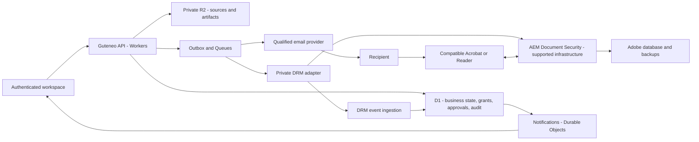

# Confidential document distribution: DRM study and implementation plan

**Later decision on 24 October 2026: the user selected an integrated Guteneo solution without PDF DRM. The [secure web viewing plan](SECURE_WEB_DOCUMENTS_PLAN.md) became the reference. The DRM comparisons/recommendations below are retained as historical research and no longer direct implementation. The subsequent [unified account plan](UNIFIED_ACCOUNT_AND_VAULT_PLAN.md) and [current implementation contract](SECURE_DISTRIBUTION_IMPLEMENTATION.md) record later account and authentication decisions.**

Study dated 24 October 2026. **Proposal for validation, without implementation or activation.**

Supplement: [Adobe/FileOpen licensing and costs for Guteneo](DRM_LICENSING_AND_COSTS.md). Detailed contractual research prioritizes FileOpen OEM negotiation, retaining Adobe as comparator; no engine is selected for implementation.

Need: distribute confidential professional PDFs, assign recipient access, control use and present a precise audit to the sending workspace. This study explicitly covers a protected PDF whose controls survive download, as with Adobe AEM Document Security.

Guteneo observations come from local `main` checkout `8b060bb`, not current-production certification. Pre-existing checkout changes are preserved. Provider references were consulted on 24 October 2026; characteristics/terms require confirmation for versions actually purchased/deployed.

## 1. Recommended decision

**For persistent PDF protection: a hybrid architecture, keeping Guteneo on Cloudflare with a licensed document DRM engine. Adobe AEM Forms Document Security and FileOpen remain technical candidates; commercial priority is qualification of a FileOpen OEM agreement suited to multi-workspace SaaS.**

Do not develop proprietary DRM or purchase AEM before a comparative trial and confirmation of multi-workspace SaaS rights. The first implementation deliverable should demonstrate feasibility on actual readers with an actionable quote. This addresses protection after download; a web viewer alone has a different protection contract.

If compatible-reader installation or licensing economics conflict with the market, offer **controlled web viewing**, largely native to Cloudflare, with explicit different protection. Do not build two complete products simultaneously: retain business contracts capable of representing both, then deliver the selected mode after trials.

Initial confidential-document recommendations: named recipients, online reading, proposed seven-day expiry, printing/copying/clear export disabled, watermark, revocation and available-event audit. These are configurable preapproval product assumptions, not legal obligations or qualified capabilities.

### Why “DRM inside a PDF” is possible but incomplete

Three elements are involved: an encrypted policy-bound file, a rights-enforcing reader and an authorization service. The file may be attached, downloaded or copied while protection remains; arbitrary PDF readers may be unable to open it.

PDF password encryption alone provides neither changing rights, per-recipient identity nor remote audit. Adobe PDF Services password protection and Reader rights extensions must not be confused with AEM Document Security. [Acrobat server policies](https://helpx.adobe.com/uk/acrobat/desktop/protect-documents/security-policies/server-based-policies.html), [PDF Services security](https://developer.adobe.com/document-services/docs/overview/security).

## 2. What the product can actually guarantee

Recipients control their computers and may be administrators. Cover forwarded links, shared/compromised mailboxes, modified clients, copied files, offline access, screenshots/photos, provider failure and malicious operators. Promise no absolute resistance to compromised devices or photographed screens.

| Action | Controlled web viewing | DRM PDF in compatible reader | Honest Guteneo wording |
| --- | --- | --- | --- |
| Email | Provider acceptance/delivery according to received evidence | Same | “Accepted by provider”, then “Delivery reported” |
| Link click | Received request, possibly robot/scanner | Protected-file download request | “Link requested”, without reading proof |
| Opening | Right checked/page authorized; client-declared display | Reader/server opening or authorization event, depending on SDK | Show provenance, identity and verification method |
| Pages/duration | Declared visibility/duration; distinguish preloading | Depends on reader instrumentation/capability | “Page displayed according to reader”, “Estimated duration” |
| Saving | Download request observable, disk save unproven | Encrypted copy possible; some Save As events instrumentable | Distinguish protected-file delivery and reported saving |
| Printing | Button/preview observable, paper outcome unknown | Better-enforced permissions; reader event depends on configuration | Reader-reported printing, without paper-output proof |
| Screenshot | No universal detection/blocking | Product/OS/reader-dependent protection | “Not observable” absent specific qualification |
| Screen photograph | Undetectable | Generally unpreventable | No detection claim |
| Revocation | Blocks future deliveries, cannot recall received pixels/files | May prevent later opening after license check | Show check delay, cache/offline and provider state |
| Clear export/printing completed | Outside control | Also outside control | Warn before permitting |

Browser `afterprint` also fires when preview closes; it does not confirm printing. Client events can be suppressed, forged or replayed. Servers attest executed operations, not attention or every OS action. [MDN](https://developer.mozilla.org/en-US/docs/Web/API/Window/afterprint_event), [OWASP Logging](https://cheatsheetseries.owasp.org/cheatsheets/Logging_Cheat_Sheet.html).

Copying a DRM file between folders may generate no reader event: rights govern opening copies, not every filesystem operation. A DRM print event remains reader-reported, not a physical-printer attestation.

## 3. Solution comparison

| Solution | Protection after download | Recipient constraints | Cloudflare fit | Guteneo assessment |
| --- | --- | --- | --- | --- |
| **Adobe AEM Forms Document Security** | Encrypted PDF/persistent policy in supported readers | Supported Acrobat/Reader, authorized identity; platform-dependent features | Cloudflare orchestration/distribution/audit with separate Adobe server | Technical reference; negotiate SaaS rights and recipient cost |
| **FileOpen** | PDF mode with compatible reader/plugin | Usually Reader/plugin or supported client; browser mode is separate | API/adapter possible; qualify SDK/hosting/OEM | Commercial OEM priority with comparative technical trial |
| **Microsoft Purview Information Protection** | PDF encryption in supported clients | Microsoft identity ecosystem/compatible readers | Hybrid Microsoft integration | Relevant to Microsoft customers; do not presume equivalent PDF audit/revocation |
| **Locklizard Safeguard** | Proprietary container protection | App/license and `.pdc`, not universal PDF | Qualify vendor integration | Secondary due to friction/format distance from PDF/Acrobat |
| **Guteneo server-rendered viewer** | Controlled web delivery, no portable protection after pixel extraction | Browser; guest access possible in this historical proposal | Strong alignment | Alternative if simplicity/Cloudflare outweigh portable DRM |
| **Password/standard-permission PDF** | Confidential while secret remains private; limited usage control | Password/reader | Simple | Insufficient for requested product |

### Adobe's concrete strengths and constraints

AEM Forms Document Security exposes protection, policy management, revocation and event search. Documented integrations include Java/SOAP on AEM Forms JEE; protection creates a new PDF. [Adobe API](https://experienceleague.adobe.com/en/docs/experience-manager-65/content/forms/developer-reference/programming-aem-forms-jee/performing-service-operations-using-apis/protecting-documents-policies).

Adobe documents Acrobat, Reader and Reader Mobile clients without certifying Windows/macOS/iOS/Android feature parity. Authentication in a system browser is not PDF viewing in that browser. Establish a versioned matrix and test sold functions. [Document Security offering](https://experienceleague.adobe.com/en/docs/experience-manager-65-lts/content/forms/use-document-security/document-security-offerings).

Standard audit differs from detailed tracking. Detailed tracking can be refused by recipients and sent in batches/on closing; scripts may request transmission. Offline access retains licenses/key material locally and synchronizes later. **Promise neither instantaneous complete audit nor immediate offline revocation.** Initially disable offline use but still measure reader sessions/caches. [Adobe client/server options](https://experienceleague.adobe.com/en/docs/experience-manager-65/content/forms/administrator-help/work-with-document-security/configuring-client-server-options).

Adobe remains enterprise infrastructure: Java, application server, supported database, backups and patching. Document Security alone may not need the entire Content Repository; AEM Forms as a Cloud Service is nevertheless not a directly substitutable DRM API for this JEE stack. Confirm precise commercial availability. [AEM LTS platforms](https://experienceleague.adobe.com/en/docs/experience-manager-65-lts/content/forms/install-aem-forms/jee-installation/aem-forms-jee-supported-platforms), [Forms Cloud differences](https://experienceleague.adobe.com/en/docs/experience-manager-cloud-service/content/forms/forms-overview/notable-changes).

### Comparators that could decide the choice

FileOpen offers API/SDK integration and multiple readers. Its official FAQ says one standard-product instance cannot resell encryption services to third parties; negotiate OEM/VAR. Price depends on administrators, users, documents and requests. Anti-capture marketing must become OS-specific tests, never photograph guarantees. Historical Flash references do not prove current compatibility. [Integration](https://www.fileopen.com/integrate-adobe-drm), [licensing/prices](https://www.fileopen.com/subscription-plans), [distributed clients](https://plugin.fileopen.com/all.aspx).

Purview supports protected PDFs in compatible clients, but **Track and revoke** explicitly applies to Office files. This does not make all PDF rights impossible; it leaves the requested PDF audit/revocation equivalence unestablished. Do not choose it without another API and specific proof. [Purview PDF in Acrobat](https://helpx.adobe.com/acrobat/desktop/protect-documents/security-policies/mpip-support-acrobat.html), [Microsoft limitation](https://learn.microsoft.com/en-us/purview/track-and-revoke-admin).

Locklizard requires its reader and `.pdc`. It claims supported-environment capture restrictions while acknowledging photographs. Consider it only if the application/format change is acceptable. [Format/reader](https://www.locklizard.com/copy-prevention/), [acknowledged limits](https://www.locklizard.com/restrict-pdf/).

## 4. Must recipients create accounts?

**Not necessarily a Guteneo account in this historical DRM proposal. Named control nevertheless requires an attributable identity or license.** Later account-required decisions supersede this proposal, not its recorded comparison.

| Journey | Visible registration | Actual assurance |
| --- | --- | --- |
| Guest web/email code | No password/workspace creation; technical guest identity | Temporary mailbox control, not civil identity |
| Standard Adobe external user | Document Security invitation/registration/activation | DRM-recognized account, not necessarily consumer Adobe ID |
| Federated professional identity | Existing SSO, if integration qualified | Enterprise identity; MFA/passkey according to policy |
| Integrated FileOpen | Existing identity/session or device license | May avoid extra registration; attribution/recovery need qualification |

Adobe documents external guest registration. Anonymous access also exists but conflicts with named attribution and should be excluded from confidential profiles. [Adobe guests](https://experienceleague.adobe.com/en/docs/experience-manager-65/content/forms/administrator-help/work-with-document-security/registering-as-a-user), [access options](https://experienceleague.adobe.com/en/docs/experience-manager-65/content/forms/administrator-help/work-with-document-security/configuring-client-server-options).

A recent Adobe flow opens authentication in the system browser with a modern IdP, then returns to Acrobat/Reader. Consulted documentation requires Forms JEE 6.5.25 or patched 6.5.24 and current 64-bit Windows Acrobat/Reader. Integration with Guteneo identity is conceivable, **without proving Auth0/macOS/mobile interoperability**; prioritize that trial. [Adobe external authentication, 9 October 2026](https://experienceleague.adobe.com/en/docs/experience-manager-65/content/forms/administrator-help/work-with-document-security/configure-external-browser-authentication-document-security).

Guest web codes go only to the invited address, never a visitor-entered replacement. Link/code in one mailbox are not independent factors. Account creation alone does not improve security; authentication, recovery and professional-identity binding matter.

Guests never become workspace members. Workspace APIs still resolve organization from authenticated membership; recipient APIs use a restricted guest principal whose organization derives from a server grant, never guest-supplied `organization_id`.

Confirm FileOpen identity integration for the selected reader; a device license alone does not identify the person at the screen. [Integration](https://www.fileopen.com/integrate-adobe-drm).

## 5. Proposed product journey

1. Select an already scanned PDF, named recipients, rights, expiry and protection profile.
2. Show reading constraints/expected cost. Prefer free preparation. If protection is billable immediately, obtain **separate prior preparation authorization** covering recipients, source processing/transfer, ceiling and cancellation. A displayed quote grants no debit authority. Atomically reserve the ceiling/write outbox; uncertainty retains the reservation. Later sending approval must not charge preparation twice.
3. Produce an **immutable protected artifact** bound to exact source/policy. Unknown/unverified output is not distributable.
4. Review content, recipients, restrictions, offline availability, artifact, message and ceiling; approve under Guteneo rules.
5. Atomically reserve quota/write outbox, then submit email to the qualified provider.
6. Default email links to the **already protected PDF** with reader instructions. DRM attachment can be optional; links are not cryptographically necessary.
7. Compatible reader verifies identity/license and enforces rights. Guteneo shows events actually received and their delay.
8. Revoke recipient/publication, distinguishing local distribution stop, DRM request, provider confirmation and residual issued-license limits.

Opening failure never automatically sends a clear PDF. Accessible alternatives, print permission or clear export require explicit audited decisions under workspace rights.

**Adobe automatic invitations:** adding an external recipient to a policy can initiate registration email. Preparation needs a demonstrated notification-free flow or separate prior invitation/activation authorization; final distribution approval cannot authorize those retroactively. Inventory resets, charges and repeat behavior too. Test that unapproved preparation sends no message. [Policy-triggered registration](https://experienceleague.adobe.com/en/docs/experience-manager-65/content/forms/administrator-help/work-with-document-security/registering-as-a-user).

## 6. Target architecture: Cloudflare core, isolated DRM

This diagram details Adobe as technical reference, not preselection. FileOpen might use an integrated permissions server/native encryption module; protocol, licensing and Cloudflare support remain unqualified.

| Component | Choice and rationale |
| --- | --- |
| Product/API | Existing React/Vite, Hono, TypeScript; shared REST/MCP domains |
| Business authority | D1 workspaces, approvals, grants, costs, operations and audit |
| DRM opening authority | Adobe; D1 records desired/confirmed state without claiming instant remote-license updates |
| Storage | Private explicitly EU-jurisdiction R2, separate immutable sources/artifacts |
| Asynchronous work | Existing outbox/Queues; provider-supported idempotency or reconciliation |
| Adapter | Private Adobe API/SDK service, limited secrets, workspace-correlated IDs and bounded time/volume |
| DRM | Supported self-hosted/contract-managed AEM; never the whole stack in Workers |
| Workspace updates | Durable Objects/WebSockets/hibernation, paginated D1 catch-up |
| Authentication | Existing member Auth0; qualify recipient identity/SSO with engine |
| Input protection | Rate/abuse limits, CSP, short sessions and provider signatures |

D1 batches keep local writes atomic, not Adobe/R2/email. Queues can duplicate/reorder, requiring durable event IDs, deduplication and sequence. [D1](https://developers.cloudflare.com/d1/worker-api/d1-database/), [delivery guarantees](https://developers.cloudflare.com/queues/reference/delivery-guarantees/), [ordering](https://developers.cloudflare.com/queues/reference/how-queues-works/).

Readers must reach the license server. Interactive Cloudflare Access can break that protocol; restrict administrative interfaces separately and qualify the public reader path. Keep a durable license domain embedded in Adobe files; domain/certificate/license migration belongs to continuity planning. [Adobe options](https://experienceleague.adobe.com/en/docs/experience-manager-65/content/forms/administrator-help/work-with-document-security/configuring-client-server-options).

### Interesting option: local Adobe PPL protection

Adobe Portable Protection Library can protect locally without sending bytes to AEM; policy/authentication still cross the boundary. Java/C++ and licensing are required. A small Cloudflare Container PPL adapter could reduce source transfers, **not eliminate the DRM server**. Adobe documents cross-unprotection limits between PPL/CSDK; test the exact protection/recovery/migration chain and demonstrate compatibility, redistribution rights, support/restoration. [Adobe PPL](https://experienceleague.adobe.com/en/docs/experience-manager-65-lts/content/forms/use-document-security/document-security-offerings).

Do not infer that all AEM belongs in Containers: it requires supported database/persistent installation, and D1 is not a documented AEM database. Adjustable Container limits do not make its disk/lifecycle a supported AEM architecture. [Adobe platforms](https://experienceleague.adobe.com/en/docs/experience-manager-65-lts/content/forms/install-aem-forms/jee-installation/aem-forms-jee-supported-platforms), [Containers](https://developers.cloudflare.com/containers/concepts/architecture/).

## 7. Integration with existing Guteneo code

The inspected baseline already had accountless protected links, separate passwords, fifteen-minute sessions, expiry/revocation. It nevertheless served ordinary PDFs and reused hosting across recipients, not individual DRM. [Existing contract](PROTECTED_EMAIL.md).

| Local source | Reuse/change |
| --- | --- |
| `apps/api/src/protected-documents.ts` | Reuse access experience; preserve historical `protected_link` |
| `migrations/0040_protected_documents.sql` | Existing organization/document hosting uniqueness; add individual grants in new tables, never edit applied migration |
| `apps/api/src/documents.ts` | Reuse immutable source/private storage/scanner/SHA/validation |
| `packages/contracts/src/pdf.ts` | Ordinary validator rejects encrypted PDFs; introduce a distinct DRM artifact type without bypassing import refusal |
| `packages/domain/src/index.ts` | Extend fingerprints/atomic checks to exact artifacts/policies |
| `apps/documents/src/expert-review.ts` | Existing server rendering for web alternative; test annotation/form/layer limits |
| `packages/contracts/src/roles.ts` | Reuse preparation, approval and report permissions |
| `apps/api/src/maintenance.ts` | Add retention, active grants, artifacts and verifiable cleanup |
| `wrangler.live.jsonc` | Add bindings/capabilities only during authorized implementation |

Existing `protected_document.downloaded` is written before response and also serves inline display. It proves no disk save. Add precise V2 labels/document historical meanings without rewriting history.

### Invariants to preserve

- Scan/validate **exact clear source** before protection. Ciphertext has separate transformation/integrity proof; scanning ciphertext cannot prove decrypted-content safety.
- Generate DRM artifact before final approval. Bind source/artifact SHA, engine version, policy, recipient, message, options and cost to approval fingerprint.
- Never silently regenerate at download or replace an object under the same ID/version.
- Unknown provider results retain `protection_unknown` and reconcile; no blind license-creation/send/billable retry.
- Activation/reservation/outbox remain locally atomic; provider acceptance is not delivery, delivery is not reading.
- Workspaces never share mutable policy authority that could broaden another's rights.
- Revoke/reduce rights under audit; broadening, new recipient, reinstatement or extension requires suitable new authority/approval.
- Compare effective policy version/fingerprint to the approved snapshot before distribution. Monitor direct DRM-console changes; drift suspends new distribution and alerts. This cannot revoke delivered copies by itself; engine confirmation is required. Trial direct console mutation.
- Assistants create no human consent, delegation or renewal. Exclude the new mode from existing mandates until its authority is explicitly defined.
- This study includes no real send, license purchase, paid provisioning, merge or deployment.

### Proposed data model

All business entities carry `organization_id` and tenant-scoped composite constraints/relations. External IDs bind the workspace provider connection; client-supplied IDs alone grant no authority.

| Entity | Essential content |
| --- | --- |
| `secure_publications` | Source/version/SHA, profile, immutable policy, state, expiry, quote |
| `secure_recipient_grants` | Opaque recipient, expected identity, rights, publication, dispatch, revocation |
| `secure_artifacts` | DRM/render type, input/output SHA, engine/version, R2 key, remote license/policy, transformation proof |
| `secure_recipient_sessions` | Secret hash, grant, method, deadlines; only if Guteneo session needed |
| `secure_provider_operations` | Operation, desired/confirmed state, remote ID, attempt, uncertainty/reconciliation |
| `secure_access_events` | Action/result/provenance/sequence, source/received times, opaque IDs, schema version |
| `secure_audit_outbox` | Postcommit notification/export, resume/deduplication |
| `secure_evidence_batches` | Sequence bounds, hashes, manifest/signature, key version/archive |

Proposed publication states: `draft → preparing → ready_for_review → approved → active → expired/revoked`, with `preparation_failed` and `protection_unknown`. DRM distinguishes `revocation_requested`, `revocation_confirmed_by_provider` and residual license windows; D1 changes alone cannot display “revoked everywhere”. These historical proposed states do not redefine the current dispatch state machine.

Proposed interfaces: prepare/follow/review/approve/accept publication, revoke grant, cursor-read/export audit and discover engine capabilities. DRM administration is not directly exposed to browser/MCP. Adapters return capability matrices rather than pretending all providers have identical guarantees.

## 8. Precise audit and measurable real time

Separate **Guteneo server**, **email provider**, **DRM server/reader** and **browser declaration** provenance. Signatures protect report integrity, not the physical truth of a client declaration.

Minimum envelope: ID, organization, publication/version, grant, pseudonymous session, actor, action/result/provenance/evidence level, source/received timestamps, sequence, policy version, correlation and deduplication key. Never duplicate document, raw email, OTP, token, signed URL or request body in technical logs. UI resolves recipient under business access controls.

Adobe audit may contain identities/IPs: normalize opaque references before Guteneo persistence without automatically archiving raw responses. Retention/access/subprocessor terms also cover provider-retained audit. [Adobe fields](https://experienceleague.adobe.com/en/docs/experience-manager-65/content/forms/administrator-help/work-with-document-security/monitoring-events).

Suggested labels: “Access authorized”, “Opening reported by Acrobat”, “Printing reported by reader”, “Export request refused”, “Revocation confirmed by DRM service”, “Synchronization delayed”. Never fabricate “screenshot detected” or “reading proven”.

### Collection and distribution

1. Persist mandatory Guteneo events before content delivery; failed required writes deny new sensitive delivery.
2. Import Adobe events incrementally with overlap/deduplication. Search APIs are documented; no low-latency webhook is qualified by this study. Handle late timestamps without inventing human-action order.
3. Commit event/local outbox atomically, then notify workspace hub. Hub failure leaves durable audit readable.
4. Use hibernating WebSockets with periodic-read fallback, cursor catch-up/reconnection and continuing rights checks. [Durable Objects](https://developers.cloudflare.com/durable-objects/best-practices/websockets/).
5. Show last synchronization and known delayed/missing events. Offline events appear as received later.

Initial measurable goals: workspace p95 notification below two seconds **after Guteneo persistence**, separately measured DRM ingestion delay and duplicate-free recovery. No reader-to-workspace two-second SLA before provider/network/client evidence.

Enable Adobe audit at both server/policy levels. Copy events may bind original documents without detecting every file copy. [Adobe tracking](https://experienceleague.adobe.com/en/docs/experience-manager-65/content/forms/administrator-help/work-with-document-security/monitoring-events). Guteneo ingestion failure need not stop an already authorized reader; separately qualify engine behavior when its audit fails. An unavailable local audit badge cannot prove remote refusal.

### Integrity and retention

Application append-only writes, role access, audited audit-access/export, hash/signature-sealed batches and independent export verification are required. Resistance to administrators holding keys/database needs independent anchoring/external proof. Hash chaining alone cannot resist complete rewrite or tail deletion.

R2 bucket locks add operational protection but authorized administrators can remove them; do not market irreversible WORM. Define retention before locking archives. [R2 locks](https://developers.cloudflare.com/r2/buckets/bucket-locks/).

## 9. Encryption, identity and confidentiality

R2 already encrypts at rest; PDF DRM adds separate portable protection. TLS protects transport. Authorized scanning/protection components see source plaintext: **neither end-to-end encryption nor zero knowledge is claimed**. [R2 security](https://developers.cloudflare.com/r2/reference/data-security/).

Evaluate R2 SSE-C for stronger storage-key control: per-object/version keys wrapped by versioned master keys outside D1, supported by Workers bindings including large objects. This does not replace DRM; ship rotation, backup/restore and key-loss handling together. Prefer standard primitives to invented chunk encryption. [SSE-C](https://developers.cloudflare.com/r2/examples/ssec/), [WebCrypto](https://developers.cloudflare.com/workers/runtime-apis/web-crypto/).

A Worker secret is initial key storage, not an independent HSM. Secrets Store was presented as beta/global, not automatic EU sovereignty. Evaluate regional enterprise KMS according to risk. Claim no cryptographic erasure while recoverable backup keys remain. [Secrets Store](https://developers.cloudflare.com/secrets-store/).

Use opaque links, hashed tokens, HttpOnly/Secure cookies, CSRF/origin checks, no preauthentication sensitive content, no third-party viewer analytics, `no-store`, `no-referrer` and strict CSP. Remove tokens from path/proxy/email-link-tracking logs too; hiding a parameter does not protect an underlying URL secret.

`GET`/`HEAD` consume no invitation, send no OTP and prove no human reading; mail security preloads links. Historical guest option requires explicit action, short-lived single-use codes, bounded attempts/rate, neutral anti-enumeration responses and frozen recipient, including OTP-spam defenses. [Documented prefetch](https://supabase.com/docs/guides/auth/auth-email-templates).

### Location and personal data

Explicitly configure/verify EU jurisdiction for D1/R2 and any DO/Queues/Containers used. This alone does not locate Workers, TLS, logs, secrets, Auth0, email or DRM entirely in Europe. Service residency differs; this research established no sufficient Browser Run jurisdiction constraint. [R2](https://developers.cloudflare.com/r2/reference/data-location/), [D1](https://developers.cloudflare.com/d1/configuration/data-location/), [DO](https://developers.cloudflare.com/durable-objects/reference/data-location/), [Queues](https://developers.cloudflare.com/queues/configuration/data-location/), [Containers](https://developers.cloudflare.com/containers/concepts/placement/).

Before viewing, explain recorded data/purpose, receiving workspace, retention, rights and subprocessors. Accepting a notice alone does not establish lawful basis. Define it and consider DPIA according to risk/scale; avoid precise geolocation, hardware fingerprinting and extensive default behavioral collection. Watermark opaque recipient references resolved under workspace authority instead of repeated full personal addresses.

Separate documents, licenses, identity, security traces, viewing detail and accounting records. CNIL's generally six-to-twelve-month security-log guidance requires justified adaptation and does not define all telemetry retention. Define/test erasure including archives/backup cycles. Revocation is not erasure; DRM PDFs cannot be recalled from recipient disks. [GDPR](https://eur-lex.europa.eu/legal-content/FR/TXT/?uri=CELEX:32016R0679), [CNIL logging](https://www.cnil.fr/fr/la-cnil-publie-une-recommandation-relative-aux-mesures-de-journalisation).

## 10. Entirely web-centered alternative

Choose this if portable DRM constraints are rejected, or later add it as a distinct offering.

Reuse private PDF.js/Browser Run rendering for pages with pixel-burned watermark before delivery. Keep source/unwatermarked renders private; preproduce needed variants rather than launching a browser for every displayed page. Never provide the original implicitly. Images remain saveable, photographable and reconstructable: this reduces direct file extraction without making content uncopyable.

Recipient-side PDF.js would require delivery of the PDF and lose that boundary. WebCrypto/nonexportable keys or Widevine/FairPlay do not create universal PDF DRM; EME concerns media rather than general document rights. [WebCrypto limits](https://www.w3.org/TR/WebCryptoAPI/#security-considerations), [EME](https://www.w3.org/TR/encrypted-media/).

D1 governs web rights: transactionally authorize/audit only after checking session, grant, policy and expiry. Serve pages only after successful authorization and prepared-artifact verification. This orders revocation: authorization after its commit must fail, while already-authorized responses/received pixels cannot be recalled. A lagging replica/KV cannot be the sole security arbiter. [D1 replication](https://developers.cloudflare.com/d1/best-practices/read-replication/).

Test the existing engine first. Consider isolated PDFium Containers if fidelity, throughput/cost or residency requires them. MuPDF needs AGPL/commercial licensing decisions. Isolate rendering from scanning, restrict privilege/network, bound pages/pixels/memory/time and pin dependencies. [Mozilla engine comparison](https://github.com/mozilla/pdf.js.comparator/blob/main/README.md), [Container egress](https://developers.cloudflare.com/containers/configuration/outbound-traffic/).

Accessibility is an exit criterion: images alone harm screen readers, search, selection and signed-document use. Evaluate an accessible path with users; client-delivered text remains extractable. Protection must not prevent screen-reader users from accessing their documents.

## 11. Comparative trial before product development

Synthetic corpus: text/scanned PDFs, embedded fonts, French/English/German/Luxembourgish, RTL/CJK, images, rotation, annotations/forms, signatures/certification, long/malformed documents. Send no actual customer document to vendors for this trial.

| Test | Expected evidence/decision |
| --- | --- |
| Protection | Input/output SHA, known license/policy/engine; distributed bytes equal approved bytes |
| Readers | Target Windows/macOS/mobile versions: opening, identity, text/accessibility and restrictions |
| Wrong reader | Clear refusal/instructions, never automatic unrestricted-file fallback |
| Third-party recipient | Forwarded link/file refused to another identity |
| Save As/file copy | Copy remains protected; distinguish reader event from unseen filesystem copy |
| Printing | Allow/deny, virtual printer, preview cancellation and exact event; no false paper proof |
| Captures | OS tools/shortcuts/recording/screenshare/second device; document limits without assuming prevention |
| Revocation | Downloaded copy, open reader, reopening, session expiry, offline/cache/network loss; actual delay |
| Audit | Opening/refusal/printing, declined detailed tracking, killed client, closing/offline; separate coverage/latency |
| Identity | Adobe guest, SSO, browser-reader return, recovery/MFA; actually verify Auth0, not diagram presence |
| Invitations/cost | No implicit preparation email/debit; separately authorized invitation/activation; no blind timeout repeat |
| Isolation | Two workspaces with similar IDs: no cross-read/revoke/search |
| Failure | AEM/database outage, protection timeout, duplicate queue, unavailable hub; uncertainty/recovery without duplicate remote effects |
| Restoration | Restore keys/licenses/database/PDF; verify access, revocations and no reopening removed rights |
| Signatures | Validate source signature and reader interpretation of protected artifact; no preservation claim before tests |

Disqualifiers: denied SaaS/OEM licensing, missing essential target-platform support, inability to isolate workspaces, uncontrolled key recovery or incompatible economics. Unpreventable capture requires contractual limits; absolute prohibition cannot be satisfied by any studied solution.

Trial summary must label each assertion as provider documentation, local test, provider test, real-device trial or unverified. Choose Adobe/FileOpen from these results rather than marketing scores.

## 12. Staged delivery plan

| Stage | Concrete deliverable | Continue only when |
| --- | --- | --- |
| 0 — Scope/contracts | Expected rights, readers, offline needs, corpus, hypothetical volumes, prepared Adobe/FileOpen quote requests | SaaS rights and trial licenses available; no purchase/request sending without authorization |
| 1 — Engine/identity trial | Protection/opening/Save As/print/revoke/audit/SSO/restore on synthetic corpus | Reviewable evidence/cost matrix and selected engine/platforms |
| 2 — Contracts/data | ADR, source/artifact types, rights, guest model, additive schema, capability/threat/retention | Isolation/immutability/cost reviewed; no implicit legacy-link change |
| 3 — Preparation/sending | Source → protection → review → approval → outbox; exact email/link and uncertainty | Concurrency/rollback simulation; no actual sends |
| 4 — Audit/management | Ingestion/provenance/search/export/notification/revocation/reconciliation | Failure/recovery/deduplication/report rights demonstrated |
| 5 — Cloudflare/readers | Synthetic staging, physical desktop/mobile, security/accessibility/benchmark | Real configuration/capabilities observed and affordable budget |
| 6 — Authorized pilot | Informed voluntary workspaces/recipients, bounded duration/volume, support/latency | Separate deployment/send authorization and complete journey evidence |
| 7 — General availability | Published limits/pricing/maintenance/monitoring/export/reversibility | Commercial license, documentation and operations ready |

Promise no delivery date before SDK/license availability and stage 1 success. Contracting/reader support may dominate application development.

Implementation checks include normal types/lint/tests/E2E/build, isolation/concurrency and separate staging/production proof. Green CI proves neither email receipt, Acrobat behavior nor provider-account qualification.

## 13. Costs and sizing

The [commercial study](DRM_LICENSING_AND_COSTS.md) details Adobe 2025 enterprise terms, On-premise/Managed Services, FileOpen OEM, three-year scenarios and quote brief. Adobe's documented 1,000-recipient minimum applies to Managed Services, not established for On-premise.

No per-document price is announced. Guteneo's historical protected-hosting price does not qualify licensed DRM pricing.

Adobe published recipient licensing under terms effective 11 May 2023; current quotes must confirm applicability, base components, guests, nonproduction, disaster recovery and SaaS operation. FileOpen quotes/negotiates OEM/VAR. [Adobe terms](https://helpx.adobe.com/legal/product-descriptions/adobe-experience-manager-on-premise-1.html), [Adobe quote](https://business.adobe.com/products/experience-manager/forms/pricing.html), [FileOpen quote](https://www.fileopen.com/subscription-plans).

Populate this model:

`Monthly cost = DRM licenses + DRM hosting/maintenance + Cloudflare storage + requests/writes/audit + artifact preparation + email/authentication + recipient support + backup/evidence`.

**Hypothetical** benchmark load: 10,000 documents/month, ten pages, three recipients/document, two sessions/recipient = 30,000 grants, 60,000 sessions and up to 600,000 page requests if every session reads everything. Web variants per page/recipient yield 300,000 images, with size/retention-sensitive storage. DRM may bill unique people rather than grants; never confuse units.

Measure cost/publication/new recipient/opening/retained month and support time. Observe D1 rows/indexes/audit, rendered variants, OTP rates and continuously available licenses. D1 per-database/write limits need testing; partition/archive only when measured. [D1 limits](https://developers.cloudflare.com/d1/platform/limits/), [D1 price](https://developers.cloudflare.com/d1/platform/pricing/), [R2](https://developers.cloudflare.com/r2/pricing/), [Browser Run](https://developers.cloudflare.com/browser-run/pricing/), [Containers](https://developers.cloudflare.com/containers/platform/pricing/).

## 14. Questions for vendors

Prepared for commercial/technical discussion; no request was sent.

1. Does the agreement allow protection/billing for documents from multiple third-party workspaces? OEM/VAR, white labeling, isolation and required notices?
2. How are occasional external recipients, guests, recurring people, test/recovery billed? Annual minimum, marginal/support/exit charges?
3. Which Windows/macOS/iOS/Android versions enforce each permission? Does free Reader suffice, and is a plugin required?
4. Which external/federated Auth0/SSO/MFA/passkey/recovery flows are supported?
5. Which open/page/print/Save As/refusal events exist; which are optional, local, deferred or forgeable?
6. Contractual audit latency, incremental API, retention, pagination/limits, deduplication ID and possible webhook?
7. Revocation delays for open files, reconnecting, cached licenses and disabled offline use?
8. Which captures are prevented/reported on which exact versions; acknowledged limitations?
9. Is protection idempotent; how can timed-out license creation be recovered without duplication/rebilling?
10. Can PPL/SDK run in Cloudflare Containers under what license/support, and what data leaves Cloudflare?
11. Offered hosting/regions/subprocessors/backups/security and supported disaster recovery?
12. What happens to distributed PDFs at contract termination, prolonged outage or migration? Exportable policies/events/continuity material?

## 15. Positioning and launch decision

Proposed promise: **“Distribute confidential documents with access rights, expiry, revocation and an audit of events available in compatible readers.”** Show qualified platforms/events/delays before sending.

Web option: **“View the document in a protected space with recipient verification, watermark and access audit.”** Keep modes distinguishable in quotes, permissions, emails and reports.

The historical recommended next step was parallel FileOpen OEM/Adobe commercial qualification, then an authorized licensed comparative trial centered on recipient experience and actual audit. Guteneo remains on Cloudflare; specialized DRM was justified by persistent file protection. Nothing here supports total-surveillance, universal capture-detection or indisputable legal-proof claims. The later integrated-web decision at the top supersedes that launch recommendation.
