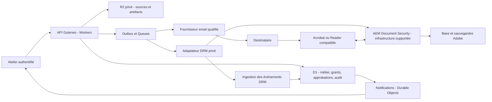

# Distribution de documents confidentiels : étude DRM et plan de réalisation

**Décision ultérieure du 24 octobre 2026 : l’utilisateur retient une solution maison dans Guteneo, sans DRM PDF. Le [plan de consultation sécurisée web](SECURE_WEB_DOCUMENTS_PLAN.md) fait désormais référence. Les comparaisons et recommandations DRM ci-dessous sont conservées comme étude historique ; elles ne pilotent plus l’implémentation.**

Étude du 24 octobre 2026. **Proposition à valider, aucune implémentation ni activation.**

Complément : [licences et coûts Adobe/FileOpen pour Guteneo](DRM_LICENSING_AND_COSTS.md). L’approfondissement contractuel donne la priorité à la négociation FileOpen OEM, avec Adobe maintenu comme comparateur ; aucun moteur n’est choisi pour implémentation.

Besoin : distribuer des PDF professionnels confidentiels, attribuer les accès à des destinataires, contrôler les usages et présenter un journal précis à l’atelier expéditeur. L’étude couvre explicitement un PDF protégé qui reste contrôlé après téléchargement, comme avec Adobe AEM Document Security.

Les constats Guteneo proviennent du checkout local `main`, commit `8b060bb`. Ils ne certifient pas l’état actuel de production. Les modifications préexistantes du checkout sont conservées. Les références fournisseurs ont été consultées le 24 octobre 2026 ; leurs caractéristiques et conditions restent à confirmer pour les versions effectivement achetées et déployées.

## 1. Décision recommandée

**Pour la demande de protection persistante du PDF : architecture hybride, avec Guteneo sur Cloudflare et un moteur DRM documentaire sous licence. Adobe AEM Forms Document Security et FileOpen restent candidats techniques ; la priorité commerciale est la qualification d’un accord FileOpen OEM adapté au SaaS multi-ateliers.**

Ne pas développer un DRM propriétaire ni acheter AEM avant un essai comparatif et la confirmation du droit de l’intégrer dans un SaaS multi-ateliers. Le premier livrable de réalisation doit être une preuve de faisabilité sur de vrais lecteurs, accompagnée d’un devis exploitable. Ce choix répond au besoin de protection après téléchargement ; un simple lecteur web ne répond pas à cette même exigence.

Si l’installation d’un lecteur compatible ou l’économie des licences est incompatible avec le marché, proposer **une consultation web contrôlée**, majoritairement native Cloudflare, avec un contrat de protection différent et explicite. Ne pas construire simultanément deux produits complets : garder des contrats métier capables de représenter les deux, puis livrer le mode retenu après l’essai.

Recommandations initiales pour des documents professionnels confidentiels : destinataires nominatifs, lecture en ligne, expiration de sept jours proposée dans l’interface, impression/copie/export en clair désactivés, filigrane, révocation et audit des événements disponibles. Ces valeurs sont des hypothèses de produit configurables avant approbation, pas des obligations légales ni des capacités déjà qualifiées.

### Pourquoi « un DRM dans le PDF » est possible, mais incomplet comme description

Le système comporte trois éléments : un fichier chiffré lié à une politique, un lecteur qui applique les droits, et un service qui délivre/vérifie les autorisations. Le fichier peut être joint à un email, téléchargé depuis Guteneo ou copié sur un autre support ; sa protection peut subsister. Un lecteur PDF quelconque n’est pas nécessairement capable de l’ouvrir.

Le chiffrement avec un mot de passe PDF ne fournit pas à lui seul des droits évolutifs, une identité par destinataire ou un journal distant. L’API Adobe PDF Services « protection par mot de passe » et les extensions de droits Reader ne doivent pas être confondues avec AEM Document Security. [Politiques serveur Acrobat](https://helpx.adobe.com/uk/acrobat/desktop/protect-documents/security-policies/server-based-policies.html), [sécurité PDF Services](https://developer.adobe.com/document-services/docs/overview/security).

## 2. Ce que le produit peut réellement garantir

Le destinataire contrôle son ordinateur et peut avoir des droits administrateur. Le modèle doit couvrir lien transféré, boîte partagée ou compromise, client modifié, fichier recopié, accès hors ligne, capture/photo, panne fournisseur et opérateur malveillant. Il ne doit pas annoncer une résistance absolue à un terminal compromis ou à la photographie de l’écran.

| Action | Consultation web contrôlée | PDF sous DRM dans un lecteur compatible | Libellé honnête dans Guteneo |
| --- | --- | --- | --- |
| Email | Acceptation/livraison fournisseur selon les preuves reçues | Identique | « Accepté par le fournisseur » puis « Livraison signalée » |
| Clic sur lien | Requête reçue, y compris robot/scanner | Requête de téléchargement du fichier protégé | « Lien demandé », sans preuve de lecture |
| Ouverture | Droit vérifié et page autorisée ; affichage déclaré par le client | Événement d’ouverture/autorisation du lecteur ou serveur, selon SDK | Afficher provenance, identité et méthode de vérification |
| Pages et durée | Visibilité/durée déclarées, préchargement distinct | Selon instrumentation et capacités du lecteur ; pas universel | « Page affichée selon le lecteur », « Durée estimée » |
| Sauvegarde | Demande de téléchargement observable, sauvegarde disque non prouvée | Copie chiffrée possible ; certains événements Save As instrumentables | Distinguer « Fichier protégé remis » et « Enregistrement signalé » |
| Impression | Bouton/aperçu observables, résultat papier inconnu | Permissions mieux appliquées ; événement du lecteur selon configuration | « Impression signalée par le lecteur », sans preuve de sortie papier |
| Capture d’écran | Pas de détection ou blocage universel | Certaines protections dépendent du produit, de l’OS et du lecteur | « Non observable » si aucune capacité précisément qualifiée |
| Photo de l’écran | Non détectable | Non empêchable de façon générale | Aucune prétention de détection |
| Révocation | Bloque les nouvelles remises ; ne retire pas les pixels/fichiers reçus | Peut empêcher une future ouverture de la copie chiffrée, après contrôle de licence | Montrer délai de contrôle, cache/offline et statut fournisseur |
| Après export en clair ou impression | Hors contrôle | Hors contrôle également | Prévenir avant d’autoriser l’export ou l’impression |

Le navigateur émet notamment `afterprint` lorsque l’aperçu se ferme : ce n’est pas une confirmation d’impression. Les événements client peuvent être supprimés, fabriqués ou rejoués. Le serveur peut attester les opérations qu’il a exécutées, pas l’attention humaine ni toutes les actions du système d’exploitation. [MDN](https://developer.mozilla.org/en-US/docs/Web/API/Window/afterprint_event), [OWASP Logging](https://cheatsheetseries.owasp.org/cheatsheets/Logging_Cheat_Sheet.html).

Pour un PDF DRM, enregistrer la copie du fichier dans un autre dossier peut ne déclencher aucun événement du lecteur : les droits protègent l’ouverture de cette copie, pas chaque opération du système de fichiers. Un événement d’impression DRM demeure un fait rapporté par le lecteur, sans attestation de l’imprimante physique.

## 3. Comparaison des solutions

| Solution | Protection après téléchargement | Contraintes destinataire | Compatibilité Cloudflare | Appréciation pour Guteneo |
| --- | --- | --- | --- | --- |
| **Adobe AEM Forms Document Security** | Oui, PDF chiffré et politiques persistantes dans lecteurs compatibles | Acrobat/Reader pris en charge ; identité autorisée ; capacités variables selon plateforme | Orchestration, distribution et audit sur Cloudflare ; serveur Adobe séparé recommandé | Référence technique ; droit SaaS et coût des destinataires à négocier |
| **FileOpen** | Oui pour son mode PDF avec lecteur/plugin compatible | Généralement Reader avec plugin ou client pris en charge ; son mode navigateur est une offre distincte | API et adaptateur possibles ; support SDK/hébergement et contrat OEM à qualifier | Priorité de qualification commerciale OEM ; essai technique comparatif requis |
| **Microsoft Purview Information Protection** | Chiffrement PDF dans les clients pris en charge | Écosystème d’identité Microsoft et lecteurs compatibles | Intégration hybride Microsoft | Pertinent pour clients Microsoft ; ne pas présumer l’audit/révocation PDF équivalent |
| **Locklizard Safeguard** | Protection dans un conteneur propriétaire | Application et licence ; sortie `.pdc`, pas PDF universel | Intégration fournisseur à qualifier | Secondaire : friction et format éloignés de l’idée PDF/Acrobat |
| **Lecteur Guteneo avec rendu serveur** | Contrôle des remises web ; pas de protection portable après extraction des pixels | Navigateur, accès invité possible | Très bon alignement Cloudflare | Alternative si simplicité et Cloudflare priment sur le DRM portable |
| **PDF à mot de passe / permissions standard** | Confidentialité tant que le secret n’est pas partagé ; contrôle d’usage limité | Mot de passe/lecteur | Simple | Insuffisant pour le produit demandé |

### Adobe : intérêt et contraintes concrètes

AEM Forms Document Security expose des opérations de protection, gestion des politiques, révocation et recherche d’événements. Les intégrations documentées utilisent notamment Java/SOAP sur AEM Forms JEE ; la protection produit un nouveau PDF. [API Adobe](https://experienceleague.adobe.com/en/docs/experience-manager-65/content/forms/developer-reference/programming-aem-forms-jee/performing-service-operations-using-apis/protecting-documents-policies).

Adobe documente Acrobat, Reader et Reader Mobile comme clients PDF. Cela ne certifie pas la parité des fonctions sur Windows, macOS, iOS et Android. Le navigateur utilisé pour l’authentification n’est pas le lecteur PDF du navigateur. Établir une matrice par version et tester les fonctions réellement vendues. [Offre Document Security](https://experienceleague.adobe.com/en/docs/experience-manager-65-lts/content/forms/use-document-security/document-security-offerings).

L’audit standard et le suivi détaillé sont distincts. Adobe décrit un suivi détaillé que le destinataire peut refuser, envoyé notamment par lots ou à la fermeture ; un script peut demander une transmission. L’accès hors ligne implique des licences/éléments de clés conservés sur le poste et une synchronisation ultérieure. **Aucune promesse d’audit exhaustif instantané ou de révocation immédiate hors ligne.** Pour le premier profil confidentiel, désactiver l’usage hors ligne et mesurer tout de même le comportement des sessions et caches du lecteur. [Options client/serveur Adobe](https://experienceleague.adobe.com/en/docs/experience-manager-65/content/forms/administrator-help/work-with-document-security/configuring-client-server-options).

Le serveur Adobe reste une infrastructure d’entreprise : Java, serveur d’applications, base supportée, sauvegarde et correctifs. Document Security seul ne nécessite pas forcément tout le Content Repository. Il ne faut toutefois pas assimiler AEM Forms as a Cloud Service à une API DRM directement substituable à cette pile JEE. La disponibilité commerciale précise doit être confirmée. [Plateformes AEM LTS](https://experienceleague.adobe.com/en/docs/experience-manager-65-lts/content/forms/install-aem-forms/jee-installation/aem-forms-jee-supported-platforms), [différences avec Forms Cloud Service](https://experienceleague.adobe.com/en/docs/experience-manager-cloud-service/content/forms/forms-overview/notable-changes).

### Comparateurs : points susceptibles de décider le choix

FileOpen expose une intégration API/SDK et plusieurs modèles de lecteur. Sa FAQ officielle indique qu’une instance unique d’un produit standard ne permet pas de revendre un service de chiffrement à des tiers : un accord OEM/VAR est à négocier. Le prix dépend notamment des administrateurs, utilisateurs, documents et requêtes. Les affirmations commerciales anti-capture doivent devenir des cas de test par OS ; elles ne valent pas garantie contre une photo. Certaines pages historiques du fournisseur parlent encore de Flash : ne pas les utiliser comme preuve de compatibilité actuelle. [Intégration FileOpen](https://www.fileopen.com/integrate-adobe-drm), [licences et prix](https://www.fileopen.com/subscription-plans), [clients distribués](https://plugin.fileopen.com/all.aspx).

Purview protège des PDF dans les clients compatibles, mais la documentation de **Track and revoke** réserve explicitement cette fonctionnalité aux fichiers Office. Cela ne signifie pas que toute gestion des droits PDF est impossible ; cela signifie que l’équivalence avec le journal/révocation PDF demandé n’est pas établie par cette fonction. Ne pas en faire le moteur par défaut sans une autre API et une preuve spécifique. [PDF Purview dans Acrobat](https://helpx.adobe.com/acrobat/desktop/protect-documents/security-policies/mpip-support-acrobat.html), [limite Microsoft](https://learn.microsoft.com/en-us/purview/track-and-revoke-admin).

Locklizard impose son lecteur et un fichier `.pdc`. Il revendique des restrictions de capture dans les environnements pris en charge, tout en reconnaissant la limite de la photographie. À évaluer seulement si ce changement de format et d’application est accepté. [Format et lecteur Locklizard](https://www.locklizard.com/copy-prevention/), [limites reconnues](https://www.locklizard.com/restrict-pdf/).

## 4. Le destinataire doit-il créer un compte ?

**Pas nécessairement un compte Guteneo. Pour un contrôle nominatif, il faut cependant une identité ou une licence attribuable au destinataire.** Plusieurs parcours sont possibles :

| Parcours | Inscription visible | Niveau réellement obtenu |
| --- | --- | --- |
| Web invité avec code email | Aucune création de mot de passe/atelier ; identité technique invitée | Contrôle ponctuel de la boîte mail, pas identité civile |
| DRM Adobe avec utilisateur externe standard | Invitation, inscription et activation Document Security | Compte reconnu par le service DRM ; ce n’est pas nécessairement un Adobe ID grand public |
| DRM avec identité professionnelle fédérée | Connexion SSO existante, si intégration qualifiée | Identité de l’entreprise ; MFA/passkey selon sa politique |
| FileOpen intégré | Identité/session existante ou licence liée à un appareil, selon intégration | Peut éviter une inscription supplémentaire ; attribution et récupération à qualifier |

Adobe documente l’inscription des invités externes. Un mode anonyme existe aussi, mais il serait contraire à l’objectif d’attribution nominative : l’exclure des profils confidentiels. [Invités Adobe](https://experienceleague.adobe.com/en/docs/experience-manager-65/content/forms/administrator-help/work-with-document-security/registering-as-a-user), [options d’accès](https://experienceleague.adobe.com/en/docs/experience-manager-65/content/forms/administrator-help/work-with-document-security/configuring-client-server-options).

Une évolution récente d’Adobe permet d’ouvrir l’authentification dans le navigateur système avec un fournisseur d’identité moderne, puis de revenir à Acrobat/Reader. La documentation consultée exige notamment Forms JEE 6.5.25 ou 6.5.24 corrigé et un client Windows Acrobat/Reader 64 bits à jour. Cela rend une intégration avec l’identité Guteneo envisageable, **sans prouver qu’Auth0, macOS et les mobiles fonctionneront déjà ensemble**. Ce parcours est un critère prioritaire de l’essai. [Authentification externe Adobe, 9 octobre 2026](https://experienceleague.adobe.com/en/docs/experience-manager-65/content/forms/administrator-help/work-with-document-security/configure-external-browser-authentication-document-security).

Pour l’option web, le code est envoyé exclusivement à l’adresse invitée, jamais à une nouvelle adresse saisie par le visiteur. Le lien et le code reçus dans la même boîte ne constituent pas deux facteurs indépendants. Une création de compte n’améliore pas automatiquement la sécurité ; la qualité de l’authentification, la récupération et le lien avec l’identité professionnelle comptent davantage.

Les invités ne deviennent jamais membres de l’atelier. Les API atelier continuent à résoudre l’organisation depuis la membership authentifiée ; les API destinataire utilisent un principal invité restreint dont l’organisation est résolue depuis un grant serveur. Aucun `organization_id` fourni par l’invité ne fait autorité.

L’intégration d’identité FileOpen doit être confirmée avec le mode de lecteur retenu ; une licence d’appareil n’atteste pas à elle seule l’identité de la personne devant l’écran. [Intégration FileOpen](https://www.fileopen.com/integrate-adobe-drm).

## 5. Parcours produit proposé

1. L’atelier choisit un PDF déjà analysé, nomme les destinataires et sélectionne les droits, l’expiration et le profil de protection.
2. Guteneo affiche les contraintes de lecture et le coût prévu. Privilégier une préparation non facturée ; si le moteur facture dès la protection, obtenir une **autorisation préalable distincte de préparation**, avec destinataires, traitement/transfert éventuel du source, plafond de coût et règles d’annulation. Un devis affiché ne vaut pas autorisation de débit. Cette commande réserve son plafond et écrit son outbox atomiquement ; une issue incertaine conserve la réservation. L’approbation d’envoi ultérieure ne facture pas une seconde fois cette préparation.
3. Le moteur prépare un **artefact protégé immuable**, lié au source et à une politique exacte. Tant que le résultat est inconnu ou non vérifié, il n’est pas distribuable.
4. L’expéditeur revoit le contenu, les destinataires, les restrictions, la disponibilité hors ligne, l’artefact, le message et le plafond de coût ; il approuve le tout selon les règles Guteneo.
5. L’acceptation réserve le quota et écrit l’outbox atomiquement. L’email est ensuite soumis au fournisseur qualifié.
6. Le destinataire reçoit par défaut un lien vers le téléchargement du **PDF déjà protégé** avec des instructions adaptées au lecteur. La pièce jointe DRM peut être une option : le lien n’est pas une nécessité cryptographique.
7. Le lecteur compatible vérifie l’identité et la licence, puis applique les droits. Guteneo affiche les événements effectivement reçus et leur délai.
8. L’atelier peut révoquer un destinataire ou la publication. Le tableau distingue arrêt local de distribution, demande transmise au DRM, confirmation fournisseur et limite des licences déjà délivrées.

Un échec d’ouverture ne déclenche jamais l’envoi automatique d’un PDF en clair. Une alternative accessible, une autorisation d’impression ou un export en clair exige une décision explicite et tracée conforme aux droits de l’atelier.

**Attention aux invitations automatiques Adobe :** l’ajout d’un destinataire externe à une politique peut initier son inscription par email. La préparation doit utiliser un parcours sans notification démontré, ou obtenir une autorisation distincte préalable pour les invitations/activations. L’approbation finale de distribution ne les autorise pas rétroactivement. Inventorier aussi les réinitialisations, leurs coûts et leurs possibilités de répétition ; tester qu’une simple préparation non autorisée à communiquer n’envoie aucun message. [Inscription déclenchée par une politique Adobe](https://experienceleague.adobe.com/en/docs/experience-manager-65/content/forms/administrator-help/work-with-document-security/registering-as-a-user).

## 6. Architecture cible : Cloudflare au centre, DRM isolé

Le schéma suivant détaille la variante Adobe servant de référence technique. Il ne présélectionne pas ce fournisseur. La variante FileOpen pourrait utiliser un serveur de permissions intégré et un module natif de chiffrement ; son protocole, sa licence et son support Cloudflare restent à qualifier.

| Composant | Choix et raison |
| --- | --- |
| Produit / API | React/Vite, Hono et TypeScript existants ; conserver les domaines métier partagés REST/MCP |
| Autorité métier | D1 pour ateliers, approbations, grants, coûts, opérations et journal Guteneo |
| Autorité d’ouverture du PDF DRM | Moteur Adobe ; D1 conserve l’état souhaité et confirmé, sans prétendre modifier instantanément une licence distante |
| Stockage | R2 privé, juridiction UE explicite, sources et artefacts séparés, objets immuables |
| Travail asynchrone | Outbox/Queues existantes, opérations idempotentes quand le fournisseur le permet, réconciliation sinon |
| Adaptateur | Service privé pour API/SDK Adobe, secrets limités, identifiants corrélés par atelier, délai et volume bornés |
| DRM | AEM sur environnement officiellement supporté, auto-hébergé ou géré sous contrat ; pas tout AEM dans Workers |
| Temps réel atelier | Durable Objects avec WebSockets et hibernation ; rattrapage paginé depuis D1 |
| Authentification | Auth0 existant pour les membres ; identité destinataire dédiée/SSO à qualifier avec le moteur |
| Protection des entrées | Limites de fréquence, défense contre abus, CSP, sessions courtes, vérification des signatures fournisseurs |

Les mécanismes de batch D1 permettent de garder les écritures locales atomiques ; cela n’étend pas la transaction au serveur Adobe, à R2 ou à l’email. Queues peut livrer en double et hors ordre : identifiant d’événement, déduplication et séquence durable sont nécessaires. [D1](https://developers.cloudflare.com/d1/worker-api/d1-database/), [garanties Queues](https://developers.cloudflare.com/queues/reference/delivery-guarantees/), [ordre des messages](https://developers.cloudflare.com/queues/reference/how-queues-works/).

Le serveur de licences doit être joignable par les lecteurs. Une page interactive Cloudflare Access devant cet endpoint peut casser leur protocole : réserver les contrôles de service aux interfaces d’administration et qualifier le chemin public lecteur séparément. Conserver un domaine de licences durable : son adresse est incorporée aux documents Adobe. La migration de ce domaine, de ses certificats et des licences fait partie du plan de continuité. [Configuration Adobe](https://experienceleague.adobe.com/en/docs/experience-manager-65/content/forms/administrator-help/work-with-document-security/configuring-client-server-options).

### Option intéressante : protection locale par Adobe PPL

La Portable Protection Library d’Adobe peut protéger le fichier localement sans envoyer ses octets au serveur AEM ; politiques et authentification continuent à circuler. Elle est proposée en Java/C++ et nécessite une licence. Un petit adaptateur PPL sur Cloudflare Containers serait donc une piste de réduction des transferts du source, **pas une suppression du serveur DRM**. Adobe documente une limite croisée de déprotection entre PPL et CSDK : tester la chaîne exacte de protection, récupération et migration. Compatibilité, licence de redistribution, support et restauration doivent être démontrés. [PPL Adobe](https://experienceleague.adobe.com/en/docs/experience-manager-65-lts/content/forms/use-document-security/document-security-offerings).

Ne pas héberger tout AEM dans Containers par simple analogie : la pile Adobe exige une base supportée et une installation persistante ; D1 n’est pas une base AEM documentée. Les limites Containers sont ajustables, mais leur disque et leur cycle de vie ne constituent pas une architecture AEM supportée. [Plateformes Adobe](https://experienceleague.adobe.com/en/docs/experience-manager-65-lts/content/forms/install-aem-forms/jee-installation/aem-forms-jee-supported-platforms), [architecture Containers](https://developers.cloudflare.com/containers/concepts/architecture/).

## 7. Intégration au code Guteneo existant

Le socle actuel contient déjà un lien protégé sans compte destinataire, un mot de passe distinct, des sessions de quinze minutes, l’expiration et la révocation. Il sert toutefois un PDF ordinaire et réutilise un hébergement entre plusieurs destinataires. Ce n’est pas déjà un DRM individuel. [Contrat existant](PROTECTED_EMAIL.md).

| Source locale | Réutilisation / modification à prévoir |
| --- | --- |
| `apps/api/src/protected-documents.ts` | Réutiliser l’expérience de contrôle d’accès ; conserver le comportement historique de `protected_link` |
| `migrations/0040_protected_documents.sql` | Hébergement courant unique par organisation/document : ajouter des grants individuels dans de nouvelles tables, sans modifier une migration appliquée |
| `apps/api/src/documents.ts` | Réutiliser source immuable, stockage privé, scanner, SHA et validation |
| `packages/contracts/src/pdf.ts` | Le validateur refuse les PDF chiffrés : créer un type d’artefact DRM distinct, sans contourner ce refus pour les imports ordinaires |
| `packages/domain/src/index.ts` | Étendre le fingerprint et les contrôles atomiques aux artefacts/politiques exacts |
| `apps/documents/src/expert-review.ts` | Rendu serveur déjà disponible pour l’alternative web ; limites actuelles sur annotations, formulaires et couches à tester |
| `packages/contracts/src/roles.ts` | Réutiliser préparation, validation et accès aux rapports selon les permissions |
| `apps/api/src/maintenance.ts` | Intégrer rétention, grants actifs, artefacts et nettoyage vérifiable |
| `wrangler.live.jsonc` | Ajouter les bindings et capacités seulement à l’étape d’implémentation autorisée |

L’événement existant `protected_document.downloaded` est enregistré avant la réponse et sert aussi l’affichage inline. Il ne prouve pas une sauvegarde disque. Ajouter des libellés v2 précis et documenter l’interprétation des anciens événements, sans réécrire l’histoire.

### Invariants à conserver

- Scanner et valider le **source exact non chiffré** avant protection. Le ciphertext a une preuve de transformation et d’intégrité distincte ; un scan de ciphertext ne prouve pas l’innocuité du contenu déchiffré.
- Générer l’artefact DRM avant l’approbation finale. Lier source SHA, artefact SHA, version moteur, politique, destinataire, message, options et coût au fingerprint approuvé.
- Ne jamais régénérer silencieusement un PDF DRM au téléchargement ou remplacer un objet sous le même identifiant/version.
- Après un résultat fournisseur incertain, conserver `protection_unknown` et réconcilier. Aucun retry aveugle de création de licence, envoi ou opération facturable.
- Activation, réservation et outbox restent atomiques localement ; l’acceptation du fournisseur n’est pas une livraison, et une livraison n’est pas une lecture.
- Les politiques de deux ateliers ne doivent jamais partager une autorité modifiable qui étendrait les droits d’un autre atelier.
- Une révocation/diminution de droits est contrôlée et auditée ; un élargissement, nouveau destinataire, rétablissement ou prolongation requiert une nouvelle autorité/approbation adaptée.
- Relire la version/empreinte de politique effective avant distribution et la comparer au snapshot approuvé. Surveiller aussi les modifications directes dans le moteur DRM. En cas de dérive, alerter et suspendre les nouvelles distributions ; cela ne suffit pas à annuler les droits de copies déjà distribuées. Leur correction doit être confirmée par le moteur. Inclure dans l’essai une modification directe via la console fournisseur.
- Aucun assistant ne crée de consentement humain, n’active une délégation ni ne renouvelle un mandat. Le nouveau mode doit être exclu des mandats existants jusqu’à définition explicite de ses droits.
- Aucun envoi réel, achat/licence, provisioning payant, merge ou déploiement ne fait partie de cette étude.

### Modèle de données proposé

Toutes les entités métier portent `organization_id`, avec contraintes et relations composites tenant-scoped. Les identifiants externes sont rattachés à une connexion fournisseur de l’atelier ; aucun ID reçu du client n’est une autorité en soi.

| Entité | Contenu essentiel |
| --- | --- |
| `secure_publications` | Source/version/SHA, profil de protection, politique immuable, statut, expiration, devis |
| `secure_recipient_grants` | Destinataire opaque, identité attendue, droits, publication, dispatch, révocation |
| `secure_artifacts` | Type DRM ou rendu, SHA source/résultat, moteur/version, clé R2, licence/politique distante, preuve de transformation |
| `secure_recipient_sessions` | Empreinte du secret, grant, méthode d’authentification, échéances ; uniquement si session Guteneo nécessaire |
| `secure_provider_operations` | Opération, état souhaité/confirmé, identifiant distant, tentative, incertitude, réconciliation |
| `secure_access_events` | Action, résultat, provenance, séquence, heures fournisseur/réception, identifiants opaques, version de schéma |
| `secure_audit_outbox` | Notifications/export à publier après commit, reprise et déduplication |
| `secure_evidence_batches` | Bornes de séquence, hashes, manifeste/signature, version de clé et archive |

États de publication : `draft → preparing → ready_for_review → approved → active → expired/revoked`. Branches explicites `preparation_failed` et `protection_unknown`. Pour le DRM, distinguer `revocation_requested`, `revocation_confirmed_by_provider` et la fenêtre résiduelle de licence ; ne pas afficher « révoqué partout » sur un simple changement D1.

Interfaces proposées : préparer une publication, suivre sa préparation, revoir/approuver, accepter l’envoi, révoquer un grant, lire les événements avec curseur, exporter un journal et connaître les capacités du moteur. Les opérations d’administration du DRM ne sont pas exposées directement au navigateur ni au MCP. Un adaptateur retourne une matrice de capacités ; il ne prétend pas que tous les fournisseurs ont les mêmes garanties.

## 8. Audit précis et temps réel mesurable

Le journal sépare quatre provenances : **serveur Guteneo**, **fournisseur email**, **serveur/lecteur DRM**, **déclaration du navigateur**. Une signature protège l’intégrité du rapport ; elle ne transforme pas une déclaration client en fait physique certain.

Enveloppe minimale : identifiant, organisation, publication/version, grant, session pseudonyme, acteur, action, résultat, provenance, niveau de preuve, heure source, heure de réception serveur, séquence, version de politique, identifiant de corrélation et clé de déduplication. Ne pas dupliquer document, email brut, OTP, jeton, URL signée ou corps de requête dans les journaux techniques. L’interface résout le destinataire depuis les données métier sous contrôle d’accès.

L’audit Adobe peut lui-même contenir des identités et adresses IP : normaliser les réponses en références opaques avant persistance Guteneo, sans archiver automatiquement les réponses brutes. Les durées, accès et engagements de sous-traitance doivent aussi couvrir le journal conservé chez le fournisseur. [Champs des événements Adobe](https://experienceleague.adobe.com/en/docs/experience-manager-65/content/forms/administrator-help/work-with-document-security/monitoring-events).

Exemples de libellés : « Accès autorisé », « Ouverture signalée par Acrobat », « Impression signalée par le lecteur », « Demande d’export refusée », « Révocation confirmée par le service DRM », « Synchronisation en retard ». Aucun faux événement « capture détectée » ou « lecture prouvée ».

### Collecte et diffusion

1. Persister les événements Guteneo obligatoires avant remise du contenu ; panne de l’écriture obligatoire = refus de nouvelle remise sensible.
2. Importer les événements Adobe via API incrémentale, avec chevauchement et déduplication. Les API de recherche sont documentées ; aucun webhook à faible latence n’a été qualifié dans cette étude. Traiter les horodatages et événements tardifs sans inventer l’ordre des actions humaines.
3. Écrire l’événement et son outbox locale atomiquement, puis notifier le hub de l’atelier. Si la diffusion tombe, le journal durable reste consultable.
4. WebSockets avec hibernation et repli par lecture périodique ; rattrapage par curseur, reconnexion et réévaluation des droits pendant les connexions longues. [Durable Objects](https://developers.cloudflare.com/durable-objects/best-practices/websockets/).
5. Afficher « dernière synchronisation » et événements manquants/retardés connus. Les événements hors ligne apparaissent comme reçus après coup.

Objectifs initiaux à mesurer : notification atelier p95 sous deux secondes **après persistance Guteneo** ; délai d’ingestion DRM mesuré séparément ; reprise sans doublons après interruption. Aucun SLA « action du lecteur → atelier en deux secondes » avant preuve fournisseur, réseau et client.

Pour Adobe, activer l’audit à la fois au niveau serveur et au niveau politique. Les événements d’une copie protégée peuvent être rattachés au document d’origine ; cela ne détecte pas la création de toute copie. [Suivi Adobe](https://experienceleague.adobe.com/en/docs/experience-manager-65/content/forms/administrator-help/work-with-document-security/monitoring-events). Une panne de notre ingestion n’arrête pas nécessairement un lecteur déjà autorisé : qualifier séparément le comportement du moteur si son propre audit échoue. Ne pas déduire un refus d’accès distant d’un simple état « audit indisponible » dans Guteneo.

### Intégrité et rétention

Écriture applicative append-only, accès par rôle, accès/export du journal eux-mêmes audités, lots scellés avec empreintes et signatures, vérificateur indépendant des exports. Pour une résistance à un administrateur disposant des clés et bases, prévoir un ancrage indépendant ou un service de preuve externe. Le chaînage seul ne suffit pas face à la réécriture complète ou à la suppression de la fin du journal.

Les règles de verrouillage R2 ajoutent une protection opérationnelle mais peuvent être retirées par un administrateur autorisé : ne pas les vendre comme un WORM irréversible. Définir les durées avant de verrouiller des archives. [Bucket locks R2](https://developers.cloudflare.com/r2/buckets/bucket-locks/).

## 9. Chiffrement, identité et confidentialité

R2 chiffre déjà les objets au repos ; le PDF DRM ajoute une protection portable distincte. TLS protège les échanges. Le source est visible aux composants autorisés pour analyse/protection : **ce modèle n’est pas du chiffrement de bout en bout ou du zero knowledge**. [Sécurité R2](https://developers.cloudflare.com/r2/reference/data-security/).

Pour renforcer le contrôle des clés de stockage : évaluer SSE-C R2 avec clé indépendante par objet/version, enveloppée par une clé maître versionnée hors D1. Les bindings Workers le permettent, y compris les gros objets. Cette option ne remplace pas le DRM et doit être livrée avec rotation, sauvegarde/restauration et traitement de la perte de clé. Préférer des primitives standard à un format de chiffrement par blocs inventé pour le projet. [SSE-C](https://developers.cloudflare.com/r2/examples/ssec/), [WebCrypto](https://developers.cloudflare.com/workers/runtime-apis/web-crypto/).

Un secret Worker est un premier mécanisme de stockage de clé, pas un HSM indépendant. Secrets Store est encore présenté en bêta et distribué mondialement ; il n’est pas une justification automatique de souveraineté UE. Un KMS externe régional est une option entreprise à évaluer selon le risque. Ne pas promettre un effacement cryptographique tant que des clés récupérables subsistent dans les sauvegardes. [Secrets Store](https://developers.cloudflare.com/secrets-store/).

Liens opaques, jetons stockés par empreinte, cookies HttpOnly/Secure, contrôle CSRF/origine, absence de contenu sensible avant authentification, aucune analytique tierce dans le lecteur, `no-store`, `no-referrer`, CSP stricte. Supprimer les tokens aussi des logs de chemin, des proxies et du suivi de liens du prestataire email. Un paramètre masqué ne suffit pas si le secret est dans l’URL.

Les `GET`/`HEAD` ne consomment pas d’invitation, ne déclenchent pas d’OTP et ne comptent pas comme lecture humaine. Les protections email préchargent des liens. Pour l’option invitée : action explicite, code à durée courte et usage unique, nombre d’essais et fréquence limités, réponse neutre contre l’énumération, destinataire figé. Le dispositif doit résister au spam OTP. [Préchargement documenté](https://supabase.com/docs/guides/auth/auth-email-templates).

### Localisation et données personnelles

Juridiction UE de D1/R2, et de DO/Queues/Containers si utilisés, à configurer et vérifier explicitement. Cela ne garantit pas que Workers, terminaison TLS, logs, secrets, Auth0, email et serveur DRM traitent tout en UE. Les capacités de résidence diffèrent par service ; pour Browser Run, aucune contrainte de juridiction suffisante n’a été établie dans cette recherche. [R2](https://developers.cloudflare.com/r2/reference/data-location/), [D1](https://developers.cloudflare.com/d1/configuration/data-location/), [DO](https://developers.cloudflare.com/durable-objects/reference/data-location/), [Queues](https://developers.cloudflare.com/queues/configuration/data-location/), [Containers](https://developers.cloudflare.com/containers/concepts/placement/).

Informer avant consultation : données enregistrées, finalité, atelier destinataire du journal, durée, droits et sous-traitants. Un bouton d’acceptation de notice n’établit pas à lui seul la base légale du traitement. Définir celle-ci et examiner l’AIPD selon risque/échelle ; éviter géolocalisation précise, empreinte matérielle et collecte comportementale extensive par défaut. Le filigrane peut employer un identifiant de destinataire, avec résolution autorisée côté atelier, plutôt que répéter une adresse personnelle complète.

Séparer documents, licences, identité, traces de sécurité, détails de consultation et pièces comptables. La CNIL évoque généralement six à douze mois pour les journaux de sécurité avec adaptation motivée ; cela ne fixe pas la durée de toute télémétrie. Définir une matrice de rétention et tester l’effacement, y compris archives et cycles de sauvegarde. La révocation n’est pas l’effacement ; un PDF DRM ne peut pas être rappelé depuis le disque du destinataire. [RGPD](https://eur-lex.europa.eu/legal-content/FR/TXT/?uri=CELEX:32016R0679), [CNIL journalisation](https://www.cnil.fr/fr/la-cnil-publie-une-recommandation-relative-aux-mesures-de-journalisation).

## 10. Alternative entièrement centrée sur le web

À choisir si les contraintes du DRM portable sont rejetées, ou à ajouter ultérieurement comme offre distincte.

Réutiliser le renderer privé PDF.js/Browser Run pour produire des pages avec filigrane incorporé aux pixels avant remise. Garder le source et les rendus non filigranés privés ; préproduire les variantes utiles et ne pas démarrer un navigateur à chaque page affichée. Le PDF original n’est pas fourni. Les images restent enregistrables, photographiables et reconstructibles : ce mode réduit l’extraction directe du fichier, sans rendre le contenu incopiable.

PDF.js dans le navigateur destinataire nécessiterait de lui remettre le PDF et ne fournirait pas cette frontière. WebCrypto/clé non exportable ou Widevine/FairPlay ne créent pas un DRM PDF universel. EME vise les médias, pas la gestion générale des droits de documents. [WebCrypto, limites](https://www.w3.org/TR/WebCryptoAPI/#security-considerations), [EME](https://www.w3.org/TR/encrypted-media/).

Dans ce mode, D1 est l’autorité des droits web : écrire conditionnellement une autorisation d’accès et son audit dans une transaction vérifiant session, grant, politique et expiration. Servir la page uniquement si l’autorisation a réussi, après préparation et contrôle de l’artefact. Cela définit l’ordre avec la révocation : une autorisation postérieure à sa validation doit échouer ; une réponse déjà autorisée ou des pixels déjà reçus ne sont pas récupérables. Ne pas utiliser un réplica potentiellement en retard ou KV comme seul arbitre de sécurité. [Réplication D1](https://developers.cloudflare.com/d1/best-practices/read-replication/).

Tester d’abord le moteur existant. Évaluer PDFium en Container dédié si fidélité, débit/coût ou résidence du traitement l’exigent. MuPDF implique une décision de licence AGPL/commerciale. Rendu isolé du scanner, processus à privilèges réduits, réseau restreint, budgets pages/pixels/mémoire/temps et dépendances épinglées. [Comparaison des moteurs par Mozilla](https://github.com/mozilla/pdf.js.comparator/blob/main/README.md), [réseau Containers](https://developers.cloudflare.com/containers/configuration/outbound-traffic/).

L’accessibilité est un critère de sortie : des images seules pénalisent lecteurs d’écran, recherche, sélection et documents signés. Proposer un parcours accessible évalué avec les utilisateurs ; si du texte est remis au client, reconnaître qu’il est extractible. Ne pas rendre une personne dépendante d’un lecteur d’écran incapable d’accéder à son document sous prétexte de protection.

## 11. Essai comparatif à mener avant développement du produit

Corpus synthétique : PDF texte et scanné, polices embarquées, français/anglais/allemand/luxembourgeois, RTL/CJK, images, rotations, annotations, formulaires, signatures/certification, documents longs et cas malformés. Ne pas transmettre de vrais documents clients au fournisseur pour cet essai.

| Test | Preuve attendue / décision |
| --- | --- |
| Protection | Source et sortie identifiés par SHA ; politique/licence et version moteur connues ; octets distribués identiques aux octets approuvés |
| Lecteurs | Windows/macOS et mobiles retenus : ouverture, identité, texte/accessibilité et contraintes vérifiées par version |
| Mauvais lecteur | Refus clair avec instructions ; jamais de dégradation automatique en fichier libre |
| Destinataire tiers | Lien/fichier transmis à une autre identité : contenu refusé |
| Save As / copie fichier | Copie toujours protégée ; distinguer événement lecteur et copie du système de fichiers non observée |
| Impression | Autorisée/refusée, imprimante virtuelle, annulation d’aperçu et événement exact enregistré ; aucune fausse sortie papier |
| Captures | Outils OS, raccourcis, enregistrement, partage d’écran et appareil secondaire ; documenter les limites, ne pas supposer réussite |
| Révocation | Copie déjà téléchargée, lecteur ouvert, nouvelle ouverture, session expirée, hors ligne/cache et coupure réseau ; mesurer le délai réel |
| Audit | Ouverture, refus, impression, suivi détaillé refusé, client tué, fermeture, offline ; mesurer couverture et délais séparément |
| Identité | Invité Adobe, SSO, retour navigateur/lecteur, récupération et MFA ; vérifier Auth0 réellement, pas seulement sa présence dans le schéma |
| Invitations et frais | Préparation sans email/débit implicite ; invitation/activation autorisée séparément si nécessaire ; aucune répétition aveugle après timeout |
| Isolation | Deux ateliers, documents/identités/politiques aux IDs proches ; aucune lecture, révocation ou recherche croisée |
| Pannes | AEM/DB indisponible, timeout protection, Queues doublonnée, hub coupé ; états incertains et reprise sans action distante doublée |
| Restauration | Restaurer clés, licences, base et PDF ; vérifier accès, révocations et absence de réouverture des droits supprimés |
| Signatures | Vérifier la signature du source et ce que le lecteur indique sur l’artefact ; ne pas promettre sa conservation avant test |

Critères éliminatoires : licence SaaS/OEM refusée, fonction essentielle non supportée sur le parc cible, impossibilité de séparer les ateliers, récupération de clés non maîtrisée, ou économie incompatible avec le produit. Une capture non empêchable impose une limite contractuelle ; si le besoin exige son interdiction absolue, aucune solution de cette étude ne le satisfait.

La synthèse de l’essai doit présenter chaque assertion avec son statut : documentation fournisseur, test local, test du fournisseur, essai réel sur terminal, ou non vérifié. Le choix final Adobe/FileOpen se fait après ces résultats, pas sur un score marketing.

## 12. Plan de livraison par étapes

| Étape | Livrable concret | Condition pour continuer |
| --- | --- | --- |
| 0 — Cadrage et faisabilité contractuelle | Droits attendus, parc lecteur, absence/offline, corpus, volumes hypothétiques ; demandes de devis préparées Adobe et FileOpen | Droit SaaS et essais/licences disponibles ; aucun achat/envoi de demande sans autorisation |
| 1 — Essai moteur/identité | Protection, ouverture/Save As, impression, révocation, audit, SSO et restauration sur corpus synthétique | Matrice de preuves et coût total validables ; choix d’un moteur et des plateformes supportées |
| 2 — Contrats et données | ADR, types source/artefact, droits, modèle invité, schémas additifs, capacités, menaces et rétention | Revue isolation/immuabilité/coût ; aucun ancien lien changé implicitement |
| 3 — Préparation et envoi | Pipeline source → protection → revue → approbation → outbox, email/lien exact, gestion des incertitudes | Simulation et tests de concurrence/rollback ; aucun envoi réel |
| 4 — Audit et gestion | Ingestion fournisseur, provenance, recherche/export, notifications, révocation et rapprochement des états | Pannes/reprises/déduplication et droits de rapport démontrés |
| 5 — Qualification Cloudflare et lecteurs | Staging synthétique, mobiles/desktop physiques, sécurité, accessibilité et benchmark | Configuration réelle et capacités observées ; budget acceptable |
| 6 — Pilote autorisé | Ateliers/destinataires volontaires, limites de volume et durée, support, mesure des délais | Autorisation distincte pour déploiement et envois ; dossier de preuve du parcours complet |
| 7 — Généralisation | Limites publiées, prix, maintenance, supervision, export/réversibilité | Licence commerciale, documentation et exploitation prêtes |

Ne pas annoncer une date de livraison avant disponibilité SDK/licence et réussite de l’étape 1. Le délai de contractualisation et le support des lecteurs peuvent dominer le développement applicatif.

Les vérifications d’implémentation incluront les commandes habituelles du projet (types, lint, tests, E2E et build), les cas d’isolation et concurrence, puis des preuves staging/production distinctes. Une CI verte ne prouve ni réception d’email, ni comportement Acrobat, ni qualification d’un compte fournisseur.

## 13. Coûts et dimensionnement

L’[étude commerciale approfondie](DRM_LICENSING_AND_COSTS.md) détaille les contrats entreprise Adobe 2025, les routes On-premise/Managed Services, l’accord FileOpen OEM, les scénarios sur trois ans et le brief de devis. Le minimum Adobe de 1 000 destinataires est documenté pour Managed Services, pas établi pour On-premise.

Pas de prix par document annoncé à ce stade. Le tarif historique Guteneo d’hébergement protégé ne qualifie pas le prix d’un DRM sous licence.

Adobe publie une métrique de licence par destinataire dans des conditions effectives au 11 mai 2023 ; le devis actuel doit confirmer son application, le socle nécessaire, les invités, la non-production, le secours et l’exploitation en SaaS. FileOpen fournit des devis et négocie l’OEM/VAR. [Conditions Adobe](https://helpx.adobe.com/legal/product-descriptions/adobe-experience-manager-on-premise-1.html), [devis Adobe](https://business.adobe.com/products/experience-manager/forms/pricing.html), [devis FileOpen](https://www.fileopen.com/subscription-plans).

Modèle économique à renseigner :

`Coût mensuel = licences DRM + hébergement/maintenance DRM + stockage Cloudflare + requêtes/écritures/audit + préparation des artefacts + emails/authentification + support destinataire + sauvegardes/preuve`.

Exemple de charge **hypothétique** à utiliser pour le benchmark : 10 000 documents/mois, 10 pages, 3 destinataires/document, 2 sessions/destinataire. Cela représente 30 000 grants, 60 000 sessions et jusqu’à 600 000 demandes de pages si chacune parcourt tout le document. Pour le web, une variante par page et destinataire représente 300 000 images ; le stockage varie fortement avec leur taille et leur rétention. Pour le DRM, la facturation peut dépendre de personnes uniques plutôt que de grants : ne pas confondre ces unités.

Mesurer coût par publication, par nouveau destinataire, par ouverture et par mois conservé, plus temps de support. D1 écritures/index et volume d’audit, variantes de rendu, taux d’OTP et serveur de licences disponible en permanence sont les principaux postes à observer. D1 a une limite par base et une capacité d’écriture à tester ; prévoir archivage et partitionnement uniquement si les mesures l’exigent. [Limites D1](https://developers.cloudflare.com/d1/platform/limits/), [tarifs D1](https://developers.cloudflare.com/d1/platform/pricing/), [R2](https://developers.cloudflare.com/r2/pricing/), [Browser Run](https://developers.cloudflare.com/browser-run/pricing/), [Containers](https://developers.cloudflare.com/containers/platform/pricing/).

## 14. Questions à faire confirmer aux éditeurs

Cette liste est prête pour un échange commercial/technique ; aucune demande n’a été envoyée.

1. Le contrat autorise-t-il Guteneo à protéger les documents de multiples ateliers tiers et à facturer ce service ? OEM/VAR, marque blanche, isolation et notices imposées ?
2. Quelles métriques s’appliquent aux destinataires externes occasionnels, invités, personnes récurrentes, tests et restauration ? Minimum annuel, coût marginal, support et frais de sortie ?
3. Quelles versions Windows/macOS/iOS/Android appliquent chaque droit ? Reader gratuit suffit-il pour le parcours exact, et faut-il un plugin ?
4. Quels parcours d’authentification externes et fédérés sont supportés, avec Auth0/SSO, MFA/passkeys et récupération ?
5. Quels événements remontent exactement : ouverture, page, impression, Save As, refus ? Lesquels sont facultatifs, locaux, différés ou falsifiables ?
6. Quelle latence d’audit est contractuelle ? API incrémentale, rétention, pagination, limites, identifiant de déduplication et éventuel webhook ?
7. Quels sont les délais de révocation pour document ouvert, reconnexion, licence en cache et offline désactivé ?
8. Quelles captures sont empêchées ou signalées, sur quelles versions précises ? Quelles limites sont officiellement reconnues ?
9. L’API de protection est-elle idempotente ? Comment retrouver une création de licence après timeout sans refacturation ou duplicata ?
10. PPL/SDK peut-il fonctionner dans un Container Cloudflare, sous quelle licence et quel support ? Quelles données quittent Cloudflare ?
11. Quels hébergement/région, sous-traitants, sauvegardes et mesures de sécurité sont proposés ? Quelle architecture de secours est supportée ?
12. Que deviennent les PDF déjà distribués à l’arrêt du contrat, en panne durable ou lors d’une migration ? Peut-on exporter politiques, événements et éléments nécessaires à la continuité ?

## 15. Positionnement et décision de lancement

Promesse proposée : **« Distribuez des documents confidentiels avec des droits d’accès, une expiration, une révocation et un journal des événements disponibles dans les lecteurs compatibles. »** Les plateformes, événements et délais réellement qualifiés doivent être visibles avant l’envoi.

Pour une option web : **« Consultez le document dans un espace sécurisé, avec vérification du destinataire, filigrane et journal d’accès. »** Les deux modes doivent rester reconnaissables dans les devis, les permissions, les emails et les rapports.

La prochaine étape recommandée est la qualification commerciale FileOpen OEM et Adobe en parallèle, suivie d’un essai comparatif sous licence autorisée, centré sur le parcours destinataire et la réalité de l’audit. L’architecture Guteneo demeure Cloudflare ; l’ajout d’un moteur spécialisé est motivé par la protection persistante du fichier. Aucun élément de cette étude ne justifie une promesse de surveillance totale, de capture universellement détectée ou de preuve juridique incontestable.
