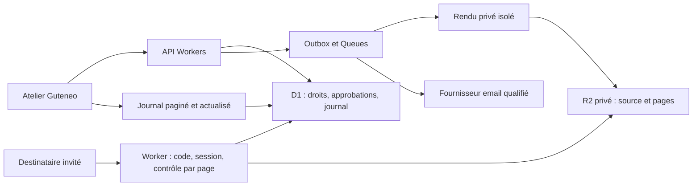

# Consultation sécurisée dans Guteneo — plan retenu

**Évolution du 24 octobre 2026 : le [plan Compte unique et coffre personnel](UNIFIED_ACCOUNT_AND_VAULT_PLAN.md) fait désormais référence. Tous les destinataires doivent avoir un compte Guteneo unique donnant également accès aux services. Le parcours invité sans compte ci-dessous est remplacé ; les principes de rendu, filigrane et audit restent une base technique. Deux catégories sont retenues : partage révocable et copie personnelle remise avec autorisation de l’atelier.**

Décision produit du 24 octobre 2026 : solution maison intégrée à Guteneo, sans DRM dans le PDF et sans dépendance Adobe/FileOpen. Ce document remplace la recommandation de moteur DRM des études précédentes. **Plan uniquement : aucune fonctionnalité implémentée, aucun envoi ni déploiement.**

Lecture du checkout local `8b060bb`, de PRODUCT, ARCHITECTURE, EXECUTION_PLAN et du parcours protégé existant. Cette lecture ne qualifie pas l’état de production.

## 1. Promesse et périmètre

**« Partagez vos documents dans un espace de consultation sécurisé, avec accès individuel, filigrane, expiration, révocation et journal d’activité. »**

Le destinataire reçoit un lien par email et consulte le document dans Guteneo, sans installer de logiciel ni créer de compte. L’atelier retrouve les accès et événements disponibles dans le suivi de l’envoi.

Pendant la consultation, le PDF source reste privé. Le navigateur reçoit des pages rendues côté serveur et une alternative accessible lorsqu’elle est qualifiée. Ces pixels et ce texte restent récupérables par un destinataire autorisé. La protection porte sur la remise du contenu et les accès futurs ; elle ne suit pas une copie extraite.

Périmètre initial : PDF, destinataires individuels, code email, consultation en ligne, filigrane personnel, expiration, révocation, suivi et export du journal. Précision proposée à la suite de l’échange : **consultation seule par défaut, avec option de téléchargement explicite du PDF original si l’atelier l’autorise avant approbation**. Aucune fonction d’impression dédiée prévue au lancement. Ces choix d’interface ne garantissent pas l’impossibilité de sauvegarder ou d’imprimer ce qui est affiché.

## 2. Parcours proposé

1. L’atelier choisit un PDF analysé, les destinataires et une durée. Proposition initiale : 1, 7 ou 30 jours, avec 7 jours par défaut, explicitement revue avant envoi.
2. Guteneo prépare et vérifie le rendu. Un document incompatible produit un refus compréhensible avant envoi, sans substitution automatique par une pièce jointe.
3. L’expéditeur revoit le contenu final, le filigrane, chaque destinataire, l’expiration, l’autorisation éventuelle de télécharger le PDF original, le message et le prix/plafond. Le lien est propre au destinataire.
4. L’acceptation active le droit, réserve les coûts et insère l’envoi dans l’outbox atomiquement. Les contrôles existants d’autorité, de fournisseur et de résultat incertain restent applicables.
5. Le destinataire ouvre la page et demande un code. Il est envoyé exclusivement à l’adresse déjà approuvée ; aucune autre adresse saisie par le visiteur ne peut remplacer cette destination.
6. Après validation du code, une session courte donne accès à ce document. Le destinataire voit qui partage, l’expiration et une notice claire sur le journal.
7. L’atelier suit les événements, peut interrompre l’accès d’une personne ou de toute la publication, et exporter le journal sous ses permissions habituelles.
8. Si le téléchargement est autorisé, le destinataire peut choisir « Télécharger le PDF original ». Cette action est distincte de l’affichage des pages et fait l’objet de contrôles et d’événements propres.

Un simple chargement du lien ne déclenche ni email OTP ni événement de lecture humaine : les scanners des messageries peuvent visiter les liens. Le code prouve la maîtrise ponctuelle de la boîte email, pas l’identité civile. Lien et code reçus dans la même boîte ne constituent pas deux facteurs indépendants.

## 3. Audit : nommer exactement ce qui est connu

| Événement | Ce que le journal peut affirmer | Limite |
| --- | --- | --- |
| Email accepté/livré | État confirmé par le fournisseur et sa provenance | Aucune preuve de lecture |
| Code validé / session créée | Vérification exécutée par Guteneo | Boîte accessible, pas identité civile garantie |
| Accès à une page autorisé | Le serveur a autorisé la remise de cette page | Ne prouve ni réception complète ni lecture |
| Page affichée | Signal envoyé par le navigateur | Déclaratif, falsifiable ou manquant ; préchargement distinct |
| Consultation démarrée | Première page déclarée affichée après vérification de l’accès | Ne signifie ni document entièrement lu ni attention humaine prouvée |
| Téléchargement demandé | Demande explicite reçue et autorisée par le serveur | Peut être annulée ou échouer avant réception |
| Remise du PDF démarrée | Début de remise instrumenté côté serveur | Ne prouve pas la réception complète ni la sauvegarde sur disque |
| Durée de consultation | Estimation à partir de signaux d’activité bornés | Ni attention ni temps exact ; exclure onglets cachés et silences prolongés |
| Accès refusé / révoqué / expiré | Décision serveur et date | Ne retire pas le contenu déjà reçu |
| Impression | Éventuel signal d’ouverture/fermeture du parcours navigateur | Aucune confirmation papier ni nombre de copies |
| Capture, photo, sauvegarde locale | Non observable de manière fiable | Ne jamais inventer d’événement de détection |

`afterprint` peut suivre la fermeture de l’aperçu, y compris sans impression physique. Les raccourcis interceptés et le masquage de boutons ne fournissent pas une preuve. [MDN](https://developer.mozilla.org/en-US/docs/Web/API/Window/afterprint_event).

Le journal porte identifiant, atelier, publication, droit individuel, session pseudonyme, événement, origine serveur/navigateur/fournisseur, résultat, versions, heure source et heure de réception. Les horodatages du navigateur ne font pas autorité. Les activités d’export du journal et les changements de droits sont eux-mêmes tracés.

Pas de document, adresse destinataire en clair, code, jeton ou URL secrète dans les logs techniques. L’interface résout les références métier uniquement pour les membres autorisés. Pas de suivi publicitaire ou de fingerprinting matériel.

### Consultation et téléchargement : deux faits indépendants

Préférer « Consultation démarrée » et « Téléchargement demandé/lancé » à « Document enregistré ». Si l’interface emploie « Document consulté », le détail doit indiquer « affichage signalé par le navigateur », sans prétendre que toutes les pages ont été lues. Un téléchargement peut survenir sans lecture préalable : conserver deux indicateurs horodatés plutôt qu’un entonnoir imposant une consultation fictive.

Le serveur ne reçoit pas de preuve universelle de l’enregistrement sur le disque. `Content-Disposition: attachment` demande un téléchargement au navigateur ; il ne prouve pas ce que l’utilisateur fait ensuite. Même une fin de flux côté serveur ou un accusé client ne constitue pas une preuve de sauvegarde durable. [MDN, Content-Disposition](https://developer.mozilla.org/en-US/docs/Web/HTTP/Reference/Headers/Content-Disposition).

### Remise du PDF original, si autorisée

Le droit `allowOriginalDownload` fait partie de la politique immuable approuvée, par destinataire. L’activer ensuite est un élargissement de droit nécessitant une nouvelle autorité/approbation adaptée. Aucun original n’est préchargé pour afficher le lecteur.

Créer une demande par action authentifiée protégée contre CSRF, liée au grant, à la session, au source/SHA et à la politique. Auditer l’autorisation durablement avant remise. Servir l’original exact par une route privée dédiée qui revalide les droits, sans URL R2 contournant ces vérifications. Le jeton éventuel de remise est bref et limité à cette opération ; il n’est jamais journalisé. Le filigrane des images ne modifie pas le PDF original : le dire dans les options de l’atelier.

Regrouper les tentatives et reprises sous un identifiant de demande. Ne pas compter `HEAD`, préchargement, réponse partielle ou reprise réseau comme autant de téléchargements humains complets. Distinguer tentative, début, interruption observée et résultat inconnu ; ne pas inférer un succès de la seule réponse HTTP 200. Revalider toute nouvelle requête ou reprise après révocation.

Une fois les octets remis, le PDF peut être conservé, copié et ouvert hors de Guteneo. **Ces ouvertures ultérieures sont invisibles à Guteneo et la révocation ne retire pas le fichier.** Un compte destinataire ne change pas cette limite. Une future copie PDF filigranée serait un artefact distinct, approuvé et nommé comme tel, sans altérer silencieusement un original signé.

## 4. Architecture Cloudflare

- **Application et API** : React/Vite, Hono et TypeScript existants. Auth0 reste l’identité des membres d’atelier ; les invités utilisent des sessions limitées au document, sans devenir membres.
- **D1** : autorité des droits, expirations, révocations et écritures métier. Pas de KV ni de cache prolongé pour autoriser un accès. Les contrôles doivent lire l’état faisant autorité, pas un réplica susceptible d’ignorer une révocation récente. [Réplication D1](https://developers.cloudflare.com/d1/best-practices/read-replication/).
- **R2 privé** : source immuable, rendus de base et pages personnalisées. Aucune URL publique ou présignée permettant au destinataire de contourner le contrôle Worker.
- **Rendu** : partir du Worker documentaire isolé et de PDF.js côté serveur déjà présents. Créer un contrat de consultation dédié, avec résolution et limites adaptées. Ne pas remettre le PDF à PDF.js dans le navigateur destinataire.
- **Queues** : préparation asynchrone, notifications, agrégats et exports, avec déduplication. Les événements d’autorisation critiques sont écrits avant la réponse, sans dépendre de la livraison d’une Queue. [Livraison au moins une fois](https://developers.cloudflare.com/queues/reference/delivery-guarantees/).
- **Actualisation atelier** : lecture incrémentale toutes les 3 à 5 secondes pendant que le suivi est visible, avec curseur et reprise. Mesurer la fraîcheur avant toute promesse. Durable Objects/WebSockets restent une évolution si la charge ou le besoin de latence la justifie ; ils ne sont pas l’autorité d’accès.

À chaque page : préparer/récupérer le rendu privé, puis effectuer une autorisation conditionnelle et son audit durable dans la même transaction D1 ; retourner les octets seulement si elle réussit. Une panne du contrôle ou de cet audit bloque la nouvelle remise. La révocation interdit toute autorisation ultérieure à sa validation ; une requête déjà autorisée ou des pixels déjà reçus ne sont pas rappelés.

Réponses privées sans cache, sans référent, sans scripts tiers, politique de sécurité restrictive et interdiction d’encadrement externe. Exclure ces données des caches du service worker et du stockage persistant du navigateur. Ce sont des protections contre les fuites involontaires, pas une impossibilité de copie volontaire.

Le stockage et les transports restent chiffrés selon les composants retenus ; ce n’est pas un chiffrement de bout en bout : Guteneo doit traiter le contenu. Une juridiction UE de R2/D1 ne prouve pas une résidence UE de toute la chaîne de rendu, email et journalisation. Qualifier chaque composant avant utilisation confidentielle réelle. [Localisation R2](https://developers.cloudflare.com/r2/reference/data-location/).

## 5. Identité, sessions et anti-abus

Une invitation correspond à un droit individuel, rattaché à un seul atelier. Tous les liens, contraintes uniques et relations métier sont tenant-scoped. Le tenant d’un invité vient du droit serveur vérifié, jamais d’un champ fourni librement.

Proposition à tester : invitation aléatoire de 256 bits, secret stocké sous empreinte ; OTP de 8 chiffres, usage unique, 10 minutes, au plus 5 essais par défi ; temporisation et quotas de renvoi par invitation, atelier et source de requête. Session HttpOnly/Secure courte, par exemple 15 minutes, sans dépasser l’expiration du droit ; toute prolongation revalide le droit. Ces valeurs sont des paramètres initiaux, pas une preuve de sécurité.

Stocker un vérificateur OTP protégé par un secret serveur, pas un simple hash facilement énumérable d’un petit code. Consommer le défi atomiquement ; invalider les défis remplacés ; tester deux validations concurrentes. Éviter les réponses qui révèlent l’adresse ou l’existence d’un document à un visiteur non autorisé.

Préférer un secret de lien en fragment, échangé par POST dans une route dédiée puis retiré de l’historique visible. Qualifier ce parcours dans les messageries et leurs réécritures de liens ; désactiver le suivi commercial de ces liens. Ne pas journaliser URL complète, corps du POST ni cookie. La possession du lien seule ne doit jamais ouvrir le document.

L’approbation initiale prévoit une enveloppe bornée pour les codes de vérification et leur coût. Le clic du destinataire ne donne pas accès au budget général de l’atelier. Un résultat email inconnu n’est pas réessayé aveuglément ; tout renvoi ultérieur est une nouvelle demande bornée et identifiable, avec gestion des codes retardés.

### Faut-il un compte destinataire ?

Pas pour le parcours invité courant : lien individuel et code permettent d’attribuer la session à une adresse dont l’accès a été vérifié. Le journal affiche la méthode et l’heure de cette vérification. Une boîte partagée, un code transféré ou une session prêtée empêchent d’en déduire avec certitude la personne physique. Une adresse IP n’est pas une identité.

Un compte apporte surtout continuité, espace documentaire et possibilité d’ajouter une authentification forte. Une inscription email/mot de passe ne vérifie pas à elle seule l’identité civile. Pour des exigences plus élevées, prévoir un profil imposant une identité professionnelle fédérée, correctement liée au destinataire, avec MFA/passkey selon une politique qualifiée et des règles de récupération adaptées ; ne pas rabaisser ce profil silencieusement à un code email. Il s’agit d’une capacité future à qualifier, pas d’une propriété déjà fournie par le mode invité.

L’email OTP reste un compromis d’accès invité, pas une authentification forte certifiée. Le NIST exclut l’email comme canal d’authentification hors bande conforme à son référentiel ; ce référentiel ne constitue pas automatiquement une obligation applicable à Guteneo. Distinguer vérification de boîte, authentification et preuve d’identité. [NIST SP 800-63B-4](https://pages.nist.gov/800-63-4/sp800-63b.html).

## 6. Rendu, filigrane et accessibilité

Le source exact est analysé avant tout traitement. Les sorties portent un manifeste immuable : source/SHA, version du moteur, pages, dimensions, empreintes des objets et version du profil. Les formulaires, annotations, signatures, calques, polices, rotations et documents longs sont des cas de qualification, pas des capacités présumées.

Le filigrane est intégré aux pixels côté serveur : mention de confidentialité et identifiant opaque lié au destinataire, résolu par l’atelier. Éviter de répéter son adresse personnelle complète. Un simple calque CSS ne suffit pas. Le filigrane décourage les redistributions ; il reste retouchable et n’établit pas à lui seul l’auteur d’une fuite.

**Choix V1 proposé :** rendre les pages de base une fois, puis préparer les variantes de chaque destinataire avant approbation finale, avec empreintes des résultats. Cela coûte plus de stockage mais permet de revoir le contenu réellement distribué et de conserver le contrat d’approbation immuable. Borner pages, destinataires et préparation ; une préparation devenue inutile est purgée. Un filigrane constant par invitation évite des variantes à chaque seconde ou session.

La génération à la demande est une optimisation future, à condition de définir et tester un contrat de transformation déterministe compatible avec l’approbation ; elle ne doit pas régénérer silencieusement un contenu approuvé avec un moteur différent.

Un lecteur composé seulement d’images n’est pas suffisant : navigation clavier, zoom, ordre de lecture et alternative textuelle structurée sont à qualifier dès le prototype. Cette alternative suit les mêmes autorisations ; son texte est extractible et cela doit être assumé. L’extraction actuelle de revue assistant, bornée et non sémantique, n’est pas une preuve d’accessibilité. Aucun transfert automatique du PDF original comme secours. [W3C, images de texte](https://www.w3.org/WAI/WCAG22/Understanding/images-of-text.html).

Les PDF scannés nécessitant OCR et les documents dont la structure ne permet pas une alternative correcte restent des cas explicitement non qualifiés. Ne pas annoncer leur accessibilité avant une solution vérifiée. Ne pas bloquer les raccourcis d’assistance ni masquer le document à chaque perte de focus.

## 7. Intégration au produit existant

Nom proposé : **Consultation sécurisée** ; nouveau mode métier, par exemple `secure_view`. Le mode historique `protected_link`, ses liens déjà envoyés, ses approbations et ses tarifs conservent leur sens.

| Point d’intégration | Travail prévu |
| --- | --- |
| `apps/api/src/protected-documents.ts` | Réutiliser les principes de secrets/sessions/révocation ; nouveau parcours individuel et téléchargement optionnel dédié, sans réutiliser le lien partagé historique |
| `apps/documents/src/expert-review.ts` et `expert-review-browser.ts` | Extraire/réutiliser les primitives de rendu isolé ; contrat privé dédié, corpus et limites propres |
| `packages/domain/src/index.ts` et contrats | Fingerprint de source, manifeste final, destinataire, politique dont droit de téléchargement, expiration, filigrane, message, enveloppe OTP et coût ; acceptation/quota/outbox atomiques |
| Nouvelles migrations | Publications, grants, défis/sessions invités, manifestes/pages et événements ; relations composites avec organisation, pas de modification des migrations appliquées |
| Interface Documents / Envois | Préparation, revue, accès individuels, journal avec provenance, expiration et révocation |
| Maintenance | Rétention séparée documents/pages/défis/sessions/journal ; purge après dernières dépendances actives et traitement des sauvegardes |

Les invités ne reçoivent pas d’autorité d’administration ou d’approbation. Les règles de rôle de l’atelier continuent à gouverner préparation, approbation et rapports. Toute augmentation d’accès, prolongation ou ajout de destinataire nécessite une nouvelle autorité/approbation adaptée. La révocation est une réduction de droit tracée. Aucun mandat assistant existant n’acquiert silencieusement ce nouveau mode.

Le renderer actuel rejette notamment formulaires, calques et annotations ; sa limite de 1 600 px et de trois pages par requête concerne la revue assistant. Le prototype doit établir fidélité, lisibilité, performance et reprise pour la consultation. L’événement historique `protected_document.downloaded` précède une réponse pouvant être inline : ne pas le recycler comme preuve de sauvegarde.

## 8. Coût : mesurer notre service, sans redevance DRM

Les contrats Adobe/FileOpen cessent d’être une dépendance de cette feature. Restent les licences des composants logiciels utilisés et les coûts Cloudflare, email, exploitation et support. Aucun prix par document ou par destinataire n’est décidé ici ; le tarif historique de 1 € ne qualifie pas ce nouveau mode.

Mesurer : pages sources converties, temps de rendu, variantes préparées, octets et durée de stockage, remises de pages, événements/index D1, rafraîchissements du journal, codes email, échecs et assistance. R2 facture stockage et opérations ; sa sortie réseau gratuite ne rend pas toute la consultation gratuite. [Tarifs R2](https://developers.cloudflare.com/r2/pricing/).

Scénario de comparaison conservé : 10 000 PDF/mois × 10 pages × 3 destinataires × 2 consultations = 100 000 pages de base, jusqu’à 300 000 pages personnalisées préparées et 600 000 remises de pages si toutes les pages sont parcourues à chaque fois. Les retours, le zoom et les préchargements peuvent augmenter ces nombres. Deux consultations ne signifient pas automatiquement deux OTP : mesurer sessions et renvois.

`Coût complet = rendu + stockage et opérations + API/journal + email/OTP + maintenance + support`.

Tester conservation de 7 et 30 jours, taille moyenne/maximale, pointe de charge, quota par atelier et pire coût d’une préparation abandonnée. Favoriser une préparation incluse dans une allocation bornée ; si une préparation devient payante, obtenir une autorisation distincte avant consommation. Aucun dépassement caché après approbation.

## 9. Étapes et critères de sortie

| Étape | Résultat attendu |
| --- | --- |
| 1 — Prototype de rendu | Corpus synthétique, fidélité/filigrane/accessibilité, coût et temps mesurés ; aucune source PDF remise pendant la consultation |
| 2 — Accès individuel | Tables et migrations additives, OTP/sessions, autorisations atomiques, révocation et expiration ; scénarios concurrentiels et inter-ateliers vérifiés |
| 3 — Préparation et distribution | Rendu final revu, approbation exacte incluant droit de téléchargement, remise originale séparée et tracée si autorisée, coûts bornés, outbox et simulations ; pas d’email réel |
| 4 — Suivi dans l’atelier | Journal serveur/client distinct, curseurs, rattrapage, export, droits et indication des retards ; objectif mesuré de quelques secondes après persistance |
| 5 — Qualification | Navigateurs et mobiles réels, technologies d’assistance, anti-abus, charge, restauration/purge, résidence et fournisseur OTP |
| 6 — Pilote | Déploiement et envois séparément autorisés ; volumes bornés, preuve du parcours et coût observé |

Tests décisifs : aucun accès croisé atelier/destinataire ; aucun octet du PDF source remis sans téléchargement explicitement autorisé ; aucune source préchargée pour le lecteur ; aucun rendu sans filigrane servi ; OTP expiré/rejoué/concurrent ; révocation contre accès simultané ; panne D1/audit refusant la remise ; panne de Queue sans perte de journal ; scanner email sans OTP ; téléchargement annulé/interrompu/repris sans faux statut d’enregistrement ; annulation d’impression sans faux succès ; aucune fausse capture détectée ; conservation des anciens liens ; purge respectant les dépendances.

Après implémentation, exécuter les contrôles adaptés du projet et qualifier séparément simulation, environnement Cloudflare et vrais navigateurs. Aucun engagement de livraison ni lancement n’est fondé sur ce plan seul.
