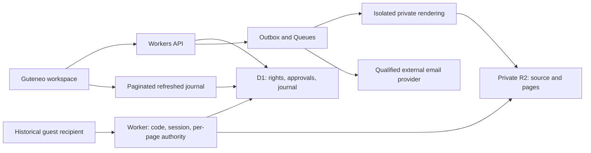

# Secure viewing in Guteneo — historical selected plan

**24 October 2026 evolution:** the [single-account and personal-vault plan](UNIFIED_ACCOUNT_AND_VAULT_PLAN.md) supersedes this proposal. Every recipient now needs one Guteneo account that also provides access to services. The account-free guest journey below is historical; rendering, watermarking and audit principles remain technical research. The retained categories are a revocable share and a personal copy delivered with workspace authorization.

**Later launch policy:** current document authentication uses `verified_account`.
Historical guest-OTP and strong-authentication proposals in this document are not
current launch requirements. Read [the implementation record](SECURE_DISTRIBUTION_IMPLEMENTATION.md)
for implemented behavior and its qualification boundaries.

Product decision on 24 October 2026: an integrated Guteneo implementation without
PDF DRM or an Adobe/FileOpen dependency. This replaced earlier studies'
recommendation of a DRM engine. **At the time of this plan: proposal only; no
feature implemented, communication sent or deployment performed by the study.**

Research inspected local checkout `8b060bb`, PRODUCT, ARCHITECTURE,
EXECUTION_PLAN and the existing protected-link workflow. This inspection does
not qualify production state.

## 1. Promise and scope of the historical proposal

**“Share documents in a secure viewing space, with individual access,
watermarking, expiration, revocation and activity history.”**

The proposed guest received an email link and viewed the document in Guteneo
without installing software or creating an account. The workspace would see
available access/events in dispatch tracking. Account-free reception has since
been superseded; it is preserved here as the original design.

During viewing, the source PDF stays private. The browser receives server-rendered
pages and a qualified accessible alternative. An authorized recipient can still
extract those pixels/text. Protection controls content delivery and future access;
it cannot follow an extracted copy.

Initial proposed scope: PDF, individual recipients, email code, online viewing,
personal watermark, expiration, revocation, tracking and journal export. A later
clarification proposed **view-only by default, with an explicit option to download
the original PDF if the workspace authorizes it before approval**. No dedicated
print function was planned for launch. These UI choices never guarantee that
displayed content cannot be saved or printed.

## 2. Historical proposed journey

1. The workspace chooses a scanned PDF, recipients and term. Initial proposal:
   1, 7 or 30 days, default 7, explicitly reviewed before sending.
2. Guteneo prepares/verifies rendering. Incompatible content produces a clear
   refusal before sending, without silently substituting an attachment.
3. The sender reviews final content, watermark, each recipient, expiry, optional
   original-download permission, message and price/ceiling. Each recipient has
   a distinct link.
4. Acceptance atomically activates the right, reserves costs and inserts the
   dispatch into the outbox. Existing authority/provider/unknown-outcome controls
   continue to apply.
5. The recipient opens the page and requests a code sent only to the approved
   address; another address entered by a visitor cannot replace it.
6. Code validation creates a short document-specific session. The recipient sees
   who shares it, expiry and a clear notice about logging.
7. The workspace follows events, may stop one person's or the whole publication's
   access, and exports the journal under existing permissions.
8. If authorized, the recipient may explicitly download the original PDF. This
   is distinct from displaying pages and has separate controls/events.

Loading the link alone triggers neither an OTP email nor a human-reading event:
mail scanners may visit links. A code proves temporary mailbox control, not civil
identity. A link and code delivered to the same mailbox are not independent
factors.

## 3. Audit: state exactly what is known

| Event                              | What the journal may assert                             | Limit                                                                     |
| ---------------------------------- | ------------------------------------------------------- | ------------------------------------------------------------------------- |
| Email accepted/delivered           | Provider-confirmed state and provenance                 | No reading proof                                                          |
| Code validated / session created   | Verification performed by Guteneo                       | Mailbox access, not guaranteed civil identity                             |
| Page access authorized             | Server authorized delivery of that page                 | Neither complete reception nor reading                                    |
| Page displayed                     | Browser-supplied signal                                 | Declarative, forgeable or absent; distinguish preloading                  |
| Viewing started                    | First page reported displayed after access verification | Neither complete reading nor proven human attention                       |
| Download requested                 | Explicit request received and authorized by the server  | May be cancelled or fail before reception                                 |
| PDF transfer started               | Instrumented start of server delivery                   | Neither complete reception nor saving to disk                             |
| Viewing duration                   | Estimate from bounded activity signals                  | Neither attention nor exact time; exclude hidden tabs and long inactivity |
| Access refused / revoked / expired | Server decision and timestamp                           | Does not withdraw already received content                                |
| Printing                           | Possible browser print-flow opening/closing signal      | No paper confirmation or copy count                                       |
| Screenshot, photograph, local save | Not reliably observable                                 | Never invent detection events                                             |

`afterprint` may follow closing print preview without physical printing. Blocking
shortcuts or hiding controls provides no proof.
[MDN](https://developer.mozilla.org/en-US/docs/Web/API/Window/afterprint_event).

The proposed journal records identifier, workspace, publication, individual
right, pseudonymous session, event, server/browser/provider provenance, result,
versions, source time and receipt time. Browser timestamps are not authoritative.
Journal exports and permission changes are themselves audited.

Technical logs contain no document, plaintext recipient address, code, token or
secret URL. The UI resolves business references only for authorized members.
There is no advertising tracking or hardware fingerprinting.

### Viewing and downloading are independent facts

Prefer Viewing started and Download requested/started to Document saved. If a UI
uses Document viewed, its detail must state browser-reported display without
claiming every page was read. Download may precede reading: retain two timestamped
indicators rather than inventing a viewing funnel.

The server receives no universal proof of disk storage. `Content-Disposition: attachment` requests a browser download; it proves nothing about subsequent
behavior. Even server-side stream completion or a client acknowledgement does
not prove durable saving.
[MDN, Content-Disposition](https://developer.mozilla.org/en-US/docs/Web/HTTP/Reference/Headers/Content-Disposition).

### Original-PDF delivery, when authorized

`allowOriginalDownload` belongs to the immutable approved policy per recipient.
Enabling it afterward broadens permission and requires appropriate new
authority/approval. No original is preloaded to display the reader.

Create the request through an authenticated CSRF-protected action bound to grant,
session, source/SHA and policy. Persist the authorization audit before delivery.
Serve exact original bytes through a dedicated private route that revalidates
rights, without an R2 URL bypassing Worker checks. Any transfer token is brief,
operation-specific and never logged. Image watermarking does not modify the
original PDF; the workspace options must state this.

Group attempts/resumptions under a request identifier. Do not count `HEAD`,
preloading, partial responses or network resumption as complete human downloads.
Distinguish attempt, start, observed interruption and unknown outcome; HTTP 200
alone does not prove success. Revalidate every new request/resumption after
revocation.

Once delivered, PDF bytes can be retained, copied and opened outside Guteneo.
**Those later openings are invisible to Guteneo, and revocation cannot withdraw
the file.** A recipient account does not change this limit. A future watermarked
PDF copy would be a separate approved/named artifact, never a silent alteration
of a signed original.

## 4. Historical Cloudflare architecture proposal

- **Application/API:** existing React/Vite, Hono and TypeScript. Auth0 remains
  workspace-member identity. The superseded guest design used document-limited
  sessions without membership.
- **D1:** authority for rights, expiry, revocation and business writes. No KV or
  long-lived access cache. Read authoritative state rather than a replica that
  might miss recent revocation.
  [D1 replication](https://developers.cloudflare.com/d1/best-practices/read-replication/).
- **Private R2:** immutable source, base renders and personalized pages. No public
  or presigned URL allowing a recipient to bypass Worker authority.
- **Rendering:** reuse the isolated document Worker and server-side PDF.js. Create
  a dedicated viewing contract with qualified resolution/limits. Do not deliver
  the source PDF to PDF.js in the recipient browser.
- **Queues:** deduplicated asynchronous preparation, notifications, aggregates
  and exports. Persist critical authorization events before responding, without
  depending on queue delivery.
  [At-least-once delivery](https://developers.cloudflare.com/queues/reference/delivery-guarantees/).
- **Workspace refresh:** proposed incremental reads every 3–5 seconds while
  tracking is visible, with cursor/recovery. Measure freshness before promising
  it. Durable Objects/WebSockets remain possible later optimizations for
  load/latency, not access authority.

For each page, prepare/retrieve private rendering, then conditionally authorize
and persist audit in the same D1 transaction. Return bytes only after success.
Failure of authority or audit blocks new delivery. Revocation prevents subsequent
authorization after it commits; it cannot recall an already authorized request
or received pixels.

Private responses use no-store, no referrer, no third-party scripts, restrictive
security policy and refusal of external framing. Exclude these responses from
service-worker caches and persistent browser storage. These controls limit
unintentional leakage, not deliberate authorized copying.

Storage/transports use the chosen components' encryption. This is not end-to-end
encryption because Guteneo must process the content. EU jurisdiction for R2/D1
does not prove EU residence across rendering, email and logs. Qualify every
component before actual confidential use.
[R2 location](https://developers.cloudflare.com/r2/reference/data-location/).

## 5. Historical guest identity, sessions and abuse prevention

An invitation represents an individual right within one workspace. All links,
unique constraints and business relationships are tenant scoped. A guest's
tenant would come from a verified server grant, never a freely supplied field.

Initial test proposal: random 256-bit invitation stored as a digest; eight-digit
single-use OTP valid for ten minutes with at most five attempts per challenge;
resend delays/quotas per invitation, workspace and request source. A short
HttpOnly/Secure session, for example 15 minutes, cannot outlive its grant; every
extension revalidates it. These were initial parameters, not security proof or
current account-policy values.

Store an OTP verifier protected by a server secret, not an easily enumerable
simple hash of a short code. Consume challenges atomically, invalidate replaced
challenges and test concurrent validation. Avoid disclosing an address or document
existence to unauthorized visitors.

Prefer a link secret in the fragment, exchanged through a dedicated POST and
removed from visible history. Qualify mail-client rewriting and disable marketing
link tracking. Log no full URL, POST body or cookie. Link possession alone must
never open content.

Initial approval would authorize a bounded verification-code allowance/cost.
Recipient clicks grant no general workspace budget access. An unknown email
outcome is never blindly retried; a later resend is a new bounded identified
request that handles delayed codes.

### Was a recipient account required in this original plan?

The historical guest proposal did not require one: an individual link/code
associated a session with an accessible mailbox. The journal would display
verification method/time. Shared mailboxes, forwarded codes and lent sessions
prevent reliable inference of the physical person. An IP address is not identity.
**The later single-account plan replaces this guest choice.**

An account provides continuity, a document area and the option of stronger
authentication. Email/password registration alone does not verify civil identity.
The study proposed a higher-assurance profile using qualified professional
federation, correct recipient binding, MFA/passkeys and appropriate recovery.
That was a future capability to qualify, not an existing guest property; never
silently downgrade the same assurance promise to email OTP.

Email OTP is a guest-access compromise, not certified strong authentication.
NIST excludes email as an out-of-band authentication channel under its framework;
that framework is not automatically a Guteneo legal obligation. Distinguish
mailbox verification, authentication and identity proof.
[NIST SP 800-63B-4](https://pages.nist.gov/800-63-4/sp800-63b.html).

## 6. Rendering, watermarks and accessibility

Scan the exact source before processing. Outputs carry an immutable manifest:
source/SHA, engine version, pages, dimensions, object hashes and profile version.
Forms, annotations, signatures, layers, fonts, rotation and long documents need
qualification rather than assumed support.

Integrate watermarks into server-rendered pixels: confidentiality notice and an
opaque recipient-linked identifier resolved by the workspace. Avoid repeating a
full personal address. A CSS overlay alone is insufficient. Watermarks discourage
redistribution but remain editable and alone identify no leak author.

**Proposed V1 choice:** render base pages once, then prepare recipient variants
before final approval with output hashes. Extra storage allows review of the
actual distributed content and preserves immutable approval. Bound pages,
recipients and preparation; purge unused preparation. A constant per-invitation
watermark avoids new variants every second/session.

On-demand generation was a future optimization requiring a tested deterministic
transformation contract compatible with approval. It must never silently
regenerate approved content with another engine.

Image-only viewing is insufficient. Qualify keyboard navigation, zoom, reading
order and structured text alternatives from the prototype. The same authority
protects extractible alternative text. Existing bounded non-semantic assistant
review extraction is no accessibility proof. Never automatically deliver the
original PDF as a fallback.
[W3C, images of text](https://www.w3.org/WAI/WCAG22/Understanding/images-of-text.html).

Scanned PDFs needing OCR or documents lacking adequate structure remain explicitly
unqualified cases. Do not claim accessibility before a verified solution. Do not
block assistive shortcuts or hide content on every focus loss.

## 7. Historical integration plan

Proposed name: **Secure viewing**, with a new business mode such as `secure_view`.
The existing `protected_link` mode, sent links, approvals and pricing retain their
meaning; the proposal does not repurpose them.

| Integration point                                                    | Proposed work                                                                                                                                                           |
| -------------------------------------------------------------------- | ----------------------------------------------------------------------------------------------------------------------------------------------------------------------- |
| `apps/api/src/protected-documents.ts`                                | Reuse secret/session/revocation principles; separate individual workflow and optional original download without reusing the old shared link                             |
| `apps/documents/src/expert-review.ts` and `expert-review-browser.ts` | Reuse isolated rendering primitives; dedicated private contract, corpus and limits                                                                                      |
| `packages/domain/src/index.ts` and contracts                         | Fingerprint source, final manifest, recipient, policy including download permission, expiry, watermark, message, OTP allowance and cost; atomic acceptance/quota/outbox |
| New migrations                                                       | Publications, grants, guest challenges/sessions, manifests/pages and events; organization-composite relations, no applied-migration edits                               |
| Documents / Dispatches UI                                            | Preparation, review, individual access, provenance-labelled journal, expiry and revocation                                                                              |
| Maintenance                                                          | Separate document/page/challenge/session/journal retention; purge after active dependencies and address backups                                                         |

Guests gain no administration/approval authority. Workspace roles continue to
govern preparation, approval and reports. Broadening access, extending a term or
adding a recipient needs appropriate new authority/approval. Revocation is an
audited reduction. Existing assistant mandates never silently acquire a new mode.

The renderer inspected in this study rejected forms, layers and annotations.
Its 1,600-pixel/three-pages-per-request limit concerned assistant review. The
prototype needed to establish fidelity, readability, performance and recovery for
viewing. Historical `protected_document.downloaded` occurs before a potentially
inline response; never reuse it as proof of saving a file.

## 8. Cost: measure the service without a DRM royalty

Adobe/FileOpen contracts cease to be feature dependencies in this proposal.
Software licenses and Cloudflare/email/operations/support costs remain. The
study decided no per-document/recipient price; the legacy EUR1 fee does not
qualify this mode's price. Current versioned pricing is documented separately.

Measure source pages converted, rendering time, prepared variants, stored bytes
and term, page delivery, D1 events/indexes, journal refreshes, code emails,
failures and support. R2 bills storage/operations; free egress does not make the
whole viewing service free.
[R2 pricing](https://developers.cloudflare.com/r2/pricing/).

Retained comparison scenario: 10,000 PDFs/month × 10 pages × 3 recipients × 2
viewing sessions gives 100,000 base pages, up to 300,000 prepared personalized
pages and 600,000 page deliveries if every page is traversed each time. Return
visits, zoom and preloading can increase counts. Two sessions do not automatically
mean two OTPs; measure sessions/resends.

`Full cost = rendering + storage/operations + API/journal + email/OTP + maintenance + support`.

Test 7/30-day retention, average/maximum size, peaks, per-workspace quotas and
worst-case abandoned-preparation cost. Prefer preparation within a bounded
allowance. If preparation becomes paid, obtain separate authorization before
consumption. No hidden overage after approval.

## 9. Historical milestones and exit criteria

| Stage                        | Expected result                                                                                                                                                         |
| ---------------------------- | ----------------------------------------------------------------------------------------------------------------------------------------------------------------------- |
| 1 — Render prototype         | Synthetic corpus; measured fidelity/watermark/accessibility/cost/time; no source PDF delivered for viewing                                                              |
| 2 — Individual access        | Additive tables/migrations, OTP/sessions, atomic authority, revocation/expiry; concurrent and cross-workspace tests                                                     |
| 3 — Preparation/distribution | Reviewed final rendering; exact approval includes download permission; original delivery separate/audited when allowed; bounded costs/outbox/simulations; no real email |
| 4 — Workspace tracking       | Distinct server/client journal, cursors/recovery/export/permissions/lag indicator; measured few-second persistence-to-display target                                    |
| 5 — Qualification            | Real browsers/mobile, assistive technologies, anti-abuse, load, restore/purge, residence and OTP provider                                                               |
| 6 — Pilot                    | Deployment and sends separately authorized; bounded volumes, observed journey and cost                                                                                  |

Decisive proposed checks: no cross-workspace/recipient access; no source PDF
without explicit download permission; no reader source preload; no unwatermarked
render served; expired/replayed/concurrent OTP; revocation racing access; D1/audit
failure refusing bytes; queue failure losing no journal; mail scanner causing no
OTP; cancelled/interrupted/resumed downloads producing no false saved status;
cancelled printing producing no false success; no invented screenshot detection;
legacy links preserved; purge respecting dependencies.

After implementation, run appropriate project checks and separately qualify
simulation, Cloudflare runtime and real browsers. This historical plan alone
establishes neither release readiness nor a delivery commitment.
