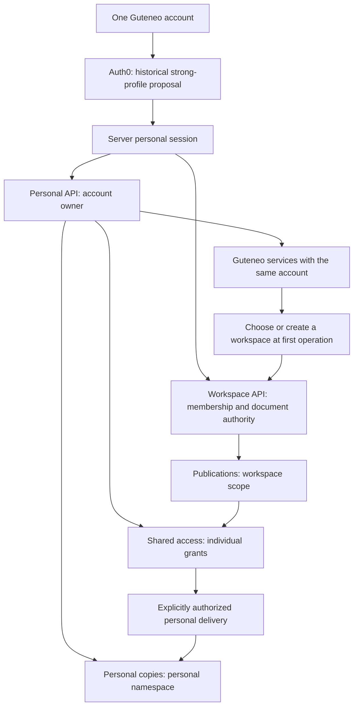
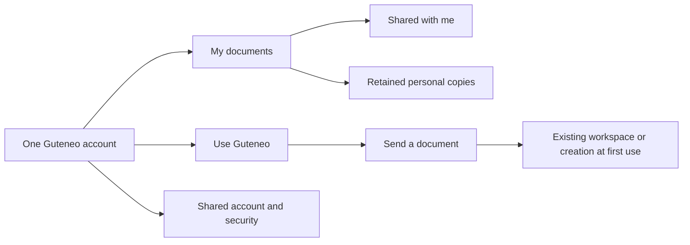

# One Guteneo account for received documents and delivery services

Product, security, architecture and interface plan dated **24 October 2026**.
Design decisions later informed the local candidate described in the
[implementation record](SECURE_DISTRIBUTION_IMPLEMENTATION.md), with
[versioned prices](SECURE_DISTRIBUTION_PRICING.md) and separate tests. This plan
proves no Auth0 activation, remote migration, communication or publication.

**Later launch decision:** document authentication uses **`verified_account`**.
A verified account following the normal sign-in flow may access its authorized
documents without an extra passkey or MFA requirement. Server identity,
freshness, session and document-authority checks remain mandatory. This later
choice supersedes the strong-only authentication recommendation in this historical
plan. Sections about compulsory WebAuthn, strong recovery, KMS/HSM targets and
future content entitlements preserve research/proposals; they do not describe
implemented or activated guarantees. See the implementation record for the
current boundary and remaining gaps.

## 1. User decisions and recommendation

Decisions expressed during the original design discussion:

- An integrated Guteneo solution without DRM inside PDFs.
- Treat every document in this workflow as very sensitive, originally with no
  lower-assurance reception profile; the later launch authentication decision
  above supersedes that original strong-only requirement.
- Require an account even to receive one document.
- **One account for all Guteneo:** receiving/finding documents, discovering/using
  services and participating in workspaces.
- Two explicit categories: revocable shared access and a retained personal copy
  only when the workspace authorizes delivery.

Recommendation: **one account/sign-in, several working contexts and distinct
rights**. Recipient and sender are uses of one account, not separate account
types to merge later. A personal space is not a fictional workspace. Receiving
a document never creates membership/rights in the sending workspace; an existing
member may also receive a document individually.

The person can discover services immediately after sign-in. Their first sending
operation creates or selects a workspace with only the information needed for
that operation. No second registration/password or subscription is required to
discover services. Normal business controls still precede real sending.

Rendering, watermarking and audit research in the [previous web study](SECURE_WEB_DOCUMENTS_PLAN.md)
remains useful. This plan supersedes its account-free guest journey. Adobe/FileOpen
comparisons become historical research.

## 2. Assumptions challenged by the study

| Intuition                                   | Benefit                                          | Problem to resolve                                                                                |
| ------------------------------------------- | ------------------------------------------------ | ------------------------------------------------------------------------------------------------- |
| An account makes recipient identity certain | Continuity, authentication, recovery and history | Initial association with the right person still needs evidence; name/email alone are insufficient |
| Centralizing a vault improves security      | Fewer scattered attachments and managed access   | One compromised account may expose documents from many workspaces                                 |
| Every document is very sensitive            | A consistent understandable policy               | Senders, operators, support and recovery need equivalent protection                               |
| A vault retains documents                   | Recurring personal value                         | Fund retention and distinguish personal copies from revocable access                              |
| Recipients become prospective customers     | Acquisition through genuine discovery            | Compulsory registration is not conversion; sales pressure can undermine trust and deliverability  |

Email verification establishes mailbox access, not claimed identity. An attacker
controlling the mailbox on first access may enroll their own passkey.
[Auth0 email verification](https://auth0.com/docs/manage-users/user-accounts/verify-emails).

Security therefore requires recipient binding, actual authentication, recovery
and authorization rather than merely adding registration. Under the original
strong-policy proposal, abandonment should be addressed through support or a
narrower commercial scope rather than silently replacing the same assurance
promise with email access. The later `verified_account` choice is an explicit
product decision, not evidence that the historical strong design was qualified.

## 3. Unique identity and historical strong-access proposal

### A personal account independent of workspaces

A person has a stable Guteneo identifier. Sign-in identities bind through
`(issuer, subject)`; email is routing information and dated verification, never
the vault key. Changing an address or losing membership does not automatically
transfer/delete personal documents.

Keep Auth0 as identity provider and reuse the server BFF/secure sessions. Do not
build a custom identity provider or migrate providers for this feature without
demonstrated reason.

The original proposal applied the following strong policy to recipients and
workspace members viewing content:

- Passkey login with user verification, or an enterprise method whose assurance
  and recovery are qualified to the same level.
- Server verification of the actual method, freshness and policy version. An
  enrolled-passkey field or old `mfa=true` boolean is insufficient.
- Recent reauthentication for original export, personal delivery, bulk export,
  factor enrollment, recovery, identity linking and sensitive permission changes;
  avoid reauthentication for every page.
- Bounded sessions, rotation/revocation, device/session visibility and suspicious
  access reporting. No email-code fallback granting the entire vault.
- A stable login domain qualified before passkey enrollment, with a domain
  migration procedure and target-device tests.

These were strong-profile design targets, not current `verified_account` launch
requirements. Auth0 offers passkeys through Universal Login; activation does not
necessarily remove other methods. Exact plan/configuration must be qualified
before promising strong policy. Documentation alone proves neither activation
nor actual tenant availability.
[Auth0 passkeys](https://auth0.com/docs/authenticate/database-connections/passkeys).

### Initial association of a document with a person

Two proposed journeys share a reliable-binding requirement:

1. **Recipient already known to this workspace:** send to a previously associated
   stable account after checking that the relationship remains valid. The
   workspace gets no global Guteneo account directory.
2. **New recipient:** opaque invitation, address verification, account creation/
   sign-in and reliable association. The original proposal requested strong
   sign-in. A prevalidated relationship or qualified identity/federation evidence
   may suffice; otherwise the workspace confirms through an existing relationship
   or known independent channel. Do not require identity-document collection by
   default.

The invitation alone reveals no content. Pending association exposes no sensitive
title, preview or file. Clicking Confirm based only on a visitor-entered name is
not the proposed verification.

Manual confirmation is not necessarily required for every new account: it applies
when adequate evidence does not preexist. If the pilot uses it, show the pending
state, responsible person and recovery route rather than promising immediate
access after signup. Prevalidating the relationship during normal customer
contact reduces delay.

Initial approval binds document, expected address and attribution rule. Later
confirmation adds immutable evidence linking stable account, workspace, intended
recipient and publication; it does not rewrite the approved dispatch's recipient.
Address correction or attribution to another person requires new preparation,
never silent grant transfer.

Enrollment must not turn account created into right person identified. Record
binding method, authorized actor and date. Promise neither absolute certainty
about who is at the screen nor complete reading.

### Recovery is part of the product

The historical strong proposal recommends an independent backup, such as another
passkey on separate hardware or a security key. Test loss of the smartphone and
accessible recovery. Someone unable to use the chosen method needs an
equivalent-assurance alternative; otherwise the pilot does not cover their
hardware.

Two devices using one synchronized keychain are not necessarily independent
backups. Qualify recovery of the synchronization account and consider a separate
security key.
[NIST, syncable authenticators](https://pages.nist.gov/800-63-4/sp800-63b/syncable/).

For complete factor loss, the proposed strong recovery is documented, includes
appropriate waiting/notifications, revokes compromised sessions and records
controlled recovery evidence. Support has no universal remove-MFA-and-open-vault
button. Account UI recovery may precede content reopening until required
assurance is restored.

Workspaces may revalidate their own recipient relationships; that alone cannot
unlock documents from other senders. Personal-copy recovery needs evidence
independent of the sending workspace's continued existence.

NIST distinguishes identity proofing from authentication and excludes email as
out-of-band authentication under its framework. It is a design reference, not
Guteneo certification or a universal legal obligation.
[NIST SP 800-63](https://pages.nist.gov/800-63-4/sp800-63.html),
[authenticators](https://pages.nist.gov/800-63-4/sp800-63b/authenticators/).

### Special addresses and identities

- A recycled address inherits no old documents: accepted rights stay bound to
  the stable account.
- No automatic linking on equal email. Future account linking needs
  reauthentication of both identities and an explicit merge policy.
  [Auth0 Account Linking](https://auth0.com/docs/manage-users/user-accounts/user-account-linking/link-user-accounts).
- A shared mailbox must not become the personal vault of the first employee who
  clicks. V1 assumes individual recipients; representatives, delegation and team
  vaults are explicit extensions.
- Employer-controlled identity alone must not open other senders' personal
  documents, enroll their access factors or recover the vault: an IdP
  administrator may take over that identity while it remains active. The strong
  study proposes an independent personal authenticator or a qualified mechanism
  against that risk. This remains one Guteneo account with appropriate
  reauthentication; SSO retains its qualified professional scope.

## 4. Two categories and two access contracts

The user confirmed this distinction.

| Property                  | Shared with me                              | Kept in my personal space                                               |
| ------------------------- | ------------------------------------------- | ----------------------------------------------------------------------- |
| Authority source          | Workspace authorization for this account    | Workspace-authorized personal delivery followed by recipient acceptance |
| Expiration                | Displayed share expiry                      | Independent displayed/funded retention term                             |
| Workspace revocation      | Blocks new access                           | Does not erase a delivered copy                                         |
| End of workspace contract | Under share terms and planned notifications | Promised personal retention must survive that departure                 |
| Original download         | Only when authorized                        | Personal export belongs to the retention contract                       |
| Workspace-visible audit   | Its share's events with provenance          | Delivery evidence, without surveillance of later private reading        |
| Recipient-visible audit   | Own access and relevant changes             | Own operations and authorized access to the personal space              |

`allowVaultDeposit` proposes autonomous, exportable delivery. A personal copy that
the workspace can still prevent exporting or make disappear is a different
promise. Share-download permission may exist without deposit permission; allowed
combinations must be explicit.

By default, sharing remains revocable and download is disabled. Recipients may
retain a copy only if the workspace chose that option before approval. Keep a
copy explains term, origin and export; no additional purchase is required to use
already funded retention.

The source and personal copy are separate retention objects even with identical
bytes. Workspace revocation, personal deletion, legal obligations and retention
expiry follow their own rules. Workspace revocation is not a vault deletion
instruction.

A downloaded original leaves Guteneo's control. Accounts do not make off-platform
opening, copying, printing or screenshots observable.

### Personal-copy delivery transaction

1. Approved policy authorizes deposit for that recipient/exact version, with a
   bounded funded term. On share activation, delivery capacity is prepaid and
   irrevocably charged to honor retention; the workspace cannot spend it again.
2. The authenticated recipient requests the copy. The historical proposal
   requires strong authentication; current implementation applies its selected
   document policy. A unique operation per share/person consumes prepaid
   capacity. Expiry without deposit refunds no option under terms disclosed
   before approval. Uncertainty is reconciled through the same operation.
3. A private job creates a personal-namespace copy with immutable object, hash,
   provenance and distinct keys. It remains invisible until verified.
4. A transaction revalidates grant/version/recipient/deposit authority and its
   reservation; consumes it at most once; activates the copy, retention
   commitment and events/outbox.
5. Revocation before activation acquires no copy and orphan objects are cleaned.
   After activation, the acquired copy stays personal. A timeout reconciles by
   identifiers/hashes rather than creating multiple deposits or charges.

D1/R2 do not form a distributed transaction. Invisible preparation followed by
conditional activation defines delivery. Backup restoration must preserve that
order and revocations.

## 5. Rights and data architecture

The diagram records the original strong-profile design. Its identity-method
requirement is superseded for launch by `verified_account`; the separate authority
domains remain the design principle.

Three distinct authorities:

- **Identity:** authenticated person, method, freshness and security state; may
  exist with zero workspaces.
- **Workspace:** current membership, role, document/folder entitlement and
  operation authority. A client may select context, never grant itself rights.
- **Personal space:** authenticated owner and personal-delivery rights. A
  workspace administrator has no authority over someone else's vault.

Keep business `AuthContext` strict. Add a personal principal and separate guards
rather than making `organizationId` optional everywhere. Each route declares
its domain: personal, workspace, shared document or private internal operation.

| Proposed entity                             | Authority and key points                                                                               |
| ------------------------------------------- | ------------------------------------------------------------------------------------------------------ |
| `users`, `auth_identities`                  | Stable global identity; email is never authority                                                       |
| Personal sessions                           | User, method/freshness evidence, revocation and policy; independent of membership                      |
| Workspace context                           | Current membership/role, expected request context and document authority                               |
| `recipient_relationships`                   | Workspace + stable recipient + binding method/evidence; no exposed global directory                    |
| `document_publications`, `recipient_grants` | Source/publication/grant/audit relationships carry organization and composite keys                     |
| Document invitations                        | Immutable target, hashed secret, status, deadline and claim evidence; never create membership          |
| Shared with me index                        | Projection of grants addressed to the account; never replaces current authority                        |
| `personal_spaces`, `personal_documents`     | Explicit personal boundary, stable owner, independent objects/retention; no workspace-deletion cascade |
| `vault_deposit_operations`                  | Controlled source-to-personal-copy bridge, idempotency, version, funding and activation point          |
| Journals                                    | Separate account security, share activity, personal activity and administration                        |

All received documents is a query authorized by the principal's `user_id`,
joining grants and their organizations. It is not a workspace API with its tenant
filter removed. Personal space adds a security domain, not a global isolation
exception.

Titles, thumbnails, search results, counts and exports follow content authority.
A stale list never reopens a revoked share. Removing membership revokes workspace
rights without erasing personal copies.

Changing space is not another sign-in. With two tabs in different workspaces,
each mutation carries its expected context for server verification; one tab's
switch must not silently retarget the other.

### Reusing a document for Guteneo services

Send with Guteneo is possible for an exportable personal copy or explicitly
authorized delivery. Before creating a business copy, show/confirm the target
workspace and people/entitlements that may read it: internal publication may
expose content before sending. Never transfer automatically to the last-used
workspace. Scanning, review, recipient, cost and dispatch approval follow;
dispatch approval does not replace internal-transfer authorization. View-only
content must not bypass policy through forwarding.

Existing assistants/OAuth authority remain workspace scoped. No implicit vault
scope is added. Existing mandates gain neither personal delivery, cross-workspace
reading nor enrollment authority.

## 6. Hosting, encryption and operations

Cloudflare remains the application center: Workers/Hono, D1, private R2,
outbox/Queues and isolated document service. Auth0 supplies identity. Workspace
notifications may start with incremental journal reads every few seconds;
real-time transport is not access authority.

For shares, scan exact sources, qualify server rendering, freeze personalized
pages before approval, integrate pixel watermarks and provide an accessible
alternative. Deliver no source PDF implicitly to the reader. Authorized download
has a separate audited route. Audit provenance and physical capture limits
remain those of the web study.

Personal copies use storage separate from workspace sources and independent
retention. Avoid cross-person deduplication for marginal object savings before
proving isolation, key handling and deletion.

R2 automatically encrypts objects at rest with Cloudflare-managed keys. This
proves neither end-to-end encryption nor impossibility of Guteneo access.
[R2 security](https://developers.cloudflare.com/r2/reference/data-security/).

**Historical recommended target to qualify:** application envelope encryption
with one data key per object, authenticated owner/source/version context, wrapping
keys separate from objects and least-privilege service access. Use established
primitives/libraries with documented rotation, restore and destruction; invent
no cryptographic protocol.

Selecting a key manager is an architecture milestone: a KMS/HSM with qualified
region/audit integrated into Workers. If that needs an external European service,
state it rather than claiming an unproven all-Cloudflare design. At the time of
research, Secrets Store was described as a beta secrets manager, not evidence of
non-exportable KMS or EU-only processing.
[Secrets Store](https://developers.cloudflare.com/secrets-store/).
Current server-secret envelope encryption must not be relabelled as qualified
KMS/HSM or end-to-end encryption.

Server rendering processes plaintext during authorized execution. This design
protects specific risks; it cannot promise that even Guteneo can never read
content. Cryptographic provider inaccessibility would need a different
key/processing architecture, decided before a commercial commitment.

Define/verify service identity, R2/D1/key privilege separation, absence of content
in logs/traces, rendering sandbox, bounded egress, private caches, source exclusion
from analytics, independently encrypted backup and restoration drills. Export
administration/key-access logs outside a path one administrator can rewrite.

Support has no universal content access. Exceptional intervention must be limited,
justified, authorized under the applicable framework and audited. Sales staff
never receive documents or detailed reading history.

D1/R2 EU jurisdiction alone does not locate Auth0, rendering, Worker execution,
keys, email, traces and backups. A confidential pilot requires qualification of
the actual deployed chain, not merely hosted-in-Europe wording.

## 7. Implications for workspaces

### The historical high-assurance target on both sides

At the checkout inspected for this study, the existing contract allowed all
members to read a workspace's documents/recipients; Viewer alone provided no
document-level isolation. This was checked in `docs/WORKSPACE_ROLES.md` and local
source. It is a dated baseline, not a claim that later secure-source guards do
not exist.

The proposal recommends supplementing roles with folder/document entitlements.
A role defines possible operations; an entitlement defines affected content.
Explicitly designate preparer, approver and recipients. Reporting alone should
not open content; workspace administration must not silently become universal
personal reading authority.

Define who assigns entitlements. If an administrator may grant themselves folder
access, do not claim they cannot read its contents; expose/audit that authority.
Stronger separation needs independent control over assignments.

Apply the boundary to source, render, search, recipients, dispatch, reports,
exports, REST, native and MCP. Do not harden only the new reader while leaving
an old original route open.

Separating preparer/approver and independently validating recipient changes
reduces internal errors. A one-person workspace must explicitly acknowledge the
absence of dual control rather than claim two-person validation.

### What the workspace must choose or do

1. Verify the recipient/account relationship for initial delivery; explain
   account creation and the actual authentication policy.
2. Choose share term, original download and any personal-copy permission, with
   separate personal-retention term/cost.
3. Review final document/policy and approve under Guteneo authority.
4. Resolve recipient mistakes, extension requests and content questions. Guteneo
   handles account security and technical incidents.
5. Understand that an acquired/downloaded copy cannot be recalled by revocation.

Tracking distinguishes notification submitted/delivered, association pending/
confirmed, access authorized, display reported, download requested/started and
personal-copy delivery. Failed registration is not successful document delivery;
a completed server stream is not proven disk storage.

A workspace sees neither global account existence, other senders nor purchased
services. It sees only facts needed for its publications. After personal deposit,
private audit belongs to the recipient; the workspace retains delivery evidence
without continuous vault surveillance.

Very sensitive is a product-protection choice, not universal regulatory
qualification. Define the pilot's sector scope. Legacy protected links need an
explicit migration/expiry plan; their continued existence must not be described
as retroactive adoption of the new protection.

## 8. Interface representation

### One product with intent-based access

| Surface                   | Main content                                                                                               | Primary action                                      |
| ------------------------- | ---------------------------------------------------------------------------------------------------------- | --------------------------------------------------- |
| Invitation before sign-in | Minimal context, language/help, invitation state; no sensitive title                                       | Access my document                                  |
| First reception           | Minimal signup/login, applicable authentication, binding if needed; original strong-only design superseded | Continue to the expected document                   |
| My documents              | Shared / Retained, sender/date/status/expiry, permission-scoped search                                     | Open document                                       |
| Shared document           | Pages, sender, term, watermark and audit notice                                                            | View; Download / Keep only if authorized            |
| Personal copy             | Version/origin, retention, export and personal history                                                     | View / export / delete with necessary confirmations |
| Use Guteneo               | Existing services explained, available prices, no confidential targeting                                   | Prepare a dispatch                                  |
| Account and security      | Visible identity, sign-in methods, recovery, sessions, language and privacy                                | Manage security / change account                    |
| Workspace                 | Existing business navigation, entitlements and tracking                                                    | Prepare / approve / administer under current rights |

A document link returns directly to its document after login even if the last
context was a workspace. General entry restores the last chosen context, with
My documents as default for someone who has only received documents.

The header shows account name/current context, with a Personal space / Workspace
selector. Do not present separate sign-in-as-recipient and sign-in-as-sender
accounts. Services remain accessible from personal space without identity change.

Mobile navigation stays short: Documents, Services, Account, with workspace
context visible when needed. Reuse Guteneo ivory/cobalt, concrete labels and the
existing four languages. Keep one account-language preference and accessible
pre-login language selection. Qualify keyboard/assistive-technology reader use.

### Interaction contracts for prototypes

| Situation                                  | Expected behavior                                                                                                                          |
| ------------------------------------------ | ------------------------------------------------------------------------------------------------------------------------------------------ |
| Wrong signed-in account                    | No content; explicitly offer account switching without moving the grant                                                                    |
| Pending binding                            | Explain status/help; no false document-available state                                                                                     |
| Revocation while reading                   | Refuse new deliveries and explain; do not claim erasure of received pixels                                                                 |
| Keep a copy                                | Show rights/term, progress, success only after durable activation; double-click creates no duplicate copy/charge                           |
| Leave during deposit                       | Recover the same operation/status on return; navigation does not cancel accepted delivery                                                  |
| Recovered account lacks required assurance | Account UI may open while documents remain locked pending the actual required check, with clear help                                       |
| First service use                          | Same account; collect needed business information at the right time; idempotent workspace creation creates no sending-workspace membership |
| Hide / delete                              | Hiding a share does not revoke its workspace dispatch; deleting a personal copy does not delete the workspace original                     |

## 9. Cross-selling is secondary to delivering the service

Recommended placement: a permanent discreet Use Guteneo entry, then a generic
suggestion after viewing, such as Send your own documents with Guteneo. No offer
in confidential email, security screens or before the expected document. A
coercive offer reduces trust in Guteneo and the workspace.

Promised document access depends on no purchase, marketing checkbox or workspace
activation. Users may explore services immediately. A sending workspace is
created only when an operation needs it, within the same session/profile.

Do not infer interests from document title/content/sender/opening/download.
Separate workspace delivery data, personal-account data, security and Guteneo's
own marketing preferences. CNIL addresses a processor's reuse of entrusted data
for its own purposes.
[CNIL reuse guidance](https://www.cnil.fr/fr/sous-traitants-la-reutilisation-de-donnees-confiees-par-un-responsable-de-traitement).

Creating an account is not marketing-email consent. CNIL states that account
creation alone is insufficient for the B2C existing-customer exception; B2B rules
differ. Provide separate preferences, free choice and suppression independent of
security/document notifications.
[CNIL prospecting guidance](https://www.cnil.fr/fr/la-prospection-commerciale-par-courrier-electronique-sms-mms-et-automate-dappel).

Success metrics, in order: successful content access, access time, enrollment
abandonment, incidents/recovery, sender/recipient satisfaction; then voluntary
service discovery, first preparation and first dispatch. Measure the commercial
funnel separately from document traces with appropriate aggregation. Compulsory
accounts are not acquired sending customers.

## 10. Retention, naming and economics

### Promise no perpetual vault

Proposed economics: recipients pay nothing to receive/view; the workspace funds
sharing and, if authorized, a defined personal-retention term. That term survives
workspace departure. Extensions are explicit, with pre-expiry information and
export. This plan decides no tariff or debit; later versioned pricing is separate.

Define distinct retention for documents, delivery evidence, account-security
traces and personal activity. Deleting/hiding content does not mechanically erase
all evidence; preserving evidence does not justify indefinite content storage.
Contracts, user information and purge must match this matrix.

A pilot might test twelve months, but that is a hypothesis to cost/validate,
not a legal obligation or sufficient term for every document. Multi-year promises
must fund operations, identity, support, backups and exit at delivery. Deleting an
account, personal copy and workspace are three procedures.

### The French digital-safe designation is not a simple UI label

For a service within the French framework, L122-22 refers to CPCE L103 duties,
including integrity/origin, user-accessible traceability, identification,
exclusive access and recovery. L103 also addresses provider processing for the
user's benefit with consent; this does not eliminate architecture/contract
qualification. Claim no already achieved compliance/certification.
[L122-22](https://www.legifrance.gouv.fr/codes/article_lc/LEGIARTI000035723787/2026-07-16),
[L103](https://www.legifrance.gouv.fr/codes/article_lc/LEGIARTI000037825515/).

The regime includes recovery/closure arrangements. D541 mentions three months'
notice and, in specified circumstances, at least twelve months of continued
recovery. Budget this and obtain qualified confirmation of applicability to the
actual service/markets before commercialization.
[CPCE D537–D541](https://www.legifrance.gouv.fr/codes/id/LEGISCTA000037472172/).
These are dated research references, not a claim of legal qualification.

Recommended working UI: **My documents**, **Shared with me** and **Retained**.
The personal-vault goal remains; changing labels does not replace analysis of
actual service duties. Qualified legal review precedes a commercial digital-safe
promise.

### New costs to budget

| Area        | Change                                                                                                    |
| ----------- | --------------------------------------------------------------------------------------------------------- |
| Identity    | Active recipients plus workspace members, authentication functions, recovery/support, hybrid B2C/B2B plan |
| Enrollment  | Workspace relationship verification, one-off-recipient support and abandonment                            |
| Retention   | Independent personal copies, renders, keys, backups and commitments after workspace departure             |
| Operations  | Monitoring, alerts, key rotation, restoration, incident response and exit export                          |
| Product     | Two authority domains, new views/migrations, accessibility, languages and support                         |
| Acquisition | Service discovery measured without funding promised documents through assumed conversion                  |

Public Auth0 plans use monthly active users and distinguish functions/plans. A
past Free selection does not qualify a future strong policy, functions, SLA or
invoice. Size the actual configuration; cumulative accounts, MAU and document
opens are different quantities.
[Auth0 pricing](https://auth0.com/pricing).

Retained planning scenario: 100 workspaces, 10,000 PDFs/month, 5,000 active
recipients/month, 1,000 new people/month after M1. This reaches 16,000 people at
M12 and 40,000 at M36, not necessarily that many MAU. Test personal-copy shares
of 10/50/100%, terms of 1/3/5 years, support per new user and recovery peaks.
These are hypotheses, not observed Guteneo volumes.

`Full cost = identity + enrollment/support + rendering + storage/retention + keys + audit + email + operations + continuity/exit reserve`.

Evaluate the conservative scenario with no cross-selling revenue. Future
conversion is potential upside, not implicit funding of promised retention.

## 11. Code gaps observed at the historical checkout

These observations were rechecked against local checkout **`8b060bb`** for this
study, not against today's deployed/Auth0 state. Later implementation and
migrations may address them; do not present this table as a current defect list.

| File                                                         | Observation at that checkout                                                                                            | Proposed evolution                                                                             |
| ------------------------------------------------------------ | ----------------------------------------------------------------------------------------------------------------------- | ---------------------------------------------------------------------------------------------- |
| `apps/api/src/auth.ts`                                       | `AuthContext`/sessions required a workspace; ordinary signup created organization/admin/quotas/welcome-credit mechanism | Independent personal session; explicit service-use workspace creation; method/freshness policy |
| `migrations/0002_auth.sql`                                   | Browser session referenced membership                                                                                   | Additive identity/session migration, transitional compatibility and controlled invalidation    |
| `apps/api/src/auth.ts`                                       | Workspace switching existed                                                                                             | Reuse its principle with personal space and concurrent-tab protection                          |
| `migrations/0043_workspace_invitations.sql`                  | Invitations created membership                                                                                          | Separate document invitations with recipient binding                                           |
| `apps/api/src/protected-documents.ts` / migration 0040       | Shared per-document link delivered the PDF                                                                              | New account-required mode, individual rights and separate original delivery                    |
| `apps/documents/src/expert-review.ts`                        | Isolated review rendering with format/resolution limits                                                                 | Qualified viewing pipeline and accessible alternative                                          |
| `packages/contracts/src/roles.ts`, `docs/WORKSPACE_ROLES.md` | Action roles without document isolation                                                                                 | Content entitlements and inventory of every reading route                                      |
| `apps/api/src/account.ts`, `apps/web/src/account-page.tsx`   | Profile/workspace shown together                                                                                        | Common account/security; workspace settings in their context                                   |
| `apps/api/src/maintenance.ts`                                | Purge followed then-current business dependencies                                                                       | Independent personal references/retention and exit procedures                                  |
| Domain, MCP, native                                          | Workspace authority/existing approvals                                                                                  | No implicit personal rights; migration without weakening safeguards                            |

Old `IDENTITY_MCP.md` wording that deferred the switcher was already superseded by
local code. Its beta `verified_email` policy was not proof of configured strong
passkeys. Historical documentation never proves current runtime capability.

## 12. Historical implementation plan and required evidence

| Stage                  | Deliverable                                                                                    | Exit condition                                                                         |
| ---------------------- | ---------------------------------------------------------------------------------------------- | -------------------------------------------------------------------------------------- |
| 0 — Product contracts  | Two categories, term/funding, binding/recovery, personal/workspace audit, naming               | Pilot-applicable decisions and written responsibilities                                |
| 1 — Identity prototype | Account without workspace, historical strong login, existing/wrong account, factor loss        | Actually qualified method/freshness/binding; no hidden weak fallback under that policy |
| 2 — Isolation          | Personal/workspace principals, entitlements/grants/sessions, additive migrations               | Full rights matrix; no cross-reading through old routes                                |
| 3 — Viewing            | Synthetic corpus, render/watermark/accessibility, invitation/approval/tracking                 | Verified journey, measured costs/limits, no real sending                               |
| 4 — Personal retention | Independent copy, delivery point, funding/retention, export/deletion                           | Revocation/deposit races, closed workspace and restore demonstrated                    |
| 5 — Unified product    | My documents, immediate service discovery, first-use workspace, shared account/security        | Document return, mobile/languages/context, no second registration                      |
| 6 — Qualification      | Independent security review, recovery, keys/regions, support/continuity/contract qualification | Actual infrastructure/device evidence and sustainable economics                        |
| 7 — Authorized pilot   | Informed workspaces/recipients, bounded volume/terms                                           | Separate release/send authority and observed reception/access                          |

The complete vault includes personal retention. An earlier share-only release
must be labelled accordingly; a list of links does not establish the final vault.

Structural tests proposed: account without workspace/credit; a workspace member
receiving from another workspace; forged recipient relationship; recycled email;
wrong account; enrolled passkey but weak session under the historical strong
policy; factorless recovery; member content-right revocation; stale list
projection; two tabs/workspaces; concurrent deposits; revocation before/after
deposit; workspace deletion preserving personal copy; purge/restore; private
export; no vault access through current MCP scopes; no compulsory commercial
conversion.

During implementation run suitable business tests, then types/lint/tests/E2E/build.
Simulation, local proof, deployed Cloudflare, real Auth0 and physical devices are
separate levels of evidence.

## 13. Historical open decisions

One account and two categories were retained. The original uniform strong-policy
recommendation was later superseded for launch by `verified_account`. The plan
identified these dependencies for explicit decision before their implementation:

1. A practical initial-recipient confirmation mechanism for workspaces.
2. Recovery policy, alternative equipment and available Auth0 method evidence.
3. Funded personal-retention term and extension/exit conditions.
4. Key management, operator access and qualified digital-safe terminology for
   served markets.
5. Minimum workspace content entitlements and legacy-access treatment.

Working assumptions: named adult recipients; no shared mailbox/representative,
vault merging or arbitrary personal import in V1. Documents arrive through
Guteneo and the same account accesses services. These extensions require their
own journeys rather than password sharing. Later choices and implemented
boundaries belong in the implementation record, not silently rewritten as
completed evidence in this historical plan.
