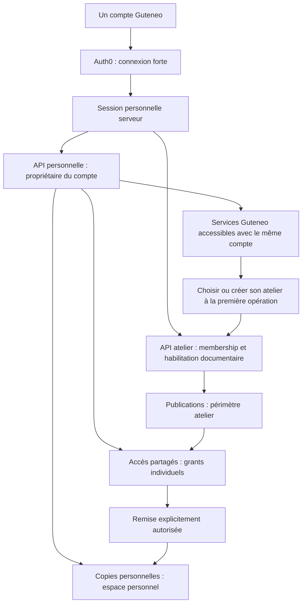
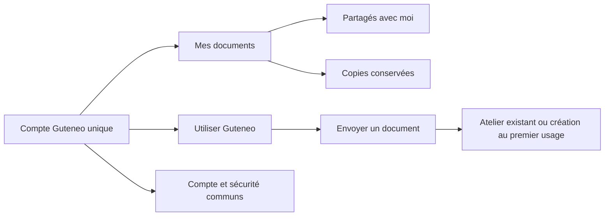

# Un compte Guteneo, les documents reçus et les services d’envoi

Plan produit, sécurité, architecture et interface du **24 octobre 2026**. Les décisions de conception ont ensuite fait l'objet d'un candidat local décrit dans [la fiche d'implémentation](SECURE_DISTRIBUTION_IMPLEMENTATION.md), avec [prix versionnés](SECURE_DISTRIBUTION_PRICING.md) et tests séparés. Ce plan ne constitue aucune preuve d'activation Auth0, migration distante, communication ou publication.

## 1. Décisions de l’utilisateur et recommandation

Décisions exprimées :

- Solution intégrée Guteneo, sans DRM dans le PDF.
- Tous les documents de ce parcours sont traités comme très sensibles ; pas de profil de réception à sécurité réduite.
- Compte obligatoire, même pour recevoir un seul document.
- **Un seul compte pour tout Guteneo** : recevoir, retrouver ses documents, découvrir et utiliser les services, participer à des ateliers.
- Deux catégories explicites : accès partagé révocable ; copie personnelle conservée seulement si l’atelier autorise cette remise.

Recommandation : **un compte et une connexion, plusieurs contextes de travail et droits distincts**. « Destinataire » et « expéditeur » sont des usages du compte, pas deux types de comptes à fusionner plus tard. L’espace personnel n’est pas un atelier fictif. Recevoir un document ne crée jamais d’appartenance ni de droits dans l’atelier émetteur ; un membre existant peut aussi être destinataire à titre individuel.

La personne peut accéder à la rubrique des services immédiatement après connexion. Sa première opération d’envoi crée ou sélectionne son atelier, avec les seules informations requises pour l’opération. Il n’y a ni seconde inscription, ni second mot de passe, ni abonnement imposé pour découvrir les services. Les contrôles métier normaux restent nécessaires avant un envoi réel.

Les détails de rendu, filigrane et audit de [l’étude web précédente](SECURE_WEB_DOCUMENTS_PLAN.md) restent utiles. Son parcours invité sans compte est remplacé par ce plan. Les comparaisons Adobe/FileOpen deviennent des recherches historiques.

## 2. Ce que je challenge

| Intuition | Ce qu’elle apporte | Ce qu’il faut résoudre |
| --- | --- | --- |
| Un compte rend le destinataire certain | Continuité, authentification, récupération, historique | Le premier rattachement à la bonne personne reste à prouver ; nom et email ne suffisent pas |
| Tout centraliser dans un coffre améliore la sécurité | Moins de pièces jointes dispersées, gestion des accès | Un seul compte compromis expose potentiellement les documents de nombreux ateliers |
| Tous les documents sont très sensibles | Une politique uniforme compréhensible | Les expéditeurs, opérateurs, supports et voies de récupération doivent être au même niveau |
| Un coffre conserve les documents | Valeur personnelle récurrente | Il faut financer la conservation et distinguer copies personnelles et accès révocables |
| Les destinataires deviennent des clients potentiels | Acquisition par découverte réelle du produit | Une inscription imposée n’est pas une conversion ; le commercial peut dégrader la confiance et la délivrabilité du parcours |

La vérification d’une adresse établit l’accès à une boîte, pas l’identité revendiquée. Un attaquant possédant cette boîte au premier accès peut créer sa propre passkey. Auth0 explicite cette limite. [Vérification email](https://auth0.com/docs/manage-users/user-accounts/verify-emails).

Le besoin de sécurité ne conduit donc pas seulement à « ajouter un formulaire d’inscription ». Il impose une politique de rattachement, d’authentification effective, de récupération et d’habilitation. Si cette politique crée trop d’abandons, il faut améliorer l’accompagnement ou réduire le périmètre commercial ; ne pas introduire discrètement un accès par simple email sous la même promesse.

## 3. Identité unique et accès fort

### Compte personnel indépendant des ateliers

Une personne possède un identifiant Guteneo stable. Ses identités de connexion sont rattachées par `(issuer, subject)` ; son adresse sert au routage et à une vérification datée, pas de clé du coffre. Changer d’adresse ou perdre une membership ne transfère ni ne supprime automatiquement ses documents personnels.

Conserver Auth0 comme fournisseur d’identité. Réutiliser le BFF serveur et les sessions sécurisées du produit ; ne pas construire un fournisseur d’identité maison, ni migrer vers un autre fournisseur pour cette feature sans raison démontrée.

Proposition de sécurité commune aux destinataires et aux personnes accédant au contenu côté atelier :

- Connexion par passkey avec vérification de l’utilisateur, ou méthode d’entreprise dont l’assurance et la récupération ont été qualifiées au même niveau.
- Contrôle serveur de la méthode réellement utilisée, de sa fraîcheur et de la version de politique. Un champ « passkey enregistrée » ou un ancien booléen `mfa=true` n’est pas suffisant.
- Réauthentification récente pour export original, remise personnelle, export massif, ajout de facteur, récupération, association d’identité et changement de droits sensible. Éviter une nouvelle authentification à chaque page.
- Sessions bornées, rotation/revocation, écran d’appareils/sessions et signalement d’accès suspect. Pas de code email utilisé comme accès de secours à tout le coffre.
- Domaine de connexion stable à qualifier avant l’enrôlement des passkeys, avec procédure de migration du domaine et tests sur les appareils visés.

Auth0 propose les passkeys via Universal Login ; leur activation ne retire pas nécessairement les autres méthodes. L’offre et la configuration exactes doivent être qualifiées avant de promettre cette politique. Aucune activation ni disponibilité du tenant réel n’est déduite de la documentation. [Passkeys Auth0](https://auth0.com/docs/authenticate/database-connections/passkeys).

### Première association d’un document à une personne

Deux parcours, avec une même exigence de rattachement fiable :

1. **Destinataire déjà connu de cet atelier** : envoi vers un compte stable précédemment associé, avec contrôle de validité de cette relation. L’atelier ne dispose pas d’un annuaire global des comptes Guteneo.
2. **Nouveau destinataire** : invitation opaque, vérification de l’adresse, création/connexion forte et rattachement fiable. Une association prévalidée en amont ou une preuve d’identité/fédération qualifiée peut suffire. Sinon, confirmation de l’association par l’atelier sur la base d’une relation préexistante ou d’un canal indépendant connu. Ne pas rendre obligatoire une collecte de pièce d’identité par défaut.

L’invitation seule ne livre pas le contenu. Tant que l’association est en attente, aucun titre sensible, aperçu ou fichier n’est révélé. Cliquer sur « Confirmer » en se fondant uniquement sur le nom saisi par le visiteur ne constitue pas la vérification proposée.

La confirmation manuelle n’est donc pas un obstacle imposé à chaque nouveau compte : elle intervient lorsqu’aucune preuve suffisante ne préexiste. Si le pilote la retient, afficher l’attente, le responsable et le moyen de résolution ; ne pas promettre un accès immédiat au document après inscription. Prévalider la relation lors de l’échange habituel atelier/client réduit ce délai.

L’approbation de départ lie le document, l’adresse attendue et la règle d’attribution. La confirmation ultérieure ajoute une preuve immuable liant compte stable, atelier, destinataire prévu et publication ; elle ne réécrit pas le destinataire de l’envoi approuvé. Une correction d’adresse ou une attribution à une autre personne demande une nouvelle préparation ; aucun transfert silencieux de grant.

L’enrôlement ne doit pas faire passer l’état « compte créé » pour « bonne personne identifiée ». Le journal conserve la méthode d’association, l’auteur habilité et la date. La certitude absolue sur la personne devant l’écran ou sur sa lecture n’est pas promise.

### Récupération : partie du produit principal

Préparer un moyen de secours indépendant, par exemple une seconde passkey sur un autre support ou une clé de sécurité. Tester l’absence de smartphone et l’accessibilité du parcours. Une personne ne pouvant utiliser la méthode prévue doit disposer d’une alternative de niveau équivalent ; sinon le pilote ne couvre pas son équipement.

Deux appareils utilisant le même trousseau synchronisé ne constituent pas nécessairement deux secours indépendants. Qualifier la récupération du compte de synchronisation et prévoir, par exemple, une clé de sécurité distincte. [NIST, authentificateurs synchronisables](https://pages.nist.gov/800-63-4/sp800-63b/syncable/).

En perte complète : parcours renforcé documenté, attente et notifications appropriées, révocation des sessions compromises, preuve de récupération contrôlée. Le support n’a pas de bouton universel « supprimer MFA et ouvrir le coffre ». La récupération de l’interface du compte peut précéder la réouverture des documents tant que l’assurance nécessaire n’est pas rétablie.

Les ateliers peuvent revalider leurs propres relations de réception ; aucun atelier ne peut, par cette seule validation, déverrouiller le coffre provenant des autres expéditeurs. Pour les copies personnelles, prévoir une preuve de récupération indépendante de la survie de l’atelier émetteur.

Le NIST distingue preuve d’identité et authentification ; l’email ne constitue pas une authentification hors bande conforme à son référentiel. Il s’agit d’une référence de conception, pas d’une certification Guteneo ou d’une obligation universelle. [NIST SP 800-63](https://pages.nist.gov/800-63-4/sp800-63.html), [authentificateurs](https://pages.nist.gov/800-63-4/sp800-63b/authenticators/).

### Adresses et identités particulières

- Une adresse recyclée n’hérite jamais des anciens documents : les droits acceptés restent liés au compte stable.
- Pas de fusion automatique sur égalité d’email. Les futures liaisons de comptes nécessitent une réauthentification des deux identités et une politique de fusion explicite. [Auth0 Account Linking](https://auth0.com/docs/manage-users/user-accounts/user-account-linking/link-user-accounts).
- Une boîte collective ne doit pas devenir le coffre personnel du premier salarié qui clique. V1 : destinataires individuels ; délégations, représentants et coffres d’équipe constituent des extensions explicites.
- Une identité administrée par un employeur ne suffit pas, à elle seule, à ouvrir les documents personnels d’autres expéditeurs, à inscrire leurs facteurs d’accès ou à récupérer le coffre : un administrateur de l’IdP pourrait reprendre cette identité, même encore active. Exiger un authentificateur personnel indépendant ou un mécanisme qualifié contre ce risque. Cela reste le même compte Guteneo, avec une réauthentification adaptée. Le SSO conserve son périmètre professionnel qualifié.

## 4. Deux catégories, deux contrats d’accès

Ce choix a été confirmé par l’utilisateur.

| Propriété | Partagé avec moi | Conservé dans mon espace personnel |
| --- | --- | --- |
| Origine du droit | Autorisation de l’atelier pour ce compte | Remise personnelle autorisée par l’atelier puis acceptée par le destinataire |
| Expiration | Celle du partage, affichée | Durée de conservation propre, affichée et financée |
| Révocation atelier | Bloque les nouveaux accès | N’efface pas une copie déjà remise |
| Fin du contrat atelier | Selon le contrat du partage et notifications prévues | La conservation promise doit survivre à ce départ |
| Téléchargement original | Seulement si autorisé | Export personnel prévu dans le contrat de conservation |
| Audit visible par l’atelier | Événements de son partage, avec provenance | Preuve de remise ; aucune surveillance des lectures privées ultérieures |
| Audit visible par la personne | Ses accès et changements pertinents | Historique de ses opérations et des accès autorisés à son espace |

Proposition : `allowVaultDeposit` autorise une remise autonome et exportable. Une « copie personnelle » que l’atelier peut encore empêcher d’exporter ou faire disparaître est une promesse différente. Le droit de téléchargement du partage peut exister sans droit de dépôt ; les combinaisons admises doivent être explicites.

Par défaut, un partage reste révocable et le téléchargement est désactivé. Le destinataire ne peut conserver une copie que si l’atelier a choisi cette possibilité avant approbation. Le clic « Conserver une copie » explique la durée, l’origine et l’export ; aucun achat supplémentaire n’est imposé pour bénéficier d’une conservation déjà financée.

Le document source et la copie personnelle sont deux objets de conservation, même si leurs octets sont identiques. L’atelier peut mettre fin au partage ; la suppression personnelle, les obligations légales et la fin de conservation suivent leurs règles propres. Ne pas traiter une simple révocation de l’atelier comme un ordre de suppression du coffre.

L’original téléchargé quitte le contrôle de Guteneo. Ses ouvertures hors plateforme, copies, impressions et captures ne deviennent pas observables parce qu’un compte existe.

### Transaction de remise personnelle

1. La politique approuvée autorise le dépôt pour ce destinataire, sur une version précise, avec durée et financement bornés. Dès l’activation du partage, la capacité de remise est prépayée et débitée irrévocablement pour honorer la conservation promise ; l’atelier ne peut pas dépenser ensuite cette même somme ailleurs.
2. Le destinataire fortement authentifié demande la copie ; une opération unique par partage et personne utilise cette capacité prépayée. L'expiration sans dépôt ne rembourse pas cette option, conformément à la règle commerciale annoncée avant approbation ; un résultat incertain se réconcilie avec cette même opération.
3. Un travail privé crée une copie dans le périmètre personnel, avec objet immuable, empreinte, origine et clés distinctes. Le résultat reste invisible tant qu’il n’est pas vérifié.
4. Une transaction valide encore le grant, sa version, le destinataire, l’autorisation de dépôt et sa réservation ; elle consomme celle-ci au plus une fois et active la copie, son engagement de conservation et les événements/outbox.
5. Révocation avant cette activation : aucune copie n’est acquise, les objets orphelins sont nettoyés. Révocation après : la copie acquise reste personnelle. Un timeout se réconcilie par identifiants et empreintes ; il ne crée pas plusieurs dépôts ou débits.

D1 et R2 ne forment pas une transaction distribuée : la préparation invisible et l’activation conditionnelle définissent le point de remise. La restauration des sauvegardes doit préserver cet ordre et les révocations.

## 5. Architecture des droits et des données

Trois autorités distinctes :

- **Identité** : utilisateur authentifié, méthode, fraîcheur, état de sécurité. Peut exister avec zéro atelier.
- **Atelier** : membership actuelle, rôle, habilitation sur le dossier/document et autorité de l’opération. Le client peut désigner un contexte, jamais s’en octroyer les droits.
- **Espace personnel** : propriétaire authentifié et droits de remise personnels. Un rôle administrateur dans un atelier ne donne aucune autorité sur le coffre d’autrui.

Conserver `AuthContext` métier strict. Ajouter un principal personnel et des gardes séparés plutôt que rendre `organizationId` facultatif partout. Chaque route déclare son domaine : personnel, atelier, document partagé ou opération interne privée.

| Entité cible | Autorité et points clés |
| --- | --- |
| `users`, `auth_identities` | Identité globale stable ; aucune clé email utilisée comme autorité |
| Sessions personnelles | User, preuve d’authentification/fraîcheur, révocation, politique ; indépendantes des memberships |
| Contexte atelier | Membership et rôle courants, contexte attendu de la requête, autorisation documentaire |
| `recipient_relationships` | Atelier + destinataire stable + méthode/preuve d’association ; pas d’annuaire global exposé |
| `document_publications`, `recipient_grants` | Toutes les relations source/publication/grant/audit portent l’organisation et des clés composites |
| Invitations documentaires | Cible immuable, secret haché, état, échéance, preuve de claim ; ne créent jamais de membership |
| Index « Partagé avec moi » | Projection des grants dont le compte est destinataire ; ne remplace jamais l’autorisation courante |
| `personal_spaces`, `personal_documents` | Périmètre personnel explicite, propriétaire stable, objets et rétention autonomes ; aucune cascade liée à la suppression d’un atelier |
| `vault_deposit_operations` | Pont contrôlé entre source atelier et copie personnelle, idempotence, version, financement, point d’activation |
| Journaux | Sécurité du compte, activité des partages, activité personnelle et administration séparées |

L’agrégation « tous mes documents reçus » est une requête autorisée par le `user_id` du principal, avec jointures sur les grants et leurs organisations. Elle ne consiste pas à retirer le filtre tenant d’une API atelier. L’espace personnel est un nouveau périmètre de sécurité, pas une exception globale aux règles d’isolation.

Les titres, miniatures, résultats de recherche, compteurs et exports sont soumis aux mêmes droits que le contenu. Une liste en retard ne doit pas réouvrir un partage révoqué. La suppression d’une membership retire les droits atelier sans effacer les copies personnelles.

Le changement d’espace n’est pas une nouvelle connexion. En présence de deux onglets sur deux ateliers, chaque mutation transporte son contexte attendu, vérifié côté serveur ; le changement dans un onglet ne doit pas modifier silencieusement la cible de l’autre.

### Réutiliser un document pour les services Guteneo

« Envoyer avec Guteneo » est possible pour une copie personnelle exportable ou une remise explicitement autorisée. Avant de créer la copie métier, une confirmation montre l’atelier cible et les personnes/habilitations qui pourront lire le contenu : cette publication interne peut exposer le document avant même l’envoi. Aucun transfert automatique vers le dernier atelier utilisé. L’analyse, la revue, le destinataire, le coût et l’approbation d’envoi viennent ensuite ; cette approbation ne remplace pas l’autorisation de transfert interne. Un document en consultation seule ne peut pas être réexpédié en contournant sa politique.

Les assistants et autorisations OAuth actuels restent limités à leurs ateliers. Aucun nouveau scope implicite pour parcourir le coffre. Les mandats existants n’acquièrent ni remise personnelle, ni lecture inter-ateliers, ni autorité d’enrôlement.

## 6. Hébergement, chiffrement et exploitation

Cloudflare reste le centre applicatif : Workers/Hono, D1, R2 privé, outbox/Queues et service documentaire isolé. Auth0 gère l’identité. Les notifications atelier peuvent commencer par une lecture incrémentale du journal toutes les quelques secondes ; le transport temps réel n’est pas l’autorité d’accès.

Pour les partages : source exact analysé, rendu serveur qualifié, pages personnalisées figées avant approbation, filigrane dans les pixels, alternative accessible, aucune source PDF remise implicitement au lecteur. Téléchargement autorisé par une route distincte et auditée. Les règles de provenance de l’audit et les limites physiques de la capture restent celles de l’étude web.

Pour les copies personnelles : stockage séparé des sources d’ateliers et rétention autonome. Pas de déduplication interpersonnelle pour économiser quelques objets avant d’avoir démontré l’isolation, la gestion des clés et la suppression.

R2 chiffre automatiquement les objets au repos avec des clés gérées par Cloudflare. Cela ne prouve ni chiffrement de bout en bout ni impossibilité d’accès par Guteneo. [Sécurité R2](https://developers.cloudflare.com/r2/reference/data-security/).

**Cible recommandée à qualifier pour ce niveau sensible :** chiffrement applicatif par enveloppe avec clé de données propre à chaque objet, contexte authentifié liant propriétaire/source/version, clés d’enveloppe séparées des objets et accès limité aux services nécessaires. Employer des primitives et bibliothèques éprouvées, avec rotation, restauration et destruction documentées ; ne pas inventer un protocole cryptographique.

Le choix du gestionnaire de clés est un jalon d’architecture : service KMS/HSM avec région et audit qualifiés, intégré aux Workers. S’il nécessite une dépendance externe européenne, l’assumer plutôt que promettre un dispositif entièrement Cloudflare non démontré. Secrets Store est un gestionnaire de secrets, publié en bêta, pas une preuve de KMS non exportable ni de traitement uniquement UE. [Secrets Store](https://developers.cloudflare.com/secrets-store/).

Le rendu côté serveur implique du contenu en clair pendant le traitement autorisé. Cette architecture protège des risques précis ; elle ne permet pas de dire « même Guteneo ne peut jamais lire vos documents ». Une exigence d’inaccessibilité cryptographique au fournisseur nécessiterait une autre architecture de clés et de traitement, et doit être arbitrée avant l’engagement commercial.

Définir et vérifier : identité des services, séparation des privilèges R2/D1/clés, absence de contenu dans logs et traces, sandbox du rendu, sorties réseau bornées, caches privés, sources interdites aux outils analytiques, sauvegarde chiffrée indépendante et exercices de restauration. Les journaux d’administration et d’accès aux clés doivent être exportés hors du chemin que peut réécrire un seul administrateur.

Pas d’accès universel au contenu pour le support. Toute intervention exceptionnelle doit être limitée, motivée, autorisée selon le cadre applicable et tracée ; le personnel commercial n’obtient jamais les documents ou leur historique détaillé.

Une juridiction UE de D1/R2 ne localise pas à elle seule Auth0, le rendu, l’exécution Workers, les clés, les emails, les traces et les sauvegardes. Le pilote confidentiel exige la qualification de la chaîne réellement déployée, et non une simple mention « hébergé en Europe ».

## 7. Implications pour les ateliers

### Une exigence forte des deux côtés

Le contrat actuel autorise tous les membres à lire tous les documents et destinataires d’un atelier. Le rôle Observateur ne fournit pas de restriction documentaire. Cette lecture a été vérifiée dans `docs/WORKSPACE_ROLES.md` et les sources locales.

Recommandation : compléter les rôles existants par des habilitations de dossier/document. Un rôle définit les opérations possibles ; l’habilitation définit sur quels contenus. Préparateur, approbateur et destinataires sont explicitement désignés ; un simple droit de reporting n’ouvre pas le contenu. L’administration de l’atelier ne doit pas devenir une lecture personnelle universelle implicite.

Définir aussi qui peut attribuer ces habilitations. Si un administrateur peut s’accorder lui-même l’accès à un dossier, ne pas prétendre qu’il lui est impossible d’en lire le contenu ; cette autorité et ses usages doivent être visibles et audités. Une séparation plus forte demande un contrôle indépendant de ces attributions.

Appliquer cette frontière à toutes les routes : source, rendu, recherche, destinataires, envoi, rapport, export, API, natif et MCP. Ne pas renforcer seulement le nouveau lecteur en laissant l’original lisible par une ancienne route.

La séparation préparateur/approbateur et une validation indépendante de changement de destinataire réduisent les erreurs internes. Prévoir le cas de l’atelier d’une seule personne : son absence de double contrôle doit être explicite, pas décrite comme une validation à deux personnes.

### Ce que l’atelier devra choisir ou faire

1. Vérifier le destinataire et sa relation au compte lors de la première remise ; informer de l’inscription et de l’authentification requises.
2. Choisir la durée du partage, le téléchargement original et l’éventuelle autorisation de copie personnelle, avec durée et coût de conservation distincts.
3. Revoir le document final et sa politique, puis approuver conformément aux droits Guteneo.
4. Traiter les erreurs de destinataire, demandes de prolongation et questions sur le contenu. Guteneo prend en charge la sécurité du compte et l’incident technique.
5. Comprendre qu’une copie acquise ou téléchargée ne peut plus être rappelée par une simple révocation.

Le suivi distingue invitation soumise/livrée, association en attente/validée, accès autorisé, affichage déclaré, téléchargement demandé/lancé et copie personnelle remise. Un échec d’inscription n’est pas une livraison documentaire réussie ; un flux serveur terminé n’est pas une sauvegarde disque prouvée.

L’atelier ne découvre ni l’existence globale du compte, ni ses autres expéditeurs, ni ses services achetés. Il voit seulement les faits nécessaires à ses publications. Après dépôt personnel, l’audit privé appartient au destinataire ; l’atelier conserve la preuve de remise sans suivi continu du coffre.

Le niveau « très sensible » est un choix de protection produit, pas une qualification réglementaire universelle. Définir le périmètre sectoriel du pilote. Les anciens liens protégés restent des engagements historiques à migrer ou laisser expirer selon un plan explicite ; tant qu’ils subsistent, ne pas annoncer qu’ils ont acquis rétroactivement cette sécurité.

## 8. Représentation de l’interface

### Un seul produit, accès centré sur l’intention

| Surface | Contenu principal | Action principale |
| --- | --- | --- |
| Invitation avant connexion | Contexte minimal, langue/aide, état de l’invitation ; pas de titre sensible | Accéder à mon document |
| Première réception | Connexion/inscription minimale, authentification forte, association si nécessaire | Continuer vers le document attendu |
| Mes documents | Partagés / Conservés ; expéditeur, date, état et échéance, recherche sous droits | Ouvrir le document |
| Document partagé | Pages, expéditeur, durée, filigrane, information sur l’audit | Consulter ; Télécharger / Conserver seulement si autorisés |
| Copie personnelle | Version/origine, conservation, export, historique personnel | Consulter / exporter / supprimer avec les confirmations nécessaires |
| Utiliser Guteneo | Services existants expliqués, tarifs disponibles, aucune donnée confidentielle utilisée pour cibler | Préparer un envoi |
| Compte et sécurité | Identité visible, moyens de connexion, récupération, sessions, langue, vie privée | Gérer la sécurité / changer de compte |
| Atelier | Navigation métier existante, habilitations et suivi | Préparer / approuver / gérer selon droits |

Depuis un lien de document, retour direct au document après connexion, même si le dernier contexte était un atelier. Depuis l’accueil général, retrouver le dernier contexte choisi, avec « Mes documents » comme entrée par défaut pour une personne n’ayant encore utilisé que la réception.

Dans l’en-tête : nom du compte et contexte actif visibles ; sélecteur « Espace personnel / Atelier … ». Ne pas présenter « se connecter comme destinataire » et « se connecter comme expéditeur ». La rubrique des services reste accessible depuis l’espace personnel, sans changement d’identité.

Sur mobile, navigation courte : Documents, Services, Compte ; contexte atelier visible lorsque nécessaire. Reprendre la marque ivoire/cobalt de Guteneo, des libellés concrets et les quatre langues existantes. Conserver un réglage de langue de compte unique et une sélection accessible avant connexion. Le lecteur reste utilisable au clavier et avec les technologies d’assistance qualifiées.

### Contrats d’interaction à montrer dans les maquettes

| Situation | Comportement attendu |
| --- | --- |
| Mauvais compte connecté | Ne pas ouvrir le document ; proposer explicitement changer de compte, sans déplacer le grant |
| Association en attente | État expliqué et aide ; aucun faux état « document disponible » |
| Révocation pendant lecture | Refus des nouvelles remises ; indication claire ; ne pas prétendre effacer les pixels déjà reçus |
| Conserver une copie | Afficher droits/durée, état en cours, puis succès uniquement après activation durable ; un double clic ne double pas copie/coût |
| Quitter pendant le dépôt | Retrouver l’opération et son état au retour ; navigation n’annule pas une remise déjà acceptée |
| Compte récupéré, assurance insuffisante | Interface accessible mais documents verrouillés jusqu’au contrôle requis ; aide compréhensible |
| Premier usage d’un service | Même compte ; informations métier demandées au moment utile ; création d’atelier idempotente sans adhésion chez l’expéditeur |
| Masquer / supprimer | Masquer un partage ne révoque pas l’envoi de l’atelier ; supprimer une copie personnelle ne supprime pas son original atelier |

## 9. Cross-selling : utile, mais secondaire au service rendu

Position recommandée : entrée permanente et discrète « Utiliser Guteneo », puis suggestion générique après consultation, par exemple « Vous aussi, envoyez vos documents avec Guteneo ». Aucune offre dans l’email confidentiel, l’écran de sécurité ou avant le document attendu. Une offre reçue sous contrainte réduit la confiance envers Guteneo et l’atelier.

L’accès aux documents promis ne dépend ni d’un achat, ni d’une case commerciale, ni de l’activation d’un atelier. L’utilisateur peut explorer immédiatement les services. La création d’un espace d’envoi se fait seulement lorsqu’il engage une opération qui en a besoin, dans la même session et avec le même profil.

Ne pas déduire un centre d’intérêt du titre, contenu, expéditeur, ouverture ou téléchargement d’un document. Séparer données de remise pour le compte de l’atelier, compte personnel, sécurité et préférences commerciales propres à Guteneo. La CNIL encadre la réutilisation des données confiées à un sous-traitant pour ses finalités propres. [CNIL réutilisation](https://www.cnil.fr/fr/sous-traitants-la-reutilisation-de-donnees-confiees-par-un-responsable-de-traitement).

Un compte créé ne vaut pas consentement aux emails marketing. En B2C, la CNIL précise que la simple création de compte ne suffit pas à invoquer l’exception client existant ; les règles B2B sont distinctes. Prévoir des préférences séparées, un choix libre et une suppression des sollicitations indépendante des notifications de sécurité/document. [CNIL prospection](https://www.cnil.fr/fr/la-prospection-commerciale-par-courrier-electronique-sms-mms-et-automate-dappel).

Indicateurs de succès, dans cet ordre : accès au document réussi, temps d’accès, abandon d’enrôlement, incidents/récupérations, satisfaction atelier/destinataire ; puis découverte volontaire des services, première préparation et premier envoi. Mesurer le tunnel commercial séparément des traces documentaires et à un niveau agrégé approprié. Les comptes contraints ne sont pas comptés comme clients expéditeurs acquis.

## 10. Conservation, appellation et économie

### Ne pas promettre un coffre éternel

Proposition économique : réception et consultation sans paiement demandé au destinataire ; l’atelier finance le partage et, s’il l’autorise, une durée de conservation personnelle définie. Cette durée reste acquise même si l’atelier quitte Guteneo. Prolongations éventuelles explicites, information avant échéance et mécanisme d’export ; aucun tarif ou prélèvement décidé par ce plan.

Définir séparément les durées des documents, preuves de remise, traces de sécurité du compte et activité personnelle. Effacer ou masquer un document ne supprime pas mécaniquement toute preuve, et conserver une preuve ne justifie pas de garder indéfiniment le contenu. Contrats, information des utilisateurs et purge doivent correspondre à cette matrice.

Un pilote peut tester une durée limitée, par exemple douze mois, mais ce chiffre est une hypothèse à chiffrer et valider, pas une obligation légale ni une durée suffisante pour tous les documents. Pour des durées de plusieurs années, provisionner exploitation, identité, support, sauvegardes et sortie dès la remise. La suppression du compte, d’une copie personnelle et d’un atelier suivent trois procédures différentes.

### « Coffre-fort numérique » n’est pas un simple libellé

Pour un service relevant du cadre français, l’appellation est encadrée : L122-22 renvoie aux obligations de L103 du CPCE. Celles-ci couvrent notamment intégrité/origine, traçabilité accessible à l’utilisateur, identification, accès exclusif et récupération. L103 prévoit aussi le cas d’un traitement par le prestataire au bénéfice de l’utilisateur avec son consentement ; cela ne dispense pas de qualifier notre architecture et ses contrats. Ne pas annoncer une conformité ou certification déjà acquise. [L122-22](https://www.legifrance.gouv.fr/codes/article_lc/LEGIARTI000035723787/2026-07-16), [L103](https://www.legifrance.gouv.fr/codes/article_lc/LEGIARTI000037825515/).

Le régime prévoit des modalités de récupération et de fermeture ; D541 mentionne notamment trois mois de préavis et, dans les situations qu’il définit, un maintien de récupération d’au moins douze mois. Intégrer ce coût et faire confirmer l’applicabilité exacte au service et à ses marchés avant commercialisation. [CPCE D537 à D541](https://www.legifrance.gouv.fr/codes/id/LEGISCTA000037472172/).

Nom d’interface de travail recommandé : **Mes documents**, avec **Partagés avec moi** et **Conservés**. La cible de coffre personnel demeure ; changer le libellé ne remplace pas l’analyse des obligations du service effectivement fourni. Une revue juridique qualifiée est un jalon avant la promesse commerciale de coffre-fort numérique.

### Coûts nouveaux à budgéter

| Poste | Ce qui change |
| --- | --- |
| Identité | Destinataires actifs + membres d’ateliers, fonctions d’authentification, récupération et support, offre hybride B2C/B2B |
| Enrôlement | Temps de validation de la relation par atelier, assistance aux destinataires uniques, abandon |
| Conservation | Copies personnelles indépendantes, rendus, clés, sauvegardes et engagements restant après départ de l’atelier |
| Exploitation | Supervision, alertes, rotation de clés, restauration, incident et export de sortie |
| Produit | Deux domaines d’autorisation, nouvelles vues, migrations, accessibilité, multilingue et support |
| Acquisition | Découverte des services mesurée sans financer les documents promis par une conversion supposée |

L’offre Auth0 publique utilise notamment les utilisateurs actifs mensuels et différencie les fonctions/plans. L’ancien choix Free ne qualifie pas automatiquement notre future politique forte, ses fonctionnalités, son SLA ou sa facture. Obtenir un dimensionnement de la configuration réelle ; ne pas confondre comptes cumulés, personnes actives mensuelles et ouvertures de documents. [Tarification Auth0](https://auth0.com/pricing).

Reprendre le scénario de travail : 100 ateliers, 10 000 PDF/mois, 5 000 destinataires actifs/mois, 1 000 nouvelles personnes/mois après M1. Cela conduit à 16 000 personnes rencontrées à M12 et 40 000 à M36, pas nécessairement autant de MAU. Tester parts de copies conservées de 10/50/100 %, durées de 1/3/5 ans, support par nouvel utilisateur et pics de récupération. Ce sont des hypothèses, pas des volumes Guteneo observés.

`Coût complet = identité + enrôlement/support + rendu + stockage/rétention + clés + audit + emails + exploitation + réserve de continuité/sortie`.

Évaluer la rentabilité sans aucun revenu de cross-selling dans le scénario prudent. La conversion future est un gain possible ; elle ne doit pas financer implicitement une conservation déjà promise.

## 11. Écarts précis du code actuel

Constats du checkout local `8b060bb`, revérifiés pour cette étude ; aucune affirmation sur le tenant Auth0 ou l’état actuellement servi en production.

| Fichier | Constat | Évolution nécessaire |
| --- | --- | --- |
| `apps/api/src/auth.ts` | `AuthContext` et session exigent un atelier ; signup ordinaire crée organisation, administrateur, quotas et mécanisme de crédit | Session personnelle indépendante ; création d’atelier à l’usage explicite ; politique de méthode/fraîcheur |
| `migrations/0002_auth.sql` | Session navigateur référencée à une membership | Migration additive de l’identité/session, compatibilité transitoire et invalidation contrôlée |
| `apps/api/src/auth.ts` | Changement d’atelier déjà implémenté | Réutiliser le principe, ajouter espace personnel et protéger les onglets concurrents |
| `migrations/0043_workspace_invitations.sql` | Invitations qui créent une membership | Invitations documentaires distinctes, avec association au destinataire |
| `apps/api/src/protected-documents.ts` / migration 0040 | Lien partagé par document et remise du PDF | Nouveau mode obligatoire compte, droits individuels et remise originale séparée |
| `apps/documents/src/expert-review.ts` | Rendu isolé destiné à la revue, avec limites de formats/résolution | Pipeline de consultation et alternative accessible qualifiés |
| `packages/contracts/src/roles.ts`, `docs/WORKSPACE_ROLES.md` | Rôles d’action sans cloisonnement documentaire | Habilitations sur les contenus et inventaire de toutes les routes de lecture |
| `apps/api/src/account.ts`, `apps/web/src/account-page.tsx` | Profil et atelier présentés ensemble | Compte/sécurité communs ; paramètres de chaque atelier dans son contexte |
| `apps/api/src/maintenance.ts` | Purge selon dépendances métier actuelles | Références et conservation personnelles indépendantes, procédures de sortie |
| Domaine, MCP, natif | Autorité atelier et approbations existantes | Aucune permission personnelle implicite ; migration sans affaiblir les garde-fous |

Le texte ancien de `IDENTITY_MCP.md` indiquant un switcher différé est dépassé par le code local. Le même document décrit la politique beta `verified_email` : elle ne vaut pas preuve de passkeys fortes configurées. Ne pas utiliser un document historique comme preuve de capacité actuelle.

## 12. Plan de réalisation et preuves attendues

| Étape | Livrable | Condition de sortie |
| --- | --- | --- |
| 0 — Contrats du produit | Deux catégories, durée/financement, rattachement, récupération, audit personnel/atelier, appellation | Décisions applicables au pilote et responsabilités écrites |
| 1 — Prototype identité | Compte sans atelier, login fort, compte existant, mauvais compte, perte de facteur | Méthode/fraîcheur et rattachement réellement qualifiés ; pas de fallback faible caché |
| 2 — Isolation | Principaux personnels/ateliers, habilitations, grants, sessions, migrations additives | Matrice de droits exhaustive ; aucune lecture croisée via anciennes routes |
| 3 — Consultation | Corpus synthétique, rendu/filigrane, accessibilité, invitation, approbation, suivi | Parcours vérifié, coûts et limites mesurés ; aucun envoi réel |
| 4 — Conservation personnelle | Copie indépendante, point de remise, financement/rétention, export/suppression | Courses révocation/dépôt, atelier fermé et restauration démontrées |
| 5 — Produit unifié | Mes documents, services immédiatement accessibles, atelier créé au premier usage, compte/sécurité communs | Retour au document, mobile, langues, contexte et absence de seconde inscription |
| 6 — Qualification | Revue sécurité indépendante, récupération, clés/régions, support, continuité et qualification contractuelle | Preuves sur infrastructure et appareils réels ; économie supportable |
| 7 — Pilote autorisé | Ateliers et destinataires informés, volumes/durées bornés | Autorisations distinctes de publication et d’envoi ; preuve de réception et d’accès |

Le coffre complet comprend la conservation personnelle ; une livraison antérieure limitée aux partages doit être annoncée comme telle. Ne pas promettre le coffre final sur la seule base d’une liste de liens.

Tests structurants : compte sans atelier ni crédit ; personne déjà utilisatrice d’un atelier qui reçoit d’un autre ; relation destinataire falsifiée ; email recyclé ; mauvaise identité connectée ; passkey présente mais session faible ; récupération sans facteur ; droit documentaire retiré à un membre ; projection de liste en retard ; deux onglets/ateliers ; dépôts concurrents ; révocation avant/après dépôt ; suppression d’atelier sans suppression personnelle ; purge et restauration ; export privé ; aucun accès coffre par scope MCP existant ; aucune conversion commerciale imposée.

Tests métier adaptés, puis types/lint/tests/E2E/build lors de l’implémentation. Simulation, preuve locale, Cloudflare déployé, Auth0 réel et terminaux physiques restent des niveaux de preuve distincts.

## 13. Décisions ouvertes, sans bloquer la préparation

Le compte unique, la sensibilité uniforme et les deux catégories sont retenus. Restent à fixer avant construction de leurs dépendances :

1. Moyen de confirmation initiale du destinataire que les ateliers peuvent réellement opérer.
2. Politique de récupération, équipements alternatifs et preuve de méthode Auth0 disponible.
3. Durée financée de conservation personnelle et conditions de prolongation/sortie.
4. Gestion des clés, modèle d’accès opérateur et qualification du terme coffre-fort sur les marchés servis.
5. Habilitations documentaires minimales côté atelier et traitement des anciens accès.

Hypothèses de travail : destinataires nominatifs adultes, pas de boîte collective ni de mandataire, pas de fusion de coffres ni d’import personnel arbitraire en V1 ; documents reçus via Guteneo, même compte pour les services. Ces extensions demandent des parcours dédiés plutôt qu’un partage de mots de passe.
