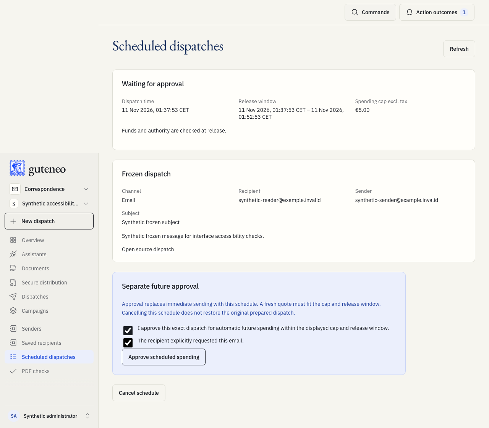
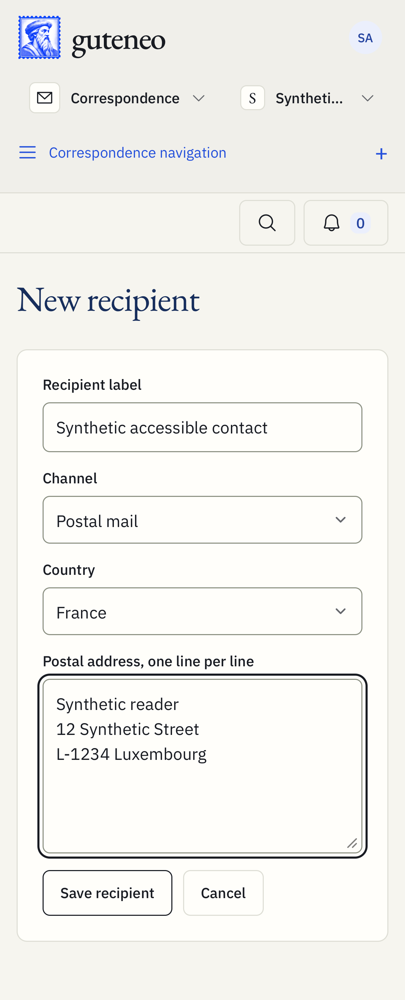
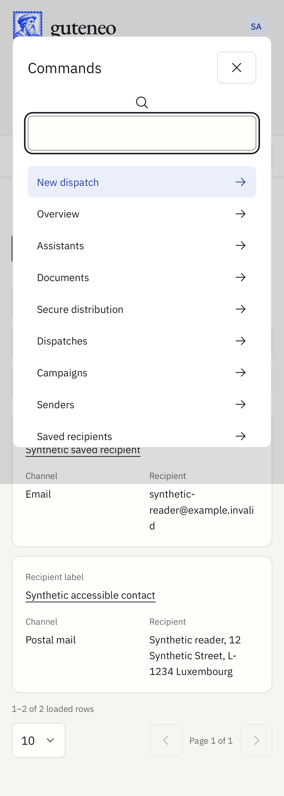

# Guteneo 1.2.0 — Safer workflows and easier recovery

This release brings together the lifecycle audit in PR #155, stale-reply and retry protections in PR #156, and the workspace improvements in PR #158. It includes every change on main since the previously deployed 1.1.32. A Git tag identifies reviewed source; the production receipt separately identifies what was actually deployed.

## Everyday use

- Find approvals, expiring quotes and protected links, uncertain provider outcomes and blocked schedules in the Overview attention queue.
- See confirmed background action outcomes after leaving a screen, without an old response changing the new screen.
- Save fax, email and postal recipients in the workspace address book. Editing an address never changes a prepared sending target.
- Open workspace destinations with Cmd/Ctrl K and save table filter, sorting and page-size preferences.
- Recover an iPhone preparation after the app closes, using an explicit Resume or Discard choice and a stable retry key.
- Load only the selected language and pause background polling in hidden tabs. Shared components now use the same layout, chart and elevation rules.

## Controlled capabilities

- Scheduled fax and message-only email support a separate, explicit human approval of future spending within a fixed maximum price. The source, recipient, options, execution time and release window are bound to that approval. Release requires a fresh eligible quote, current authority and sufficient funds; unknown outcomes are never retried automatically.
- Customer webhooks can report signed dispatch lifecycle events through a bounded delivery outbox. They contain minimal status metadata and require browser administrator configuration and encrypted signing material.
- Automatic scheduled release, new future-spending approval and customer webhook delivery remain disabled in the production configuration in this release. Schedule drafts remain available; code publication does not activate their sending. Secure or PDF email and postal sending retain their existing, separate human-review requirements.
- Native drafts remain device-local and do not grant consent. Assistant and native tools cannot grant future spending approval or create a browser administrator mandate.

## Reliability for users, developers and agents

- Campaign completion, dead-letter resolution, account deletion, cancellation, leases, receipts and recovery now have explicit transition rules and tests.
- Session and navigation fencing is the default for client actions. Rapid repeated clicks are excluded immediately, and switching away and back cannot restore authority to an old reply.
- Generation retry reuses the same job and atomically requeues eligible records without reopening frozen distribution. Logout unmounts private readers before clearing the session; interrupted pagination retains a usable recovery path.
- REST and MCP expose recipient and schedule workflows while preserving the existing operations and approval boundaries. Downloadable integration packages are synchronized at 1.2.0; marketplace and App Store publication remain separate.
- Every future production application deployment requires an exact remote GitHub version tag and version-matched human release notes. CI produces a portable HTML test report for attachment to the GitHub Release.

## Validation and limits

The attached test report records the exact tested commit, Git tree, workflow runs, attempts, test counts and any declared skips. A reused main qualification explicitly identifies the original test run and proves identical source trees. Repository screenshots below illustrate synthetic local scenarios; they are dated examples, not production account or delivery evidence.

Automated browser accessibility checks cover French, English, German and Luxembourgish, both themes, desktop Chromium, mobile Chromium and iPhone WebKit. Local load measurements are diagnostics, not a production speed guarantee. iOS simulator tests and unsigned archive validation do not prove physical-device behavior or App Store distribution.

Production verification is a separate release receipt covering the served version, source fingerprint, asset hashes, runtime health and database migration ledger. Test success, a tag or a package download alone does not prove that a production deployment or real delivery occurred. No real communication is part of release qualification.

## Source changes

- [PR #155: implicit lifecycle audit](https://github.com/nclsppr/guteneo/pull/155)
- [PR #156: stale client replies and atomic retry](https://github.com/nclsppr/guteneo/pull/156)
- [PR #158: capped schedules and recoverable workspace workflows](https://github.com/nclsppr/guteneo/pull/158)
