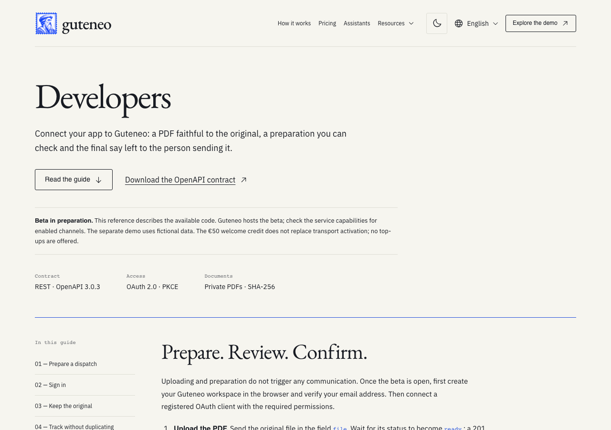
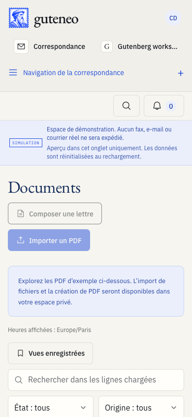
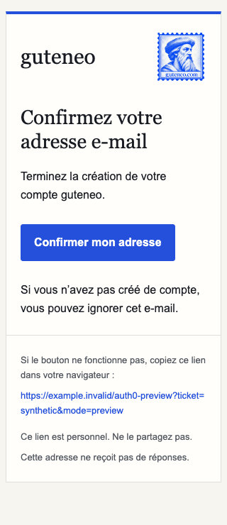

# Guteneo 1.2.1 — Less noise, clearer choices

Guteneo's interfaces now get to the point sooner. This update removes captions
that repeat the controls beside them and keeps the information needed to make a
decision or recover from an error.

## What changes

- Documents, Campaigns and Senders use direct page titles in all four languages.
- Workspace forms, tables and previews lose repeated instructions and decorative
  subheadings. Actual approval, prices, access rules and recovery stay visible.
- iPhone and iPad screens use shorter introductions and clearer functional
  headings while preserving browser review, draft recovery and spending limits.
- Public pages, API documentation, status and engineering controls remove
  duplicated labels and implementation commentary.
- Transactional messages put the document or account action first. Useful
  security instructions, unsubscribe and reporting actions remain.

## Validation and scope

The attached portable test report identifies the exact tested commit, workflow
attempts, assertions, browser inventory and declared exclusions. Identical-tree
qualification identifies its original run explicitly. Rendered examples use
synthetic local data; production verification is recorded separately.

Application changes are presentation-only. Release verification also supports
bounded serial downloads for large public media while retaining every integrity
check and its original deadline. It adds no approval authority and activates no
scheduled sending, customer webhooks or account deletion. Native simulator and
unsigned archive checks remain separate from App Store distribution. Auth0 email
template publication, status publication and the application's served version
each require their own release receipt; source changes alone do not establish
those outcomes. No real communication is part of qualification.

The review and future contribution rules are documented in the repository's
interface-copy contract and dated audit. Existing API operations, URLs, account
permissions and sending workflows retain their contracts.

## Source changes

[Changes since 1.2.0](https://github.com/nclsppr/guteneo/compare/v1.2.0...v1.2.1).

## Local examples

The examples below use synthetic local fixtures. They show interface copy and
layout; they do not establish a live account action, Auth0 publication or delivery.

