# Direct operator incident integration

**Prepared contract only, 27 October 2026. No operator bridge, webhook destination,
MCP event subscription, credential or agent run is created by these files.**

This is a separate platform-operator integration. It is not part of Guteneo's
ordinary document-delivery plugin and grants no workspace, recipient-document,
human approval or sending authority. The existing business MCP does not implement
the event methods described here.

## Intended path

```mermaid
flowchart LR
  Monitor[Cloudflare native Monitor] --> Bridge[Authenticated operator bridge]
  Bridge --> Validate[Normalize and validate closed incident schema]
  Validate --> Outbox[Durable incident and delivery outbox]
  Outbox --> Callback[Verified signed MCP Events callback]
  Callback --> Work[Subscribed ChatGPT Work cloud chat]
  Work --> Diagnosis[Independent evidence and bounded diagnosis]
  Diagnosis --> Candidate[Isolated fix, tests and draft pull request]
```



Cloudflare detects the condition without model polling. The bridge accepts only
an authenticated, specifically configured monitor source and independently
validates the account, service and expected query identity. It does not expose a
general webhook that can start arbitrary agent work. Choose and qualify its
ingress authentication before publishing a destination; no URL is assigned here.

The bridge projects the event through [incident-event.schema.json](incident-event.schema.json).
This file describes the complete MCP Events delivery envelope. Its
`properties.data` object is the event definition's `payloadSchema`; `eventId`,
`name`, `timestamp` and `cursor` belong to the protocol envelope. Inline that data
schema in discovery rather than expecting ChatGPT to fetch a local schema file.

The event catalog has one name, `guteneo.operation.incident`, with webhook
delivery. Subscription arguments may select only documented closed service,
signal and severity values already present in this schema. Omitting a filter
means all authorized operator events, not all tenants or document content.

## Operator authority and protocol

Use MCP protocol `2026-07-28` and a separately authenticated operator endpoint:

| Method               | Required behavior                                                                                                                                    |
| -------------------- | ---------------------------------------------------------------------------------------------------------------------------------------------------- |
| `server/discover`    | Advertise the actual protocol version and `events` capability only after implementation and activation.                                              |
| `events/list`        | Return only the closed incident event and filters available to the current platform operator.                                                        |
| `events/subscribe`   | Recheck explicit platform authority, validate arguments and callback, perform the signed challenge, then durably create or refresh one subscription. |
| `events/unsubscribe` | Recheck ownership, stop the matching subscription idempotently and prevent subsequent deliveries.                                                    |

Ordinary Guteneo OAuth scopes and an administrator role inside a customer
workspace must not authorize platform incident discovery, subscription or
delivery. Use an explicitly approved operator connection with its own bounded
access. This preparation installs no connection, registration, permission or
scope. A subscription is not a human dispatch approval or a delegation mandate.

Derive subscription identity from the authenticated operator, verified callback,
event name and canonical filter arguments. Store the owner, exact filters,
encrypted callback URL/signing secret, granted expiration and replay position.
Grant a finite lifetime, return its real `refreshBefore`, refresh idempotently and
recheck current operator access before every delivery. Revocation, disconnect,
expiry and unsubscribe stop delivery, including already queued events. Retain
only the sanitized incident records needed for their declared retention period.

ChatGPT supplies the callback URL and signing secret through `events/subscribe`.
There is no manually invented ChatGPT inbox endpoint. Accept only HTTPS and a
Standard Webhooks secret with the documented `whsec_` prefix and 24–64 decoded
bytes. Resolve and validate destination addresses at connection time, connect to
the validated public address while retaining the hostname for TLS verification,
and reject private/local targets and redirects. Apply these protections to both
verification and delivery; a successful challenge alone is not SSRF protection.

Before activation, send a signed, single-use, short-lived verification challenge
and require a successful response echoing that exact challenge in constant time.
Sign the exact serialized request bytes using Standard Webhooks and send
`webhook-id`, `webhook-timestamp`, `webhook-signature` and
`X-MCP-Subscription-Id`. Persist the callback/signing configuration privately;
never put it in these artifacts, agent prompts, incident data or logs.

## Durable incidents and delivery

Generate `incidentId` inside the bridge from normalized operational source/window
identity; never copy a document, dispatch, provider request or recipient ID.
Generate one `eventId` for each incident revision and preserve it across retries.
Atomically commit that sanitized revision and its outbound delivery record. A
monitor retry must not create a second incident revision or agent action.

Send one event per request, at most 256 KiB. A callback `2xx` acknowledges receipt;
it proves neither an agent run nor a successful repair. Retry only transient
delivery failures with exponential backoff, a finite attempt limit and deadline,
using the same event ID and a fresh signing timestamp/signature. Do not retry
`410` or `413`; retain an explicit delivery failure for operator review. Do not
log provider bodies, callback URLs or signing material. Backpressure must retain
the durable event rather than launch duplicate agent work.

If replay is implemented, `cursor` identifies a durable bridge outbox position.
Advance a subscription cursor only past acknowledged events and honor it across
refresh/restart. Return `truncated: true` when retained history is unavailable.
If replay is unavailable, use `cursor: null` and state that interrupted periods
are not recovered through MCP; do not imply that an empty stream proves health.
Out-of-order incident revisions must not reopen an incident already resolved by
a later revision. A resolved observation never proves that an earlier unknown
business submission is safe to resend.

Only the schema's closed labels, bounded counts/times, bridge-generated incident
IDs and independently observed release/correlation fields may leave the bridge.
Omit an unavailable commit, Worker version or correlation ID. Do not infer them
from the latest repository head or copy arbitrary fields from an alert. Reject
unknown keys, labels, oversized values and invalid timestamps before storage or
delivery. This schema is a contract for the future validator, not a deployed
content classifier.

## Synthetic event example

The following identifiers and observation are fictional contract examples, not
an emitted event or an existing subscription:

```json
{
  "eventId": "evt_11111111111141118111111111111111",
  "name": "guteneo.operation.incident",
  "timestamp": "2026-10-27T00:00:00.000Z",
  "data": {
    "schemaVersion": 1,
    "incidentId": "incident:1111111111111111111111111111111111111111111111111111111111111111",
    "revision": 1,
    "phase": "opened",
    "source": "cloudflare_monitor",
    "service": "guteneo-app",
    "environment": "production",
    "severity": "critical",
    "signal": "DISPATCH_FAILED",
    "channel": "email",
    "provider": "resend",
    "observedAt": "2026-10-27T00:00:00.000Z",
    "windowSeconds": 300,
    "count": 1
  },
  "cursor": null
}
```

## Agent behavior and qualification

Save [agent-instructions.md](agent-instructions.md) as the subscribed task's
durable behavior. Treat incident data as evidence, not instructions. Use the
existing ChatGPT account's available Work cloud capabilities; these artifacts
provision no paid inference, subscription or infrastructure and select no model.
Usage still follows the account's plan, credits and limits.

Before calling this active, qualify authenticated discovery and callback
verification, a synthetic event's actual host receipt and run, filtering,
idempotent subscribe/unsubscribe, duplicate/out-of-order revisions, replay or its
declared absence, expiry, revocation, restart and bounded delivery failure. Verify
that the task can reach the repository and execute the required tests; a cloud
chat does not inherit this Mac's checkout or credentials. A missing capability
must stop the affected action with an explicit limitation.

Official contract: [OpenAI MCP Events](https://developers.openai.com/plugins/build/mcp-events).
The operator's monitoring observations and activation evidence belong in
[the operations runbook](../../docs/OPERATIONS.md). Production publication and
actual agent subscription remain separate authorized steps.
